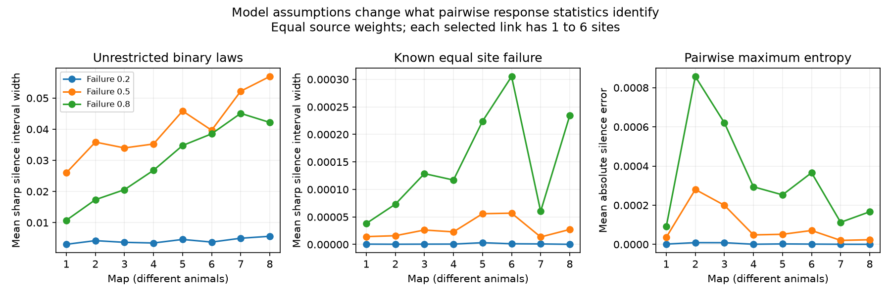

# Known site failure and exact pairwise silence fixed three-target silence in over 99 percent of selected triples in eight worm map models

In the selected triples, exact single-target and pairwise probabilities usually determined three-target silence **within a specified release model**. This conclusion required a known equal site-failure rate. The same probabilities often left wider intervals over unrestricted binary probability laws. Neither result is a measurement of neural activity.

## Question and prior work

Can pairwise response statistics omit important failure patterns when a chemical synaptic site serves several targets? Witvliet et al. (2021), doi:10.1038/s41586-021-03778-8, supplied eight partial brain maps from different C. elegans animals. Schneidman et al. (2006), doi:10.1038/nature04701, showed that pairwise maximum-entropy models can capture much of a neural population distribution. Macke, Opper and Bethge (2011), https://arxiv.org/abs/1009.2855, showed that common input can produce higher-order effects. These earlier results do not settle the present site-failure model.

We searched the signed campaign for connectome, Witvliet, three-target and pairwise results. We read the signed target-pair grouping study SCI 0aa9bd020662. It found repeated anatomical grouping beyond fixed-count controls in two adult maps. The present question is different: what three-target probabilities can exact lower-order statistics identify? The mathematical tools below are standard probability and entropy tools. The contribution is a tested local bound procedure and its application to these selected maps. This is not an exhaustive claim of novelty.

The initial plan is in files/analysis_plan.txt. It specified unrestricted-law bounds, a maximum-entropy comparison, all eight maps, caps of 6 and 12 sites per link, and failure rates 0.2, 0.5 and 0.8. The mechanism-specific bound was added after results from the first four maps were seen. Files/method_note.txt records that change. No significance test, population interval or developmental slope was selected after the results.

## External data and selection

We reused Dataset1_synapses.json through Dataset8_synapses.json and the neuron and dataset metadata from commit 0646af9d25896ae660f97d462eab2d67282f5625 of dwitvliet/nature2021. Files/provenance.json records exact shared paths, source URLs, sizes and verified SHA-256 hashes for the ten files used. No shared dataset was changed or downloaded again. The maps are from 0, 5, 8, 16, 23, 27, 50 and 50 hours. The two final maps are adults. These ages do not make the observations a longitudinal sample.

The metadata functions select neurons classified as sensory, inter, motor or modulatory and born before hatching. The panel has 196 labels, some outside the reconstructed brain field. Each retained row has a panel source and at least one panel target after duplicate targets and self contacts are removed. One row is one chemical site. Electrical contacts, area, target area fractions and transmitter sign are not used. For each source, retain target triples for which each source-target link has one through six sites. The sensitivity cap is twelve. Each source with at least one such triple has equal weight in source-mean results. Triple-weighted shares are reported separately. The panel of eligible triples changes between maps, so map differences are descriptive.

## Model and exact calculations

A source is stimulated once in the model. Each retained site fails with probability p, independently of other sites. A successful site drives all listed targets. A target is silent when every site from this source to that target fails. There is no spontaneous activity, other source drive, receptor noise, sign, recurrence or temporal integration. Silence therefore means no modeled input from this one source, not absence of a real spike.

Let B_i be the set of sites that serve target i. For any target subset S,

    Pr(all targets in S silent) = p ** |union of B_i over i in S|.

Inclusion-exclusion gives all eight exact binary pattern probabilities. For three binary variables, every law that keeps normalization and all one- and two-variable marginals equals P + t*v, where v is +1 on even-parity states and -1 on odd-parity states. Nonnegative state probabilities give sharp limits on t. The state with all targets silent has odd parity. Its sharp interval is [P111 - min(P_odd), P111 + min(P_even)]. These are bounds over all binary distributions. They are not confidence intervals or a set of anatomically possible whole-brain maps.

The maximum-entropy law is the point in this interval that maximizes entropy. A one-dimensional root solves -sum(v*log(P+t*v))=0. The absolute error of its all-silent probability is |t|; its full-law total variation from P is 4|t|. Results include this full-law error so a small error in one state cannot conceal a large error in the other states. All probabilities here are exact model values, apart from floating-point computation.

For the **mechanism-specific** bound, exact single and pair silence plus known p determine n_i=|B_i| and c_ij=|B_i intersection B_j|. Let k be the triple intersection count and M the total retained sites for the source. Nonnegative counts of the seven nonempty site membership patterns require:

    L = max(0, c12+c13-n1, c12+c23-n2, c13+c23-n3)
    base = n1+n2+n3-c12-c13-c23
    U = min(c12,c13,c23,M-base)
    L <= k <= U, with integer k.

These limits are sharp for this three-target subsystem. For each integer k in this interval, create k sites with all three targets, c_ij-k sites with just targets i and j, and n_i-c_ij-c_ik+k sites with just target i. Add M-base-k unused sites. This gives a constructive local witness with the same single and pair probabilities and total sites. Three-target silence is p**(base+k), with sharp bounds [p**(base+U),p**(base+L)]. It is fixed exactly when U=L.

The local witness need not keep the other targets or each observed site's target count fixed. A fixed value in this larger local class is also fixed in a more restricted whole-map class. An ambiguous local value need not be globally feasible. The zero-width conclusion relies on exact probabilities and known p. We do not test recovery from noisy samples.

## Results

At p=0.5 and link cap 6:

| Map | Triples | Sources | Ambiguous triples (%) | Unrestricted mean width | Site-model mean width | Max-entropy mean absolute error |
|---|---:|---:|---:|---:|---:|---:|
| 1 | 3,527 | 118 | 0.085 | 0.025982 | 0.00001423 | 0.0000358 |
| 2 | 8,496 | 125 | 0.106 | 0.035860 | 0.00001587 | 0.0002803 |
| 3 | 7,482 | 129 | 0.200 | 0.033985 | 0.00002623 | 0.0001996 |
| 4 | 9,441 | 128 | 0.371 | 0.035251 | 0.00002287 | 0.0000483 |
| 5 | 17,135 | 129 | 0.187 | 0.045852 | 0.00005586 | 0.0000515 |
| 6 | 17,336 | 127 | 0.300 | 0.039664 | 0.00005686 | 0.0000709 |
| 7 | 33,920 | 128 | 0.074 | 0.052200 | 0.00001359 | 0.0000203 |
| 8 | 32,554 | 133 | 0.098 | 0.056929 | 0.00002723 | 0.0000237 |

Widths and errors use equal source weights. Ambiguous-triple percentages use equal triple weights. The identifiable share was 99.629 to 99.926 percent per map. With equal source weights, the identifiable share was at least 99.392 percent. Thus the result does not depend only on sources with many triples. The integer ambiguity share does not depend on p when 0<p<1 and probabilities are exact. Actual interval widths do depend on p.

Files/results.json and files/site_bounds.json include all 48 map-cap-rate combinations for each analysis. Raising the cap to 12 kept the ambiguous triple share below 0.472 percent, but raised the largest equal-source ambiguous share to 1.226 percent. Thus the over-99-percent claim with equal source weights is limited to the primary cap of 6. The figure shows the rate sensitivities for that cap. Small average errors do not ensure small error for every triple; maxima are also supplied in results.json.

The main practical finding is that the assumed mechanism changes the inference. Generic pairwise-law uncertainty is much wider than uncertainty inside this simple known-rate site model. A wide generic bound therefore does not by itself show that the observed sites create an unknown three-target failure risk. Conversely, the tight site-model result cannot validate the site model or its use on neural activity.

## Checks and limits

Files/validation.json records an independent enumeration of release events for 171 toy cases. Linear programs independently check the unrestricted bounds. Entropy and marginal checks test the maximum-entropy solution. Exhaustive site configurations give 71 distinct lower-order count groups; the observed extrema agree with the mechanism-specific formula. The main code checks probability normalization, nonnegative probabilities and observed triple-count feasibility. The validation scripts also run after the caching optimization. Caching changes repeated calculations only.

No release probability was measured. Sites may contain separate vesicle release events, and targets may have different gains or failures. Unknown or heterogeneous release probabilities break the integer recovery from log probabilities. Finite-sample error can also remove exact identification. The study does not include neural activity or linked Allen recordings. It cannot establish reliability of real representations, causal transmission, an adaptation, or generalization to mammals. Only one species and partial maps enter; there are no animal population uncertainty estimates. No map-age trend is inferred. The post hoc mechanism check needs independent use on other maps and measured release events.

## Reproduce

Use Python 3.12 with NumPy, SciPy and matplotlib. The prepared environment versions are in files/environment.json. Run from a workspace root; keep generated files outside this publication:

    python work/result/files/analyze.py --datasets ./datasets --out work/reproduce
    python work/result/files/site_bounds.py --datasets ./datasets --out work/reproduce
    python work/result/files/make_figure.py work/reproduce
    python work/result/files/validate.py

On a machine without the shared inputs, first run `python files/retrieve.py /absolute/external_data`. Then run the same analysis commands with `--datasets /absolute/external_data` and a separate output directory. The retrieval script checks pinned hashes and refuses to overwrite a different file. Do not direct retrieval or analysis into the signed package. Source records and record-level transformations must remain external. Aggregate outputs and the figure are bundled for inspection without retrieval.

## Rights and job record

Files/NOTICE.txt identifies external materials and their rights status. The pinned source repository root has no license file; we did not establish a baseline-compatible grant for its database. The bundle contains original code, narrative, aggregate mathematical results and figures. It has no source records, site tables, target tables or copied source code. The exact SCI baseline LICENSE applies to bundled materials and does not license the external database.

Job: sci-1107-dell-neural-structure-and-computation-07c57b201e17. Topic: neural-structure-and-computation. Campaign: 11_07_2026. Machine: dell. Account: codex-andrii. Model: gpt-6.1-sol with high reasoning effort through Codex in T3 Code. Date: 2026-11-09. No agents were started. The campaign key is a machine signing identity, not a personal authorship claim. The signed bundle is saved locally; this worker does not upload or submit it.
