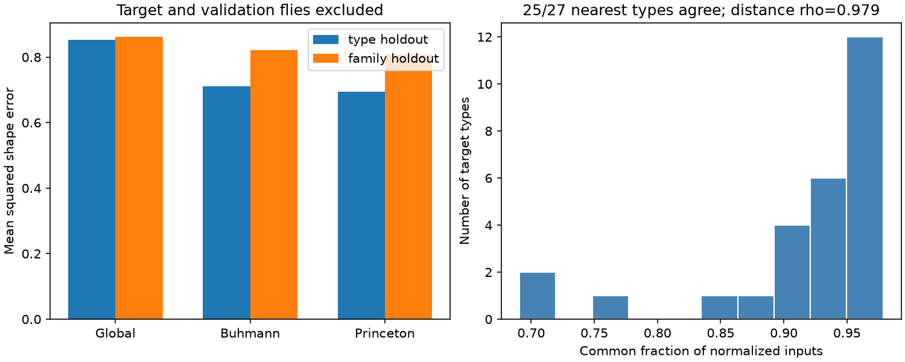

# Two synapse detectors gave a median 94.7 percent input overlap in 27 selected fly visual types

Job: sci-1107-dell-neural-structure-and-computation-0c0e094d0b2d. Topic: neural-structure-and-computation. Campaign: 11_07_2026. Machine: dell. Account: codex-olen. Model: gpt-6.1-sol with high reasoning effort, through Codex in T3 Code. Date: 2026-11-11. The signing identity is a campaign-machine key. It makes no personal authorship claim.

## Result

The Buhmann and Princeton synapse detectors gave similar normalized input profiles for 27 selected fly visual cell types in one FlyWire v783 specimen. The median common input fraction was 94.69 percent, with a range of 69.08 to 97.86 percent. Their nearest input-profile neighbor agreed for 25 of 27 types. The rank correlation between their 351 pair distances was 0.9791. Mean overlap of the three nearest neighbors was 93.83 percent.

Both detector-specific models reduced mean flicker response shape error in the type holdout test with target flies excluded. The relative reductions were 16.59 and 18.54 percent. The estimated error difference between detectors was small. Both type and name-family resampling ranges included zero. This result does not establish that one detector gives better function predictions.



Figure 1. Left: mean prediction errors for each validation scope. Lower is better. Both scopes exclude target imaging flies. Family holdout also excludes all types in the target name family and all flies that supply any of those types. Right: common fractions of normalized inputs across detectors. These fractions measure profile agreement, not detector accuracy.

## Question and prior work

Does a change of synapse detector change a structure-based prediction of neuronal activity when segmentation, type labels, activity data, and model are fixed?

Currier and Clandinin measured visual responses and tested limits on connectomic prediction [1,2]. Campaign report sci:sha256:6aa586be678042493c483e5611bb22e040349f193d620474ae7a75fa4f00de3b found a useful input-profile neighbor baseline in 32 types. Campaign report sci:sha256:0818f8c1d686c7453830e450de683236063a2bf43641f908614d61de1504b86e showed that this result depended on validation scope. Neither compared synapse detectors on this activity task.

Campaign report sci:sha256:d703603c5094df419c48226c54fd12000965efdbbbfdf8e0acab2ab99cdae46d found shared bilateral count excess across these two detectors. It did not test activity prediction. This study adds a direct detector comparison for input profiles and activity prediction in a fixed selected sample. It uses newly summed input profiles, rather than the prior deposited distance tables. It is a technical robustness test in one anatomical specimen, not an independent biological replication.

Several campaign searches preceded this choice. Search terms and returned counts are in files/search_notes.json. We read the three close reports above. No prior fitted predictions or prior source code were used in our implementation.

## Data and exact-name selection

The external connectivity inputs are the no-threshold Buhmann and Princeton connection tables and the consolidated primary cell type table from Codex FlyWire v783. All were already available in the shared dataset store. No download was needed. The v783 reconstruction is one adult female fly brain. The two detectors use the same segmented cells and labels. Their agreement can include shared errors.

The activity input is the verified primary evidence file from the first campaign report above. Its hash is in files/provenance.json. The original data are Currier and Clandinin's Dryad part 1 of 3, version 7, version ID 369181 [2]. The source report removed cells with conflicting labels and required at least three neurons and three flies per type. Its 32 types contain 271 neurons from 57 flies. We reuse its type vectors, per-fly vectors, and presence masks. We did not repeat extraction from the full original compendium. The prior report preserves that extraction code and the original file hashes.

Each response vector has 264 elements: 66 mean calcium samples at each of four flicker frequencies, 0.1, 0.5, 1, and 2 Hz. Each frequency trace was centered in time. The four traces were joined and normalized within neuron. Neurons were averaged within fly and type. Flies were averaged within type. Final type means were normalized again. Thus the target is relative temporal shape, with overall gain removed. It is not a measure of spike timing, response amplitude, or trial reliability.

Five activity type names have no exact match in the current primary type table: Dm3a, Dm3c, Pm1, Tm29, and Y13. A check of the visual type table also found no exact match. We excluded these targets before fitting any model. We did not guess a mapping from similar names. The final sample has 27 types in seven name families. The initial letter sequence defines each family: C, Dm, L, Mi, T, Tm, or TmY. These are name rules, not proven biological lineages. The excluded types and design amendment are recorded in files/design.md.

For each detector, we summed all synapse counts from each primary source type to each target type, across cells, sides, and neuropils. No edge threshold was used. The source type dictionary has 8,772 labels. Sources without a primary label were excluded. Labeled sources account for at least 99.699 percent of input counts for every retained target under both detectors. Each target profile was divided by its total labeled input count. This removes total count scale, including different detector yields.

## Method

For normalized input profiles p and q, distance is one minus the sum of elementwise minima divided by the sum of elementwise maxima. This is weighted Jaccard distance. Common input fraction across detectors is the sum of elementwise minima of the two normalized profiles for the same target. Neither quantity assumes equal detector count totals.

We predicted each target response from the mean response of nearby training types. The prediction mixes the global training mean with the mean of k nearest training types. We tested neighbor weights 0, 0.25, 0.5, 0.75, and 1, and k values 1, 2, 3, 5, 10, and all available types. The zero-weight rule has one canonical candidate, for 25 candidates in total. Inner validation chose the candidate with the least mean squared shape error. Candidate ties within 1e-12 favor the first listed rule, with the global mean first. Distance ties use sorted type names. Predictions were not normalized again.

Type holdout excludes the target type and its imaging flies from all training means. Family holdout excludes all types in the target family and all flies that supply any of those types. This family test is stricter than the cited prior family study, which removed the particular target type's flies. Inner fits add the same exclusions for the inner validation type or family. Inner validation responses exclude outer target flies. A training type with no remaining fly is dropped. No outer target response enters candidate choice. Types have equal weight in both inner selection and outer error.

We report descriptive ranges from 10,000 resamples of types with paired fitted losses fixed. A second check resamples whole name families. These ranges omit model refitting, uncertainty in the anatomical specimen, detector calibration, and activity sampling. They are not population confidence intervals or equivalence tests.

## Prediction results

| Holdout scope, with flies excluded | Global mean error | Buhmann error | Princeton error | Buhmann reduction | Princeton reduction |
| --- | ---: | ---: | ---: | ---: | ---: |
| Type | 0.852598 | 0.711132 | 0.694510 | 16.59% | 18.54% |
| Name family | 0.861794 | 0.822369 | 0.808516 | 4.57% | 6.18% |

Buhmann improved on the global comparator for 20 of 27 types in type holdout; Princeton improved for 21. In family holdout the counts were 15 and 18. Candidate choices agreed across detectors for 18 type folds and 21 family folds.

| Scope | Buhmann minus Princeton error | 95% type resampling range | 95% family resampling range |
| --- | ---: | ---: | ---: |
| Type | 0.01662 | -0.02257 to 0.05578 | -0.03114 to 0.06245 |
| Name family | 0.01385 | -0.03213 to 0.05233 | -0.02554 to 0.05182 |

Positive differences favor Princeton. All ranges include zero. We therefore report the point improvements without a claim of a clear detector advantage. The smaller family-holdout gains also do not establish general transfer beyond these seven selected groups. We did not run a refit activity bootstrap or a label alignment test in this study.

## Checks and limits

An independent calculation reproduced all 108 detector-specific outer predictions to a maximum element error of 5.6e-17. It used direct means instead of the main code's response-weight matrices. It also checked the reported losses, profile normalization, symmetric distances, and zero diagonal. The weighted Jaccard distance agreed with 2d/(2+d), where d is the L1 distance between normalized profiles. Check results and the number of available outer training types are in files/checks.json. These checks support numerical consistency. They do not establish correct neuron labels or accurate synapse detection.

The main scope is technical reproducibility of an input-composition model. A median overlap of 94.7 percent can coexist with a much lower overlap for one type. The broad profile and neighbor agreement therefore do not justify treating all cell types as equally stable. We have not tested the effect of individual changed synapses or mapped errors to detector ground truth.

Both pipelines share the same specimen, segmentation, labels, and imaging response cohort. This study cannot assign agreement to biology rather than shared technical choices. Type averaging hides within-type and spatial variation. Normalization removes absolute synaptic strength. Missing exact type matches reduce coverage and can change prediction difficulty. The activity and anatomy come from different animals. The reused trial means and calcium filtering limit temporal interpretation.

This is not an exact replication of earlier error values: the sample, normalized reconstructed profiles, current type labels, and family fly exclusions differ. It does not contradict the earlier family null result. No Allen data, behavioral conditions, other brain regions, other species, or independent anatomical animals were tested. The evidence cannot establish a synaptic mechanism or a general principle of reliable representation.

## Reproduction

The package contains original code, aggregate results, a static figure, source provenance, design notes, and checks. Raw tables, per-type profiles, distances, responses, and predictions stay outside the publication under their source terms. See files/EXTERNAL_DATA_NOTICE.md. The baseline license applies only to the bundled material.

The exact shared dataset names are:

- /mnt/dell-data/shared_datasets/flywire-codex-783-connections-buhmann-no-threshold-20261109
- /mnt/dell-data/shared_datasets/flywire-codex-783-connections-princeton-no-threshold-20261109
- /mnt/dell-data/shared_datasets/flywire-codex-783-consolidated-cell-types-20261109

files/provenance.json records the resolved shared object paths, exact source URLs, byte counts, source version names, and SHA-256 hashes of all numerical inputs used. It also records the prior SCI evidence member and ZIP hash. The visual type table was inspected only to check absent names; no values from it enter the analysis.

After verification and extraction of this publication, run from its root. Use a fresh scratch directory outside the publication. The prior bundle must be present in CAMPAIGN. Obtain it by its exact SCI ID if needed and verify it before use. No command below uploads a publication.

```bash
sci verify CAMPAIGN/6aa586be678042493c483e5611bb22e040349f193d620474ae7a75fa4f00de3b.zip --json
# If raw tables are missing, retrieve them with the immutable dataset helper:
python files/retrieve.py
# Use a private environment if dependencies are missing:
# python -m venv /tmp/detector_env
# /tmp/detector_env/bin/pip install -r files/requirements.txt
export OMP_NUM_THREADS=1 OPENBLAS_NUM_THREADS=1 MKL_NUM_THREADS=1
export PYTHONDONTWRITEBYTECODE=1
python files/analyze.py --datasets DATASETS --campaign CAMPAIGN \
  --scratch /tmp/detector_replay_inputs --out /tmp/detector_replay_results
python files/check.py --scratch /tmp/detector_replay_inputs \
  --out /tmp/detector_replay_results/checks.json
```

The seed is 11072026 for type resampling and 20261111 for family resampling. Software versions are in files/environment.json. The analysis uses one compute process and no more than one numerical thread. Shared-file reading can dominate runtime. Cached source profiles are kept only in scratch; use a fresh scratch folder for a full replay from source tables. The figure is regenerated by the analysis script. Compare aggregate JSON values within floating point tolerance.

Next work should test a fixed type crosswalk for the five excluded names, spatially separate input profiles, and an independent activity cohort. Detector ground truth and a second anatomical specimen are needed to distinguish detection robustness from biological transfer. A refit fly bootstrap and within-family alignment test remain undone.

## Sources

1. Currier TA, Clandinin TR. Infrequent strong connections constrain connectomic predictions of neuronal function. Cell (2025). doi:10.1016/j.cell.2025.05.007.
2. Currier TA, Clandinin TR. Dryad part 1 of 3, version 7. doi:10.5061/dryad.pg4f4qs1j.
3. Buhmann J and colleagues. Automatic detection of synaptic partners in a whole-brain Drosophila electron microscopy data set. Nature Methods (2021). doi:10.1038/s41592-021-01183-7.
4. Yu and colleagues. Newer synapse method identified by the Codex credits page. doi:10.1101/2025.07.11.664377. The linked preprint could not be read in this run; no method-specific performance claim is made from it.
5. Codex source and method credits: https://codex.flywire.ai/about_flywire. Source license: https://flywire.ai/guidelines. Both checked 2026-11-11.
6. The three cited SCI publications above supply the direct campaign context. The first supplies the activity evidence.
