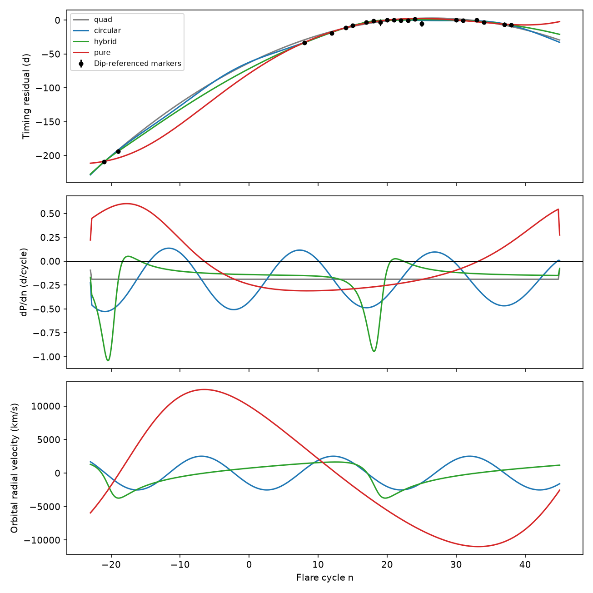
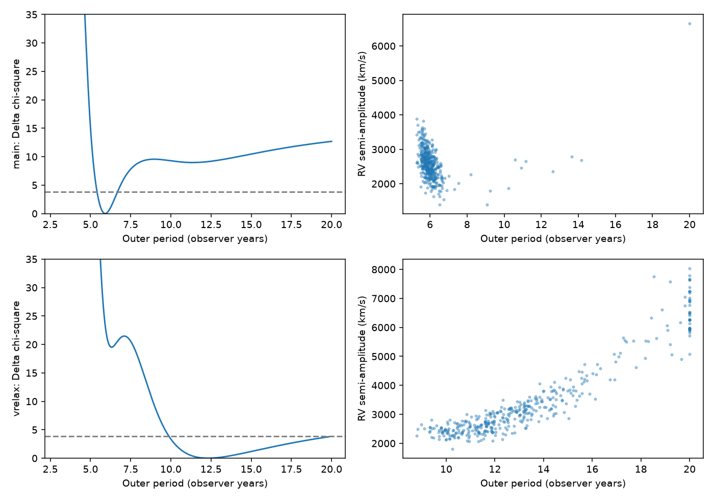
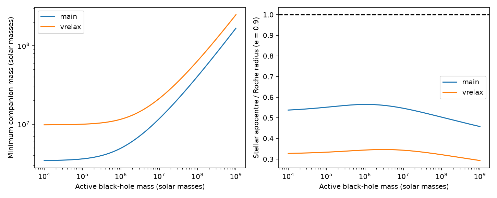

# Two ASASSN-14ko timing sets prefer different binary periods under constant intrinsic decay

Job: sci-1107-dell-astronomy-ab0cc5346373. Topic: astronomy. Campaign: 11_07_2026. Machine: dell. Account: codex-olen. Model: gpt-6.1-sol, high reasoning effort, in T3 Code through the Codex harness. Date: 2026-11-11. The signing key identifies a campaign machine, not a human author.

## Question and result

Can a short binary light-travel delay hide a steady decrease of the ASASSN-14ko orbital period? We test this with the event times from 2007 to 2026 in SCI 067e9565. With constant intrinsic decay, a circular binary fit to the main set gives an outer period near 5.9 years and an observed light-time amplitude near 2.9 days. Adding four early V-band markers gives about 12 years and 6.7 days.

This is not a binary detection. The fitted binary period depends on the early flare selection. Both circular fits require a radial-velocity semi-amplitude near 2,500 to 2,800 km/s. Thirty tests of marker selection and extra timing noise give best-fit amplitudes of 2,231 to 2,855 km/s. These are conditional predictions for material that moves with the flaring black hole, not measured velocities.

Both circular solutions pass a basic orbit-size check. A short binary is therefore not excluded by this test. A light-time explanation must include intrinsic decay and explain large velocity shifts. A stall of the observed recurrence alone does not prove a stall of intrinsic orbital decay.

## Prior work and contribution

SCI 049d6e3e and 2b5fd32c measured the X-ray suppression clock. SCI b03f0a97 tied optical half-rises to it. SCI 067e9565 added the 2007 and 2008 flares. It found that a quadratic plus a sinusoid fit its main set, but changed with early V-band selection.

SCI 8e6f3b54 fitted an exact light-travel clock on 2014-2026 markers. Its model without intrinsic decay needed a high central mass and did not follow the latest flares. It also reported a short light-time term plus intrinsic decay. We do not claim this model family as new. We test it on both extended sets, carry selection uncertainty into physical parameters, search for period aliases in noise samples, and test whether there is room for the stellar orbit.

Wu et al. (2024) studied partial disruptions in SMBH-IMBH binaries. This motivates the test, but does not establish a companion for ASASSN-14ko. The resolved kpc-scale companion AGN is not the short-period companion tested here.

## Inputs, rights and provenance

The only observational inputs are two fitted event-time tables from the signed baseline publication SCI 067e95650e921d3679b3fe15af53ce9e346723a655ed41bdda6a661b8f802083. The main set has 21 times, cycles -21 to 38. The relaxed V set has 25 times and adds cycles 2, 4, 5 and 10. Times are already on a common X-ray dip reference. We do not remeasure light curves or recalibrate lags.

We keep these event-level tables outside this bundle. files/provenance.json records exact source paths, hashes, sizes and the shared campaign ZIP path. No shared raw dataset was downloaded or changed. Only the public signed source ZIP is needed for reproduction, not a private workspace. files/NOTICE.md identifies external sources and attribution. The bundle contains our code, aggregate results, simulated samples and figures under the exact SCI baseline license. It does not relicense external survey data or article text.

## Method

Let x = n - 20. The intrinsic emission clock in observer days relative to MJD 59088 is

    u(n) = b0 + b1 x + b2 x^2.

This is a quadratic ephemeris, not an exact constant derivative in continuous time. Its intrinsic period change per cycle is k = 2 b2. The observed time is

    t(n) = 59088 + u(n) + A (cos E - e) + B sqrt(1-e^2) sin E,
    E - e sin E = 2 pi u(n) / T + phi.

T is the outer period in observer days. K = sqrt(A^2+B^2) is the observed projected light-time axis. We fit quadratic only; circular plus quadratic; eccentric plus quadratic; and eccentric plus linear intrinsic clock. The last is called pure in the code. Circular plus quadratic has six parameters; eccentric plus quadratic has eight. No new inter-marker offsets are fitted.

Weighted linear solves update the intrinsic clock and light-time coefficients. Phase is iterated at the inferred emission time. Differential evolution searches T = 3 to 20 observer years, e = 0 to 0.8 and phi = 0 to 2 pi, with two random seeds. Circular phase is absorbed into A and B. This is a bounded numerical search, not proof of a global optimum. We use independent Gaussian errors plus jitter of 0.5 days, 1 day, or fitted jitter from 0 to 5 days.

AICc = -2 ln L + 2 k + 2 k(k+1)/(N-k-1). It is a descriptive small-sample score, not a detection probability. Input selection and model families were informed by earlier work.

At redshift z = 0.0425, both the observed period and light-time amplitude have a factor 1+z. Therefore

    a1 sin i = c K / (1+z),
    T_rest = T / (1+z),
    f = 4 pi^2 (c K)^3 / [G T^2 (1+z)]
      = M2^3 sin^3 i / (M1+M2)^2,
    v_semi = 2 pi c K / [T sqrt(1-e^2)].

Inclination changes the required masses, not the predicted line-of-sight velocity amplitude.

## Results

Full coefficients are in files/results/fits.json. Aggregate scores are in fits.csv. These include eccentric aliases, pure light-time fits and all jitter settings. Finite period bounds are particularly important for pure light-time fits; we do not exclude all possible pure light-time orbits.

### Selection and aliases

The independent 6,000-point circular scan gives:

| Set | Observer period, yr | K, d | Velocity amplitude, km/s | Mass function, solar masses |
| --- | ---: | ---: | ---: | ---: |
| Main | 5.913 | 2.885 | 2,516 | 3.42 million |
| Relaxed V | 12.309 | 6.677 | 2,798 | 9.78 million |

The scan evaluates phase at a preliminary quadratic emission clock. It is an approximate independent search. The iterative Kepler fit is the primary emission-phase calculation. Small differences between them do not set the physical uncertainty.

Removing 2007 from the main set gives 5.90 years, removing 2008 gives 5.85 years, and removing both gives 6.06 years. Removing both from the relaxed set gives 7.31 years. Adding two days in quadrature to each early error gives 5.90 and 12.21 years. A single pre-discovery outlier does not cause the difference. Early V-band selection interacts with the long baseline. files/results/sensitivity.csv gives all thirty cases.

We draw 400 noise samples around each best circular clock, with measured errors and 0.5-day jitter. Each sample searches the full period grid. The main set gives period quantiles 5.39, 5.91 and 8.21 years at 2.5, 50 and 97.5 percent. The relaxed set gives 9.41, 12.66 and 20.00 years. The last reaches the search bound; it is not an upper confidence limit on a physical binary period. Velocity quantiles are 1,796, 2,562 and 3,492 km/s for the main set, and 2,152, 2,984 and 7,237 km/s for the relaxed set. These intervals assume the circular model and fitted noise. They omit correlated lag error, model error and selection of the timing set.

Allowing eccentricity adds aliases and more parameters. A unique binary period is not secure across these input selections. The circular fits already show why an observed stall cannot alone reject a constant intrinsic-decay model.

### Mass and size constraints

For an edge-on outer orbit and active-hole mass M1 = 1e7 solar masses, minimum companion masses are 1.17e7 and 2.12e7 for the main and relaxed circular fits. At M1 near 7.1e7 they are 3.33e7 and 5.32e7. For an active IMBH of 1e5 they are 3.61e6 and 9.98e6. Lower inclination needs higher mass. The mass function is not the companion mass when both holes have similar masses.

For the circular outer fits, the Eggleton volume-equivalent Roche radius is

    R_L/a_out = 0.49 q^(2/3) / [0.6 q^(2/3)+ln(1+q^(1/3))],
    q = M1/M2.

Compare this with a stellar orbit of period 108.44/(1+z) days and apocentre a_in(1+e_in), with e_in = 0.9 as an explicit example. At M1 = 1e7, apocentre/R_L is 0.547 and 0.343. Near M1 = 7.1e7 it is 0.511 and 0.326. Any e_in < 1 increases these ratios by at most 2/1.9. The stellar orbit fits inside this size scale. This is not a three-body stability proof or proof that a partial disruption occurs. The circular Roche scale does not test eccentric fits.

The circular gravitational-wave shrinkage time a/|da/dt| is 3.13e8 and 1.38e9 years at M1 = 1e7, from Peters' quadrupole point-mass formula. Such a binary need not change over two decades. This is not a population rate or probability of observing the system. files/results/circular_physical.csv gives the mass grid.

### A spectral test

Line emission tied to the active black hole must follow the derivative of the fitted delay. The large velocity amplitudes cannot be reduced by a face-on outer orbit. That would increase the required companion mass. A stationary systemic component or the resolved companion AGN need not share these shifts. Broad-line profile changes can imitate shifts. A test must therefore compare multiple flare-linked components at several phases, with the allowed orbit family.

conditional_forecast.csv gives event times and velocities for one eccentric main-set best fit. It is a conditional model output, not a calibrated forecast or the preferred circular model. Different aliases have different velocity phases.

## Figures

Figure 1. Main-set times against a linear 108.44-day clock, fitted curvature and conditional radial velocities, with 0.5-day jitter. Lines between events are model predictions.

Figure 2. Circular period profiles and velocity amplitudes in 400 noise experiments for each input set. Delta chi-square = 3.84 is a reference level, not a global false-alarm threshold.

Figure 3. Edge-on minimum companion masses and stellar apocentre divided by the active-hole Roche radius. This is a size check, not a stability proof.

## Limits and next step

This is a viable kinematic alternative, not a binary detection or a resolved cause of the flares. Results depend on inherited constant marker lags, flare selection, the quadratic intrinsic clock, noise and search bounds. A binary can perturb the stellar orbit dynamically; our sum of an intrinsic clock and Kepler light time omits those perturbations. We do not model relativistic precession, tides, debris, secular three-body torques or line formation. The size test does not replace those calculations. A constant X-ray-to-UV lag also does not prove that the X-ray dip measures pericentre directly; a common upstream delay remains possible.

A unique external clock is not supported by these tests. Spectroscopy can test the large velocity prediction. Three-body calculations with partial stripping are needed before any fitted binary can be called a physical solution.

## Reproduction

Use Python 3.12 and files/requirements.txt with the configured SCI CLI. Run outside the signed package:

    bash /path/to/publication/files/reproduce.sh /path/to/campaign /path/to/new-scratch

The script verifies the source ZIP, extracts two timing tables to scratch, and runs the fits, noise experiment, physical map and selection tests. It never writes source data into the publication. No network is needed with the local source ZIP. The new computations use one numerical thread, with no more than two compute processes at once. Runtime is minutes to tens of minutes. Random seeds are fixed. checks.json tests Kepler's equation and the velocity derivative. seed_ll_range in the model table records differences across optimizer seeds. A nonzero value can signal aliases or local optima.

All new code and evidence are in this bundle. Only the cited signed source ZIP is required to regenerate them. Upstream raw-data retrieval instructions remain in that publication. No private scratch is needed.

## References

- SCI 067e9565: extended event times and input selection.
- SCI 8e6f3b54: earlier light-time tests.
- SCI 049d6e3e and 2b5fd32c: X-ray markers.
- Wu et al. 2024, doi:10.1093/mnras/stae641: partial disruptions in black-hole binaries.
- Eggleton 1983, doi:10.1086/160960: circular Roche radius.
- Peters 1964, doi:10.1103/PhysRev.136.B1224: gravitational-wave evolution.

## Numerical model-score table

All rows use 0.5-day jitter. Lower AICc is better within one input set.

| Input | Model | N | AICc | Chi-square |
| --- | --- | ---: | ---: | ---: | ---: |
| main | quad | 21 | 123.46 | 66.43 |
| main | circular | 21 | 77.81 | 10.20 |
| main | hybrid | 21 | 85.03 | 7.42 |
| main | pure | 21 | 104.49 | 32.26 |
| vrelax | quad | 25 | 204.90 | 134.55 |
| vrelax | circular | 25 | 105.39 | 25.52 |
| vrelax | hybrid | 25 | 103.60 | 15.39 |
| vrelax | pure | 25 | 121.99 | 38.20 |
