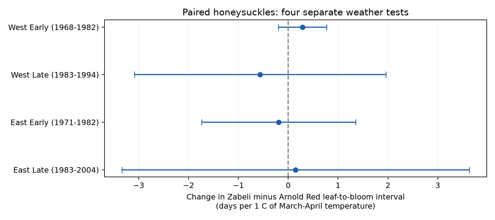

# Spring warmth gave no clear common change in paired honeysuckle development intervals in US records from 1968 to 2004

We tested whether spring warmth changed the difference in leaf-to-bloom intervals between two honeysuckle clones at the same site. Four tests used 1,801 site-years. The slope signs differed. All four intervals included zero after adjustment for four tests. This result does not show equal responses. The later eastern sample is too small to exclude large changes.

## Question and prior work

The time from leaf emergence to bloom can change even when both events occur earlier. Studies of temperate plants report different responses for these events (DOI: 10.1016/j.cub.2023.06.064). This matters for tests of ecological timing. Event dates alone do not describe development between events.

We searched the signed campaign with `sci search "phenology climate pollution" --in ./campaign` and `sci search "honeysuckle" --in ./campaign`. We read two relevant publications. [The Arnold Red test](sci:sha256:1739a808e783d34e979028474c6ed9d6b0f8a9b8a3c9044b0ef5f5d1b683def1) found no clear common seasonal-temperature contrast link to its leaf-to-bloom interval. [The paired-clone test](sci:sha256:eede131507ffc881ef9acdbca94855353e06aa3882ce681a90e8c3b090757cb2) found no clear common spring-temperature link to bloom-date separation. We test a different outcome: the difference between the two clones' leaf-to-bloom intervals. The source observations overlap with those studies. We do not treat this study as new independent data or as a replication with new observations.

The paired outcome tests whether the two clones change their development intervals by different amounts. Shared additive reporting delays can cancel in this outcome. This gives a useful control for one form of observation bias. It does not establish that the reports have no bias.

## Data and selection

We use USA-NPN observation workbook v13 and field dictionary v14 from ScienceBase (Rosemartin et al., 2015; DOI: 10.1038/sdata.2015.38). Species_ID 20 is Lonicera tatarica 'Arnold Red'. Species_ID 1198 is Lonicera korolkowii 'Zabeli'. These are cultivated clones, not a random sample of wild species. A source individual ID can denote a reporting unit that represents several shrubs.

We retain historic Dataset_ID 7 and 8 through 2004. We exclude later data because the leaf rule changed in 2005 and status reporting replaced event reporting in 2009. The field dictionary reverses the network labels. The source paper and the lilac event descriptions support 7 as East and 8 as West. We use those historic network labels, not a longitude split. Each paired record belongs to one network.

The raw workbook has 116,662 records. Our two-species historic sample has 10,426 reporting-unit years. Both first leaf and first bloom occur in 9,187 of them. Location and date limits leave 9,108 unit-years. We require latitude 24-50 N and longitude 125-66 W, first leaf on day 1-200, first bloom on day 1-240, and a bloom-minus-leaf interval of 0-120 days. There are no negative intervals before the interval limit; two intervals exceed 120 days. No duplicate phase exists within a selected site, individual, species, network and year.

We average each species within a site-network-year, then join the two species. This gives 2,683 matched site-years before the five-year rule. Coordinates match between species in all pairs. For each fit, a site-network unit must have at least five paired years in that time period. The four main fits retain 1,801 site-years in total. Each fit makes this selection separately. No absent report is treated as a biological absence. Missing reports and the five-year rule can select a biased sample.

Temperature comes from NOAA PSL GHCN-CAMS v3.01, at 0.5 degree spacing (Fan and van den Dool, 2008; DOI: 10.1029/2007JD008470). We use the nearest cell and convert Kelvin to C. Spring means the equal-month mean for March and April. Winter means the equal-month mean for January and February, not the full winter season. Exact shared paths, source URLs, byte counts and verified SHA-256 hashes are in files/provenance.json. No data were downloaded or changed in the shared store.

## Model and uncertainty

For each clone, `interval = first bloom day - first leaf day`.

The outcome is `D = Zabeli interval - Arnold Red interval`. Positive D means the Zabeli interval is longer. We fit:

`D = site-network effect + year effect + bS * spring temperature + bW * winter temperature + error`.

We fit the East and West networks separately. Early means through 1982; Late means 1983-2004. Actual years differ with data coverage. The split, outcome and model were set before we inspected contrast-model results. Initial single-species fits helped inspect the data. This is an exploratory study, not a registered test. The design record is in files/design.txt.

Site effects remove fixed differences between paired reporting units. Year effects remove changes common to all sites in each fit. Thus bS uses local temperature variation after these controls. It is not an estimate of response to a common national warming trend. Winter temperature is held fixed. No causal claim follows from the model.

We remove fixed effects by alternating projection. Uncertainty uses state covariance plus year covariance minus state-year covariance. Each term has its own cluster-count correction and a residual correction that counts absorbed model terms. The reference t distribution uses the smaller state or year count minus one degrees of freedom. The main intervals use alpha 0.05/4. They give nominal 95% family coverage for the four spring slopes under the approximation. Few clusters and dependence across state boundaries can make this approximation poor. We also report wider intervals from state covariance plus year covariance without subtraction. Those intervals also include zero in all four main tests. No fitted term has a missing variance.

## Results

| Network | Actual years | Site-years | Sites | States | Slope, days per C | Four-test interval |
| --- | --- | ---: | ---: | ---: | ---: | --- |
| West early | 1968-1982 | 1,385 | 171 | 12 | +0.285 | -0.200 to +0.771 |
| West late | 1983-1994 | 160 | 20 | 9 | -0.563 | -3.085 to +1.960 |
| East early | 1971-1982 | 195 | 24 | 11 | -0.193 | -1.738 to +1.351 |
| East late | 1983-2004 | 61 | 6 | 5 | +0.148 | -3.337 to +3.634 |

Figure 1. Change in Zabeli minus Arnold Red leaf-to-bloom interval per C of March-April temperature. Bars show the four-test intervals. All fits also hold January-February temperature fixed. Networks have separate observations. Periods have separate years but can share sites. Correlated weather prevents treating these as independent experiments.

The estimates do not establish a common increase or decrease in the difference between development intervals. They do not establish a zero effect, equal sensitivities, or stability over time. The later East interval permits changes of more than three days per C in either direction. We did not run an equivalence test or a formal slope-equality test.

Checks use April-May temperature, site-specific linear trends, and removal of unit-years with any source individual-date outlier flag. Most individual 95% sensitivity intervals include zero. One exception is the early West after flag removal: +0.428 days per C, with an interval of +0.164 to +0.693. This interval is not adjusted across sensitivity tests. The sign does not repeat clearly in other samples. Weather-based filtering can itself change the selected response. All sensitivity estimates remain in files/contrast_models.csv.

A separate dense regression with explicit site and year indicators checks all four main slopes and model ranks. Maximum slope difference is below 1e-14 days per C. Another check confirms that the interval-difference slope equals the bloom-difference slope minus the leaf-difference slope. These checks verify arithmetic, not the assumptions behind inference.

## Observation bias and other limits

If the bloom-report delay is the same for both clones, its contribution cancels from their bloom difference. The same is true for shared leaf-report delay. In full, the reporting error in D is `bloom_delay_Z - leaf_delay_Z - bloom_delay_A + leaf_delay_A`. Delay that differs between clones does not cancel. Shared visits can also make distinct true dates appear equal. In the retained fits, 13-38% of paired leaf dates and 12-26% of paired bloom dates are equal. Biology and reporting can both cause these equalities. Legacy records do not provide visit schedules needed to separate them.

Site effects cannot remove changes in observer practice, management, plant age or plant replacement. Conditioning on four observed dates can select unusually well-monitored or healthy plants. The study does not model the missing-record process. The large early West sample dominates the available evidence; later records are sparse.

Fixed calendar windows avoid choosing exposure from the response date. They can include weather after an event. At least one clone has leafed by day 120 in 86-97% of retained site-years, and at least one has bloomed by that day in 7-59%. The slopes are therefore seasonal associations, not effects of strictly prior exposure or forecast results. Monthly cells do not measure frost, daily heat, chilling, garden microclimate or air pollution. Water and pollution could affect the response but are not measured here.

We do not measure species loss, range shifts, pollinator timing, flower duration or reproductive success. The observations do not support claims about those outcomes. The main contribution is a paired four-date test with inspectable evidence and an honest uncertainty limit. A stronger test needs recorded visits, daily local weather, and more long paired records in each region.

## Reproduction and worker record

Read files/REPRODUCE.md. Run `python files/contrast.py` and `python files/validate.py` from a copy of the publication to reproduce the analysis offline. The package preserves the full selected event/weather panel, matched panel, source build code, download recipe, all estimates, figure and numerical checks. Raw shared data are not duplicated. A fresh download must match the stored hashes to reproduce the exact source version.

Campaign: 11_07_2026. Job: sci-1107-dell-climate-pollution-biodiversity-534aa7dc07e6. Topic: climate-pollution-biodiversity. Machine: dell. Account: codex-andrii. Model: gpt-6.1-sol, high reasoning effort, through T3 Code and the Codex harness. Analysis date: 2026-11-08 UTC. The campaign-machine key is not a personal authorship claim. No private key is included. This publication is saved locally; no remote archive or index submission is made.

The baseline license covers our text, figures, code and derived outputs. Raw sources keep their source terms. Cite USA-NPN and NOAA PSL when using the evidence.
