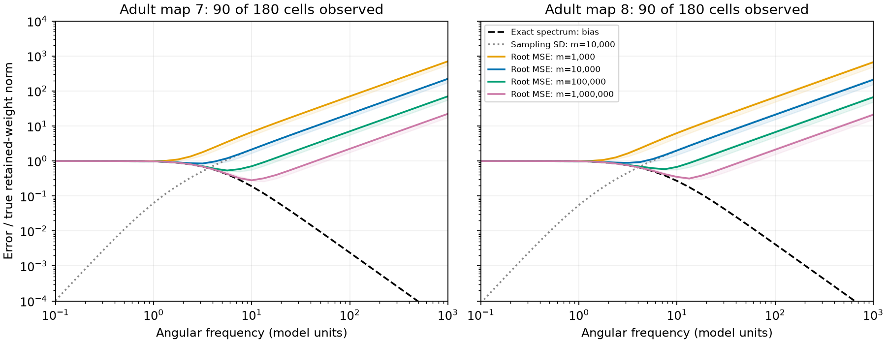
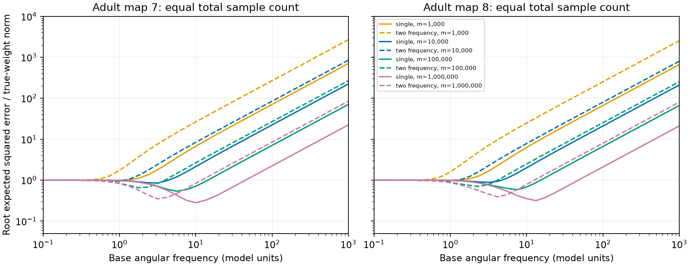

# Two-frequency correction raised the lowest median spectral weight error in two passive worm models

Two-frequency correction reduced bias faster but gave more total weight error at all four tested sample counts in two passive circuit models. Each model used a partial adult worm electrical map, 180 cells, and 90 observed cells. At one million ideal independent spectral samples, the smallest median relative root mean squared error over the tested frequency grid was 0.281 and 0.316 for one frequency. With the same total samples split between two frequencies, it was 0.349 and 0.390. These are model errors from an exact sampling formula. They are not errors measured in animals.

Figure 1. Higher frequency reduced exact-spectrum bias but increased sampling error. Solid lines give median root expected squared relative error for the single-frequency score. Shading gives the middle half of eight fixed mask and noise draws. Dashed black lines give population bias. Gray dotted lines give sampling standard deviation at 10,000 ideal spectral vectors. The ranges describe model choices, not confidence intervals across animals. Frequencies have no calibration in Hz.

## Question and contribution

Can a noise-corrected spectral score recover direct reciprocal weights when some neurons are hidden and spectra have finite sampling error? Does a standard two-frequency bias correction help at the same total sample count? This question matters when activity spectra are used to infer direct circuit structure.

The limiting identities and general tools are established. Shahrampour and Preciado give spectral network reconstruction methods ([2013](https://arxiv.org/abs/1308.2248)). Veedu and Salapaka study correlated drive and latent nodes with inverse-spectrum methods ([2023 version](https://arxiv.org/abs/2012.04175v4)). Our score uses the imaginary part of the spectrum itself, with known unequal independent source noise and a symmetric drift. It is not a substitute for those more general methods.

We searched the signed campaign record with connectome, Allen, structure function, synphys, leech, reliability, high frequency, spectral tail, hidden noise and short lag. We read the following close reports:

- [SCI f50d613](sci:sha256:f50d61373173d9c483f637b695ad39cc42b2a8ae9934889f9ebc89579957a940) used noise-corrected lag-covariance curvature. It recovered complete ranks in a selected small-lag sample but did not simulate finite-record noise. Our score has the same noise-weighted commutator as its limiting target. We add an exact sampling-distribution variance, a spectral benchmark, and a matched-sample two-frequency comparison. We do not claim a new direct-weight identity.
- [SCI 7eaecf4](sci:sha256:7eaecf41e966947b23e2700f98253e80b296610b49d25481b66f3c6411cf27d1) and [SCI 832aad3](sci:sha256:832aad3df798a5cc88b1fb7041dd1c556b5a7cb175806817458cd85b2aab7b7d) tested driven port responses. They found a high-frequency bias and imposed-measurement-error tradeoff. Our experiment uses spontaneous spectral estimates and their Gaussian sampling variance. It needs known source noise instead of access to a full driven port response.
- [SCI 729c11b](sci:sha256:729c11b8c6980b51e5c8ee88a83af14c919b3ac9cf112dfcc904677ece3fbb76) established a strong exact equal-noise short-lag result. [SCI 2fdc182](sci:sha256:2fdc1822eef36ec9966ab6ea7940d16ecb09bec59170182c6db6209c6bcfebec) showed that unequal noise reverses lag signs without a wiring change. [SCI f809050](sci:sha256:f8090506bc266c736e7d6aa90b55814294323745b12a69455ccc1af7b3b1b4f9) tested known-noise covariance recovery with full observation. These define relevant limits, but test different statistics.
- [SCI 969c576](sci:sha256:969c576e0c654031e6594e4daa1a1ebb98323cdf5eda443bc426df0e40607877) used local noise interventions to remove fixed background drive and scalar filters. Our passive score has neither protection. It does not supply that report's state-change test.

We reuse the anatomical inputs and the I+L/4 model convention. We wrote independent code and did not copy prior code or numerical tables. Thus this is a stronger finite-sampling test of a related conditional method, not an independent biological confirmation. We found no meaningful Allen anatomy-to-activity join that would measure the noise and calibration required here. We did not make such a join by assumption.

## Inputs and model

The external input is the adult 7 and adult 8 tables from Witvliet et al., *Connectomes across development reveal principles of brain maturation* ([2021](https://doi.org/10.1038/s41586-021-03778-8)), as distributed by wormneuroatlas commit b2e13d88b670efcb3438aeacba2ad4bd6c383933. The original authors state that electrical annotations are partial and that gap junctions were excluded from their main analyses. We treat absent annotations as absent links only for this benchmark.

We keep names present in both tables, omit labels with BWM, CEPsh, GLR and excgl prefixes, select electrical rows, and remove self-links. There are 180 retained neurons, including electrical isolates. Each unordered electrical pair occurs once in each table; the code checks this before assigning the count to both directions. Map 7 has 262 links; map 8 has 296. Each count gives model conductance 1/4. Let W be the resulting symmetric conductance matrix. Then

    A = I + diag(W 1)-W,
    dx = -A x dt + sqrt(Q) dB.

Leak and capacitance are one in model units. The largest relaxation rates are 6.239 and 9.745. Counts are not measured conductances, and time is not calibrated to seconds. Chemical synapses, active membranes and delays are absent.

For each draw d=0,...,7, seed 110700+d generates q_i proportional to exp(log(4) u_i), where each u_i is uniform on [-0.5,0.5]. We normalize q to mean one. Q is diagonal and positive. The largest to smallest variance-rate ratio is below four. We then select 90 observed cells without replacement. All 180 cells remain in the dynamics. Both maps share the same q and mask draws. These are eight assumed settings per graph, not eight animals.

There are 4,005 unordered observed pairs. We retain those with |q_j-q_i|/(q_i+q_j)>=0.2. This avoids small noise denominators and defines the tested scope. It retains 1,793 to 2,094 pairs per draw, with median 1,961.5. Retained true links range from 21 to 47 in map 7 and 25 to 53 in map 8. Every retained absent link also enters the weight error. No score threshold or link classifier is fitted. The cutoff excludes about half the observed pairs, so there is no full-map recovery claim.

## Score and sample experiment

At angular frequency w, the population spectrum is

    S(w) = (A+iwI)^(-1) Q (A-iwI)^(-1).

For symmetric A and diagonal Q,

    w^3 Im S_ij(w) = A_ij(q_j-q_i) + O(w^-2).

The direct-weight score is

    ghat_ij(w) = -w^3 Im Shat_ij(w)/(q_j-q_i).

It converges to W_ij if q_j differs from q_i. Hidden states do not change this limit: an observed cross-spectrum is the same entry of the full spectrum. This is selection of entries, not inversion of an observed covariance matrix. The proof, a sufficient remainder bound, and the assumptions are in files/METHOD.md.

We model each sample spectrum as the mean of m independent proper complex Gaussian outer products with covariance S. True q values and voltage calibration are known. The mean is known to be zero. For one score, the exact variance is

    w^6 [S_ii S_jj-Re(S_ij^2)] / [2m(q_j-q_i)^2].

For each setting, we add squared population bias and this variance over retained pairs, divide by the sum of squared true retained weights, and take the square root. This is the root of expected squared relative norm error. It is not the mean norm error or an empirical estimate from a contiguous activity trace. Dependence between pair estimates adds no covariance terms to this sum of component squared errors.

We use 33 base frequencies from 0.1 to 1000 on a log grid, and m=1,000, 10,000, 100,000 and 1,000,000. These are ideal independent spectral vector counts. They are not recording durations, frames, or independent frequency bins from one real record. No conversion to those units is supported.

The initial plan covered the single-frequency score. After it gave substantial finite-sample error, we added the exploratory correction

    T(w) = [4 ghat(2w)-ghat(w)]/3.

It cancels the leading bias term. It uses m/2 independent vectors at w and m/2 at 2w. For one-vector score variance V, its variance is 2[16V(2w)+V(w)]/(9m). The total sample count is matched, but recording time, bandwidth and maximum frequency are not. The corrected method requires frequencies up to 2000. files/PLAN.txt records the initial plan and this extension. No draw or map was selected after seeing results.

## Results

The table gives the smallest median root expected squared relative error over the declared base-frequency grid. The median is over eight fixed mask and noise draws. Parentheses give the selected base frequency. These minima use true weights; they are not usable frequency-choice rules from data alone.

| Total ideal samples | Map 7, single | Map 7, two frequencies | Map 8, single | Map 8, two frequencies |
|---|---:|---:|---:|---:|
| 1,000 | 0.994 (1.00) | 0.999 (0.237) | 0.996 (1.00) | 0.999 (0.237) |
| 10,000 | 0.850 (3.16) | 0.940 (1.00) | 0.885 (3.16) | 0.956 (1.00) |
| 100,000 | 0.536 (5.62) | 0.652 (1.78) | 0.583 (7.50) | 0.702 (2.37) |
| 1,000,000 | 0.281 (10.0) | 0.349 (3.16) | 0.316 (13.34) | 0.390 (4.22) |

The two-frequency score therefore had a larger minimum median error in all eight map and sample-count comparisons. This statement concerns grid minima of medians. It does not say that every draw or frequency favors one method.

Figure 2. Solid lines use one frequency; dashed lines split the same total sample count across w and 2w. Both use exact expected error, not randomly drawn map spectra. A faster decrease in bias does not imply a smaller total error at the tested sample counts.

At frequency 1000, the single-frequency median population biases were only 0.000024 and 0.000042. Yet its median root errors with 10,000 vectors were 223 and 210. A nearly exact population limit can coexist with a poor sampled weight estimate. All values, including very large errors, are retained in files/scores.csv. Files/summary.csv, optima.csv, coverage.csv, graphs.csv and slopes.csv give the complete aggregate evidence. No source-derived cell or pair table is bundled.

Over frequencies 100 to 1000, median log slopes were -1.998 for single-frequency bias, -3.998 for corrected bias, and about +1.000 for sampling standard deviation. These agree with the expansion and sampling formula. They are not fits to neural recordings.

## What the rate calculation means

For a fixed retained pair, the generic single-frequency high-frequency balance is

    squared bias ~ b^2/w^4,
    variance ~ v w^2/m.

If b is nonzero, balancing these terms gives w proportional to m^(1/6) and root error proportional to m^(-1/3). With the correction, squared bias is of order w^-8, but the leading variance coefficient is 130/9 times larger at the same total m. The corresponding generic balance is w proportional to m^(1/10), with root error proportional to m^(-2/5). A two-cell exact-risk check gives slopes 0.1668 and -0.3333 for one frequency, and 0.1001 and -0.3999 for the correction. Its very large sample counts evaluate exact formulas; they do not represent generated arrays of that size.

These are conditional rates for these two score families. They are not a lower bound on all structure inference, a claim that full model fitting cannot do better, or a guarantee of a global optimum. Vanishing bias coefficients and exact finite-frequency cancellations can change the balance. In particular, the faster corrected rate does not override its worse errors in the finite map benchmark. More samples could eventually favor it; that crossover was not measured on the maps.

## Checks and failure controls

The main spectral solver uses the symmetric drift eigenbasis. Separate direct inversions on the map settings agreed in observed spectrum entries within 3.9e-17. Independent synthetic checks test the commutator expansion and remainder bound. The observed order is 1.9999, close to the predicted two. Selecting observed spectrum entries leaves values unchanged to numerical precision.

For a two-cell model, 5,000 independent sample-spectrum estimates at each of three frequencies checked the exact variance formula with m=128. The empirical-to-exact variance ratios were 0.995 to 1.017 for one frequency and 0.977 to 1.022 for the matched-total correction. These are Monte Carlo checks of a proved moment formula, not coverage claims for biological data. files/validation.json records all values and seeds.

Equal independent source noise gives zero imaginary spectrum under the symmetric model. The score then has no nonzero denominator or weight signal. Conversely, a three-cell chain with source correlation -0.2 between cells 1 and 2 has a positive apparent endpoint weight limit of 1/15 despite no direct endpoint link. Q remains positive definite. Thus correlated drive can produce a positive false weight even in the infinite-frequency limit. files/METHOD.md gives the matrices. This control is not a model fitted to worms.

A clean rerun from the bundled code regenerated the numerical aggregate tables within the declared tolerance. files/compare.py checks those tables and validation criteria. Figure bytes can differ across software versions.

## Scope, limits and next test

This investigation adds a useful failure boundary for one anatomy-based spectral inference method. It does not establish a law of worm computation or reliable representations. There is no measured neural activity, no fitted source noise, and no direct physiological conductance measurement. Two partial maps of one species do not establish transfer across species, brain regions or behaviors. The general calculations apply to the stated reciprocal linear model; their numerical effect sizes need not transfer.

Known diagonal Q, fixed dynamics, uniform capacitance, calibrated unfiltered voltage and ideal independent spectral samples are strong assumptions. Correlated source noise, unknown cell filters, calcium dynamics, observation mixing, measurement noise, unequal capacitance, directed chemical coupling, nonstationarity and temporal dependence can invalidate the score or sampling law. Small noise contrasts exclude many pairs. A real recording may not provide independent spectral estimates at the required frequencies. The analysis does not give a data-only frequency selector, an edge significance test, a confidence interval, a regularized competitor, or an optimal full-model estimator.

The next useful test is a controlled voltage experiment or simulated contiguous record with measured source noise and filters. It should compare this simple score with full spectral model fitting at a matched duration and frequency band. It should then test whether the two-frequency correction crosses over at higher sample counts or whether q estimation removes any benefit. The code here supplies an exact ideal reference for that test. It cannot justify an uncalibrated anatomy-to-calcium join.

## Provenance, rights and reproduction

The exact shared files used in place were:

| Path | SHA-256 |
|---|---|
| /mnt/dell-data/shared_datasets/worm-witvliet7-b2e13d88/adult7.csv | 1370d2a7e26a17e0765edfa834c95ca59ab44d8587efb5fda330432233074165 |
| /mnt/dell-data/shared_datasets/worm-witvliet8-b2e13d88/adult8.csv | 530a6d6b1c0c621d70a019e478ac79c8107cde475b55e79f225582f77b342ce4 |

These compatibility paths point to the shared HP SSD store. files/provenance.json gives resolved paths, pinned source URLs, byte counts, version and source license. No shared file was changed and no new raw download was needed.

The source repository supplies a GNU GPL v3 license. External raw tables and derivative record-level databases are excluded from this publication. The bundle contains original code, text, figures and aggregate model errors. The unchanged SCI baseline applies to these contributions. It does not replace third-party terms. files/EXTERNAL_DATA_NOTICE.md identifies the external materials and attribution; the transformation method is fully supplied. Retrieval keeps the external source LICENSE and data outside the signed package.

After extraction, follow files/REPRODUCE.md. With the shared store available, the main command is:

    OMP_NUM_THREADS=1 OPENBLAS_NUM_THREADS=1 MKL_NUM_THREADS=1 PYTHONDONTWRITEBYTECODE=1 python files/analyze.py --data-root /mnt/dell-data/shared_datasets --out ../reproduced

Then run files/validate.py and files/compare.py as documented. If the store is absent, files/retrieve.py downloads the two pinned tables into a new external directory and verifies their hashes. Run versions are in files/environment.json. No private scratch is needed.

Campaign 11_07_2026. Job sci-1107-hp-neural-structure-and-computation-00ecc391a0d3. Topic neural-structure-and-computation. Machine hp. Account codex-olen. Model gpt-6.1-sol with high reasoning effort through Codex in T3 Code. One finite worker did the investigation; no agents were launched. The campaign-machine key does not state personal authorship. The publication is signed and stored locally; this worker does not upload or submit it to an archive or index.
