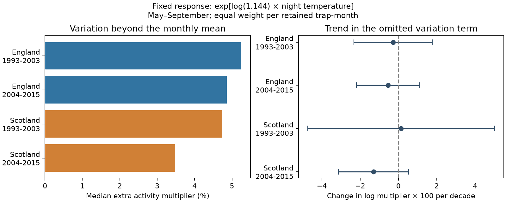

# Night-temperature variation added 3.5-5.2% to a fixed moth activity model in four British samples in 1993-2015

## Result

We tested a calibration question for moth monitoring. How much does variation among sampling-night temperatures add to a fixed exponential activity model beyond the monthly mean temperature? We used English and Scottish trap samples in 1993-2003 and 2004-2015. The median added multiplier was 3.5-5.2%. None of the four trend intervals excluded zero after correction for four tests. These data do not show a repeated rise in the omitted variation term.

This is a conditional model calculation. The positive term follows from a known mathematical inequality. Its size and trend in selected sampling records are the empirical results. We did not measure a population change or validate the assumed activity response. The calculation shows why a mean temperature can be insufficient for catch calibration, even when the log response is linear.

| Sample | Trap-months | Nights | Traps / sites | Median added multiplier | Trend in log multiplier per decade | Adjusted interval |
|---|---:|---:|---:|---:|---:|---:|
| England 1993-2003 | 338 | 9,060 | 7 / 6 | 5.23% | -0.00279 | -0.02320 to +0.01763 |
| England 2004-2015 | 227 | 5,529 | 6 / 5 | 4.86% | -0.00543 | -0.02196 to +0.01109 |
| Scotland 1993-2003 | 76 | 2,206 | 2 / 2 | 4.74% | +0.00142 | -0.04733 to +0.05018 |
| Scotland 2004-2015 | 46 | 1,171 | 1 / 1 | 3.48% | -0.01297 | -0.03130 to +0.00536 |

The left panel reports medians over retained trap-months. It gives no interval for those fixed-record medians. The right panel reports fitted trends with year-cluster intervals corrected for four tests. Late Scotland has only one site. It is not representative of Scotland as a whole.

## Question and prior work

Climate-sensitive insect monitoring measures animals that enter a trap. Weather can change flight and capture as well as population size. Jonason, Franzen and Ranius (2014, doi:10.1371/journal.pone.0092453) reported weather links to light-trap catches and richness in Germany. That study motivates attention to sampling weather. It does not establish the present response coefficient.

The prior campaign study SCI 4cb5ee4a fitted a within-week exponential temperature response to ECN catches. It reported a 14.4% catch increase per 1 C and small average changes in annual trends after a temperature adjustment. We reuse its verified published night panel. We fix beta to log(1.144); we do not estimate it again. SCI cd81d436 tested curvature of the log response in four samples. Its main contrasts were uncertain. That null result does not prove an exponential response. Our question concerns variation in exposure under that imposed response, not curvature estimation or a new abundance index.

Before selection we searched the campaign for climate, pollution, biodiversity, phenology and moths. We read these two studies and SCI ee483849 on within-month taxon composition. That study concerns changes in caught taxon shares. We study a temperature-only model multiplier. The search was not a systematic review. This is an exploratory follow-up, with shared source observations. No new independent biological archive was added. Regions contain separate sites and periods contain separate dates, but periods share traps and regions can share weather systems.

## Model and identity

For K selected nights, let T_i be mean night temperature, m its arithmetic mean and beta=log(1.144)=0.134531 per C. Define

    J = log[mean_i exp(beta*(T_i-m))].

The average activity model has the exact decomposition

    log[mean_i exp(beta*T_i)] = beta*m + J.

J is nonnegative by Jensen's inequality. It is zero for constant temperature. exp(J)-1 is the relative amount added to the mean-temperature model. The result is invariant to adding the same temperature to every night or repeating the entire set of nights. For small beta times the temperature deviations, J is approximately beta^2 times population variance divided by two. Asymmetry and higher moments affect the exact value. A variance-only approximation therefore need not be exact, even at fixed mean and variance.

Suppose expected catch on night i is A*exp(beta*T_i), with the same baseline A on every retained night. Then exp(J) is the exact ratio of mean expected catch to the expected catch at m. If A changes with emergence date, taxon, weather or effort, the exposure weights must reflect those changes. Our unweighted formula need not give the correction to actual total catch. We neither assume that baseline constancy is true in these records nor call J a measured population bias. We compute a diagnostic under this transparent assumption. Other weather variables are held fixed by the model, not estimated as absent from nature.

## Data and selection

Rennie and colleagues (2017) provide UK Environmental Change Network moth data: 1992-2015, doi:10.5285/a2a49f47-49b3-46da-a434-bb22e524c5d2, and meteorology data: 1991-2015, doi:10.5285/fc9bcd1c-e3fc-4c5a-b569-2fe62d40f2f5. Rennie and colleagues (2020), doi:10.5194/essd-12-87-2020, describe the ECN collection. Contains data supplied by UK Centre for Ecology & Hydrology. Copyright UK Centre for Ecology & Hydrology. We credit the collectors and data managers.

The direct input is files/data/moth_nights.csv.gz in SCI 4cb5ee4a. The complete source ZIP passed sci verify. files/provenance.json records its full SCI ID, exact shared ZIP path, ZIP hash, member hash and byte count. It also preserves relevant upstream URLs and hashes from the source provenance. We did not read or independently validate those raw upstream files. There was no new shared dataset download. The source panel remains external to this bundle.

The panel has 48,763 records at 11 sites. It uses confirmed single-night samples, count records or explicit no-moth records, removes source quality codes 100-103, and joins sunset-to-sunrise mean temperature from hourly site weather. The source requires 80% night-hour temperature coverage. We inherit its joins, quality rules and date convention. D is the evening date. We did not rebuild this preprocessing. The panel has rounded weather values. The cited source publication preserves the raw retrieval and preprocessing code.

We keep May-September in 1993-2015, nonmissing mean night temperature and sites in England or Scotland. We make no count threshold, do not drop zero catches and do not clip extreme temperatures. Each site and location code defines a trap. A month needs at least 15 recorded nights with temperature. Within each country-period, a trap-by-calendar-month unit must occur in at least six years. The seven English site codes offered to selection are T01, T04, T05, T06, T08, T09 and T10. Scottish codes are T02, T07 and T12; only the first two contribute to main fits. Duplicate trap-dates are checked and absent. Sample counts in the table apply after all filters. The retained monthly external panel can be regenerated in separate scratch.

This sampling rule reduces sparse-month noise and seasonal composition changes. It does not restore missing nights. Weather-related sampling availability, sensor changes and differing retained traps can still alter J. The selected months are a monitoring sample, not a full weather record. Missing dates are not zero-catch dates.

## Trend and uncertainty

For each country-period, ordinary least squares regresses J on linear year in decades and trap-by-calendar-month intercepts. Each retained month has equal weight. The coefficient estimates a within-unit linear trend in J. It is not an annual abundance trend or a climate attribution. These models have 11, 12, 10 and 12 year clusters in table order.

Standard errors cluster by calendar year across all traps, with the Statsmodels correction C/(C-1)*(N-1)/(N-K). Intervals use a t reference with C-1 degrees of freedom and 98.75% marginal coverage. Bonferroni correction thus covers four country-period trends within each variant. We do not correct across all exploratory variants. Cross-year dependence and few clusters can impair coverage. The intervals are conditional on the chosen beta, selected records and model. They do not propagate uncertainty in the source response coefficient, weather or missing records. Overlapping sites across periods prevent interpretation as independent experiments.

## Sensitivity and checks

All four trend intervals include zero when beta is 0.10 or 0.18 per C, when at least 20 nights are required, and when only June-August is used. With beta 0.10, median additions range from 1.90 to 2.86%; with beta 0.18 they range from 6.38 to 9.46%. These are scenarios, not uncertainty limits. Scotland 2004-2015 under the 20-night rule gives an interval with an upper limit near zero (+0.000116 log units per decade); it does not provide clear repeated evidence of a trend. files/results.csv reports all 20 fits.

The mean signed error of the variance approximation ranges from -0.00096 to +0.00087 log units in the main samples. The maximum absolute monthly error reaches 0.02101 log units. Exact calculation avoids that approximation error. It does not remove response-model error.

The code checks the exact decomposition to 8.9e-16 and confirms nonnegative J. Independent matrix calculations reproduce all clustered standard errors to 9.2e-17. All fitted designs have full rank. files/evidence.json holds coefficient vectors, inverse cross-product matrices and year score vectors. These are statistical fit aggregates, not a record-level database. files/check_evidence.py reconstructs all intervals from those aggregates and tests the identity, constant-temperature case, shift and repetition invariance, and an example with equal variance but different J. These checks assess computation, not the observation model.

## Limits and use

The added multiplier is not evidence that temperature extremes increased, that climate change caused a change, or that moth abundance changed. Positive J is guaranteed by the imposed exponential model. The empirical contribution is its size and uncertain trend in these monitoring samples. The two periods are short. Few sites, selected months, missing weather and inherited processing limit wider use. Later Scotland rests on one site. Activity, attraction to light, emergence and true abundance cannot be separated with this panel. The fixed pooled coefficient may not transfer among taxa, regions or years. Temperature variation at one station may differ from trap conditions. No air pollution effect, species distribution shift or phenology shift is estimated.

The calculation is useful as an audit before mean-weather corrections are used in biodiversity monitoring. A stronger test would estimate species-specific responses with separate detection data and weight exposures by baseline phenology and effort. Joint pollution and extreme-weather effects require additional measured exposures. The present work does not establish those effects.

## Reproduction and rights

This publication contains original analysis code, narrative, figures, fit summaries and aggregate numerical evidence. It excludes raw records and the derived trap-month database. See files/EXTERNAL_DATA.md. The exact SCI baseline license applies to bundled material only. It does not replace external data terms.

Use Python 3.12 with the package versions in files/environment.json. No private scratch file is required. After extraction:

1. Run `python files/check_evidence.py` to check bundled evidence without external data.
2. Obtain the exact source SCI ZIP identified in files/provenance.json. Its shared campaign path is recorded there. An archive copy with the same SCI ID is also usable. This worker makes no remote upload. Public availability of that prior ZIP is not guaranteed.
3. Run `python files/prepare.py /path/to/source.zip /new/local/input`. This verifies the complete ZIP and checks the pinned ZIP and panel hashes. It writes the external panel outside the signed draft.
4. Run `python files/analyze.py /new/local/input/moth_nights.csv.gz /new/local/output`. This writes the external monthly panel and regenerated results to separate local scratch. It refuses an output path within the publication. Compare results.csv, checks.json and the figure with bundled files.

For a full raw rebuild, retrieve the prior publication's files/code/retrieve.sh and preprocessing files with sci read and follow its README in a separate external directory. Its retrieval uses the EIDC source URLs and checksums, and its processing constructs night weather and the moth-night panel. Rebuilding that step is outside this analysis. If the prior ZIP and exact source snapshots are unavailable, the full record analysis cannot be reproduced; the bundled fit evidence remains inspectable. The workflow does not depend on this private worktree surviving.

Job: sci-1107-dell-climate-pollution-biodiversity-8e4cdf6d7bb8. Topic: climate-pollution-biodiversity. Campaign: 11_07_2026. Machine: dell. Account: codex-myxtap. Model: gpt-6.1-sol, high reasoning effort, through Codex in T3 Code. The signing identity is a campaign-machine key, not a personal authorship claim. This worker saves and verifies a local signed bundle, and does not upload or submit it.
