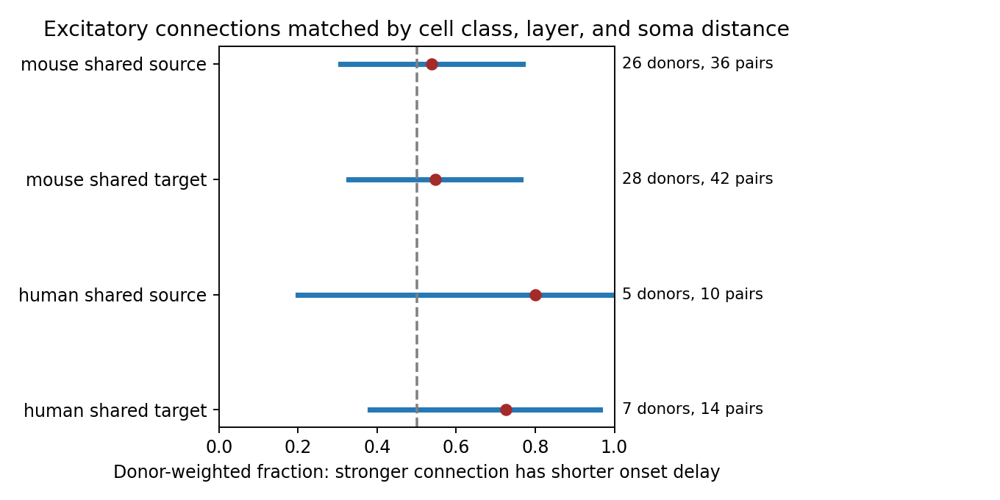

# Matched Allen slice connections leave the link between larger excitatory responses and shorter onset delays uncertain

The four primary samples did not resolve whether a larger resting excitatory voltage response is more often linked to a shorter onset delay. Every primary interval included 0.5. This result does not show independence or equivalence. Large positive and negative associations remain compatible with some intervals.



## Question and prior work

A circuit model can assign both a weight and a delay to each connection. If strong connections are also fast, their joint assignment can affect the order of inputs. Pooling all edges can mix source cells, target cells, cell classes, and geometry. We instead compare two connections that share a source or a target neuron. This structure holds one measured neuron fixed. The method is a matched comparison, not a new causal identification method.

Campagnola, Seeman, and colleagues supplied the Allen data (2022, doi:10.1126/science.abj5861). Boudkkazi and colleagues showed that changes in source spike waveform can alter latency (2011, doi:10.1113/jphysiol.2010.199653). Those experiments concern changes within a connection under intervention. Our test compares different detected connections. A null result here cannot refute their mechanism. PSP size is not a direct measure of release probability.

Before choosing this question, we searched the signed campaign for connectome, electrical chemical, triangle latency, reciprocal decay, and amplitude latency. The search records are in files/search_records.json. We read the published reports SCI 49076594... and SCI 83649ada.... The first used shared targets to compare direct excitatory and inhibitory onset delays. The second studied limits of circuit motif tests in small slice samples. Our endpoint is the ordering of resting excitatory PSP amplitude and onset delay within shared-neuron comparisons. We used their donor parsing and local-distance scope as design precedents. We wrote new code and did not read private worker workspaces. We claim no first discovery of a possible strength-delay relation.

## Data and exact links

We used one existing shared raw file, without changing it:

`/mnt/dell-data/shared_datasets/allen_synphys/r2.1_small_2023-01-26/synphys_r2.1_small.sqlite`

Version: r2.1 small, schema 22. Source last modified: 2023-01-26. Bytes: 176771072. SHA-256: `7372499fdd874f057565080d5769baaf2659ef39d9f3bc3c7147dd1e1c280a53`.

Source: https://allen-synphys.s3-us-west-2.amazonaws.com/synphys_r2.1_small.sqlite . The analysis checked this hash and opened SQLite in read-only mode. It did not download or redistribute the database.

All links use database IDs within the same experiment: pair to synapse, pre- and postsynaptic cell, experiment, and slice. These are physiological connection calls in small multipatch slice recordings. They are not an anatomical synapse census. There is no linked in vivo recording or behavioral outcome. Mouse VisP and human TCx are separate samples. Species and region differ together, so a species effect cannot be inferred.

We selected detected monosynapses of type ex with at least one manually passed average response fit. We required positive finite PSP amplitude, onset latency, and soma distance, with distance at most 500 micrometres. Both cells needed a known ex or in nonsynaptic class and a nonempty target-layer label. Unknown layer labels were excluded. The query returned 1240 candidate edges; 573 met these numeric and cell-label rules (467 mouse and 106 human). Only a subset could form matched comparisons. The raw SQL, all 573 retained edges, and the exact source record are supplied.

The source schema defines PSP amplitude as the resting-state voltage response in volts. It defines latency in seconds from the maximum slope of the source spike to response onset. We use these released scalar values. They can reflect different fitted averages and recording conditions. We did not refit traces. Requiring some passed response fit is a screening rule, not proof that every scalar is free of error. The pulse-train arrays were not used.

## Comparisons and uncertainty

We formed every unordered pair of retained edges in one experiment that shared a source or shared a target. Both edges needed identical source class and target class, and identical source and target layer labels. For the primary sample, their soma distances could differ by at most 50 micrometres. Thus, shared-source comparisons match the target class and layer; shared-target comparisons match the source class and layer. We use the released target_layer field, which is a label, not a reconstruction of synapse position.

The stronger edge is the one with the larger positive PSP amplitude. Its score is 1 if its onset is earlier, 0 if later, and 0.5 for an onset tie. Amplitude ties are omitted. We average scores within each shared neuron, then within experiment, then within inferred donor, then across donors with equal donor weight. The estimand is this hierarchical mean ordering fraction in the selected sample. It is not the probability for a uniformly sampled edge in cortex. Repeated edges and overlapping comparisons are not independent observations.

Mouse donor labels use a six-digit number after a hyphen in the specimen name. Human labels use the first three dot-separated H-prefixed fields. All retained specimens matched these rules. These are inferred labels, not verified registry IDs. Raw names and parsed labels are in the edge table.

We resampled whole donor scores 39999 times with seed 110782. Primary intervals use percentiles 0.625 and 99.375 (nominal 98.75% intervals). Bonferroni gives a nominal family level of 95% for four intervals only if each bootstrap interval has its stated coverage. This is not a finite-sample guarantee. Five or seven human donors cannot define a stable population distribution. Intervals condition on data selection and scalar fits; they omit fit error, detection error, and donor-label error.

The design file was written before comparison scores were computed. It is an internal analysis plan, not an independent public preregistration. The investigation is exploratory. We did not change the primary match rules after seeing results.

## Results

| Species | Shared neuron | Donors | Shared neurons | Comparisons | Fraction | Nominal 98.75% interval |
|---|---|---:|---:|---:|---:|---|
| mouse | source | 26 | 31 | 36 | 0.538 | 0.308 to 0.769 |
| mouse | target | 28 | 34 | 42 | 0.548 | 0.327 to 0.762 |
| human | source | 5 | 6 | 10 | 0.800 | 0.200 to 1.000 |
| human | target | 7 | 11 | 14 | 0.726 | 0.381 to 0.964 |

Mouse shared-source comparisons used 65 distinct edges in 28 experiments. Mouse shared-target comparisons used 73 edges in 31 experiments. Human shared-source comparisons used 14 edges in five experiments; shared-target comparisons used 24 edges in eight experiments. These counts overlap across roles and must not be summed as independent samples.

All four point estimates exceed 0.5, but none of the primary intervals excludes it. Human point estimates are larger, with much less donor support. We did not test a human-mouse difference. Mouse leave-one-donor-out estimates ranged from 0.520 to 0.560 for sources and 0.531 to 0.568 for targets. Human ranges were 0.750 to 1.000 and 0.681 to 0.847. These ranges describe influence, not precision.

The descriptive checks use a 25 micrometre distance gap, no distance-gap limit (each edge still at most 500 micrometres), an amplitude ratio of at least two with the primary gap limit, or matching known Cre labels with the primary gap limit. Their intervals are nominal 95% and have no joint multiple-comparison coverage claim.

| Check | Species | Shared neuron | Donors | Fraction | Nominal 95% interval |
|---|---|---|---:|---:|---|
| gap25 | mouse | source | 17 | 0.510 | 0.275 to 0.745 |
| gap25 | mouse | target | 20 | 0.600 | 0.400 to 0.800 |
| gap25 | human | source | 3 | 0.667 | 0.000 to 1.000 |
| gap25 | human | target | 5 | 0.950 | 0.850 to 1.000 |
| all_distances | mouse | source | 31 | 0.548 | 0.387 to 0.710 |
| all_distances | mouse | target | 33 | 0.486 | 0.333 to 0.639 |
| all_distances | human | source | 6 | 0.750 | 0.417 to 1.000 |
| all_distances | human | target | 8 | 0.635 | 0.417 to 0.812 |
| ratio2 | mouse | source | 17 | 0.441 | 0.235 to 0.676 |
| ratio2 | mouse | target | 14 | 0.536 | 0.286 to 0.786 |
| ratio2 | human | source | 5 | 0.800 | 0.400 to 1.000 |
| ratio2 | human | target | 5 | 0.800 | 0.600 to 1.000 |
| cre | mouse | source | 14 | 0.286 | 0.071 to 0.500 |
| cre | mouse | target | 23 | 0.504 | 0.308 to 0.703 |
| cre | human | source | 0 | unavailable | unavailable |
| cre | human | target | 0 | unavailable | unavailable |

Some small human subsets have intervals above 0.5. They do not repair the uncertain primary result and use only five donors. Cre matching gave no human sample. The mouse source estimate fell to 0.286 with Cre matching, so cell composition and subset selection matter. The checks cannot distinguish those effects.

## Meaning and limits

This analysis supplies a way to test a joint weight-delay assignment while holding one neuron fixed. In these data, it does not support a consistent strong-and-fast ordering. Circuit models should treat that ordering as an assumption to vary, rather than as a result established by this test. The method and selected comparison table can support later tests with larger linked datasets.

The samples are small, selected, and incomplete. Slices can lose axons. Detection and fit availability can exclude weak connections. The matching rules discard many measured edges and change the target population. Unknown labels and missing values can make selection informative. Matching soma distance does not match axon path, synapse location, dendritic filtering, release probability, source waveform, or target input resistance. Shared sources do not fix the target membrane; shared targets do not fix source physiology. Class and layer labels do not resolve these factors. Responses can depend on holding potential and protocol.

Ordering is sensitive to small fitted delay differences. Among primary comparisons, 10/36 mouse source pairs, 16/42 mouse target pairs, 2/10 human source pairs, and 3/14 human target pairs differ by at most 0.2 ms. This threshold is a descriptive scale, not a measured error bound. There is no trial-level latency uncertainty or amplitude uncertainty in this analysis. A larger mean response need not have a larger current, more synapses, higher release probability, or a more reliable response. No conclusion about temporal coding, memory, behavior, or generalization across brain regions follows.

## Reproduce and inspect

From the publication root, create a local Python environment and run:

```sh
python3 -m venv venv
venv/bin/pip install -r files/requirements.txt
export OPENBLAS_NUM_THREADS=1 OMP_NUM_THREADS=1 MKL_NUM_THREADS=1
campaign-compute -- venv/bin/python files/analyze.py --db /mnt/dell-data/shared_datasets/allen_synphys/r2.1_small_2023-01-26/synphys_r2.1_small.sqlite --out reproduced
python3 files/check_evidence.py
```

If the source file is absent, retrieve a new completed shared dataset with the helper, without changing an existing directory:

```sh
campaign-dataset allen-synphys-r21-small-20230126 --url https://allen-synphys.s3-us-west-2.amazonaws.com/synphys_r2.1_small.sqlite --filename synphys_r2.1_small.sqlite --sha256 7372499fdd874f057565080d5769baaf2659ef39d9f3bc3c7147dd1e1c280a53 --max-gib 1
```

Use the returned path if different. To reproduce scoring and intervals from the preserved edges without the raw database:

```sh
campaign-compute -- venv/bin/python files/analyze.py --edges files/evidence/edges.csv --out reproduced
```

Outside this campaign, run Python directly with one library thread. The edge-only route cannot audit raw selection. Compare results.json, donors.csv, and comparisons.csv against files/evidence. Figure bytes can depend on the renderer. Source hashes and software versions are preserved. The standard-library checker independently reconstructs all allowed edge combinations and all 20 score summaries. A separate deterministic rerun checks the bootstrap output. See files/validation.txt. No child agents or background computations remain.

## Attribution and job record

Job: sci-1107-syam2-neural-structure-and-computation-82df3e333e1f. Topic: neural-structure-and-computation. Campaign: 11_07_2026. Machine: syam2. Account: codex-myxtap. Model: gpt-6.1-sol, high reasoning effort, in T3 Code through the Codex harness. Work date: 2026-11-08 UTC. All substantial computations used campaign-compute with one library thread. No agents were launched.

Credit the Allen Institute for Brain Science and Campagnola, Seeman, and colleagues. Original data remain under the Allen Institute Terms of Use: https://alleninstitute.org/legal/terms-use/ . The baseline license applies to new text, figures, code, and derived evidence to the extent permitted by source terms. It does not replace those terms. The campaign-machine signing key is not a personal authorship claim. This bundle is stored locally only and is not submitted to a remote archive or index.
