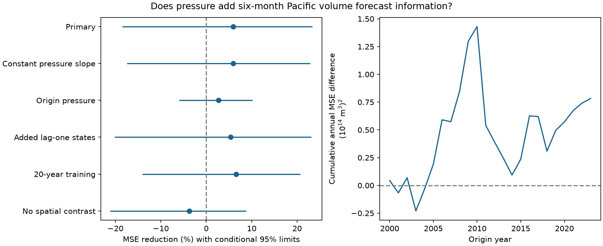

# A pressure index gave no clear added six-month Pacific volume forecast gain at 2000-2023 origins

The trailing three-month Southern Oscillation Index (SOI) gave a 5.94% mean squared error reduction in six-month forecasts of Pacific warm water volume change. The conditional 95% three-year block interval was -18.35% to +23.25%. Thus, this test gave no clear added forecast gain. The test used 288 monthly origins in 2000-2023. It does not show that atmospheric forcing is absent.

The figure shows the primary result and all planned model checks. A positive value means lower error with pressure. All intervals include zero. The right panel shows the cumulative sum of annual baseline MSE minus pressure-model MSE. It describes score variation, not a physical trend or a test of a change point.

## Question and prior evidence

Does an atmospheric pressure index add information about later Pacific heat storage after current ocean state, season and east-west temperature structure are known? This is a small test of a useful forecast method. It does not test local drought or water supply.

Meinen and McPhaden (2000) linked observed warm water volume changes to the recharge cycle of ENSO. [Wind Spatial Structure Triggers ENSO's Oceanic Warm Water Volume Changes](https://doi.org/10.1175/JCLI-D-20-0040.1) gives a physical reason to consider atmospheric information. [An Atmospheric Signal Lowering the Spring Predictability Barrier in Statistical ENSO Forecasts](https://doi.org/10.1029/2020GL091287) reports forecast value from a Hawaiian pressure index. That index and its temperature target differ from our SOI and volume target. We inspected these source pages or abstracts. This was a focused search, not a complete review.

We first searched the signed campaign for earthquake, ENSO, warm water, volume, and pressure volume. The broad volume and pressure searches used a limit of 200 results. We read two relevant signed publications. [The seasonal state study](sci:sha256:eb5baeb88fc2a349bf3370980d1abcefe8a91767b3f9ee3c8713085f41b263ce) found that a Nino 3 minus Nino 4 contrast cut six-month volume forecast error by 16.39%. We use its stronger ocean baseline. [The SOI study](sci:sha256:de26c5f930f29c79c6604f12b9058e37541d7256c43a2037ef0085da00c5aaa3) found no clear SOI gain for a temperature target. We test a volume-change target with new code. These studies share source data and some test choices with this study. This is not independent data confirmation or a claim of first use of pressure in ocean forecasts.

## Data and provenance

We reuse three immutable shared snapshots. No download was needed. Source files were not changed.

| Variable | Exact shared file | SHA-256 |
|---|---|---|
| V | /mnt/dell-data/shared_datasets/noaa-pmel-godas-wwv-basin-20261109/wwv.dat | 857fc7d0cc2bd388f1d33eb47993e8d0247914f2ca75c6b2944b880c9968afc0 |
| T, G | /mnt/dell-data/shared_datasets/noaa-cpc-nino-regions-ersstv5-20261109-c15aaeaf/nino_regions.txt | bedcd0683c07f7ccb2ae358a90cb39d57413dcc8881027e0c30a1811f6d58012 |
| SOI | /mnt/dell-data/shared_datasets/noaa-cpc-soi-20261109-earth8345/soi.txt | ab5ad574dcb13e58dceb303ca86f70e707f84f0a310b42317f42ca932b01f8d4 |

These paths lead to the shared store on HP SSD. The files are 9 November 2026 snapshots. Exact URLs, byte counts, resolved paths, hashes and software versions are in files/provenance.json. Only the three used files were hashed.

V is the NOAA PMEL GODAS basin warm water volume anomaly, divided by 10^14 cubic metres. It covers water above 20 C in 5 S-5 N, 120 E-80 W, with a 1981-2010 reference. GODAS combines an ocean model and observations. V is not a direct measurement of transport or total ocean heat.

T is the CPC ERSSTv5 Nino 3.4 anomaly in C. G is the Nino 3 anomaly minus the Nino 4 anomaly. Both use the saved 1991-2020 reference. We select anomaly fields, not absolute temperature fields. SOI is the second table in the CPC file, headed STANDARDIZED DATA. It is a standardized Tahiti-minus-Darwin pressure difference. The first table is not used. Missing codes below -900 are excluded. We require all four monthly series in January 1980-December 2024, with no interpolation.

We thank the GTMBA Project Office, NOAA/PMEL, NOAA/NCEP and NOAA CPC. No NOAA endorsement is implied. NOAA source data are not our property. Raw files, monthly input tables and monthly forecasts remain outside this publication. The bundle contains our code, text, figure and aggregate scores. files/EXTERNAL_DATA.txt records source terms and attribution. No external paper, figure or database extract is bundled.

## Method

files/plan.txt was saved before fitting. At origin month t, the target is V(t+6)-V(t). S is the mean standardized SOI at t, t-1 and t-2. Let a=2*pi*(month-1)/12.

The primary baseline has 24 columns: twelve month intercepts; time in decades since 1980; V(t), T(t), V(t-6), T(t-6), absolute T(t); sine and cosine interactions with current V and T; and G(t), G(t-6). The candidate adds S, S*sin(a), S*cos(a), for 27 columns. These are linear statistical models, not transport equations.

Each January in 2000-2023, ordinary least squares uses only rows whose target month is strictly earlier than that January. The first origin is July 1980. The first fit has 228 training rows and the last has 504. The last training origin is June of the prior year. Fixed January coefficients predict all twelve origins in that year using each origin's state. These are monthly forecasts, not twelve forecasts issued in January. Targets end in June 2024. All fits have full column rank. Training-column scaling only improves numerical conditioning.

The primary score is 100*(1-MSE_candidate/MSE_baseline). Each month has equal weight. We form annual mean squared errors, then draw paired circular blocks of three consecutive years. Each draw has 24 years after truncation. There are 20,000 draws, with seed 8873 plus block length. The 2.5 and 97.5 percentiles give conditional limits. These limits hold forecasts fixed; models are not refit. They assume the observed score blocks represent uncertainty and do not include source error.

Planned checks use one- and five-year blocks, two twelve-year periods, a constant SOI slope, origin SOI instead of its three-month mean, added prior-month V and T in both models, twenty-year training origins, or removal of G terms from both models. The rolling window includes origins at or after January twenty years earlier and still excludes ineligible targets. All checks are reported. Intervals are marginal, with no correction for multiple tests.

## Results

| Setting | MSE reduction (%) | Conditional 95% limits (%) |
|---|---:|---:|
| Primary, three-year blocks | 5.94 | -18.35 to 23.25 |
| Primary, one-year blocks | 5.94 | -16.19 to 22.78 |
| Primary, five-year blocks | 5.94 | -17.53 to 22.16 |
| Primary, 2000-2011 | 6.98 | -31.06 to 31.54 |
| Primary, 2012-2023 | 4.46 | -18.78 to 22.45 |
| Constant pressure slope | 5.90 | -17.35 to 22.74 |
| Origin pressure | 2.67 | -5.81 to 10.06 |
| Added prior-month states | 5.38 | -20.09 to 23.01 |
| Twenty-year training | 6.59 | -13.92 to 20.52 |
| No spatial contrast | -3.70 | -20.99 to 8.65 |

Primary MSE changed from 0.550232 to 0.517571 in squared volume units. RMSE changed from 0.741777 to 0.719424 in units of 10^14 cubic metres. The baseline RMSE reproduces the prior seasonal study's contrast-model score. All ten reported intervals include zero.

Removing the spatial contrast changes the point gain to a loss. This is descriptive and does not establish that spatial temperature structure causes pressure to become useful. The pressure term could reflect omitted wind information, correlated ocean state, model error or chance. We did not distinguish these explanations.

## Limits and scope

There are only 24 test years and few independent ENSO cycles. The wide intervals permit both useful gains and material losses. A null test is not proof of equal forecast skill or absence of atmospheric effects. Whole-year sampling keeps seasonality, but circular blocks can join unrelated endpoints. The intervals do not guarantee coverage under climate change.

We use revised data and fixed anomaly references. Some information can differ from what was available at a past issue date. Current monthly inputs are assumed available without release delay. Thus this is a retrospective benchmark, not an operational forecast trial. Changing ocean observation coverage, shared analysis errors and rounded SOI values are not included in the uncertainty.

The model form, evaluation years and ocean baseline partly follow earlier work on the same record. No new independent holdout was reserved. One pressure index can miss important wind structure, short wind bursts and remote forcing. We test no nonlinear pressure effect, no modern dynamical model, no physical cause and no local water impact.

## Reproduction and checks

Verify and extract the ZIP. From its root, use Python 3.12 with NumPy, pandas and Matplotlib:

    python files/analyze.py --datasets /mnt/dell-data/shared_datasets --out /absolute/external-scratch/volume-pressure
    python files/audit.py /absolute/external-scratch/volume-pressure

Omit --datasets to retrieve the exact source URLs into the external output folder. The script stops on a hash mismatch. Mutable upstream files may no longer match. The shared snapshots are the reference sources. Output inside the publication root is rejected. Do not put regenerated external records into a signed draft.

The analysis writes monthly inputs and 1,728 forecasts only to external scratch. It also regenerates the bundled annual_scores.csv, summary.csv, bootstrap.npz, fit_audit.json, provenance.json and figure.png. Compare aggregate CSV files numerically; exact software versions are recorded. The bundle preserves 144 annual score pairs and all 20,000 skill draws for each setting.

All fits are compared with a scaled QR solver. The separate audit recomputes scores with scalar sums, checks target eligibility, row counts and ranks, and rebuilds the primary bootstrap with explicit index lists. Score differences are below 1e-12. This checks arithmetic and timing; it is not independent validation of the data product or parser. A second full run gave identical aggregate CSV, fit-audit, score-audit and figure bytes. files/repeat_audit.json records their hashes.

Job: sci-1107-dell-earth-and-ocean-sciences-c8873b0e93d4. Topic: earth-and-ocean-sciences. Campaign: 11_07_2026. Machine: dell. Account: codex-andrii. Model: gpt-6.1-sol, high reasoning effort. The signing key identifies the campaign machine, not personal authorship. Private keys remain outside this publication.
