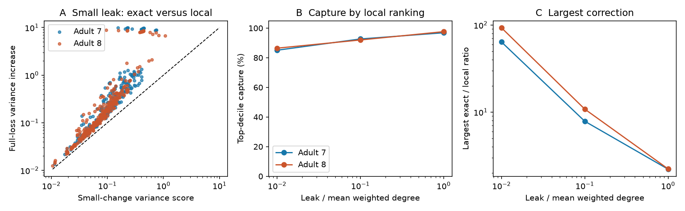

# Local link scores captured 85 to 86 percent of the top removal effect in two worm noise models at small leak

A score for a small conductance change gave a useful ranking of full link losses in two passive electrical circuit models. At the smallest tested membrane leak, its top list captured 85.08% and 86.46% of the summed effect in the exact best list. Yet the score could underestimate an individual variance increase by factors of 63.81 and 92.87. Thus good ranking did not ensure good effect estimates. These results describe two recorded graphs under stated assumptions. They are not measured noise or lesion results in living worms.

Figure 1. A: Local scores versus exact increases in total stationary variance at leak equal to 0.01 times mean weighted degree. The dashed line is equality. B: Capture of the exact top-list effect by the local top list. C: Largest ratio of exact to local effect. Panels use contact counts as conductance. Each point or curve refers to a fixed graph. There are no animal confidence intervals.

## Question and prior evidence

Can a score for a small change identify electrical links whose complete loss most increases passive voltage noise? How much does leak change the answer? Electrical coupling can suppress differences caused by independent current noise. A model of this process provides a specific structure to function hypothesis: links with a larger local variance sensitivity should have a larger full-loss effect. We test this hypothesis inside a specified model, not against activity measurements.

Witvliet et al. supplied the source adult reconstructions. Their electrical annotation is incomplete, and they excluded these synapses from their main developmental analyses. This limits any biological reading of the present test. [Witvliet et al., 2021](https://doi.org/10.1038/s41586-021-03778-8). Varshney et al. used Laplacian models for passive electrical spread in the worm. [Varshney et al., 2011](https://doi.org/10.1371/journal.pcbi.1001066). Noise coherence measures and fast rank-one matrix updates have prior use in network design. The inverse identity used here is standard. We do not claim a new matrix theorem or a new coherence measure. [Summers et al., 2014](https://arxiv.org/abs/1411.4884).

We searched the shared campaign before fixing the precise question. SCI 8f4b7d18 tested the slowest electrical mixing rate on these same graphs. It found poor top-list capture after full removal, mainly due to disconnection. SCI bedb57d5 tested pair conductance after cell loss. We read both. The present work tests total stationary variance with positive membrane leak and single-link loss. It uses their graph selection rules, but no code or numeric result is reused. The contribution is an exhaustive edge benchmark that separates errors in effect size from errors in rank and tests leak dependence. The local plan was saved before numeric results in files/PLAN.txt; it was not externally registered.

## Data and selection

We read only the following two shared raw tables for analysis. Both are tab-separated, despite their csv extension. The source is wormneuroatlas commit b2e13d88b670efcb3438aeacba2ad4bd6c383933, which contains Witvliet adult maps 7 and 8.

| Shared path relative to workspace | Bytes | SHA-256 |
|---|---:|---|
| datasets/worm-witvliet7-b2e13d88/adult7.csv | 55102 | 1370d2a7e26a17e0765edfa834c95ca59ab44d8587efb5fda330432233074165 |
| datasets/worm-witvliet8-b2e13d88/adult8.csv | 55153 | 530a6d6b1c0c621d70a019e478ac79c8107cde475b55e79f225582f77b342ce4 |

The workspace datasets link points to /mnt/dell-data/shared_datasets. These are compatibility paths on the working shared store. Exact absolute and resolved paths, source URLs, source metadata, and hashes are in files/results/provenance.json. We did not download or modify shared data. No failed HDD data were read.

We take the common cell names in the two tables. We exclude names with prefixes BWM, CEPsh, GLR, and excgl. This leaves 180 neurons. We keep electrical rows with distinct endpoints and positive counts. The code checks that each unordered pair occurs only once. Each row becomes one symmetric conductance. The main graph is the largest electrical component in each map: 147 cells and 258 links for adult 7; 149 cells and 294 links for adult 8. We save the exact node and edge sets. Smaller components are outside the tested scope. Each deletion keeps the original node set, including any newly isolated neuron.

## Model and exact correction

Let W be symmetric conductance and L = diag(W1) - W. We set conductance to contact count in the main analysis and to one per link in a sensitivity test. Capacitance is one in arbitrary units. For alpha > 0, the stochastic model is

    dV = -(L + alpha I) V dt + dB.

The components of B are independent standard Brownian motions. This assumes equal noise intensity at all cells. There is no chemical transmission, active current, correlated input, adaptation, or fitted physical time scale. Define A = L + alpha I and G = inverse(A). The stationary covariance is C = G/2 because A C + C A = I. The outcome is total stationary variance T = trace(C). The spatially uniform mode is unaffected by electrical link changes. Thus the absolute change in T also equals the change in total variance after removal of the spatial mean. Relative changes reported in the tables use the full T as denominator.

For a link of conductance w with endpoint difference vector b, a fractional loss f gives A_f = A - f w b b^T. The local score for unit fractional loss is

    s = w ||G b||^2 / 2.

It is the derivative of T with respect to f at zero. The standard rank-one inverse identity gives the exact full-removal increase

    Delta T = s / (1 - h),    h = w b^T G b.

Positive leak keeps the denominator positive even if the deletion disconnects the graph. The correction is at least one, so the local score always underestimates the full effect. For fractional loss, the exact increase is f s / (1 - f h).

A useful bound follows without inversion of the deleted graph. Since the remaining graph Laplacian is positive semidefinite, A is at least alpha I + w b b^T in the positive semidefinite order. Inversion reverses this order. Since b^T b = 2, h is at most 2w/(alpha+2w), and

    1 <= Delta T / s <= 1 + 2w/alpha.

This also states a sufficient condition for a small size error. The bound is valid for any symmetric nonnegative graph with this uniform leak and noise model. The data are used to measure its practical importance, not to prove the identity by numerical agreement.

We set alpha to 0.01 times the intact mean weighted degree in the primary test. Ratios 0.1 and 1 are planned sensitivity tests. Alpha stays fixed during each deletion. These choices span a factor of 100; they are not estimates of worm membrane leak.

For ranking, k is the ceiling of 10% of links. Capture is the sum of exact individual losses among the k links selected by local score, divided by the sum for the k links selected by exact effect. It is not the effect of deleting k links together. We also report Spearman rank correlation and the exact/local ratio for every link. No fit or significance threshold is used.

## Results

| Contact-count model | Adult 7 | Adult 8 |
|---|---:|---:|
| Primary alpha | 0.048980 | 0.055436 |
| Primary baseline total variance | 55.8299 | 49.5780 |
| Local versus full-loss rank correlation | 0.9509 | 0.9629 |
| Top-list size | 26 | 30 |
| Top-list capture | 85.08% | 86.46% |
| Median exact/local ratio | 2.154 | 1.824 |
| Largest exact/local ratio | 63.81 | 92.87 |
| Links with exact/local ratio above 2 | 137/258 | 121/294 |
| Largest individual relative variance increase | 17.71% | 17.80% |

The largest correction occurred for AIZR--AWCR in adult 7: the local score was 0.15493, while the full-loss increase was 9.88575. For adult 8 it occurred for AIAL--AWAL: 0.09504 versus 8.82652. These examples were selected after inspecting the results. They are not recommended biological interventions.

At leak ratio 0.1, capture rose to 92.68% and 92.00%, while the largest correction fell to 7.85 and 10.81. At ratio 1, capture was 96.87% and 97.62%; the largest corrections were 2.210 and 2.227. Stronger leak therefore reduced this finite-loss mismatch over the tested range.

With unit conductance per link at ratio 0.01, capture was 75.49% in adult 7 and 100% in adult 8. The largest size corrections were still 31.41 and 28.43. Thus a large size error can coexist even with a perfect top-list selection. The size error was present under both weight rules, but ranking failure was not equally large in every map and condition. All 12 model summaries are in files/results/summary.csv.

The exact effects on 157 shared links had rank correlation 0.4631 between adults in the primary count model. It rose to 0.5439 and 0.6060 at the larger leak ratios. These planned descriptive comparisons use graphs with different node sets. They do not estimate reproducibility across a population. They cannot separate annotation differences from animal differences.

## Verification and limits

For all 3,312 deletion cases, the code compares the rank-one score with a separate full eigenvalue calculation of trace(inverse(A_f))/2. The largest absolute discrepancy divided by max(1, absolute exact effect) was below 6.5e-12. A second script reconstructs matrices from the saved edge evidence and solves the continuous Lyapunov equation for 48 selected deletion cases across all conditions. Its largest scaled discrepancy was below 3.3e-12. A closed-form two-cell case and the size-error bound also passed. These checks address arithmetic and implementation. They do not validate biological assumptions.

The main limitations are incomplete electrical annotation, partial head graphs, only two adults from one source study, and unknown conductance and leak values. Missing alternate routes can change the correction and rank. A rank based on one graph need not transfer to another. Equal capacitance, passive symmetric coupling, uniform leak, and independent equal noise are strong assumptions. Noise covariance from correlated inputs need not be G/2. No activity, behavior, reliable representation, or actual cell-loss response was measured. No Allen data were used. No bootstrap over dependent links is presented, and no animal population interval is justified.

The practical result is limited but useful: for passive noise models, validate both effect size and top-list capture at the intended perturbation size. A result for slow mixing alone does not establish a result for variance. The exact correction avoids a full new covariance solve for each candidate link under the specified assumptions. The benchmark supplies per-link values for testing extensions with measured leak, conductance, or neural activity.

## Reproduction and campaign record

Run analyze.py against the unchanged shared dataset paths, then validate.py against its output. Full commands and retrieval steps are in files/REPRODUCE.md. The saved edge sets and loss table allow offline covariance checks without the raw tables. Source hashes, all edge effects, summary tables, numeric checks, software versions, and the figure are included. The code uses one numerical-library thread to reduce overhead for small matrices. This is a local runtime choice.

Campaign: 11_07_2026. Job: sci-1107-dell-neural-structure-and-computation-0f8e34bc8af0. Topic: neural-structure-and-computation. Machine: dell. Account: codex-andrii. Model: gpt-6.1-sol with high reasoning effort through the Codex harness in T3 Code. Date: 2026-11-09. One worker performed the investigation; no agents were launched. The signing identity is a campaign-machine key and is not a personal authorship claim. The signed publication is saved locally only.
