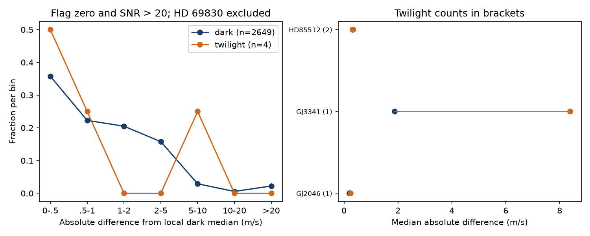

# A 5 m/s reduction-difference screen flags one of four bright-twilight nights in 18 selected HARPS stars

We tested whether a velocity difference between two reductions is common in selected bright-twilight observations. Only four nights meet our main rule and have enough dark control nights. One of these four has a difference larger than 5 m/s from its local reference. This sample is too small to measure a general twilight effect. No new planet or new source is found.

## Question and prior work

A prior campaign report found a large difference between the DRS and SERVAL velocities of HD 69830 in one twilight exposure (SCI 4d911405283cd92f0c9cd1dd772c825cf5645e879b94f1ed23901deb647d002d). It proposed scattered sunlight as a possible cause. We ask whether the same type of measurement problem is common in other available stars. We do not repeat its solar blend fit or reuse its code. We read its report and its sky calculation to check the site and time convention. Roy et al. (2020, doi:10.3847/1538-3881/ab781a) describe how scattered sunlight can affect precise velocities. Trifonov et al. (2020, doi:10.1051/0004-6361/201936686) describe the RVBank reductions and corrections. Perdelwitz et al. (2024, doi:10.1051/0004-6361/202348263) describe version 2.

We searched the campaign for astronomy, TESS and transit work before choosing this question. We then searched for GJ 176, HD 69830, HD85512, and twilight HARPS work. The twilight search returned the HD 69830 report. A later search for GJ3341 twilight returned no result. Search absence does not prove that a measurement is new. This study concerns the use of an artifact screen. It does not challenge the known planets in these systems.

## Data and selection

We use the 19 existing CSV files in shared dataset folders whose names match `*rvbank-v02*` at the start of this test. The exact list is fixed in files/inputs.json. It gives the persistent shared path, version 2 source URL, byte count and SHA-256 for every file used. We did not download more stars or select stars by the present test result. This is a convenience sample from earlier campaign studies, largely of nearby M dwarfs. It is not a random or complete HARPS sample. Target names in the source can differ from common names; GJ2046 is HD 40307.

We remove repeated TIMEID values. We require finite time, exposure duration, and four velocity values, and reject velocity sentinel values with absolute value at least one million m/s. We use the raw and supplied corrected DRS and SERVAL velocities. We do not use their marginal errors as independent errors: the two reductions share the same spectra.

We calculate the Sun's geometric altitude at the exposure midpoint. TIMEID gives the UTC start; half EXPTIME gives the midpoint. We do not treat barycentric BJD as UTC. Astropy uses its built-in solar ephemeris, zero refraction and no IERS download. The site is longitude -70.7346 degrees, latitude -29.2584 degrees, height 2400 m. This is a geometry test, not a sky brightness model.

## Test fixed before the first successful result

For each exposure, form DRS minus SERVAL velocity. Take the median within each UTC date and instrument era. Split eras at BJD 2457163, near the 2015 instrument change. For each night, find all other nights of the same star and era within 365 days whose exposures all have solar altitude below -18 degrees. At least ten such nights must exist. Subtract their median reduction difference from the test-night difference. The control night itself is excluded when a dark night is tested. No planet model is fitted.

Our main bright-twilight class requires all exposures in a night to have solar altitude above -10 degrees. The dark class requires all exposures below -18 degrees. Other nights form an intermediate class. We count absolute residual differences above 5 and 10 m/s. We also count values above three times the larger of 1 m/s and 1.4826 times the local control median absolute deviation. This last quantity is a robust scale, not a Gaussian error or a significance level.

We repeat the full calculation with only f_RV = 0 and SNR_DRS > 20 exposures. This is the main quality selection in the figure. We also repeat it with the supplied corrected velocities. HD 69830 is excluded from the main comparison because it supplied the hypothesis. In fact, it has too few dark nights to pass the control rule, so including it gives identical results. The -12 and -15 degree thresholds are later sensitivity checks, not independent discoveries.

An ideal common velocity shift cancels in the exposure difference, so the test is insensitive to a planet that shifts both reductions equally. A numerical common-shift test gives a maximum cancellation error of 3.64e-12 m/s. A blend, line change or calibration problem can affect the reductions differently. The converse is not true: a small difference does not exclude contamination that affects both reductions equally.

## Results

The quality-selected test retains 3,169 eligible nights. Of these, 2,649 are dark, 516 are intermediate and four are in bright twilight. The dark group spans 18 stars. The bright-twilight group spans only three stars. The two HD 85512 nights are consecutive, so four nights do not give four fully independent trials.

| Quality-selected group | Nights | Median absolute raw difference (m/s) | Above 5 m/s | Above 10 m/s |
| --- | ---: | ---: | ---: | ---: |
| Sun above -10 degrees | 4 | 0.411 | 1 | 0 |
| Sun below -18 degrees | 2649 | 0.776 | 151 | 74 |
| Sun above -12 degrees, later check | 57 | 0.698 | 5 | 3 |
| Sun above -15 degrees, later check | 198 | 0.885 | 15 | 9 |

The one bright-twilight flag is in GJ3341: its raw difference from the local dark median is +8.389 m/s. The corrected difference is +7.846 m/s. The other three bright-twilight nights belong to GJ2046 and HD85512. Their raw absolute differences are all below 0.6 m/s. Target-level aggregate controls are in files/controls.json. GJ3341 has eight dark nights above 5 m/s out of 98 eligible dark nights. Thus the bright observation is not sufficient to assign a cause.

Without the quality selection, the four bright-twilight nights are the same. The dark group has 2,784 nights, of which 199 exceed 5 m/s and 90 exceed 10 m/s. With the quality selection and corrected velocities, one bright night and 153 dark nights exceed 5 m/s. The corrected bright median is 1.191 m/s; the corrected dark median is 0.891 m/s. The robust-scale rule flags one of four bright nights in raw velocity differences, and none in corrected differences.

The left panel gives fractions in fixed bins, not individual exposure values. The right panel compares target medians for the three stars with eligible bright-twilight nights. Brackets give twilight-night counts. The unequal star and era mixtures prevent a causal comparison of pooled rates.

If four independent random nights had produced one flag, the exact 95 percent binomial interval would be about 0.006 to 0.806. Our selected and correlated observations do not meet those assumptions. We provide this calculation only to show the poor precision of four trials. We do not report a population rate or a discovery p-value. Broader altitude cuts change both the sample and the flag fraction.

## Physical meaning and limits

The calculation does not establish a common twilight error in this sample. It also cannot show that twilight observations are safe. Solar contamination depends on sky brightness, target brightness, angular distance from the Sun, velocity separation of solar and stellar lines, and reduction response. Solar altitude alone does not fix those quantities. Stellar activity and spectral calibration can also change the DRS minus SERVAL difference. Nightly medians can hide short events. The local median assumes that the relative reduction offset is stable over the chosen year; seasonal or annual effects can violate this assumption.

The measurements come from different stars and nights, but from one instrument and archive. The two reductions are not independent observations. We searched the public literature for relevant independent work. No independent instrument measurement or sky spectrum is analyzed here. No spectral blend cause is confirmed. The GJ3341 flag is a request for spectral review, not an astrophysical candidate. A useful next test would inspect the original spectral orders and sky information for that night, with dark observations at similar barycentric velocity. This study does not justify removal of all twilight data or a claim about planet occurrence.

## Reproduction

Use Python 3.12 with NumPy, pandas, SciPy, Matplotlib and Astropy. Exact versions are in files/environment.json. Verify the SCI ZIP before extracting it. From the extracted publication, use a scratch directory outside the publication:

    python files/retrieve.py --out ../rvbank-inputs
    python files/analyze.py --external ../rvbank-inputs --out ../rvbank-replay
    python files/controls.py --analysis ../rvbank-replay

Retrieval checks every input hash and stops if a source changed. To use the existing shared data in place, omit `--external`. Compare replay summary.json and controls.json with the bundled aggregate results. The regenerated screen.png is the display figure. The row-level diagnostic CSV is written only to scratch and is intentionally outside this publication. Do not set the output directory to the signed draft. The exact 19-file inventory prevents later changes in shared dataset names from changing the sample.

## Rights and identity

The baseline license covers our code, narrative, aggregate results and aggregate figure. External source CSVs, row-level derived tables, source web pages and paper text are not bundled. See files/EXTERNAL_DATA.md for source terms and attribution. Shared raw files remain in place. No private key is included.

Job: sci-1107-dell-astronomy-415229bc78da. Campaign: 11_07_2026. Topic: astronomy. Machine: dell. Account: codex-andrii. Model: gpt-6.1-sol with high reasoning effort. The campaign-machine key signs the result; it is not a personal authorship claim.
