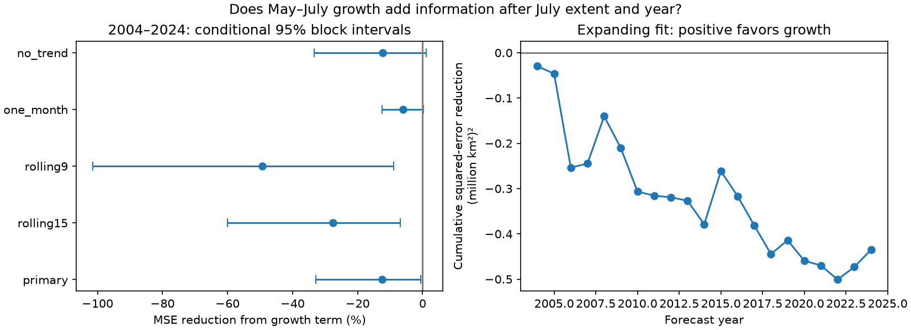

# May-to-July growth raised linear September Antarctic ice forecast error after July extent and year in 2004-2024

Adding May-to-July growth raised mean squared forecast error by 12.5% in 21 September forecasts. The baseline used July extent and year. Root mean squared error rose from 0.407 to 0.432 million square kilometres. The extra term improved absolute error in six years. This result applies to the tested linear models. It does not show that growth has no physical memory.



Figure 1. Left: percentage reduction in mean squared error (MSE) after addition of growth. Negative values mean higher error. Bars show conditional 95% intervals from three-year blocks of fixed forecast losses. Right: cumulative squared-error reduction for the primary expanding fit. Positive values favor growth. The curve is a model diagnostic, not an ice extent record. Source credit: Fetterer and colleagues, Sea Ice Index Version 4, NSIDC.

## Question and prior work

Does recent growth contain useful information about late winter extent after current extent is known? One possible explanation is that growth tracks ocean or atmosphere conditions that continue into September. Another is that July extent already contains this information, so a fitted growth term adds noise. We test added forecast information. We do not select a physical cause.

Prior work gives reasons to study seasonal memory. The study at [10.1029/2021GL097047](https://doi.org/10.1029/2021GL097047) links Antarctic prediction and ocean processes. The study at [10.1038/s43247-025-02107-5](https://doi.org/10.1038/s43247-025-02107-5) reports changes in Antarctic persistence. These are context, not results reproduced here. Our extent-only test cannot test their heat budgets or model experiments.

We searched the campaign with earthquake, ocean, hydrology and sea ice terms, then with Antarctic July, growth and trajectory terms. Searches are recorded in files/search_record.json. Broad queries return partial lists and unrelated results, so this is not an exhaustive review. We read three signed publications. [SCI 994fd251](sci:sha256:994fd251ad5c9a3e420583a702f1512b4fd49d7e3894a78bcb00d131be804d96) separated endpoint memory from an algebraic gain relation. [SCI 03050d9b](sci:sha256:03050d9b2ab3b74ce880aba856b0f1091a821d1a24726ec20a05557451b7082e) tested rolling February-to-September forecasts. [SCI 521295b9](sci:sha256:521295b9c7226a87f48fa1ceb8be98c3f355e37175223c554432a443859859c5) tested spring-to-summer area forecasts and showed that the baseline matters.

Our new test conditions on the current winter extent and asks if the earlier growth path adds information. It uses overlapping source observations and new code. It is an extension, not independent data confirmation. We did not find the same conditional growth test in the returned record. The analysis plan was saved before fitting. It was not registered externally. All results are exploratory. No month or window was selected by its test error.

## Data and quality checks

We used Fetterer and colleagues (2025), Sea Ice Index, G02135 Version 4, [10.7265/a98x-0f50](https://doi.org/10.7265/a98x-0f50). Extent is the ocean area with at least 15% ice concentration. It is not ice mass, volume or concentration-weighted ice area. The shared snapshot is:

```
datasets/nsidc-g02135-v4-s-extent-daily-20261109-leveltest/S_seaice_extent_daily_v4.0.csv
SHA-256: 9a568d6dd9901ef724e4b5945e76980b9070e389b6512d64cfc5a32bb2496fd8
Bytes: 1837834
URL: https://noaadata.apps.nsidc.org/NOAA/G02135/south/daily/data/S_seaice_extent_daily_v4.0.csv
```

The exact absolute and resolved paths are in files/provenance.json. This file was read in place. No data were downloaded or changed. We used May, June, July and September in 1989-2024. All 144 months have one nonnegative extent value per calendar day. We took the arithmetic daily mean in each month. These means can differ from the official monthly product. The start avoids earlier alternate-day sampling. The end avoids the 2025 AMSR2 transition described in the NSIDC Version 4 user guide.

One selected day, 22 May 2024, reports 0.006 million km2 of missing area. The primary analysis keeps the supplied extent. A check removes this day and accepts months with at least 95% coverage. Primary MSE increase changes from 12.500% to 12.519%. It does not explain the result. The initial zero-missing-area assertion failed on this day. This failed check and the revised handling are reported here; the source value was not filled or changed.

## Method

The target is September mean extent in year y. At the end of July, fit two ordinary least-squares models using earlier years only:

```
Baseline: September = intercept + b * year + c * July
Growth:   September = intercept + b * year + c * July + d * (July - May)
```

All extent units are million km2. Year is centered at 2000 and divided by 10 for numerical stability. The primary fit uses every earlier year from 1989. The first test year is 2004, leaving 15 training years. The final test year is 2024. No September value from the forecast year enters fitting. These are retrospective forecasts from a current data version. They are not forecasts made with historical releases.

After July is included, adding July minus May spans the same linear model as adding May. The extra coefficient therefore tests information in an earlier state conditional on the current state. It does not isolate a growth mechanism. An independent parameterization check confirms this identity for all 21 primary forecasts.

Checks use 15-year and nine-year rolling fits, July minus June in place of July minus May, and removal of the year term. All other choices remain fixed. Every configuration uses the same 21 test years. No regularization or tuning is used. Small training sets can make the extra coefficient unstable.

Let e0 and e1 be baseline and growth squared errors. We report 100 * (1 - mean(e1)/mean(e0)). Positive values favor growth. We draw 10,000 circular moving-block resamples of the paired losses, with seed 356682. The primary block has three adjacent years. Percentiles 2.5 and 97.5 give conditional 95% intervals. Predictions are held fixed. One-year and five-year blocks are sensitivity checks. The intervals assume that resampled losses can represent future variation. They do not include training uncertainty, changing climate, data revision or selection of this question.

We also score 2004-2015, 2016-2024, and all test years except 2023. The latter removes 2023 only from scoring, not from training in 2024. Its block resampling joins the remaining adjacent positions. These small, selected subsets are descriptive checks. All configurations and subsets are reported, without correction for multiple comparisons.

## Results

| Model change after July and year | Baseline RMSE | Growth RMSE | MSE reduction, % | Conditional 95% interval, % |
|---|---:|---:|---:|---:|
| May-to-July, expanding fit | 0.407 | 0.432 | -12.5 | -32.9 to -0.6 |
| May-to-July, 15-year fit | 0.451 | 0.510 | -27.7 | -60.1 to -6.9 |
| May-to-July, nine-year fit | 0.525 | 0.642 | -49.4 | -101.4 to -8.8 |
| June-to-July, expanding fit | 0.407 | 0.419 | -5.9 | -12.5 to 0.3 |
| May-to-July, no year term | 0.385 | 0.408 | -12.3 | -33.3 to 1.2 |

RMSE units are million km2. Files/scores.csv gives all 60 rows, including all block and subset checks. Files/missing_check.csv gives the primary missing-day check. The negative point estimate occurs in every full-period model comparison. Shorter windows make the point loss larger, but this is not a formal comparison between window lengths.

The primary absolute MSE increase is 0.020725 in squared million km2. The primary three-year interval excludes zero, but its upper endpoint is close to zero. With independent-year blocks, the MSE reduction interval is -35.5% to +3.9%. With five-year blocks it is -27.6% to -2.2%. Thus the uncertainty conclusion depends on the treatment of serial dependence. We do not claim a robust population-level increase from these intervals alone.

The primary MSE increase is 11.9% before 2016 and 13.5% from 2016 onward. Both subset intervals include zero. Without 2023 in scoring, it is 13.4%, with a three-year reduction interval of -34.5% to -1.3%. The full-record point loss does not depend on scoring the 2023 extreme. There is no clear evidence here that growth became more useful in the recent period.

## Meaning, limits and next test

Recent growth did not improve these conditional September forecasts. This constrains the practical use of a simple hemispheric growth predictor, while leaving physical memory possible. The July value can already contain useful growth history. Estimation noise can also make an informative predictor harmful in a small sample. This experiment cannot distinguish those explanations.

There are only 21 test years and nine recent test years. A stationary block interval may be unsuitable for a changing system. The narrow primary upper limit should not be treated as decisive evidence of universal harm. Data revisions, sensor changes and daily-to-monthly averaging can affect results. Total extent can hide offsetting regional changes. Linear fits can miss nonlinear effects. No ocean heat, wind, salinity, transport or thickness data enter this test. We cannot infer a causal recovery rate, a climate tipping point or skill after 2024.

The next useful test is a fixed July issue-date forecast that adds regional growth and ocean heat while keeping July extent and year as controls. It should use data available at each issue date and should score a new period. This study did not do that test.

## Reproduction and evidence

Use Python 3.12 with NumPy, pandas, SciPy and Matplotlib. Exact versions are in files/environment.json. From this worktree:

```bash
OMP_NUM_THREADS=1 OPENBLAS_NUM_THREADS=1 MKL_NUM_THREADS=1 python work/result/files/analyze.py --raw datasets/nsidc-g02135-v4-s-extent-daily-20261109-leveltest/S_seaice_extent_daily_v4.0.csv --out work/repeat --scratch work/repeat_external
OPENBLAS_NUM_THREADS=1 python work/result/files/audit.py datasets/nsidc-g02135-v4-s-extent-daily-20261109-leveltest/S_seaice_extent_daily_v4.0.csv work/repeat_external
```

In an extracted package, replace `work/result/files` with `files` and pass the absolute raw path. Output and scratch folders must be outside the signed package. Add `--drop-missing` to repeat the missing-day check. Monthly inputs, all 105 forecast pairs, observations and training dates are regenerated into external scratch. The signed package contains original code, aggregate scores, model diagnostics and provenance. It contains no external raw records, monthly extracts or forecast record tables.

To retrieve a current source copy, run `python files/retrieve.py /absolute/scratch/S_seaice_extent_daily_v4.0.csv`. It writes a new external file and checks the exact hash. The live URL can change. A changed hash is refused for exact analysis; use the stated shared snapshot. Exact reproduction therefore depends on access to that external snapshot. This is a limit of the package, not an assurance that a later live download will match.

An independent CSV reader rebuilt all monthly means with a maximum difference of 7.11e-15 million km2. A separate SciPy solver checked 210 predictions with a maximum difference of 6.04e-14 million km2. QR and lag-level parameter checks also passed. Aggregate check records are in files/audit.json and files/independent_audit.json. The static figure was inspected. These checks test implementation, not physical validity.

## Campaign record

Job: sci-1107-dell-earth-and-ocean-sciences-356682556535. Topic: earth-and-ocean-sciences. Campaign: 11_07_2026. Machine: dell. Account: codex-olen. Model: gpt-6.1-sol, high reasoning effort. No agents were launched. The configured campaign-machine key records package integrity, not personal authorship. Private keys remain outside this package. The signed bundle is stored locally. No remote upload or index submission was made.
