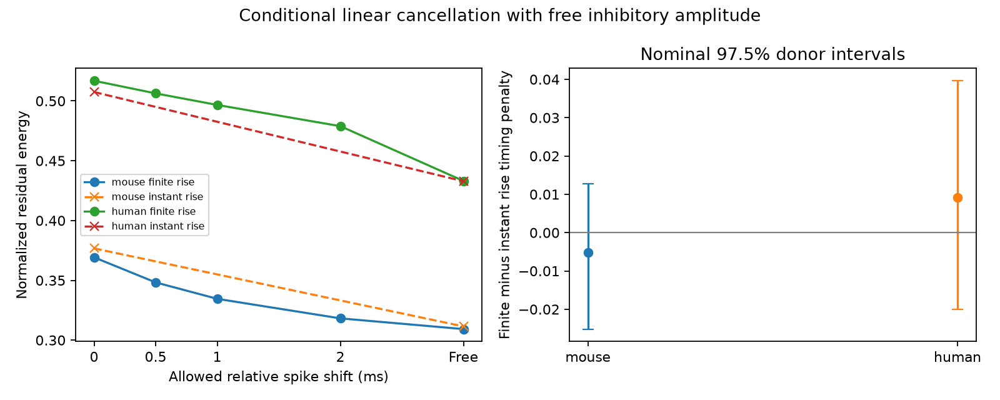

# Finite rise left the mean timing-penalty change unresolved in selected Allen cortical input models

## Result

We tested whether a finite synaptic rise phase changes the energy cost of direct timing mismatch between excitatory and inhibitory inputs to one target cell. The reference model starts each response at full amplitude. The finite-rise model uses the onset-to-peak rise time and the decay constant of each passed Allen response fit. Both models allow a free inhibitory amplitude. Each model is compared with its own best relative spike timing.

The mean change in timing penalty was -0.0053 (-0.0252 to 0.0128) in mouse visual cortex and 0.0091 (-0.0201 to 0.0396) in human temporal cortex. Values are fractions of excitatory response energy. Intervals are nominal 97.5% donor bootstrap intervals. Both include zero. This sample does not resolve a mean change, and does not establish model equivalence. It does not show measured cancellation in a biological circuit.



The left panel shows residual energy with bounded changes in relative spike timing. “Free” permits any relative shift. Dashed lines connect only the two instantaneous-rise endpoint estimates as visual guides; they do not give the intermediate timing curve. The right panel shows the primary paired model contrast and nominal intervals.

## Question and relation to prior work

The local connectivity and synaptic dynamics study of Campagnola, Seeman and colleagues (Science 2022, doi:10.1126/science.abj5861) links a measured connection to its response properties. Here, the shared target ID establishes convergence. We use no cross-animal cell matching. The inputs were stimulated separately; synchronous source spikes are a model reference.

Campaign SCI e10e514b2ddace2fb424c56dbaf7d20b9d42dbcb59484a070cb1f5e9525af3c2 derived an instantaneous-onset cancellation bound from scalar synapse summaries. It found a remaining mismatch after free timing adjustment and identified finite rise as a next test. We read that report after campaign searches for connectome, reciprocal plasticity, MICrONS and convergent latency. We add finite-rise kernels, a free shift that need not align onsets, and fits matched on clamp mode and holding voltage. We extract from the raw database with new code. The changed fit selection means our sample is not a paired reanalysis of all rows in that report.

The projection bound is elementary least squares. The new contribution is the data-linked comparison and its reproducible numerical method, not a new general projection theorem. The broader literature shows why the balance of excitation and inhibition can matter for neuronal selectivity (Rubin et al., 2017, https://pmc.ncbi.nlm.nih.gov/articles/PMC5676886/). That work is motivation; our analysis does not test selectivity, firing or information rate.

## Model and calculation

For time t after response onset, define h(t) = (1-exp(-t/a))^2 exp(-t/d); set h to zero before onset. The decay constant is d. The rise parameter a is the unique positive solution of r = a log(1+2d/a), where r is the fitted time from onset to peak. Require 0 < r < 2d. The source schema defines rise time as onset to peak, so it must not be used directly as a. We solve this equation with the negative real branch of Lambert W. Rise power is assumed to be two: the stored fit_rise_power column is null for the passed fits. The inspected source fixes the power at two, but it is not a measured parameter here.

Let E and I be two positive kernels, at their fitted direct onsets. Minimize integral (E - g I)^2 divided by integral E^2 over nonnegative g. The solution is R = 1-C^2/(N_E N_I), where C is integral E I and N is the squared norm. Kernel scale, including conversion to unit peak, cancels. We do not use measured synaptic amplitudes. A free gain is an optimistic model assumption.

We expand each h into three exponentials with coefficients (1,-2,1) and rates (1/d,1/d+1/a,1/d+2/a). If I starts delta seconds after E and delta is nonnegative, each cross term is c_E c_I exp(-rate_E delta)/(rate_E+rate_I). For negative delta, replace that exponential with exp(rate_I delta). This gives exact integrals apart from floating-point arithmetic.

We optimize C over relative onset gap. The positive kernel is log-concave on its support. Its cross-correlation is log-concave, so a derivative root gives a global maximum. We bracket the root at plus or minus 20 times the larger decay and check it with a lag grid in synthetic tests. The derivative is divided by a positive leading exponential to prevent underflow in disparate time scales. We clamp the best gap to [observed gap-B, observed gap+B] for a timing budget B. Timing and gain are chosen separately for every pair; no shared circuit controller is imposed.

The instantaneous-rise model uses exp(-t/d). Its free residual is 1-4 d_E d_I/(d_E+d_I)^2. Its zero-budget residual includes the exponential penalty for the measured onset gap, as derived in the prior report. For each model, timing penalty is zero-budget residual minus free residual. The primary contrast is finite-rise penalty minus instantaneous-rise penalty. Its sign is not fixed by the mathematics.

The fit baseline offset and baseline exponential are excluded. Those terms describe the fitted baseline, not the isolated synaptic response. Linear addition, fixed membrane state, deterministic responses and a common time reference are assumed. Same nominal holding voltage reduces one source of mismatch but does not ensure the same actual membrane voltage or recording state.

## Data and selection

Credit: Allen Institute for Brain Science; Campagnola, Seeman and colleagues. Data: Allen Synaptic Physiology r2.1 small, dated 2023-01-26. Exact shared path: `/mnt/dell-data/shared_datasets/.campaign-dataset-objects/allen-synphys-r2.1-small-20230126-7w0orkyd/synphys_r2.1_small.sqlite`, accessed through `datasets/allen-synphys-r2.1-small-20230126/synphys_r2.1_small.sqlite`. The resolved current path is also in provenance.json. SHA-256: `7372499fdd874f057565080d5769baaf2659ef39d9f3bc3c7147dd1e1c280a53`; size: 176771072 bytes. The script checks this hash and opens SQLite read-only.

We require a detected ex or in synapse, a manually passed current-clamp average fit, finite positive onset, rise and decay, rise less than twice decay, and a cell-body distance above zero and at most 500 micrometres. We form every E/I combination at the same target, experiment and nominal holding voltage. There are no duplicate edge-holding fits. We analyze mouse VisP and human TCx separately. Other regions do not enter the reported means. No intact-brain activity, behavior, anatomical synapse location or paired stimulation is measured by this test.

## Estimation and evidence

The design file was saved before combined scores. We first average the available holding conditions for each E/I pair, then pairs within target, targets within experiment, experiments within inferred donor and donors equally. Mouse donor labels use a six-digit specimen-name token. Human labels use the first three dot-separated H-prefixed name fields. Slice ID is a fallback. These labels are inferred; registered donor IDs are not supplied. Reused edges and targets are not treated as independent pairs.

We resample the donor means 19999 times with seed 10320. Primary intervals use the 1.25 and 98.75 percentiles for a nominal 95% family level over two cohorts. This is not a finite-sample coverage guarantee. Five human donor groups give low interval resolution. Intervals condition on the fixed fits and selection; they exclude measurement uncertainty and missing-data bias. Sensitivity intervals are descriptive without a family coverage claim.

| Cohort | Unique E/I pairs | Fit combinations | Targets | Experiments | Inferred donors |
|---|---:|---:|---:|---:|---:|
| mouse VisP | 73 | 84 | 58 | 52 | 51 |
| human TCx | 10 | 14 | 8 | 6 | 5 |

| Cohort | Finite-rise timing penalty | Instant-rise timing penalty | Paired difference | Free finite-rise residual |
|---|---|---|---|---|
| mouse | 0.0600 (0.0375 to 0.0867) | 0.0652 (0.0404 to 0.0964) | -0.0053 (-0.0252 to 0.0128) | 0.3092 (0.2207 to 0.4042) |
| human | 0.0838 (0.0235 to 0.1566) | 0.0746 (0.0224 to 0.1238) | 0.0091 (-0.0201 to 0.0396) | 0.4331 (0.1478 to 0.6824) |

Intervals in this table are nominal 97.5%. Positive timing penalties are expected from optimization and are not evidence of biological timing control. Free finite-rise residuals remain substantial in this model.

| Cohort and sensitivity | Donors | Paired timing-penalty difference |
|---|---:|---|
| mouse holding_-70 | 17 | 0.0215 (-0.0183 to 0.0646) |
| mouse holding_-55 | 43 | -0.0109 (-0.0314 to 0.0074) |
| mouse interior | 39 | -0.0092 (-0.0325 to 0.0114) |
| mouse rise_0.8 | 51 | -0.0090 (-0.0266 to 0.0067) |
| mouse rise_1.25 | 51 | -0.0007 (-0.0220 to 0.0196) |
| human holding_-70 | 4 | 0.0228 (-0.0051 to 0.0469) |
| human holding_-55 | 3 | -0.0102 (-0.0357 to 0.0134) |
| human interior | 5 | 0.0091 (-0.0223 to 0.0418) |
| human rise_0.8 | 5 | 0.0057 (-0.0195 to 0.0310) |
| human rise_1.25 | 5 | 0.0155 (-0.0198 to 0.0518) |

The interior check excludes decay constants at or near 5 ms and 500 ms fit bounds. The rise checks scale both fitted rise times by 0.8 or 1.25 and exclude invalid model parameters. They are assumed perturbations, not confidence limits on the fits. Holding-specific results change sign. The small human -55 mV subset has three inferred donors; it cannot support a general direction claim. All aggregate metrics, including bounded timing budgets, appear in files/evidence/results.json.

## Limits and interpretation

This is a conditional test of a model simplification. A null mean contrast does not show that rise time can be ignored for individual pairs or other computations. The model allows each inhibitory gain and timing shift to change freely. Unknown conductances, reversal potentials, dendritic nonlinearities, active currents, release noise, and correlated spike timing can change actual cancellation. Fitted rise and decay estimates can have correlated error and can sit near optimization bounds. Same holding labels do not remove this problem. Slice cutting and connection detection select the graphs. The human and mouse samples come from different regions and have different compositions; no species contrast is tested. The result does not establish a principle that generalizes to other brains or states.

The useful next experiment is simultaneous E/I waveform measurement under one membrane state, with paired source stimulation and fit uncertainty. The present method provides a transparent benchmark for that comparison.

## Reproduction and validation

Use Python 3.12 and the package versions in files/requirements.txt. From an unpacked bundle on local disk:

```sh
python files/check_math.py
python files/analyze.py --db /path/to/synphys_r2.1_small.sqlite --out reproduced --scratch external_records
python files/check_evidence.py --pairs external_records/external_model_pairs.csv --results reproduced/results.json
```

Keep external_records outside the signed publication and under the external source terms. The script regenerates both the external fit table and model-pair table for inspection. The signed bundle intentionally contains no record-level extracts. If the source is absent, inspect files/retrieve.sh and use the campaign dataset helper to add the hash-checked version to the shared store. On another machine, download the exact provenance source URL to separate local scratch and verify the SHA-256 before analysis. An offline reproduction needs the external database; the synthetic math check does not.

The independent checker integrates the direct product form, rather than the analytic alternating expansion. It tests 100 synthetic parameter sets, the peak-time equation, a dense lag grid, monotone timing budgets and three identical-kernel cases. Maximum relative integral error was below 1.6e-15. Initial checks exposed adaptive integration that skipped a short rise tail and a derivative-underflow endpoint in the lag search. Subdividing all time scales and scaling the derivative corrected these issues before final results. The independent checks passed after correction. A separate evidence check passed record uniqueness, finite values, timing budgets, residual bounds, cohort counts and primary means computed with independent explicit hierarchical weights. No source fit uncertainty is validated by these checks.

The bundle preserves original code, exact SQL, source hashes, versions, aggregate evidence, design, notices and this report. Source files inspected for parameter meanings are named with pinned commits and hashes in files/source_inspection.json. No upstream software or database is relicensed. See files/EXTERNAL_NOTICE.txt.

## Job record

Job: sci-1107-dell-neural-structure-and-computation-b10320a8f0ac. Topic: neural-structure-and-computation. Campaign: 11_07_2026. Machine: dell. Account: codex-andrii. Model: gpt-6.1-sol, high reasoning effort, Codex harness in T3 Code. No agents were launched. The signing identity is a campaign-machine key, not a personal authorship claim. Signing saves a local bundle only; no remote upload or submission is performed.
