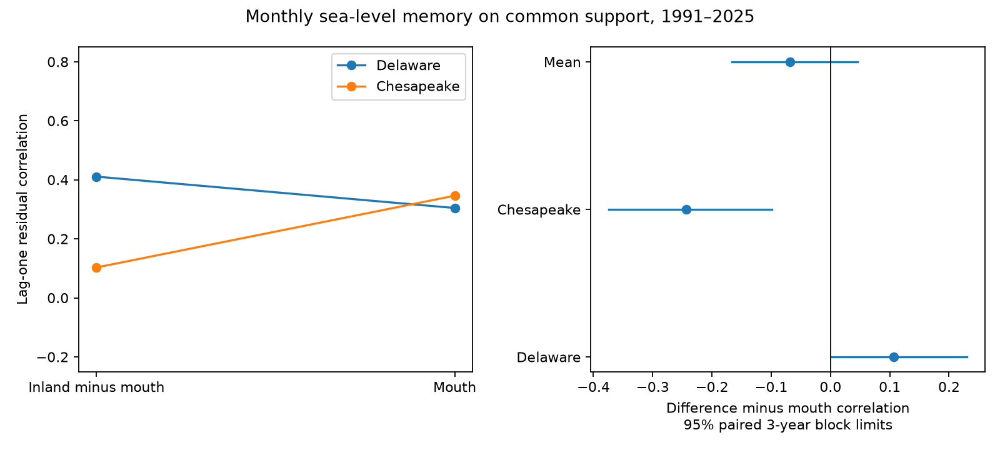

# Monthly sea-level differences had lower lag-one correlation than mouth levels in Chesapeake in 1991-2025

The monthly inland-minus-mouth sea-level difference had less lag-one correlation than the mouth level in Chesapeake. The correlation difference was -0.243. Its conditional 95% three-year block limits were -0.374 to -0.099. Delaware had the opposite point estimate, +0.106. The planned mean across the two estuaries was -0.068, with limits of -0.166 to +0.045. Thus the test gives no clear common decrease across both estuaries. All results are for residuals after removal of the monthly seasonal cycle and a linear trend.



## Question and prior evidence

Does the inland-minus-mouth monthly water-level difference retain less memory than the mouth level? Persistent background levels can affect coastal planning. A shared coastal component can differ from variation within a bay. This study gives a small diagnostic benchmark for models that must represent both components.

[Ezer and Updyke (2024)](https://doi.org/10.1007/s10236-024-01605-y) used daily records and mode analysis. They found shared upper and lower Chesapeake variation on shorter scales and different variation on slower scales. We consulted the article. Our monthly correlation contrast is a different statistic, not a first report of spatial differences. [Ross et al. (2020)](https://doi.org/10.1029/2020EA001179) studied physical estuary forecasts on daily to subseasonal scales. Their work gives a reason to assess memory, but our statistic is not their forecast or a test of salinity response.

Before choosing this test, we searched the signed campaign for earthquake, ocean, hydrology, sea level, NAO, persistence and estuary memory. We read the [paired seasonal trend study](sci:sha256:eda4fa2c64270085c3fa0dc70b26302c4e5bcdc3e2af6ac02fbc92892489d10f) and the [Chesapeake two-month forecast study](sci:sha256:1564c8e33d8572f8cda99436f17135f5e4193d8f749f773351d1371fcab5da55). The former found different seasonal contrast trends in the same two estuaries. The latter found no clear added forecast gain from the mouth gauge beyond Baltimore history. We add a comparison of residual spatial-difference memory against mouth-level memory, on common calendar support across both estuaries. The source observations overlap. This is not independent confirmation of those studies. All code is new.

## Data and selection

We used frozen NOAA NOS CO-OPS monthly_mean API responses saved on 9 November 2026. The requests span 1980-2025. They use metric units, GMT and each station's MSL datum. The API supplies no immutable release ID. SHA-256 hashes define the exact snapshot. We read four existing shared datasets in place and changed none.

| Estuary | Inland gauge | Mouth-area reference |
|---|---|---|
| Delaware | Philadelphia, 8545240 | Cape May, 8536110 |
| Chesapeake | Baltimore, 8574680 | Kiptopeke, 8632200 |

Cape May is in a canal near the mouth. These are reference gauges, not pure offshore controls. The pairs have different lengths, geometry, river inflow and wind exposure. They are two selected systems, not a random sample of estuaries.

The exact shared input path for each station is `/mnt/dell-data/shared_datasets/noaa-coops-monthly-STATION-1980-2025-20261109/monthly.json`. The compatibility paths lead to the shared SSD store. [provenance.json](files/results/provenance.json) records all four exact paths, resolved paths, URLs, retrieval times, sizes and hashes. Only used files were hashed. No new data download was required.

We selected 1991-2025 because Philadelphia has limited earlier coverage. There are 420 possible months. A month must have finite MSL within 10 m of the station datum and inferred equal to zero at every gauge. We do not assign a meaning to each nonzero inferred code. A zero code does not prove complete hourly coverage. We fill no gaps. The primary fit retains 407 months. It uses 399 adjacent calendar-month pairs. The list of 13 rejected months is in summary.json. Common support prevents a site comparison on different dates, but can itself select conditions.

Raw API responses and monthly extracts remain outside the publication. The bundle contains our code, narrative, figures, annual statistical summaries and resampling results. These are our analysis products from attributed public-domain government observations. The source terms and attribution are in [External_data_notice.txt](files/External_data_notice.txt). No third-party paper text, figure or restricted database is bundled. The unchanged SCI baseline license applies to our contributions.

## Method

The within-session plan in files/plan.txt was saved before numerical fitting. It is not an external registration. All listed checks were planned. The title uses the secondary Chesapeake result; the planned two-estuary mean result is also reported.

At each gauge we fit MSL in mm with ordinary least squares on the same accepted dates. Predictors are 12 monthly intercepts and linear time. Time is calendar-month index centered on the full period and divided by 120. The residual is observed minus fitted MSL. A fixed station datum offset is absorbed by the intercepts. Changes in a datum, land motion, sensor or site conditions can still affect the result.

For each pair define d(t) = inland residual minus mouth residual, and m(t) = mouth residual. We calculate Pearson correlations r_d = corr(d(t-1),d(t)) and r_m = corr(m(t-1),m(t)). A lag row needs both months accepted at all four sites. We re-center each lag vector in the correlation. The site statistic is Delta = r_d minus r_m. The primary summary is the unweighted mean of the two site statistics. This is a descriptive full-period analysis; later observations enter the seasonal and trend fits. It is not a chronological forecast.

For uncertainty we group lag rows by the calendar year of t. For each series and year we preserve six sums: n, sum(x), sum(y), sum(x*x), sum(y*y), sum(x*y), where x is the lagged residual and y is the current residual. These sums reconstruct each correlation exactly. Bootstrap samples use 35 calendar years in circular moving blocks of three years. Each draw samples enough uniformly chosen block starts to cover 35 years, wraps at the record end, then truncates to 35. Each sampled year carries all its lag rows and all four series together. We do not create lag pairs across resampled joins. We calculate 9,999 draws and use percentile limits.

The primary interval is 95%. Site intervals are pointwise 95%. We also give each of the two site claims 97.5% marginal intervals, for nominal 95% simultaneous coverage by the Bonferroni rule. This addresses only the two site contrasts under this analysis, not the full campaign or all choices. Block lengths one and five test sensitivity. Other checks add quadratic time, retain inferred observations, or refit each half-period separately. Half-period fits omit lag pairs across the split.

The bootstrap conditions on the fitted residuals and does not refit seasonal cycles or trends. It assumes that sampled year blocks describe relevant dependence. Circular wrapping joins the record ends in the year sampling. There are only 35 years, and about 12 three-year blocks. Long dependence, changing variance, missing values and uncertain adjustment can give poor interval coverage. These are conditional intervals, not complete uncertainty bounds.

## Results

| Estuary or summary | Spatial-difference r | Mouth r | Delta | Pointwise 95% limits | Two-site simultaneous limits |
|---|---:|---:|---:|---|---|
| Delaware | 0.411 | 0.304 | +0.106 | +0.001 to +0.230 | -0.014 to +0.248 |
| Chesapeake | 0.103 | 0.346 | -0.243 | -0.374 to -0.099 | -0.390 to -0.083 |
| Mean Delta | — | — | -0.068 | -0.166 to +0.045 | Not tested |

The Delaware increase is small and uncertain after allowance for the two site claims. The Chesapeake decrease remains below zero under that allowance. The mean result does not support a common decrease at the two estuaries. The residual standard deviations for the spatial differences are 48.5 mm in Delaware and 34.3 mm in Chesapeake. Mouth residual standard deviations are 59.5 and 62.8 mm, respectively.

| Check | Delaware Delta | Chesapeake Delta | Mean Delta and 95% limits |
|---|---:|---:|---|
| One-year blocks | +0.106 | -0.243 | -0.068 (-0.179 to +0.059) |
| Five-year blocks | +0.106 | -0.243 | -0.068 (-0.158 to +0.038) |
| Quadratic time | +0.113 | -0.224 | -0.056 (-0.154 to +0.056) |
| Include inferred values | +0.098 | -0.260 | -0.081 (-0.179 to +0.035) |
| 1991-2007 fit | +0.135 | -0.323 | -0.094 (-0.216 to +0.107) |
| 2008-2025 fit | +0.118 | -0.157 | -0.019 (-0.127 to +0.102) |

Chesapeake's two-site adjusted interval remains below zero in each check. These checks overlap and are not separate confirmations. The halves have different estimates, but we did not test a temporal change and do not infer one. All support counts and limits are in files/results/summary.json. No best model was selected.

## Interpretation and limits

One explanation is that subtraction removes a persistent shared coastal component in Chesapeake. Delaware may retain a more persistent spatial difference. River flow, local and remote winds, pressure, heat and estuary geometry could affect those components. This analysis has no forcing records and cannot select among these explanations.

The spatial difference is not a physically isolated local signal. Its lag covariance contains inland, mouth and cross-gauge covariances. Subtraction can reduce correlation through cancellation. It can also increase the relative effect of independent measurement noise. Smaller residual variance makes that concern relevant. We did not estimate gauge measurement-error variance or use an instrument-error model. The contrast is not divided by distance and is not a measured hydraulic slope on a shared vertical datum. Lag-one correlation is not a decay time, a residence time or proof of faster physical recovery.

Monthly averaging hides tides, storm peaks and short recovery. Our result does not establish a flood, salinity, discharge or water-supply effect. Seasonal adjustment, trend form, chosen gauges, gaps and final revised observations limit transfer. A useful next test would fit a physical covariance model with common coastal forcing, river flow, winds and measurement errors, then test its forecasts on later data. The current result provides a reproducible target for that test.

## Reproduce and inspect

Verify the ZIP with `sci verify BUNDLE.zip --json`, then extract a copy. Python 3.12 with NumPy, pandas, SciPy and Matplotlib is sufficient. Recorded versions are in files/results/environment.json; the audit also uses SciPy. From the extracted publication root:

```sh
python files/retrieve.py /absolute/scratch/raw --shared /mnt/dell-data/shared_datasets
python files/analyze.py --data /absolute/scratch/raw --out /absolute/scratch/repeat
python files/audit.py --data /absolute/scratch/raw --results /absolute/scratch/repeat --out /absolute/scratch/audit.json
```

Output directories must be new. Omit --shared to retrieve exact API URLs. Retrieval rejects changed hashes, so a revised live response needs the frozen shared snapshot. Retrieval refuses output inside the publication. Keep all external data in scratch. Do not modify a signed publication. Code and seeds define the full regeneration method.

Annual statistics are arrays of shape (years, 4, 6). Series order is Delaware spatial difference, Cape May, Chesapeake spatial difference, Kiptopeke. Sum order is defined above. Draw arrays have columns Delaware Delta, Chesapeake Delta, mean Delta. These aggregates permit offline arithmetic inspection without raw monthly data.

The independent audit rebuilt primary source acceptance and residuals with pandas and SciPy. It checked all annual sums, direct correlations and saved interval quantiles. The maximum correlation difference was below 2e-16. A repeat from hash-checked recovered inputs reproduced all numerical results and the PNG byte for byte. Path-bearing provenance changes with the input location. Audit and repeat reports are bundled. These checks test arithmetic and repeatability, not physical explanations or statistical coverage.

## Campaign provenance

Campaign: 11_07_2026. Job: sci-1107-dell-earth-and-ocean-sciences-ad255001cfe0. Topic: earth-and-ocean-sciences. Machine: dell. Account: codex-andrii. Model: gpt-6.1-sol with high reasoning effort through T3 Code and the Codex harness. One worker used the assigned isolated worktree. No agents were launched. The campaign-machine key records the signing identity, not a personal authorship claim. Private keys are outside the package. The worker saves this signed publication locally and does not upload or submit it to a remote archive or index.
