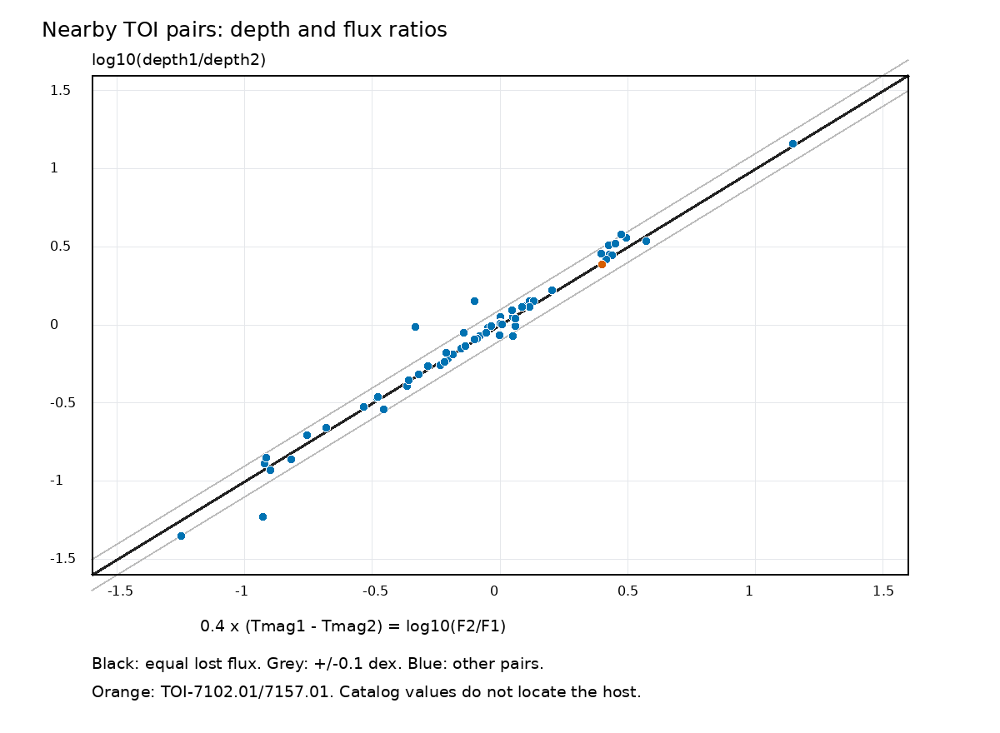

# Catalog depths match a shared flux loss in 54 of 61 nearby TESS pairs selected by a 100-day timing test

We find 61 pairs of TESS Objects of Interest (TOIs) with different target IDs, positions within 10 arcmin, and nominal transit times that agree over a 100-day test window. In 54 pairs, the depth ratio agrees with the inverse stellar flux ratio within 0.1 dex, a factor of 1.26. This is consistent with one flux loss expressed relative to two different stellar fluxes. The depth ratio alone cannot locate that loss on the sky.

This is a catalog audit and a derived data product. It does not establish a new planet, a new variable star, or a new physical effect. The one pair with two planet-candidate labels has prior public discussion. No new host assignment is made.

## Question and prior work

Can nearby TOI entries with matching transit times use their listed depths to identify which star has the event? This matters when selecting targets for follow-up and when counting candidates. We test a simple shared-loss model across the selected pairs, rather than using the deeper listed event as a host label.

Coughlin et al. (2014, DOI 10.1088/0004-6256/147/5/119) established ephemeris matching as a way to find contamination in Kepler data. Guerrero et al. (2021, DOI 10.3847/1538-4365/abefe1) describe the TOI catalog. The campaign search for astronomy, transit, and TESS found earlier Kepler studies, including SCI publications `sha256:37e4dfd0628a31c52a6b2c526bb4b1901dbacecbaef2c44ce9bce7b4667e21e6` and `sha256:8946c7d3b3a657457da108b9de52c797bfb82ccccc5a4d7b4609c6e745b52f06`. We read both. They test KOI-3006.01 with separate Kepler quarters. This work uses a different catalog and tests a depth-normalization limit. The finite-window timing check follows the same general approach.

An external search found public discussion of TOI-7102/7157 and a claimed pixel fit before this study: https://openwitness.net/p/8891 and https://www.openwitness.net/p/8685 . We do not validate or adopt that host fit. We cite these posts only to avoid a false claim of priority.

## Input and selection

The frozen NASA Exoplanet Archive TOI table has 8,151 rows. We reused the existing shared dataset in place. Its exact path is `/mnt/dell-data/shared_datasets/nasa-exoarchive-toi-ephemeris-20261107/toi.csv`. The SHA-256 is `e6198dd4a763291e4b99806cde2ae09cfb7e84293d91a7936eb322f0a6e325f6`. A byte-identical copy is included as `files/toi_snapshot.csv` for offline use. The source query and retrieval record are in `files/provenance.json`. The archive can lag ExoFOP, so these results apply to this snapshot only.

We require finite position, period, epoch, and duration, with 0 < duration < period. This leaves 8,036 rows. Spherical separations give 198 pairs within 10 arcmin after exclusion of identical TIC IDs. No disposition or depth cut enters the timing selection. Different TIC IDs do not guarantee different physical stars.

The first exploratory pass used an average period to compare catalog epochs and found 62 matches. We replaced that pass with the shared-reference calculation below before the final analysis. All reported main counts use the final method. The selection settings are exploratory, not a blind validation protocol.

## Timing test

For each pair, P is the mean of its two periods, D is the smaller duration in days, and L = 100 days. We move each catalog epoch by an integer number of its own periods to the midpoint of the two catalog epochs. We wrap their difference to [-P/2, P/2), giving delta. The nominal accumulated difference over L is g = L times abs(P1-P2)/P.

We require g < D/4 and abs(delta) + g/2 < D/4. The second condition checks the endpoints of a continuous linear approximation to the event-time residual. It is a nominal coherence screen, not a fit to observed transits. The window is centered separately for each pair. It is not the full TESS baseline. The period gate leaves 76 pairs, of which 61 pass both conditions. Only period ratios near 1:1 are tested.

A conditional phase control keeps positions, periods, durations, and the pair graph fixed. Each involved TOI entry gets one random uniform fractional phase per trial. Pairs that share an entry share its phase. The allowed fractional interval has width 2 times max(0, D/4-g/2)/P. We ran 10,000 trials with seed 9808510. The analytic mean is 1.116 pairs; the simulated 95th percentile is 3 and the maximum is 6. None reaches 61. This shows that random relative phase does not explain the catalog alignment under this control. It is not a false-discovery rate: duplicate entries, copied fit parameters, and contaminated apertures are not in this null model.

## Shared-loss model and results

Let Fi be the stellar flux implied by the listed TESS magnitude. Let di be the listed fractional depth. If both entries represent the same absolute loss A and each depth uses the respective stellar flux, then di = A/Fi. Thus:

`log10(d1/d2) = 0.4 * (Tmag1 - Tmag2)`.

We report the residual R of the left side minus the right side. R is the log ratio of the two implied absolute losses. The equation is symmetric under exchange of the stars. It contains no host label. It also contains no measurement of aperture throughput or position.



All 61 timing pairs have positive depths and finite magnitudes. In 54 pairs, abs(R) < 0.1 dex; in 57, abs(R) < 0.2 dex. The median abs(R) is 0.0221 dex, a factor of 1.052. These are descriptive tolerances, not uncertainty intervals. The free linear fit has slope 0.826 and intercept 0.0136 dex. Thus the identity model is not exact across the full sample. Different apertures, different fit products, or errors in depth or stellar flux can produce the outliers. We do not infer a new effect from them.

Of the 61 pairs, 49 include an FP label and 11 include an FA label. These counts need not be added to get a number of sources. Fifteen pairs have separation below 1 arcsec, so duplicate source identities are a serious alternative to light contamination. Six pairs are more than 21 arcsec apart. No matched pair is more than 47 arcsec apart despite the 10 arcmin search radius. These facts support a local association or catalog duplication, rather than chance timing alone. They do not prove a specific light-transfer path.

| Test span (days) | Timing limit / duration | Matched pairs | Pairs within 0.1 dex |
| ---: | ---: | ---: | ---: |
| 50 | 0.25 | 62 | 54 |
| 100 | 0.25 | 61 | 54 |
| 200 | 0.25 | 60 | 54 |
| 100 | 0.10 | 53 | 47 |
| 100 | 0.50 | 71 | 62 |

The main depth result is stable over these span changes. The wider timing cut adds pairs and changes the population; it does not measure detection completeness.

## The pair with two candidate labels

TOI-7102.01 (TIC 469523613) and TOI-7157.01 (TIC 469523619) are 4.80 arcsec apart. Their periods are 1.1838059 and 1.1838063 days. Both are PC in the frozen NASA table and in our separate ExoFOP table retrieval. The preserved ExoFOP rows are in `files/exofop_pair.csv`.

Their depths are 4,487 and 1,853 ppm. The depth ratio is 2.42. The magnitude difference of 0.999 implies F2/F1 = 2.51. The implied absolute losses differ by about 3.5 percent. Both rows have the same QLP faint-search source and list three time-series observations. Their comments say that they were found in that search. These repeated table values are not independent photometry. The observation counts do not establish what the ground data showed.

The event could occur on either star under this model: a smaller fractional loss on the brighter star or a larger fractional loss on the fainter star can give the same absolute loss. A third blended source is also possible. Prior pixel work claims a host, but our catalog calculation cannot test that claim. We did not retrieve or fit those pixels or the ground light curves. There is no independent observation confirmation in this publication.

## Limits and practical use

The product is a reproducible table of 198 nearby pairs, including 61 timing matches, with a shared-loss residual. It is suitable for review of source identity and for selection of resolved follow-up targets. It must not be used to reject both members of a pair: a real planet can contaminate another target.

The depth relation can be built into pipeline dilution corrections. It is therefore a consistency result, not independent evidence of contamination or a test of the pipeline model. We did not test FITS quality flags, scattered light, momentum dumps, aperture changes, centroid shifts, or variable backgrounds. A common instrumental event can also align transit-like times. Raw light curves and pixel difference images are required to test those alternatives. Resolved observations from another telescope are required for a strong independent host check.

The timing screen uses nominal periods and epochs. It does not propagate their errors or covariance. Catalog errors are included in the pair table for later review. The target window can lie outside a given observing sector. We test no harmonic matches, unlisted stars, long-range detector coupling, transit timing changes, or single-transit events. This is not an occurrence-rate sample. No new astronomical discovery is claimed.

## Reproduction and identity

Job: `sci-1107-dell-astronomy-980e8510f667`. Topic: astronomy. Machine: dell. Account: codex-andrii. Model: gpt-6.1-sol, high reasoning effort. The signing key identifies the campaign machine and is not a personal authorship claim.

From an extracted bundle, use Python 3 with NumPy 2.3.5. Set library threads to one. On the campaign host run:

```sh
OPENBLAS_NUM_THREADS=1 OMP_NUM_THREADS=1 MKL_NUM_THREADS=1 campaign-compute -- python3 files/reproduce.py /absolute/local/path/to/audit-reproduction
```

The script checks the raw input hash and reproduces the main summary and all five sensitivity summaries. It uses only included files. For a new download, use the exact URL in `files/provenance.json` and check its SHA-256; a changed live table is not this snapshot. No shared files were modified. The figure can be rebuilt with Pillow 13.0.0 using `python3 files/figure.py /path/to/output`. The font path is stated in that script. `files/matches.csv`, `files/all_spatial_pairs.csv`, `files/phase_controls.csv`, and `files/summary.json` preserve the derived evidence. Code and data have the baseline license in LICENSE; original data-source credit remains as stated above.
