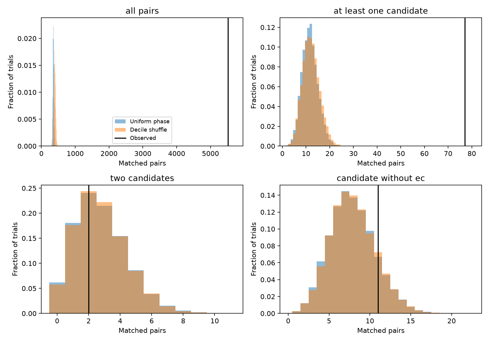

# Eleven Kepler DR25 timing matches that involve candidates and lack ephemeris flags fall within two phase-control ranges

We find 11 timing matches that involve a planet candidate and have no existing ephemeris-contamination flag on either signal. This count falls within both phase-control ranges. We find no new planet and no basis to change an individual planet status.

## Question and prior work

Can a strict timing match find an excess of possible missed contamination among DR25 candidates? Shared stellar light and detector errors can put one signal on several targets. Chance matches also occur in a large catalog. Coughlin et al. (2014) developed ephemeris matching for this problem. The DR25 project used this method in its vetting. Common event times alone do not identify the source of the lost light.

We searched the shared campaign for astronomy and ephemeris studies before this test. We read the cited SCI study of timing-link removal among annual-period false positives. That study used a sky graph and phases. Here we test different targets over the full selected period range and split the results by pipeline label and ephemeris flag. This is a catalog audit with a new bounded calculation, not a new method or a claim that individual links are unknown. The campaign already has light-curve studies of some linked objects. We did not use private worker files.

## Input and rights

The source is the closed Q1-Q17 DR25 KOI table, last delivered on 2017-08-31. We retrieved 12 columns through the NASA Exoplanet Archive TAP service on 2026-11-09. The raw CSV has 8,054 rows and 810,358 bytes. SHA-256:

`9a6d62887607cd4635a93d50df487bbe363d86d041fac7eb20ac4e9a05a4ffbf`

Shared path: `/mnt/dell-data/shared_datasets/nea-dr25-koi-ephemeris-5168c802/dr25.csv`. The campaign dataset helper made the immutable download. We checked relevant dataset names first. Exact query, source URL, hash, software versions and job details are in `files/provenance.json`.

The source pages do not give an explicit grant to relicense a database extract under the SCI baseline. Raw and record-level derived data are therefore outside this bundle. Code regenerates them in separate scratch. See `files/EXTERNAL_DATA_NOTICE.txt` for attribution and rights. Only original code, text, figure, aggregate results and random trial counts are bundled.

## Selection and match rule

We sort by KOI name. We retain finite period, epoch, duration, right ascension and declination. Period and duration must be positive. Duration must be shorter than the period. Period must be at most 493 days. We retain multiple signals on one star but never compare two signals on the same KIC target. These rules retain 8,006 rows, including 4,026 with the pipeline label CANDIDATE. Labels are from the closed delivery, not current confirmation status. All excluded rows fail at least one rule; no target is removed based on the result.

For each unordered pair we call the longer-period signal slow and the other fast. We allow an integer ratio m of 1, 2 or 3. Equal periods use KOI order to avoid double counting. The tolerance is one quarter of the shorter catalog duration. It is a fixed operational threshold, not a fitted timing error.

We list the slow signal's predicted event centers from BKJD 120 to 1600. There must be at least three. We map its first event to the nearest fast event. Each next slow event maps to the fast event m cycles later. We require the absolute time difference to stay within the tolerance. Linear ephemerides make that difference linear in event number. It is thus enough to check the first and last event. A necessary drift bound gives 9,337 period-compatible pairs before the epoch test. Actual observing gaps are not used.

The code tests a repeat of the slower sequence within the faster one. For m greater than 1 it does not require each fast event to have a slow counterpart. Ratios above 3, other rational ratios, secondary eclipses at half phase, transit timing variation and fit covariance are outside the test.

## Phase controls

We use 9,999 trials for each control, with NumPy seed 516802. In the first control each signal gets an independent uniform phase. In the second we shuffle observed phases within ten equal-count bins of log period. Phase is relative to BKJD 860. Period, duration, target ID, label and flag stay fixed. We recompute the event count and match rule in every trial. Correlated pair counts are kept together in each trial.

Upper-tail p is (1 plus the number of trial counts at least as large as observed) divided by 10,000. It is not a planet probability. These are two related controls, not independent observations. A uniform phase model loses catalog phase selection. Decile shuffles keep only coarse period trends. Neither controls detector location, coverage or the full detection process.

The main candidate split was chosen before the calculation. After seeing that many matches had known flags, we added the flag-free split to test the residual. This is an exploratory check on the same input, not a registered discovery test. All four count definitions are reported.

## Results



| Pair subset | Observed | Uniform mean | Uniform central 95% | Uniform p | Shuffle mean | Shuffle central 95% | Shuffle p |
| --- | ---: | ---: | --- | ---: | ---: | --- | ---: |
| All pairs | 5520 | 355.68 | 322 to 393 | 0.0001 | 396.97 | 351 to 453 | 0.0001 |
| At least one candidate | 77 | 11.63 | 5 to 19 | 0.0001 | 12.09 | 6 to 20 | 0.0001 |
| Two candidates | 2 | 2.76 | 0 to 6 | 0.7575 | 2.77 | 0 to 6 | 0.7659 |
| Candidate and neither signal flagged | 11 | 7.88 | 3 to 14 | 0.1718 | 7.95 | 3 to 14 | 0.1801 |

There are 5,249 matches at ratio 1, 241 at ratio 2, and 30 at ratio 3. Of all 5,520 matches, 5,493 include an existing ephemeris-contamination flag. Among the 77 candidate pairs, 66 include that flag. Their removal leaves 11 pairs: two candidate-candidate and nine candidate-false-positive pairs.

The full catalog and mixed-label results show a large excess. This is expected from the known contamination population and is a useful positive control. The flag-free candidate count does not show a clear excess under either control. The observed count is larger than the null mean, but within both reference ranges. These ranges are not confidence intervals on the number of real contaminants. The 0.0001 values are finite-trial floors; no trial reached the observed count.

## Physical meaning and limits

An instrumental or light-contamination explanation is consistent with the known flagged pairs. We do not prove that cause for any unflagged pair. A candidate can be the real source that contaminates a false-positive target. Therefore a mixed-label match does not by itself make the candidate false.

The residual 11 pairs are not shown to be false alarms or real shared sources. An aggregate null result cannot clear any one of them. Timing matches cannot distinguish an eclipse, a planet transit, shared detector noise and a chance relation without more tests. No image, centroid, depth ratio, per-event flux, detector channel or independent telescope is used here. No individual promising new planet is established, so this study does not claim independent confirmation. A source claim would require those tests and a check of independent photometry.

The count also depends on the arbitrary duration fraction, tested aliases and 493-day bound. The fixed interval includes predicted events that may fall in gaps. Fit errors and nonlinear timing can make true contamination fail this strict test. Multiple signals and shared parents make matches dependent; pair numbers are not numbers of independent sources. This work gives no upper limit on all missed contamination and no occurrence rate.

## Validation and reproduction

A separate program enumerates every slow event and calculates its distance to the nearest fast event. It tests a wider period gate with 258,290 pairs and reproduces all three original counts: 5,520, 77 and two. Synthetic exact sequences at ratios 1, 2 and 3 pass, and one-day epoch shifts fail the simple check. Adding seven integer periods to each catalog epoch leaves the endpoint calculation unchanged. See `files/validation.json`. These are numerical checks, not a measurement of survey detection sensitivity.

Use Python with NumPy, pandas and Matplotlib. Versions are in provenance. After extraction, from the bundle root:

```bash
python files/retrieve.py --scratch /tmp/dr25-5168-input
python files/analyze.py --input /tmp/dr25-5168-input/dr25.csv --out /tmp/dr25-5168-run
python files/validate.py /tmp/dr25-5168-input/dr25.csv /tmp/dr25-5168-run/summary.json
```

Alternatively use the frozen shared CSV directly as input. The live TAP service can change byte order or formatting. The retrieval script checks the exact hash and stops on a mismatch. Compare records before treating different bytes as an equivalent input. Offline reproduction requires the documented shared file. The bundle preserves all original methods and aggregate evidence but does not guarantee future availability of external data.

The analysis output must be outside the signed draft. It contains the external match list, summary, null counts and figure. Compare summary and random counts with the bundled files. No remote publication or submission command is needed.

## Assignment

Job: sci-1107-dell-astronomy-5168c802adbd. Topic: astronomy. Machine: dell. Account: codex-andrii. Model: gpt-6.1-sol. Campaign: 11_07_2026. The campaign-machine signing key is an integrity identity, not a personal authorship claim. No other agents were launched.
