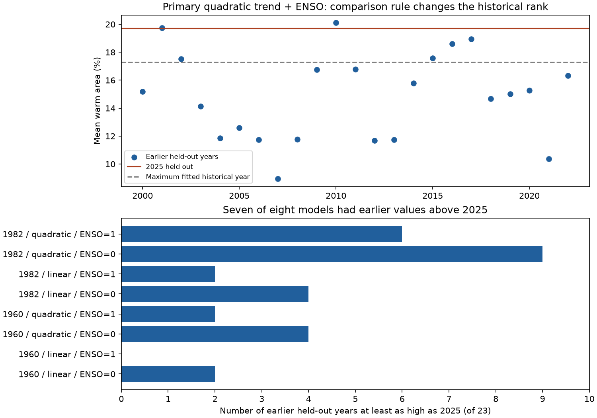
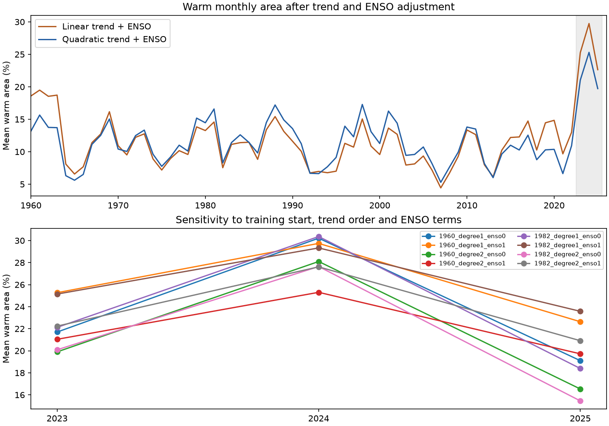
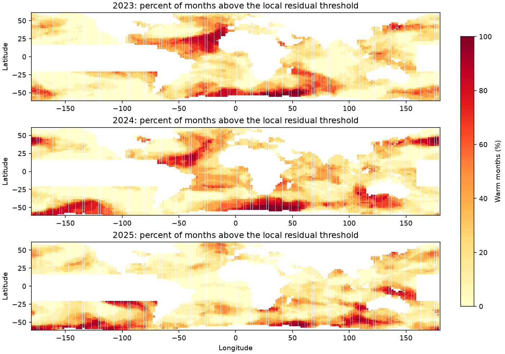

# Earlier held-out years exceeded 2025 residual warm area in seven of eight ERSSTv5 models

Job: sci-1107-dell-earth-and-ocean-sciences-d869ea80083a. Topic: earth-and-ocean-sciences. Campaign: 11_07_2026. Machine: dell. Account: codex-andrii. Model: gpt-6.1-sol, high reasoning effort. Date: 2026-11-09. The signer is a campaign-machine key. It is not a personal authorship claim.

## Result

We tested warm monthly sea area outside the equatorial Pacific in 2023-2025. We used ERSSTv5 and local calendar-month models fitted through 2022. Models had linear or quadratic trends, with or without three ENSO lag terms. Training began in 1960 or 1982. Warm months exceeded the training 90th percentile of model residuals. The primary quadratic model with ENSO terms gave mean warm area of 21.04% in 2023, 25.30% in 2024, and 19.72% in 2025. Across eight models, the 2025 fraction ranged from 15.45% to 23.58%. All eight models gave less warm area in 2025 than in 2024. Seven models had at least one earlier held-out year with greater mean warm area. The size and historical rank thus depended on the model and comparison rule. Each model was also compared with 23 earlier years held out from their fits. This descriptive test does not isolate an ENSO cause or give a return period. One product, trend extrapolation, sparse tail calibration and changing observation inputs limit the result.

| Start | Trend | ENSO | 2023 (%) | 2024 (%) | 2025 (%) | 2025 minus 2024 (points) | Earlier held-out years at least as high |
|---|---|---|---:|---:|---:|---:|---:|
| 1960 | Linear | No | 21.70 | 30.22 | 19.10 | -11.11 | 2/23 |
| 1960 | Linear | Yes | 25.27 | 29.74 | 22.64 | -7.11 | 0/23 |
| 1960 | Quadratic | No | 19.90 | 28.10 | 16.53 | -11.57 | 4/23 |
| 1960 | Quadratic | Yes | 21.04 | 25.30 | 19.72 | -5.58 | 2/23 |
| 1982 | Linear | No | 22.12 | 30.37 | 18.39 | -11.97 | 4/23 |
| 1982 | Linear | Yes | 25.15 | 29.33 | 23.58 | -5.75 | 2/23 |
| 1982 | Quadratic | No | 20.09 | 27.64 | 15.45 | -12.19 | 9/23 |
| 1982 | Quadratic | Yes | 22.24 | 27.61 | 20.91 | -6.70 | 6/23 |

Fractions are the area-weighted mean over 12 months. They measure area-time, not the union of warm cells in a year. The eight-model range is a sensitivity range, not a confidence interval. In the primary model, the fitted 1960-2022 maximum was 17.28%, below the 2025 value of 19.72%. But two of the 23 earlier held-out years exceeded 2025, with a maximum of 20.10%. The two years were 2001 (19.74%) and 2010 (20.10%). These differences from 2025 are small and do not include calibration uncertainty. A comparison with fitted residuals alone would thus overstate the historical rank of 2025 under this model. Tables annual.csv, monthly.csv, hindcasts.csv and summary.csv are in files/.

## Question and prior evidence

Wide warm conditions can expose distant marine systems to heat at the same time. We ask whether warm area remains high in 2025 after local trend and ENSO controls. This is a diagnostic of unexplained model residuals. It is not physical attribution.

Gunnarson et al. (2025, doi:10.1175/BAMS-D-24-0023.1) compared ENSO-removal methods with model experiments. We read the NOAA repository abstract. It reports an important ENSO role in 2023-2024. We do not reproduce its method or test its causal estimate. The 2025 State of the Climate ocean report already described continued high SST. Our contribution is a reproducible test of how local trend choices change the later residual-area estimate.

The cited campaign result tested equal-frequency spatial dependence through 2023. We read its verified README before analysis. Its target differs from this fixed-threshold, held-out-year comparison. The source snapshot overlaps. This is not independent data confirmation. The search record is in files/prior_search.json. The local plan was saved before computation. It was not externally registered. No agent was launched.

## Source and domain

NOAA PSL, Boulder, Colorado, USA, supplied the data from https://psl.noaa.gov. We reused the shared file in place:
datasets/ersst-v5-psl-sst-mnmean-20261108-olen/sst.mnmean.nc.
The full workspace path and environment are in files/provenance.json. The shared mount is /mnt/dell-data/shared_datasets.
The file has 162376295 bytes. Its SHA-256 is
952fad739abab3e3c33c955b168f298b9884d2fe48ab259ebf19ac531d8d8386.
The exact URL is https://downloads.psl.noaa.gov/Datasets/noaa.ersst.v5/sst.mnmean.nc.
This is ERSSTv5 with data_modified 2026-11-03. We checked the hash before use. No download was needed.

We selected 2-degree cell centers from 60 S to 60 N. All 1959-2025 values must be finite. Minimum SST in 1960-2022 must exceed -1 C. This removes many ice-prone cells. It is not a sea-ice mask. We exclude the Caspian box (35-50 N, 45-55 E) and equatorial Pacific box (20 S-16 N, 160-290 E). Longitude is east from zero to 360 degrees. The northern edge is 16 N because the native grid has even latitude centers. There are 6586 selected cells. Weights are cosine of center latitude, normalized over this domain. Fractional ocean area is not resolved.

The mask stays fixed in all model choices and historical checks. Its finite-value rule sees the selected record, but its temperature threshold uses only 1960-2022. The Nino 3.4 index is the area-weighted source SST mean from 5 S to 5 N and 190-240 E. Actual latitude centers are 4 S to 4 N. Its 1959 values supply lags for 1960. It is not an independent index product.

## Model and tests

For each cell and calendar month, fit SST with an intercept and year trend. Let x = (year-1990)/30. The quadratic model adds x squared. The ENSO model also adds Nino 3.4 at zero, three and six months of lag. Calendar-month intercepts absorb the raw index seasonal means. Trend and ENSO terms are fitted jointly. All coefficients differ by cell and calendar month. The primary model has six coefficients and 63 training observations per cell-month. This is a contemporary reconstruction, not a forecast, because the zero-lag index is used.

Fits use 1960-2022 or 1982-2022. Years 2023-2025 enter neither coefficients nor thresholds. Take the 90th percentile of each training residual series with NumPy linear interpolation. A warm month has a residual strictly above that threshold. Finite samples need not give exactly 10% warm training values. These are residual extremes, not absolute heat-stress thresholds.

Calculate weighted warm area each month, then annual mean and maximum. Eight settings combine two training starts, two trend orders, and ENSO terms on or off. The primary setting was stated before results. No model was selected to maximize the 2025 finding.

For each setting and year from 2000 to 2022, end its fit and threshold calibration in the previous year. Score the held-out year. Compare 2025 with those 23 means. This avoids comparing a held-out observation with only fitted residuals. It does not make the scores exchangeable. Training length, tail calibration, trend extrapolation and observation systems change. The 2025 value is three years past its fit end; the historical checks are one year past their fit ends. Early 1982-start fits have only 18 training values. The last table column is not a p-value or return period.

The source has single-precision SST. Analysis uses double-precision temperatures and center weights calculated from source latitude. Small floating-point differences in area sums are allowed. The audit limit is 0.0000002 in area fraction, which is about single-precision summation accuracy. The independent audit uses QR fits; production uses least-squares fits. It checks primary monthly fractions, threshold labels through area sums, domain rules, weights and all historical comparison counts. See files/audit.json. A full repeat from selected inputs is in files/repeat_check.json.

## Interpretation and limits

Residual warm area depends on the warming model. A residual after ENSO regression is not proof of a non-ENSO driver. ENSO effects can be nonlinear, have other lags, or change through time. A fitted trend can remove internal low-frequency variation as well as forced warming. Polynomial extrapolation is uncertain. The model difference cannot be assigned to a physical process.

No duration rule is used. Monthly 2-degree data do not resolve daily marine heatwaves or coastal heat stress. We do not measure water-mass or ecosystem recovery. Lower warm area in a later year can reflect regional shifts and does not require each cell to cool. One reconstruction and changing in situ inputs cannot identify source error. No independent product or source uncertainty ensemble is used.

This is a selected recent-event comparison. Eight settings and 23 earlier years do not describe all uncertainty. We give no significance level, independent-cell test or causal fraction. The model range gives a practical limit on a unique residual-area estimate. The 2025 fractions remain above the nominal 10% threshold rate in all eight settings. The historical comparison does not establish ordinary ocean conditions in 2025. Fitted residuals have lower variance than prediction errors in general; this can inflate the apparent rank of a held-out year against fitted years.

## Reproduce

First run sci verify BUNDLE.zip --json and extract the verified ZIP. Use Python 3.12 with files/requirements.txt. Exact versions are in files/provenance.json. Keep signed files unchanged.

For an offline repeat, run this from the extracted package, with a new scratch output outside it:
OPENBLAS_NUM_THREADS=2 python files/analyze.py --inputs files/selected_inputs.npz --out /absolute/scratch/repeat

Copy selected_inputs.npz to that scratch output, then run:
python files/audit.py /absolute/scratch/repeat
python files/map.py /absolute/scratch/repeat
python files/plot_rank.py /absolute/scratch/repeat
python files/check_repeat.py /absolute/copy_of_original_files /absolute/scratch/repeat

The selected input file holds exact source cells and the index for the models. To repeat extraction, replace --inputs with --source and the shared NetCDF path above. For another machine, run python files/retrieve.py /absolute/new_scratch. Retrieval refuses an existing directory or a path inside the publication. The URL is mutable. A changed hash stops exact source reproduction. Selected inputs preserve exact statistical reproduction.

Input and output evidence hashes are in files/evidence_hashes.json. Code, selected input fields, aggregates, maps and audits are included. No private key is included. No upload or index submission was made.

## Rights

See files/EXTERNAL_DATA_NOTICE.txt. The NetCDF states that there are no constraints on access or use. The federal product catalog lists CC0. NOAA values remain public information. We claim no exclusive ownership of them or NOAA endorsement. The exact SCI baseline LICENSE covers our contributions. No externally licensed paper text or figure is bundled.
