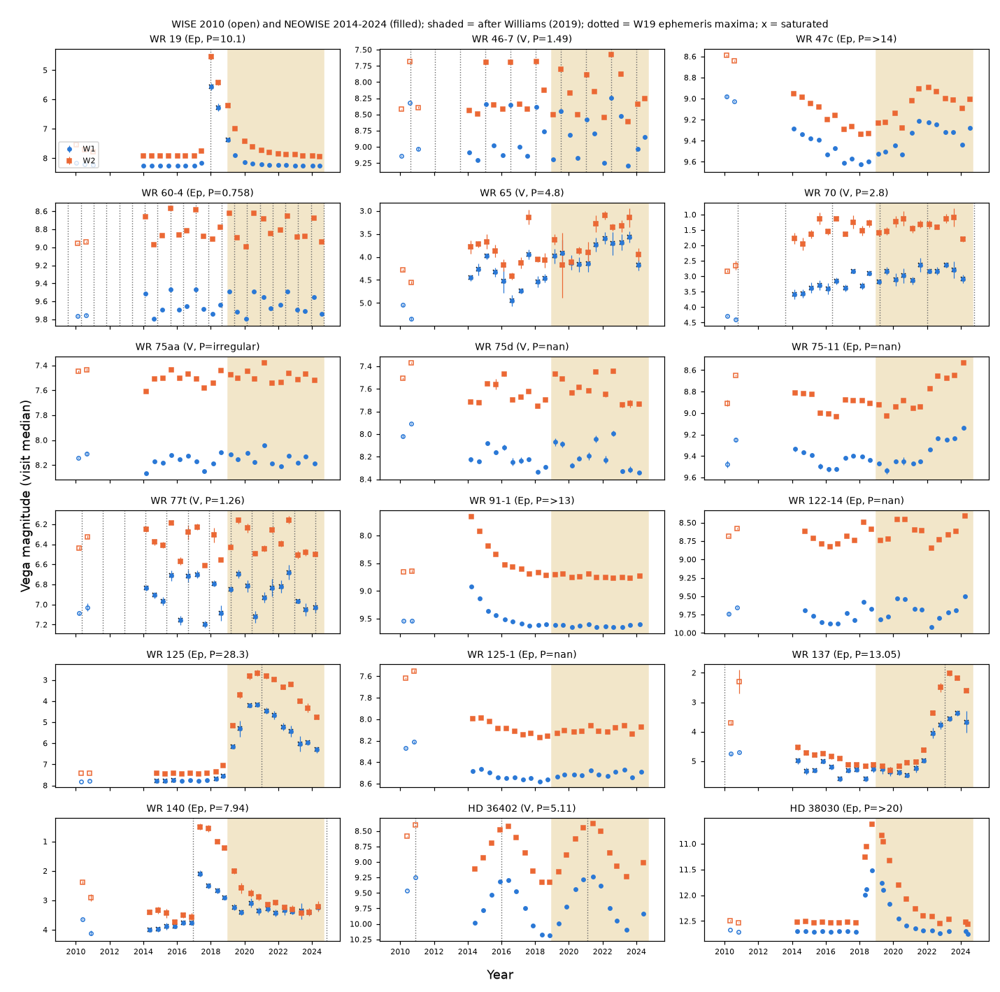
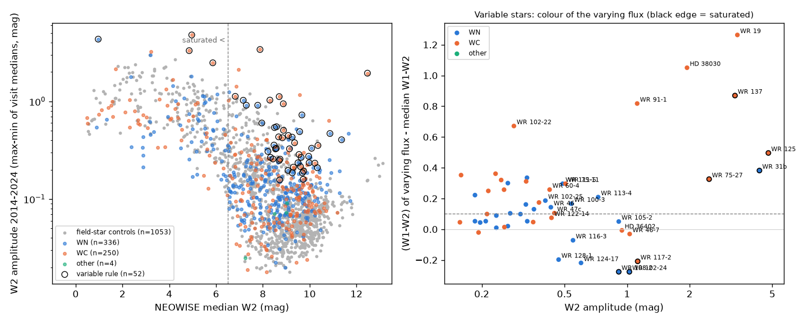
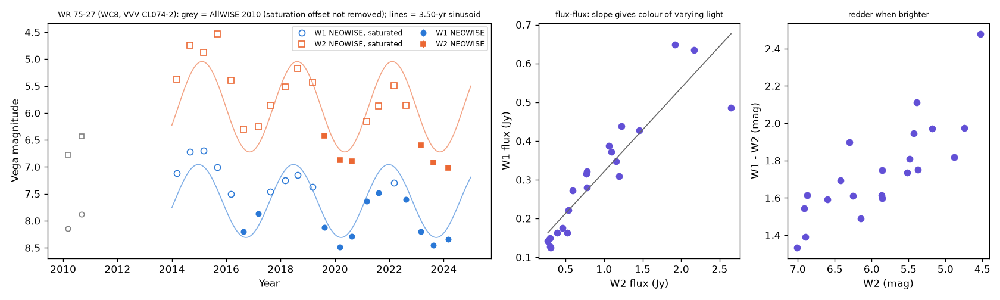

# NEOWISE 2014-2024 infrared light curves of Galactic Wolf-Rayet stars: a forward test of the Williams (2019) dust-maker results and a blind search for new dust variables

Job sci-1107-dell-astronomy-1f3b22c5b195. Topic: astronomy. Machine: dell. Model: Claude Opus 5.5 (claude-opus-5-5). The signing key is a campaign-machine key. It is not a personal authorship claim.

## Summary

Wolf-Rayet (WR) stars of the carbon sequence (WC) make dust in colliding-wind binaries. In eccentric orbits, the dust forms near periastron, so the 3-5 um flux rises and then falls once per orbit. Williams (2019, MNRAS 488, 1282) used NEOWISE data from 2014 to 2018 for 128 WC stars. He gave dates of dust maxima and periods for about 20 dust-variable stars. NEOWISE continued until August 2024. The 2019-2024 data are therefore a forward test of his results. We also searched all 718 stars of the Galactic WR catalogue v1.36 (Crowther; WN and WC stars) for new infrared variables. We used magnitude-matched field stars as an empirical null.

Main results:

1. **Dated predictions held.** WR 125 had its brightest 2019-2024 W2 visit at 2020.75 (prediction 2021.0). WR 137 had it at 2023.35 (prediction 2023.05). HD 36402 (LMC) had it at 2021.41 (prediction 2021.13). WR 19, WR 91-1 and HD 38030 faded after their episodes and did not brighten again (at most 0.003, 0.07 and 0.08 mag). The difference between predicted and observed maxima is at most 0.30 yr, which is less than one NEOWISE visit interval (0.5 yr).
2. **Two of the four short periods held.** A light-curve template from the 2014-2018 data predicts the 2019-2024 visits of HD 36402 (P = 5.11 yr; Spearman rho = 0.96, p = 1e-4, R2 = 0.91) and WR 46-7 (P = 1.49 yr; rho = 0.68, p = 0.01, R2 = 0.31). The refitted periods are 4.99 +- 0.01 yr and 1.494 yr (68 percent bootstrap range 1.494-1.554 yr). The 0.758-yr period of WR 60-4 failed (rho = -0.36, R2 = -0.55); the data give 0.700 yr or its cadence alias 1.75 yr. The tests for WR 77t (1.26 yr) and WR 70 (2.8 yr) also failed, but their W2 photometry is saturated, so these failures are not decisive.
3. **New dust episodes in two known episodic dust makers.** WR 47c brightened by 0.40 mag in W2 from 2018 to a maximum near 2022.1, and it faded after that. Its earlier broad maximum was in 2005-2010, so the interval is 12-17 yr. WR 75-11 brightened by 0.47 mag from 2021.6 to 2024.2 and was still rising when NEOWISE stopped. Its previous maximum was in 2010.7, so the interval is at least 13.5 yr. In both stars the varying flux is redder than the mean flux, as new hot dust requires.
4. **A 3.5-year infrared cycle in the WC8 star WR 75-27 (VVV CL074-2).** This star is not among the Williams variables. Its W2 brightness changes by 2.5 mag and W1 by 1.8 mag. There are maxima near 2015.5, 2018.6 and 2022.2 and minima near 2016.9, 2020.4 and 2023.9. The best period is 3.50 yr (bootstrap 3.25-3.55 yr), but the cycle is not strictly periodic. The star is redder when it is brighter. The varying flux has W1-W2 = 2.06 mag, equivalent to a 500-650 K blackbody for A_Ks = 0-3. 2MASS and GLIMPSE sources are within 0.2 arcsec of the WR position. The most probable explanation is periodic dust formation in an eccentric WC8+OB binary with P near 3.5 yr. A blended dusty AGB star within about 1 arcsec is not excluded. If the cycle continues, the next maxima are near 2025.7 and 2029.2 (+- 0.4 yr).
5. **Blind survey.** 590 targets (588 Galactic WR stars and the 2 LMC stars) have at least 10 NEOWISE visits (416 unsaturated, 174 saturated). 45 unsaturated and 7 saturated stars pass the variability rule. Field stars at W2 = 6.5-9 mag pass at a similar rate, because many of them are variable giants. WR stars fainter than W2 = 9 pass more often (25 of 183) than field stars (16 of 404). The WR-specific signal is the colour of the variation: 9 unsaturated WR stars show coherent multi-year changes that are redder when brighter, against 4.3 expected from magnitude-matched field stars (Poisson p = 0.031). New candidates in this class are WR 75-9, WR 76-1, WR 111-11 and WR 111-5. Local field stars in the same frames do not share these changes.
6. **Saturation calibration.** For field stars brighter than W2 = 6.5 mag, the NEOWISE visit-to-visit error floor is 0.10-0.43 mag, and AllWISE (2010) is fainter than NEOWISE by up to 1.4 mag. Thus 2010-to-2014 comparisons of bright WR stars are not valid without this correction. The apparent brightening of WR 31b (AG Car) is mostly this effect.

## Data

- **Target list.** Galactic Wolf-Rayet Catalogue v1.36 (Sept 2026, 718 stars), P. A. Crowther, http://pacrowther.staff.shef.ac.uk/WRcat/index.php, retrieved 2026-11-12, HTML sha256 65599ef1b80a66330f3e49bb1fc53ce88837dfee6f13c872417815d481e41eb4. We added the LMC stars HD 36402 (81.516388, -67.499182) and HD 38030 (84.214056, -69.432385) from the CDS Sesame resolver. The catalogue is not in the bundle (see `files/NOTICE-external-data.md`). `files/data/wr_ids.csv` maps our internal identifiers to WR designations.
- **WISE photometry.** IRSA Gator multi-object upload. NEOWISE-R single-exposure source table (`neowiser_p1bs_psd`, 2013-12 to 2024-08) and AllWISE multi-epoch photometry (`allwise_p3as_mep`, 2010-2011), with a 4 arcsec upload radius for the targets and 2.5 arcsec for the controls. AllWISE source catalogue (`allwise_p3as_psd`) within 150 arcsec of each target and in two IRSA TAP strips for the control pool. All retrievals were made on 2026-11-12. The SHA-256 values of all raw tables are in `files/provenance/raw_inputs_sha256.txt`. The raw tables are not in the bundle because of their size (about 230 MB). `files/code/run_all.sh` downloads them again into a separate scratch folder.
- **Williams (2019) Table 19.** Periods and dates of maxima, typed from the paper into `files/data/williams2019_table19.csv` with the test that we applied to each star.
- The shared campaign dataset store had no WR or NEOWISE data for these stars. We did not add data to it.

## Method

1. **Visits** (`03_visits.py`). For each target and each WISE frame we kept the nearest detection within 2.5 arcsec. We removed frames with qual_frame = 0, qi_fact = 0 or saa_sep <= 0, and band values in moon-masked frames. Exposures separated by more than 20 days are different visits (about every 6 months). The visit value is the median magnitude. Its error is the larger of 1.253 x 1.4826 x MAD and the median catalogue error, divided by the square root of the number of exposures.
2. **Controls** (`04_controls.py`, `04b_controls_pool.py`). For each target with an AllWISE match we selected two isolated field stars (nb = 1, ext_flg = 0, cc_flags = 0000, ph_qual AA, no other AllWISE source within 8 arcsec). Their W2 is within 0.5 mag and W1 within 1.0 mag of the target. We first took stars in the 150 arcsec fields, and then stars from two Galactic-plane strips (W2 within 0.75 mag, W1 within 1.5 mag). This gave 1,058 controls for 533 targets.
3. **Noise model** (`05_noise.py`). In bins of median magnitude, the error floor is the median over controls of sqrt(rms^2 - mean error^2). We also measured the AllWISE-minus-NEOWISE offset and the control amplitude distribution (`files/data/ctrl_noise.csv`).
4. **Per-star statistics** (`06_targets.py`), from the NEOWISE visits only. They are: amplitude (max - min of visit medians); reduced chi-square with the error floor; amplitude and chi-square after we remove the most deviant visit; the von Neumann ratio eta (mean squared successive difference / variance; about 2 for white noise, about 4 for alternating seasonal offsets, below 1 for slow coherent change); the colour of the varying flux from a Theil-Sen fit of W1 flux against W2 flux; and a centroid test (correlation of the visit position offset with the W2 flux).
5. **Classes** (`09_survey.py`). The variability rule is W2 chi2 >= 10, W2 amplitude >= 0.15 mag and W1 chi2 >= 5. Variable stars are then put in this order of classes: single-visit (the rule fails without the most deviant visit); centroid-blend (|r| >= 0.6 and |slope| >= 0.3 arcsec per unit fractional flux); alternating (eta >= 2.8); coherent-red (eta < 1.2, varying-flux colour at least 0.10 mag redder than the median colour, flux-flux r >= 0.8); coherent-other (eta < 1.2); and irregular. Tier A stars have a median saturated-pixel fraction <= 0.05 in both bands. Tier B stars are saturated. We applied the same rules to the controls.
6. **Forward test** (`07_williams_forward.py`, `14_periods.py`). For periodic stars, we did three tests: (a) the Williams ephemeris (last listed maximum and period) gives a phase for each 2019-2024 visit, and we computed the Spearman rho between cos(2 pi phase) and the W2 brightness; (b) a non-parametric template from the 2014-2018 visits, folded at the Williams period, predicts the 2019-2024 visits (Spearman rho with a permutation p-value, and R2 relative to the 2014-2018 mean); (c) a sinusoid fit to 2014-2018 only. The periods were refined by phase-dispersion minimisation with 300 bootstrap resamples. The `eph_t0` column of `res_williams_forward.csv` is the last listed maximum. For episodic stars we compared the year of the brightest 2019-2024 visit with the predicted maximum, or we tested for a new rise after the fade.
7. **Shared systematics** (`12_local_fields.py`, `13_local_test.py`). For each of the 49 variables we took up to 5 isolated field stars within 150 arcsec. They have W2 near that of the target and are in the same frames. Their median deviation series is the local trend. Local trends have a median amplitude of 0.06 mag (maximum 0.18 mag; median rms 0.015 mag). If we subtract the local trend, the target amplitudes change by at most 0.10 mag. No candidate is a shared-frame effect. In particular, no shared 2023-2024 rise occurs near WR 75-9 and WR 75-11, which are 0.6 deg apart.

## Results

### Forward test of Williams (2019)

| Star | Williams (2019) | Test | 2019-2024 NEOWISE result | Verdict |
| --- | --- | --- | --- | --- |
| WR 19 | Ep, P 10.1 yr, maximum 2018 | fade, no new rise | faded to the pre-episode level (W2 7.93 in 2024 vs 7.92 before), largest re-brightening 0.003 mag | pass |
| WR 46-7 | V, P 1.49 yr | template from 2014-2018 | rho 0.68, p = 0.010, R2 0.31; PDM 1.494 yr | pass |
| WR 47c | Ep, P > 14 yr, broad maximum 2005-2010 | report | new rise, W2 maximum 2022.1, +0.40 mag; interval 12-17 yr | new episode |
| WR 60-4 | Ep, P 0.758 yr | template | rho -0.36, p = 0.89, R2 -0.55; PDM 0.700 yr or alias 1.75 yr | fail |
| WR 65 | V, P about 4.8 yr | period search | saturated W2 (floor about 0.1-0.3 mag); Lomb-Scargle peak at the 12-yr search limit | not decisive |
| WR 70 | V, P 2.8 yr? | ephemeris/template | rho -0.52, saturated | not decisive |
| WR 75aa, WR 75d | V | report | low-amplitude changes continue (0.23, 0.31 mag) | consistent |
| WR 75-11 | Ep, maximum 2010.67 | report | rise of 0.47 mag from 2021.6 to 2024.2, still rising | new episode |
| WR 77t | V, P 1.26 yr | template | rho -0.13, saturated W2 | not decisive |
| WR 91-1 | Ep, maximum 2014.2, P > 13 yr | no new episode | largest 2019-2024 rise above the faint level 0.07 mag | pass |
| WR 122-14 | Ep, maxima 2010.75, 2018.26 | 7.5-yr spacing gives the next maximum near 2025.8 | brightenings 2020.3-2020.7 and 2024.3 (+0.38 mag) | spacing not periodic at 7.5 yr |
| WR 125 | Ep, P about 28.3 yr, previous maximum 1992.7 | maximum near 2021.0 | brightest W2 visit 2020.75, +4.8 mag (saturated) | pass |
| WR 125-1 | Ep, maximum 2010.80 | report | no new episode (0.09 mag) | consistent |
| WR 137 | Ep, P 13.05 yr, maximum 2010 | maximum near 2023.05 | brightest visit 2023.35, +3.2 mag (saturated) | pass |
| WR 140 | Ep, P 7.94 yr | maxima 2016.9 and 2024.9 | peak 2017.4 (already in the Williams data); 2024.9 is after the end of NEOWISE | not testable |
| HD 36402 | V, P 5.11 yr | next maximum near 2021.13 | brightest visit 2021.41; template rho 0.96, p = 1e-4, R2 0.91; PDM 4.99 +- 0.01 yr | pass |
| HD 38030 | Ep 2018, P > 20 yr | fade, no repeat | faded by 2022, largest re-brightening 0.08 mag | pass |
| WR 48a, WR 98a, WR 112 | V | | no usable NEOWISE photometry (too bright) | not testable |

### Blind survey

Counts of classes (WR stars and field-star controls; `files/data/res_class_counts.csv`):

| Tier | Class | WR | Controls |
| --- | --- | --- | --- |
| A (unsaturated) | constant | 371 | 648 |
| A | coherent-red | 9 | 8 |
| A | coherent-other | 7 | 13 |
| A | irregular | 16 | 25 |
| A | single-visit | 10 | 6 |
| A | alternating | 2 | 7 |
| A | centroid-blend | 1 | 1 |
| B (saturated) | constant | 167 | 329 |
| B | coherent-red | 4 | 0 |
| B | alternating | 3 | 13 |
| B | other variable classes | 0 | 8 |

The magnitude distributions of WR stars and controls are different. In seven W2 bins from 6.5 to 15 mag, the control rate of coherent-red changes predicts 4.3 such WR stars in tier A. We observed 9 (Poisson p = 0.031). Five of the nine are known episodic dust makers (WR 19, WR 47c, WR 75-11, WR 91-1, HD 38030). In tier B, the 4 coherent-red stars are WR 125, WR 137, WR 75-27 and WR 31b (AG Car), and the controls have none.

New candidates (not in Williams 2019 Table 19; light curves in Figure 4; values from `files/data/res_survey.csv`):

| Star | Type | Class | W2 (mag) | W2 amplitude | dcol | Note |
| --- | --- | --- | --- | --- | --- | --- |
| WR 75-27 | WC8 | coherent-red (saturated) | 5.86 | 2.48 | +0.33 | 3.5-yr cycle, see below |
| WR 75-9 | WC9+late / WC8-9d? | coherent-red | 9.36 | 0.38 | +0.17 | rise in 2023-2024 |
| WR 76-1 | WN9 | coherent-red | 8.48 | 0.36 | +0.13 | slow brightening 2016-2024 |
| WR 111-11 | WN8 | coherent-red | 8.54 | 0.33 | +0.16 | small step up near 2018 |
| WR 111-5 | WN9 | coherent-red | 9.57 | 0.49 | +0.30 | AllWISE match at 0.93 arcsec; only one local field star |
| WR 105-2 | WN8-9 | coherent-other | 7.78 | 0.91 | +0.05 | rise 2014-2018, drop 2019, rise 2023-2024 |
| WR 102-23 | WC7: | coherent-other | 10.35 | 0.35 | +0.05 | slow fade |
| WR 122-6 | WC8: | coherent-other | 9.74 | 0.19 | -0.02 | 4-yr bright plateau 2016-2020 |
| WR 48-12, WR 127 | WN9h, WN3b+O9.5V | coherent-other | 8.3, 8.2 | 0.27, 0.31 | ~0 | small slow changes |

dcol is the W1-W2 colour of the varying flux minus the median W1-W2. Fourteen further stars are in the irregular class (WR 44, WR 46, WR 52-1, WR 58, WR 60-8, WR 61-3, WR 84-5, WR 100-3, WR 102-25, WR 116-3, WR 118-8, WR 123-7, WR 124-13, WR 128-1). Our confidence in these is lower. WR 46 is a known short-period optical variable. WR 116-3 (WN6ha) changes by 0.55 mag with a varying flux that is not red.

### WR 75-27

WR 75-27 (VVV CL074-2; WC8 in the catalogue; 16:32:05.27 -47:49:14.3) has 2MASS K = 10.46 and GLIMPSE [3.6] = 7.17, [5.8] = 5.56 and [8.0] = 5.19 mag. Both sources are within 0.2 arcsec of the WR position. The AllWISE source (W1 8.02, W2 6.61) is 0.26 arcsec away. Thus the infrared excess is very large (K - W2 of about 3-5 mag). The NEOWISE W2 values at maximum are saturated, but the change is 2.5 mag, more than 1.6 times the 99th percentile of saturated field stars of the same brightness (1.16-1.45 mag). The faint states in 2020 and 2023-2024 are not saturated. The changes are coherent (eta = 0.50) and occur in W1 and W2 together. Thus they are not the alternating artifact of saturated stars.

The cycle (maxima near 2015.5, 2018.6, 2022.2) is like the dust cycles of WR 98a (1.5 yr), WR 70 (2.8 yr) and HD 36402 (5 yr). The rise and the fall each take about 1.4-1.8 yr. This is different from the fast rise and slow fall of WR 140. The varying flux is cool (500-650 K if A_Ks = 0-3). These properties are possible for a dust maker that does not lose its dust fast. They are also possible for a pulsating, dust-enshrouded AGB (OH/IR) star with a period of about 1,280 days. Such a star would have to be within about 1 arcsec of the WR star, because of the 2MASS, GLIMPSE and WISE positions. The tests that can decide are: (a) K-band spectra at maximum and minimum (WC8 line dilution with dust, or AGB absorption bands); (b) VVV/VVVX Ks light curves from 2010 to 2023, which must show the same cycle; (c) an OH maser search; (d) SPHEREx 2025-2026 spectra. If the dust explanation is correct, the 3-5 um flux will be near a maximum in late 2025.

## Limitations

- WISE resolution is about 6 arcsec. 179 of the 718 catalogue stars have no AllWISE source within 2.5 arcsec, mostly in crowded inner-Galaxy clusters, and 86 of the 676 targets with NEOWISE detections have fewer than 10 visits. Thus the survey is not complete for the inner Galaxy, the Galactic-centre clusters and Westerlund 1. The centroid test does not detect blends closer than about 1 arcsec.
- Saturated stars (W2 < 6.5) have error floors of 0.1-0.4 mag. For these stars, only large and coherent changes are reliable. Short-period tests of WR 65, WR 70, WR 77t, WR 98a and WR 140 are not decisive.
- The controls are isolated field stars, many of them giants. They are an empirical null for instrument and pipeline effects, but they are not WR-like stars. The class thresholds (chi2 10, amplitude 0.15 mag, eta 1.2 and 2.8, dcol 0.10) were set before the final run but were not tuned on independent data.
- We did not correct the colours for extinction. The dust temperatures are ranges for assumed A_Ks values.
- The visit cadence is 0.5 yr. Periods near 0.5-1 yr have aliases at |2/yr - f|. The 0.700/1.75-yr result for WR 60-4 is one such pair.
- We did not use spectra or ground-based near-infrared monitoring. Only two LMC stars were included.
- The WR catalogue changes with time. A rerun with a later version can give a different target list.

## What remains open

- WR 75-27: dust maker or blended AGB star? Use the tests (a)-(d) above. The next predicted maximum is near 2025.7.
- WR 75-11 was still brightening at the end of NEOWISE in August 2024. Its maximum date and amplitude are unknown.
- WR 122-14 brightened in 2024.3. The Williams 7.5-yr spacing predicts a maximum near 2025.8; SPHEREx data can test this.
- WR 140 had periastron near 2024.9, after NEOWISE ended. SPHEREx and ground data must show the 2025 dust maximum.
- The new coherent candidates (WR 75-9, WR 76-1, WR 111-11, WR 111-5, WR 105-2, WR 122-6) need spectra (WC dust or WN wind changes) and confirmation at higher resolution.

## Files

- `files/code/`: all analysis code. `run_all.sh` reproduces the full analysis in an empty scratch folder (about 1.5 h, mostly IRSA queries). `11_figures.py data fig` remakes the figures from the bundled tables only.
- `files/data/visits_targets.csv`: visit light curves (W1, W2, errors, number of exposures, saturation fraction, centroid offsets) of the 679 targets with NEOWISE detections. `visits_ctrl.csv` and `visits_local.csv` contain the same for the controls and local field stars. Control positions are in `controls_all.csv` and `local_fields.csv`.
- `files/data/target_stats.csv` and `res_survey.csv`: per-star statistics and classes (the columns are described in the docstrings of `06_targets.py` and `09_survey.py`). `class` is a coarse WN/WC/WO class from the catalogue spectral type.
- `files/data/ctrl_*`, `res_ctrl_classes.csv`: noise model and control statistics.
- `files/data/res_williams_forward.csv`, `res_periods.csv`, `res_local_test.csv`, `res_class_counts.csv`: test results.
- `files/provenance/raw_inputs_sha256.txt`: hashes of the raw downloads.
- `files/NOTICE-external-data.md`: sources, terms and credits of the external data.

## Relation to campaign work

There was no WR publication in the campaign before this one (search on 2026-11-12). The NEOWISE retrieval route (IRSA Gator upload), the use of magnitude-matched field stars as an empirical null and the centroid-flux test follow sci:sha256:6f8dd585b3fe4e1353323d8c3333e8bf1e8ad8bad62a20f4b4f08aace7c492f7. The new parts are the WR sample, the saturation calibration, the classes, the local-field test and the forward test.
