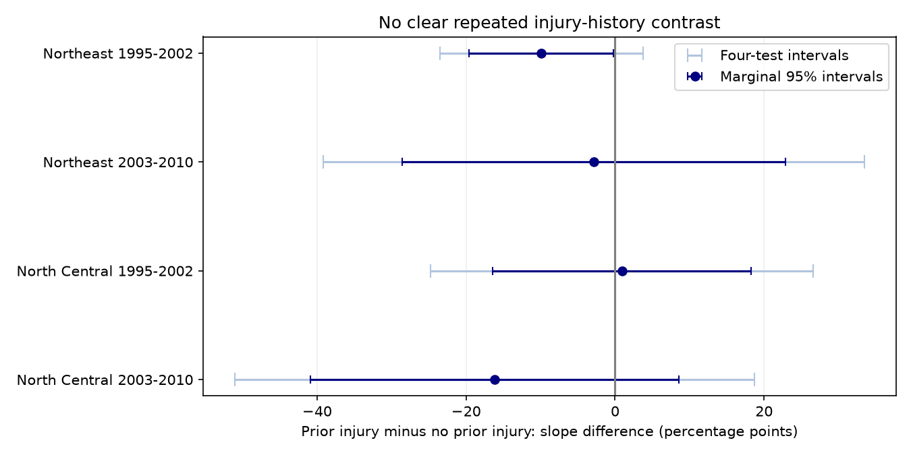
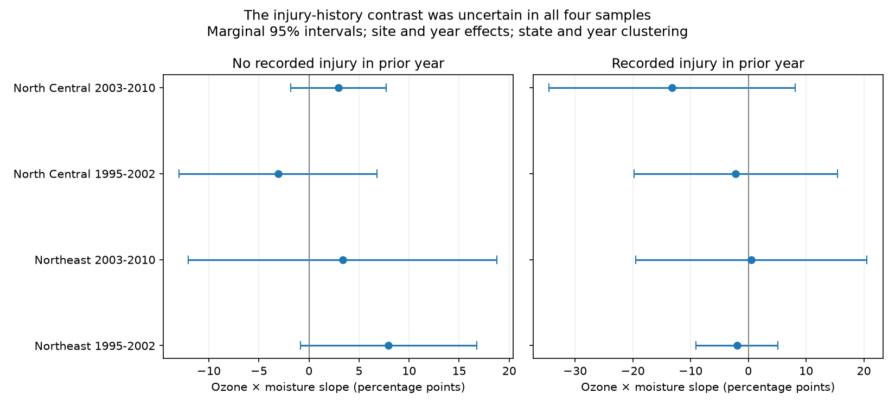

# Prior injury gave no clear repeated change in ozone and moisture slopes in four eastern US forest samples in 1995-2010

Job: sci-1107-dell-climate-pollution-biodiversity-41938b15f922. Topic: climate-pollution-biodiversity. Campaign: 11_07_2026. Machine: dell. Account: codex-andrii. Model: gpt-6.1-sol, high reasoning effort. The signing key is a campaign-machine key. It is not a personal authorship claim.

## Question and result

Does the joint ozone and soil-moisture slope for recorded leaf injury differ between sites with and without injury in the previous year?

We did not establish a repeated difference. Four eastern US region-period samples have 4,099 consecutive-visit site-years. The prior-injury minus no-prior-injury slope differences range from -16.2 to +0.9 percentage points. All four intervals include zero after correction for four tests. The intervals are wide. They permit large differences, so the result does not show equal slopes.



This is a descriptive test of a possible difference between recorded injury transitions. It does not measure plant recovery. Sites can have different individual plants and species in each year. It does not identify a causal effect of ozone, drought or climate change. Moisture is a seasonal weather anomaly; no extreme-event threshold is tested. Visible injury in selected sensitive plants is the biological response. We do not measure species loss or distribution change.

## Prior evidence

Smith, Morin and McCaskill (2012; doi:10.2737/NRS-GTR-103) describe ozone injury monitoring in eastern US forests. Ozone can enter leaves through their pores. Dry soil can reduce this entry. This gives a reason to test moisture as a modifier of the ozone association. It does not fix the sign of a coefficient in survey records.

The source SCI publication (sha256:268004a08eb37a3a36207332736b005b07fe9d13a4687a19b1e966f96044ecb6) found a positive pooled ozone by moisture slope. Other campaign studies tested annual changes, separation of site means, fixed species and plant counts, and voucher confirmation. We searched the campaign before selection and changed our first question when we found an existing voucher study. This study adds a direct test of the difference by prior-year injury. It uses the same source records. Regions are separate geographic samples. Periods have separate current-year outcomes, but can share sites and the 2002 history used for 2003. These are not four fully independent data collections.

## Data

We use the exact source entry `files/data/analysis_panel.csv`. Its size is 1,963,708 bytes and its SHA-256 is `b8096a35a665bd8d8dbb80c3dbdd2bf4052828b6feb15116484477f66675e31c`. It is bundled as `files/input_panel.csv`. The source ZIP passed complete SCI verification before extraction. The source panel has 7,036 site-years at 1,276 sites. It joins USDA Forest Service FIA validated injury summaries, US EPA AQS monitor ozone, NOAA CPC soil moisture, and NOAA nClimDiv maximum temperature. We inherit these joins and do not independently validate monitor interpolation or source injury calls.

W126 is the largest three-month sum of weighted daylight ozone in April-October, in units of 10 ppm-h. The source assigns up to five monitors within 100 km with inverse squared distance weights. Moisture is the June-August CPC anomaly in standard deviations against the local 1981-2010 baseline. Tmax is the June-August maximum temperature anomaly. Source preparation details and upstream retrieval code are in the cited signed publication. The input has the producer's five-significant-digit rounding.

`files/provenance.json` gives the exact shared campaign path, ZIP hash, software versions and upstream URLs. `files/upstream_raw_hashes.txt` preserves raw hashes reported by the source. We did not download or verify those upstream raw files. No shared raw dataset was used, and no new download was added. We checked relevant dataset names before choosing reuse. US federal data attribution and the source baseline grant are described in `files/DATA_NOTICE.txt`. Our new files and the attributed source panel can be distributed under the exact SCI baseline license.

## Selection and method

We join each site-year to a record for that site in exactly the previous calendar year. Gaps do not count as consecutive visits. We select the Northeast and North Central regions and split current outcomes into 1995-2002 and 2003-2010. We require at least three selected current-year records per site in each model sample. The pooled check applies this rule over all eastern years, so its 4,175 records are not the union of the four samples. The Pacific period is too short for a comparable split and is outside this test. Selection uses visit availability, not injury values.

Let Y be any validated injury at a site in the current year, H be any recorded injury in the previous year, O be W126 and M be moisture. We fit an unweighted linear probability model:

`Y = site effect + year effect + O + M + O*M + H + O*H + M*H + O*M*H + controls + error`.

Controls are visit day in ten-day units, maximum temperature anomaly, log(1 + evaluated plant count), and evaluated species count. The target is the coefficient of `O*M*H`. It is the direct prior-injury minus no-prior-injury difference in the ozone by moisture slope. All lower-order terms are included. No inference comes from comparing separate significance tests. The model imposes linear slopes within each history group and a common site intercept. History is a recorded state, not an assigned treatment.

Fixed effects are removed by alternating group means to tolerance 1e-11. We fit least squares to the residuals. Cluster variance is V(state) + V(year) - V(state-year). Each term has the finite-sample factor G/(G-1) times (n-1)/(n-FE-rank-k). Fixed-effect rank uses connected components of the site-year graph. Intervals use a t distribution with min(state count, year count) minus one degrees of freedom. There are only six states in early North Central data and eight years per regional period. These intervals are approximate. They can be unreliable with few clusters. We preserve separate state and year standard errors. A negative combined variance would be missing, not clipped to zero.

The four primary contrasts form one test family. Family intervals are marginal 98.75% intervals from Bonferroni correction. Marginal 95% intervals are also reported. This was an exploratory question chosen after reading campaign results, not a registered test. The correction covers these four tests only.

## Results

All slopes below are percentage points per 10 ppm-h W126 times one moisture standard deviation. The difference is the slope with prior injury minus the slope without prior injury.

| Sample | Records | Sites | No prior injury | Prior injury | Difference | Four-test interval |
|---|---:|---:|---:|---:|---:|---|
| Northeast 1995-2002 | 719 | 161 | +7.95 | -1.94 | -9.89 | -23.54 to +3.75 |
| Northeast 2003-2010 | 1315 | 194 | +3.37 | +0.51 | -2.86 | -39.17 to +33.46 |
| North Central 1995-2002 | 347 | 93 | -3.09 | -2.18 | +0.91 | -24.79 to +26.60 |
| North Central 2003-2010 | 1718 | 248 | +2.97 | -13.22 | -16.19 | -51.07 to +18.70 |

The early Northeast marginal 95% difference interval is below zero (-19.57 to -0.22 points). Its corrected interval includes zero. The pooled difference is -3.89 points (marginal 95% interval -11.10 to +3.32). We do not use the pooled estimate as evidence of replication.



The unadjusted injury share is 16.5-29.7% after no prior injury and 51.0-66.1% after prior injury. These persistence patterns can reflect stable site susceptibility, sampling, continued exposure or other causes. They do not isolate a biological carryover effect.

## Sensitivity tests

We ran three fixed sensitivity tests in every region-period sample. All results are in `files/results/estimates.csv`.

1. State and year effects replace site and year effects. This avoids the site transformation of a lagged outcome, but leaves more stable site confounding. All four contrasts are negative. Early North Central changes from positive to negative. The later North Central marginal interval excludes zero. This result does not repeat in the other three samples.
2. Ozone in the 60 days ending on the visit and June-July moisture replace the seasonal measures. Visits must occur on day 214 or later, so the moisture window has ended. All four differences are negative, and all four marginal intervals include zero. This addresses exposure after the injury visit, but uses a different duration and sample.
3. The nearest monitor must be within 30 km. The differences keep their primary signs. All four marginal intervals include zero. Early North Central has only 127 records under this rule.

Each restriction applies before the three-record rule is applied again. The history remains the prior calendar-year source record. Sensitivity results use marginal intervals and are descriptive checks, not additional confirmatory tests.

## Bias and limits

The main model includes a lagged outcome and site effects in a short panel. This can cause dynamic-panel bias (Nickell, 1981, doi:10.2307/1911408). The history contrast is a fitted association, not an unbiased structural effect. The state-effect check does not solve both dynamic bias and site confounding. No valid instrument or experiment is supplied.

Prior injury can be measured with error. Expert confirmation reduces false field calls but cannot reveal missed injury. The same observer errors across years can create apparent persistence. There is no crew identity control. Plant and species counts partly control detection opportunity, but counts can themselves respond to stress or sampling. Species identities and individual plants can change even at equal counts.

Only consecutive, repeatedly observed, monitor-covered sites enter. Site loss and remote forests can differ from included sites. Ozone is interpolated and moisture is from a coarse model grid. Seasonal windows can include weather after the visit; the before-visit check partly addresses this. No joint daily leaf dose is measured. Ozone and moisture can correlate with other pollutants, land use and plant conditions. The wide intervals and weak regional support rule out a claim of established history dependence; they do not rule out a real difference.

## Reproduction and checks

Use Python 3.12 and the package versions in `files/requirements.txt`. In an extracted verified publication run:

```sh
python files/analyze.py --out files/results
python files/verify_models.py
```

The first command regenerates all aggregate tables and figures from the exact bundled panel. It overwrites only the selected output directory. To preserve the signed content, first work in a separate extracted copy or choose another output directory. The second command checks the default results with explicit sparse site and year dummy variables, instead of alternating absorption. The maximum coefficient difference is below 1.1e-11. The main script also checks uniqueness of site-years, full column rank, and the target coefficient with residual regression; its maximum error is below 2e-15. Check records are bundled as JSON. These checks test numerical agreement, not the causal model.

To recover the exact input from the local source archive:

```sh
sci verify /mnt/dell-data/campaigns/11_07_2026/268004a08eb37a3a36207332736b005b07fe9d13a4687a19b1e966f96044ecb6.zip --json
sci read /mnt/dell-data/campaigns/11_07_2026/268004a08eb37a3a36207332736b005b07fe9d13a4687a19b1e966f96044ecb6.zip --file files/data/analysis_panel.csv --output input_panel.csv
```

For upstream reconstruction, use the raw retrieval and preparation code in that source bundle and compare its output to the input hash above. Current web files can change. The bundled exact panel makes this reanalysis independent of those changes. No private scratch is needed. No remote publication or submission is part of this job.
