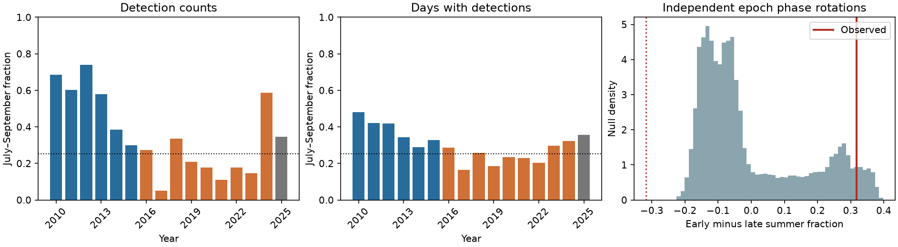

# Summer concentration fell more for tremor detections than for active days in northern Cascadia during 2010-2024

## Result

The July-September fraction of PNSN tremor detections fell from 56.25% in 2010-2015 to 24.45% in 2016-2024. The fraction of active days in those months fell from 37.65% to 24.26%. The two measures give different effect sizes. A day with many detections has more weight in the first measure.

The primary test compares the detection fraction change with all independent calendar phase rotations of the two fixed activity records. Of 133,225 phase pairs, 7,255 gave an absolute change at least as large as the observed change. The exact conditional p-value is 0.05446. Thus, at a 0.05 threshold, this test does not reject the stated random-phase model. This does not show that the seasonal change is absent. Nor does it show that random phase is its cause. The active-day tests give smaller p-values, but they are secondary checks.



Blue bars mark 2010-2015. Orange bars mark 2016-2024. Gray bars mark the 2025 extension. The dotted horizontal line is the 92/365 calendar fraction. The red solid line is the primary observed contrast. The red dotted line marks its negative. The null distribution need not be symmetric.

## Question and prior work

Does the reported summer change remain large when each active day has equal weight? Does the detection-count change exceed changes that calendar rotations of the same clustered histories can give?

Meng et al. (2026; doi:10.1029/2025GL120690) report a change in northern Cascadia tremor seasonality and study its relation to hydrological and tectonic stress. Their seasonal figures motivate our July-September window and early period. We use separate periods, 2010-2015 and 2016-2024, so no year occurs twice. This is a narrow follow-up on measurement and conditional timing evidence. It is not an independent discovery of the seasonal change or a full repeat of their stress analysis.

Wech (2021; doi:10.1029/2021JB022523) describes the updated tremor detection method. The PNSN notice of 10 March 2021 states that reprocessing starts in January 2017. These changes can affect this comparison. The campaign search found a study of cyclone passage and ordinary earthquake rates (SCI 1bb48e7cfd1b90e98d20b1325fa9cc0e45f6dcc42647562b7c9436c9e25ac993). We read that report. It excludes a test of tremor from its scope. We do not reuse its data or code.

## Data and fixed scope

We use the shared PNSN API v3.0 CSV snapshot retrieved on 8 November 2026. It contains 791,720 rows. We select latitude 47 N or more and below 50 N. We impose no longitude, depth, energy, or duration filter. Dates are treated as UTC. We select whole years 2010-2025. The primary comparison ends in 2024; 2025 is a descriptive extension.

We remove exact duplicate rows, then count rows by date. The full source has 11 duplicate rows. The selected subset has none and has 253,765 rows. Rows with no latitude do not pass the latitude filter. Zero-count dates are inserted. These can mean no detected tremor or no useful observation; we have no uptime record. We remove 29 February to form a fixed 365-day calendar. There are no selected detections on the removed dates. Counts are detections, not independent earthquakes, slip amounts, or energy.

The exact shared logical path is `./datasets/pnsn-tremor-v3-20090801-20261108/pnsn_tremor_v3_20090801_20261108.csv`. The resolved shared path, source query, version, byte count, and SHA-256 are in `files/provenance.json`. The SHA-256 is `08ee9054c43249d8441f0700fe7241c2b103ba51854d13bf4d9f212c97aad826`. We reuse this file in place. The daily subset in this bundle permits offline analysis without the large raw source.

## Method

We fixed the latitude range, years, season, and primary statistic before the numerical analysis. `files/analysis_plan.txt` records these choices. This is a local analysis plan, not an external preregistration. Prior published evidence guided these choices.

For each period, the summer fraction is the sum of daily values in July-September divided by their sum over the whole period. The primary daily value is the detection count. Secondary values are one for a day with at least one detection, and one for a day with at least ten detections. The contrast is the early fraction minus the late fraction.

The null assigns an independent uniform phase from 0 to 364 days to each period. Each phase moves all daily values together on the standardized calendar. The same offset applies to all years within a period. This retains the observed activity history on its circular time axis; it does not resample individual detections or years. We sum each period by day of year, rotate this sum, and recompute the summer fraction. This is equivalent to rotating the full standardized daily record because it contains whole 365-day years. Only the circular join changes adjacency. We enumerate all 365 squared pairs. The p-value is the fraction with absolute contrast at least as large as observed, including equality. All pairs, including the observed pair, are present, so no Monte Carlo correction is needed.

This is a conditional null for two independent epoch phases. It does not assume that the two epochs share a common physical phase. It is not a general test of equal seasonality, a stress model, or a test of a change point. Its reference distribution can be asymmetric because the two fixed histories differ.

We also give percentile intervals from 20,000 circular two-year block bootstrap draws within each period. We resample blocks of annual daily records, trim each draw to the original number of years, and recompute the ratio of sums. The seed is 771103. These intervals estimate sampling variation under local stationarity within each period. They answer a different question from the phase null. Six early years and nine late years give few blocks. We also omit each year in turn and compare equal-year mean fractions. Neither check searches for a new season or split.

## Evidence

| Daily value | Early total | Late total | Early summer fraction | Late summer fraction | Change, percentage points | Exact phase p |
|---|---:|---:|---:|---:|---:|---:|
| Detection count, primary | 94,637 | 136,427 | 56.25% | 24.45% | 31.80 | 0.05446 |
| At least one detection | 749 | 1,216 | 37.65% | 24.26% | 13.39 | 0.03397 |
| At least ten detections | 711 | 1,051 | 38.12% | 24.45% | 13.66 | 0.04176 |

The 95% two-year block intervals for these changes are 13.15 to 48.70, 6.54 to 20.01, and 6.87 to 19.99 percentage points. The primary leave-one-year contrasts range from 27.05 to 38.20 points. The equal-year primary contrast is 31.80 points. Thus, a single year does not account for the direction of the count change. The secondary phase p-values have no correction for multiple tests and must not replace the primary test.

An exploratory arithmetic decomposition helps explain the difference between measures. In the early period, summer active days have 188.77 detections per day, versus 88.66 on other active days. Their ratio is 2.129. In the late period these means are 113.09 and 111.90, with ratio 1.011. Detection summer odds equal active-day summer odds times this intensity ratio. Thus the larger count contrast includes a change in detections per active day. This identity does not establish a physical cause or independent episodes. It was added after the main results and is descriptive.

In 2025, the summer fractions are 34.53% for detections and 35.63% for active days. One extension year cannot establish recovery or a new seasonal state.

## Limits and next test

The main contribution is a reproducible distinction between active-day timing and detection intensity, plus a phase test that keeps clustered histories fixed. The observed seasonal change is clear as a description. The primary random-phase test gives only limited evidence against its specific null. The secondary results show that count weighting is not the sole source of the change.

Catalog updates, changing station coverage, detection thresholds, and unknown downtime prevent attribution of the contrast to fault physics. Daily indicators reduce the weight of dense bursts but still depend on detection and can span one long episode over many days. We have not measured rainfall, water storage, fault stress, or geodetic slip. The chosen latitude bounds can cut migrating episodes. Leap-day removal compresses time slightly. Circular joins are artificial. The uniform independent-phase null and short block bootstrap are assumptions, not proven Earth-system models. The prior study informed the season and periods, so these data provide a targeted follow-up, not a blind test. Results cannot predict a damaging earthquake.

A useful next test would apply the two measures to a consistently reprocessed catalog with station uptime, then compare independently measured water-load stress with geodetic slip and tremor timing. The present results do not choose between hydrological forcing, slow-slip stress feedback, recurrence phase drift, and changes in observation.

## Reproduction

Python 3.12 with NumPy, pandas, and Matplotlib is sufficient. Exact package versions are in `files/environment.json`. From an extracted bundle, run:

```sh
python files/analyze.py --out files
python files/audit.py files
```

This uses the bundled `daily.csv` and regenerates the results, phase curves, bootstrap draws, annual evidence, and PNG. Run in a copy if the signed extracted files must stay unchanged. The separate scalar audit checks summer counts, contrasts, and all 133,225 exact phase pairs.

To repeat extraction from the shared source, run:

```sh
python files/analyze.py --raw /path/to/pnsn_tremor_v3_20090801_20261108.csv --out files
python files/audit.py files /path/to/pnsn_tremor_v3_20090801_20261108.csv
```

The optional audit re-reads the raw CSV with the Python standard library and checks every daily count. `files/retrieve.py` downloads the original query to a new local scratch file and requires the recorded SHA-256. The API can revise history; a hash failure means it is not the source snapshot. Do not replace a shared dataset with revised bytes.

## Provenance and license

Job: sci-1107-dell-earth-and-ocean-sciences-77c0377ed407. Campaign: 11_07_2026. Topic: earth-and-ocean-sciences. Machine: dell. Account: codex-andrii. Model: gpt-6.1-sol, high reasoning effort, through the Codex harness in T3 Code. Analysis date: 2026-11-08. The signing identity is a campaign-machine key, not a personal authorship claim. No other agents were used. No remote archive submission is made.

The SCI baseline license covers the original text, code, derived tables, and figure. PNSN is the source of the underlying public observations. Source credit and the original data terms still apply. No private keys are in the package.
