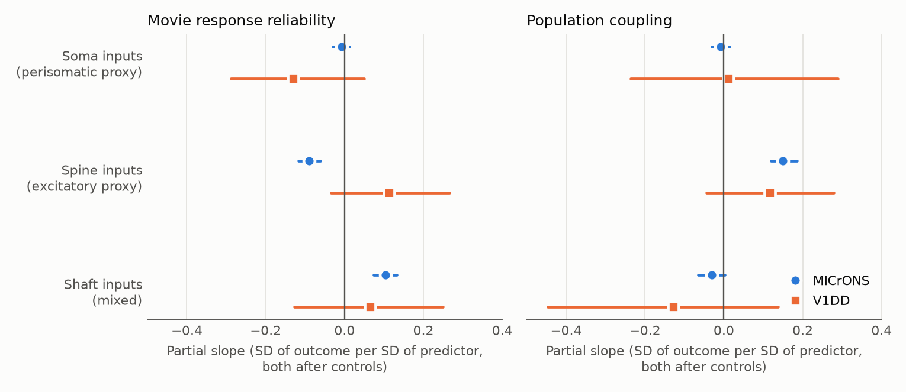
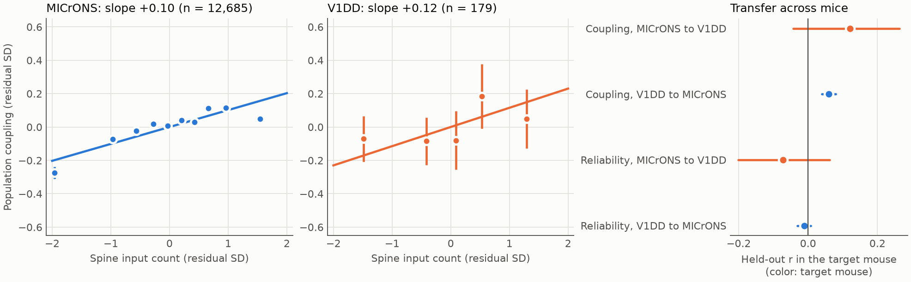
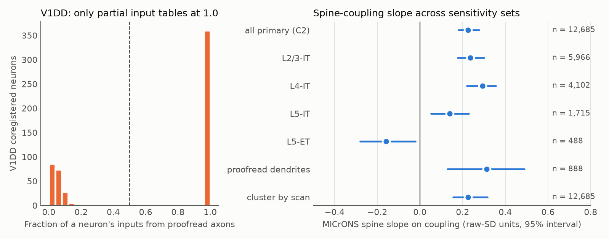

# Spine input count predicted population coupling in 12,685 MICrONS neurons, soma input count did not, and 179 V1DD neurons gave no replicated relation

## Summary

We asked one question. Does the input anatomy of one excitatory cortical neuron predict two activity properties of that neuron? The two properties are how reliably the neuron responds to a repeated movie and how strongly the neuron follows the activity of the population. We tested the same model in two mice that have calcium imaging and electron microscopy (EM) of the same neurons: MICrONS and V1 Deep Dive (V1DD).

We counted three types of input synapse on each neuron: soma, spine and shaft. Soma synapses are a proxy for perisomatic inhibition. Spine synapses are a proxy for excitatory input. Shaft synapses are a mixed class.

We wrote and hashed the analysis plan before we computed any relation between anatomy and activity. We called a relation "replicated" only if it had Holm-adjusted significance in both mice with the same sign.

Main results:

- **No relation met the replication rule.** The V1DD sample is small (179 neurons in 31 spatial clusters). Its intervals are wide and all six of its Holm-adjusted p values are 0.86 or more.
- **In MICrONS (12,685 neurons), spine input count predicted higher population coupling.** The partial slope is +0.150 (95% interval 0.120 to 0.185, Holm p = 0.006). The V1DD estimate has a similar size, +0.116, but its interval includes zero (-0.045 to 0.279).
- **In MICrONS, soma input count did not predict reliability or coupling.** The slopes are -0.007 (interval -0.030 to 0.013) and -0.008 (-0.031 to 0.014). Thus the perisomatic hypothesis has no support in the primary model. The V1DD intervals are too wide to test it (reliability -0.288 to 0.050; coupling -0.236 to 0.290).
- **In MICrONS, shaft input count predicted higher reliability** (+0.103, interval 0.074 to 0.132), and spine input count predicted lower reliability (-0.091, interval -0.116 to -0.061). The negative spine slope changed with the reliability measure (see Results). It has the opposite sign in V1DD (+0.113, interval -0.035 to 0.267).
- **Cross-mouse prediction gave one clear result, and it is small.** A coupling model that we fit in V1DD predicted held-out MICrONS coupling with r = 0.060 (interval 0.039 to 0.080; permutation Holm p = 0.002). It explains about 0.3% of the residual variance. The reverse direction had r = 0.122 (interval -0.043 to 0.264, Holm p = 0.33). Reliability did not transfer in either direction.

## Why this question

Prior work in this campaign tested pairs of neurons and connections between the neurons in a selected population. Okun et al. (2015) proposed that strongly coupled neurons receive more local input. A V1DD study in this campaign (a932e167) found that coupled neurons receive more input from coregistered neurons. A MICrONS study in this campaign (eab8ce57) found a smaller effect. Both studies counted only inputs from a selected set of proofread cells. We used counts of all inputs on the neuron, by postsynaptic site. We also added a second outcome, reliability, and a test across animals.

Perisomatic inhibition can control spike timing. Thus we expected that a neuron with more soma synapses would have more reliable responses. The plan did not state a direction, and the tests are two-sided.

## Data

| Item | MICrONS (mouse A) | V1DD (mouse B) |
|---|---|---|
| Animal and EM version | minnie65, materialization v1507 | mouse 409828, materialization 1196 |
| Neuron table | Ding et al. 2025 functional nodes (12,894 records) | 565 coregistered ROIs, 553 EM roots |
| Input labels | SSA spine/shaft/soma predictions, counts per root | SSA spine/shaft/soma labels per synapse |
| Activity | 13 scans; 1-s CNMF traces and events | 3 sessions; dF/F and events; binned to 1 s |
| Reliability stimulus | 6 oracle clips, 9 samples each, 10 repeats | 120-s natural movie, 8 complete repeats |
| Analysed excitatory neurons | 12,685 | 179 |
| Cell-type counts | L2/3-IT 5,966; L4-IT 4,102; L5-IT 1,715; L5-ET 488; L6-IT 268; L6-CT 146 | L2/3-IT 60; L4-IT 28; L5-IT 13; L5-ET 78 |
| Median soma / spine / shaft inputs | 68 / 2,112 / 881 | 62 / 2,539 / 755 |

File paths, sources, versions and SHA-256 values are in `files/data_files_used.json` and `files/PROVENANCE.md`.

## Methods

The full plan is `files/ANALYSIS_PLAN.md`. Its SHA-256 hashes and times are in `files/results/plan_sha256.txt`. The plan was hashed before `03_join.py` joined anatomy and activity. Amendment 1 was hashed after the audit below and before any anatomy-outcome relation was computed.

**Sample.** Excitatory neurons with one nucleus on the EM root and a harmonized type. At least 100 labelled input synapses. For V1DD, a proofread dendrite and a complete input table.

**Amendment 1: V1DD input-table audit.** An audit without outcomes showed that the V1DD synapse table is bimodal per neuron (Figure 3, left). For 365 of 565 ROIs, every recorded input comes from an axon on the proofread list, and the median count is near 80. For the other 200 ROIs, under 20% of inputs come from these axons and counts are 800 to 14,000. The first group has partial tables, so we removed it. The 100-synapse rule in the first version of the plan did not remove it. This amendment decreased the V1DD sample from 332 to 179 neurons.

**Predictors.** log(1 + count) for soma, spine and shaft inputs. All three enter one model.

**Outcomes.** `rel` is the mean split-half correlation of the 1-s movie response over 100 random splits, with Fisher z transform. `coup` is the correlation of 1-s events with the summed z-scored events of neurons in other imaging planes or fields, across the session, with Fisher z transform. The other-plane population removes same-plane neuropil. Both outcomes were z-scored within session.

**Models.** OLS with fixed effects for session x plane and for harmonized type. Controls: lateral soma position, log nucleus volume and an imaging-noise term (MICrONS log CNMF noise; V1DD log noise power).
- C2 is the primary model.
- C3 is C2 plus log event rate. Rate can be a mediator, so C2 and C3 answer different questions.
- C1 is C2 without the noise term.

**Inference.** Cluster bootstrap with 2,000 replicates. Clusters are 100-micrometre lateral cubes, resampled within session. Holm correction covers 6 primary tests per mouse. The smallest possible bootstrap p is 0.001, so the smallest possible Holm p is 0.006.

**Units of slopes.** The plan z-scored predictors across the whole sample of a mouse, before fixed effects. Those "raw-SD" slopes are in `files/results/models.csv`. The fixed effects remove much of the predictor variance, so we also give the same slope in units of residual SD of predictor and outcome, in `files/results/slopes_common_unit.csv`. This is an exact rescaling of the same OLS fit. The Summary and Figure 1 use these common units. Figure 3 (right) and the sensitivity table use raw-SD units.

**Transfer.** We removed the controls from outcome and anatomy within each mouse. We fit three slopes in the source mouse. We predicted the target mouse and report the correlation of prediction and outcome, with a cluster bootstrap interval and a permutation test that shuffles target anatomy within session x type. Holm correction covers the 4 tests in C2.

**Checks.** With the time order of one half scrambled, mean reliability fell to about zero in both mice (MICrONS 0.509 to -0.001 in 6 scans; V1DD 0.20-0.23 to 0.000-0.009 in 3 sessions, 2 planes each). Our V1DD reliability and coupling values agree in rank with the earlier V1DD bundle (Spearman 0.86 and 0.74, n = 559).

## Results

### Primary model (C2)

| Relation | MICrONS slope (95% interval) | Holm p | V1DD slope (95% interval) | Holm p |
|---|---|---|---|---|
| soma to reliability | -0.007 (-0.030, 0.013) | 0.88 | -0.131 (-0.288, 0.050) | 0.86 |
| spine to reliability | -0.091 (-0.116, -0.061) | 0.006 | +0.113 (-0.035, 0.267) | 0.86 |
| shaft to reliability | +0.103 (0.074, 0.132) | 0.006 | +0.065 (-0.127, 0.250) | 1.00 |
| soma to coupling | -0.008 (-0.031, 0.014) | 0.88 | +0.012 (-0.236, 0.290) | 1.00 |
| spine to coupling | +0.150 (0.120, 0.185) | 0.006 | +0.116 (-0.045, 0.279) | 0.86 |
| shaft to coupling | -0.030 (-0.065, 0.002) | 0.19 | -0.128 (-0.447, 0.138) | 0.93 |

Slopes are in residual SD of outcome per residual SD of predictor.



**Figure 1.** Partial slopes for the three input classes and the two outcomes, primary model. Lines show 95% cluster bootstrap intervals. MICrONS has 12,685 neurons; V1DD has 179.

### Between-mouse differences (exploratory)

We did not specify this test in the plan. The six differences between the two mice used independent standard errors in `files/results/between_mouse_difference_exploratory.csv`. Only spine to reliability has a nominal difference (MICrONS minus V1DD = -0.203, z = -2.53, p = 0.011, Holm p = 0.068). Thus the data do not show a clear difference between the mice in any relation. The V1DD intervals are wide, so they also do not show that the mice agree.

### Spine input and population coupling



**Figure 2.** Left and centre: mean population coupling in bins of spine input count. Spine count and coupling are residuals after the controls and the soma and shaft counts (added-variable plot), so the printed slope is not the Table slope. Vertical lines show plus or minus one standard error. Right: correlation between the prediction from the source mouse and the outcome in the target mouse, with 95% intervals.

The MICrONS relation is not exactly linear. The lowest decile of spine count is well below the line, and the top decile is below it. The spine-coupling slope kept its sign in these MICrONS checks: C1 (+0.216, raw-SD units), C3 with the rate control (+0.290), L2/3-IT (+0.236), L4-IT (+0.293), L5-IT (+0.139), proofread dendrites (+0.313, n = 888), clustering by scan (+0.225) and spontaneous-only coupling (+0.161). All of these intervals exclude zero.

**L5-ET cells are different.** In the 488 MICrONS L5-ET cells, the slope is negative (-0.159, interval -0.280 to -0.020). The V1DD L5-ET slope has the other sign (+0.289, interval -0.107 to 0.723, n = 78). The result for coupling applies to IT neurons in MICrONS and not to all excitatory types.



**Figure 3.** Left: fraction of each V1DD neuron's inputs that come from proofread axons. Neurons at 1.0 have partial input tables and we did not use them. Right: spine slope on coupling in MICrONS sensitivity sets, in raw-SD units.

### Reliability

- The negative spine-reliability slope is not robust. It used the 54-sample oracle response and the CNMF trace. With the Ding et al. CC_max measure it is -0.049 (interval -0.089 to -0.004), and with C3 and CC_max it is -0.018 (interval -0.057 to 0.025). In proofread dendrites it is -0.102 (interval -0.296 to 0.042). V1DD has the opposite sign.
- The shaft-reliability slope is positive in all of these checks (proofread dendrites +0.260, CC_max +0.118, C3 with CC_max +0.106; all intervals exclude zero; raw-SD units).

### Soma inputs

Soma input count has no clear relation to reliability in MICrONS in the primary model. The association with coupling depends on the model. Without spine and shaft (soma-only model) it is +0.060 (interval 0.028 to 0.091). With the rate control it is -0.059 (interval -0.092 to -0.029). In the L2/3-IT and L4-IT strata it is -0.074 and -0.069. These changes show shared variance with the other input counts. We do not treat these estimates as evidence for an effect of perisomatic inhibition.

### Transfer across mice

| Direction | Outcome | r (95% interval) | Permutation Holm p | Out-of-sample R2 |
|---|---|---|---|---|
| MICrONS to V1DD | coupling | +0.122 (-0.043, 0.264) | 0.33 | 0.014 |
| V1DD to MICrONS | coupling | +0.060 (0.039, 0.080) | 0.002 | 0.003 |
| MICrONS to V1DD | reliability | -0.072 (-0.201, 0.062) | 0.42 | -0.033 |
| V1DD to MICrONS | reliability | -0.011 (-0.031, 0.008) | 0.42 | -0.026 |

With the rate control (C3), the V1DD-to-MICrONS coupling prediction had r = 0.150 (Holm p = 0.002). The other three C3 tests were not significant. In the V1DD coupling model, the spine coefficient is +0.116 and the shaft coefficient is -0.128. The spine sign agrees with MICrONS. The two V1DD coefficients have similar magnitudes and wide intervals.

## Limitations

- Two animals. One positive transfer result does not establish a general rule, and it explains less than 1% of the variance.
- V1DD has only 179 neurons, 3 sessions and 31 spatial clusters, and the cell-type mix differs from MICrONS. L4-IT (28) and L5-IT (13) are below the stratum threshold.
- The data are observational. Anatomy can correlate with many unmeasured properties, for example dendrite length and cell age.
- The MICrONS spine and shaft counts include 11,797 neurons without proofread dendrites. Their counts can depend on segmentation. The proofread subset has the same sign for the spine-coupling slope, but only 888 neurons.
- Soma, spine and shaft counts correlate after controls (MICrONS r = 0.43 to 0.74). Their slopes are conditional on one another.
- The soma label is a proxy for perisomatic inhibition. Among the 29% of V1DD soma inputs with a typed presynaptic cell, 95.5% come from inhibitory cells. The typed cells are a selected group. MICrONS soma labels were checked by earlier work (97.8% from basket axons, for the proofread-axon set).
- The spine label is a proxy for excitatory input. In V1DD only 4.9% of spine inputs have a typed presynaptic cell, and that set has an inhibitory excess, so the table does not validate the proxy.
- The reliability stimulus differs between mice (clips versus one continuous movie), and the trace type differs (CNMF trace versus dF/F). The MICrONS trace has a 30-s baseline removed.
- V1DD spontaneous coupling in the sensitivity table is from dF/F in the earlier bundle; MICrONS uses events.
- Unbalanced sampling can give some bias. We used the Ding functional node set, which selects neurons with good coregistration.
- The plan estimated a slope standard error near 0.08 for V1DD. This is approximately correct in residual-SD units (0.08 to 0.15). The raw-SD standard errors are 0.21 to 0.51.

## Deviations and execution notes

- Amendment 1 (described above). It is the only change to the plan.
- We implemented the model bootstrap with per-cluster cross-products and a ridge of 1e-8 for the collinear fixed effects. The ridge does not change the slopes at this size.
- The first full run of `04_models.py` exceeded the machine's time limit in its transfer stage. All other models had finished and we kept them. We then moved the transfer test into `04b_transfer.py` with a vectorised bootstrap and permutation of the same estimator. A short test with 20 replicates ran earlier, and we did not use its values.
- We ran the time-scramble check on a subset (MICrONS: 6 scans; V1DD: 2 planes per session).

## Reproducibility

Software: Python 3.12, numpy 2.5.4, pandas 3.1.1, scipy 1.18.1, matplotlib 3.11.2, pyarrow 26.0.1. `02a_v1dd_activity.py` and `05b_v1dd_sanity.py` also need zarr 3.

From a folder with `datasets/` linked to the shared datasets, and the derived tables from this bundle:

```text
mkdir -p work/tables work/prior
cp files/derived/tables/* work/tables/ ; cp files/derived/prior/* work/prior/
# Rebuild tables from source data (optional; needs the shared datasets)
python files/code/01_anatomy_tables.py
python files/code/02a_v1dd_activity.py
python files/code/02b_microns_activity.py
python files/code/03_join.py
# Models and figures (work/tables is enough, plus the V1DD proofread axon list for figure 3)
python files/code/04_models.py 2000
python files/code/04b_transfer.py 2000
python files/code/05a_checks.py
python files/code/05b_v1dd_sanity.py
python files/code/06_summary_figures.py
```

The scripts use paths relative to a working folder and write to `work/result/files/`. Random seeds are fixed in the scripts. The `work/prior` files come from bundle a932e167 (coregistration table, SNR table, reliability and coupling for comparison); their hashes are in `files/PROVENANCE.md`.

## Files

- `files/ANALYSIS_PLAN.md`, `files/results/plan_sha256.txt`: plan and hash record.
- `files/results/models.csv`, `slopes_common_unit.csv`, `sensitivity.csv`, `transfer.csv`, `between_mouse_difference_exploratory.csv`, `checks.json`, `sanity_v1dd.json`, `fig2_bins.json`.
- `files/derived/tables/`: per-neuron analysis table and intermediate tables. `files/derived/prior/`: source files from bundle a932e167.
- `files/code/`: all scripts. `files/data_files_used.json`, `files/PROVENANCE.md`: shared-data provenance.

## References

MICrONS Consortium, doi:10.1038/s41586-025-08790-w. Ding et al. 2025, doi:10.1038/s41586-025-08840-3. Elabbady et al. 2025, doi:10.1038/s41586-024-07765-7. Celii et al. 2025, doi:10.1038/s41586-025-08660-5. Schneider-Mizell et al. 2025, doi:10.1038/s41586-024-07780-8. Okun et al. 2015, doi:10.1038/nature14273. Allen Institute V1 Deep Dive EM release 1196 and two-photon sessions, https://aind-open-data.s3.amazonaws.com/.
