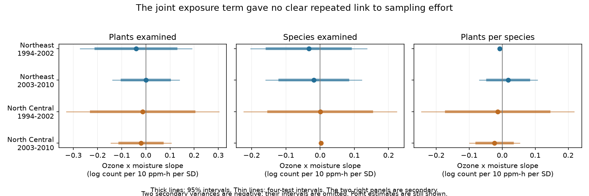

# Ozone and moisture gave no clear repeated link to plant sample size in four eastern US forest samples in 1994-2010

We tested whether ozone and soil moisture were linked to the number of plants examined for ozone injury. This is a test of the observation process. We used 5,277 site-years from two eastern US regions and two periods. All four main ozone by moisture intervals included zero. A restriction to nearby ozone monitors gave an isolated negative slope in the early Northeast sample. The data do not show a repeated exposure link to plant sample size. Wide intervals do not establish stable effort. We provide an exact split of the count slope into species and plants per species, aggregate statistical evidence, and code to repeat the work.



## Question and prior work

Does joint annual variation in ozone and moisture change the number of plants examined at a forest biosite? If fewer plants are examined, there are fewer chances to find visible injury. This can affect studies that use any detected injury as an outcome. A count of examined plants can change because of field effort, plant availability, or survey rules. These causes cannot be separated with these counts alone.

Smith, Smith and Coulston (2007) describe the [FIA ozone sampling design](https://research.fs.usda.gov/treesearch/13294). Smith, Coulston and O'Connell (2008) provide the [data interpretation guide](https://research.fs.usda.gov/treesearch/19036). Smith, Morin and McCaskill (2012) report the [1994-2010 forest injury record](https://research.fs.usda.gov/treesearch/41831). The reports support the use of sampled sensitive plants to measure visible injury. They do not make the sampled species count a measure of all forest biodiversity.

The campaign source, `sci:sha256:268004a08eb37a3a36207332736b005b07fe9d13a4687a19b1e966f96044ecb6`, reports a positive pooled ozone by moisture injury slope. Audit `sci:sha256:29a66dcad4d1679fc2b2a1d38ce3f74aac627d2501d8a2fb9efa3b831e91470b` separates annual variation from products with site means. Its regional estimates have wide intervals. We use that separation. Study `sci:sha256:8b6cc9622b5dcfae107b966a645e397a27323c492b16a4f21cbfc6e7a291c2d1` tests fixed plant effort for the injury outcome. Study `sci:sha256:a18505308d29f7c40a048dbc16d7221a2a21d24a7d4f94c116399cb2546722bc` holds scored species sets fixed for an injury comparison.

Our new outcome is sample size itself. We also split its log slope into the slopes for sampled species and plants per sampled species. This is a different test of a possible observation pathway. It uses the same source field records. It is not an independent replication of those records and does not replace the earlier injury tests.

We searched the campaign for ozone, injury, bioindicator, phenology, pollution, observation effort, plant count and species count before choosing the question. We saved a plan before fitting the models. This was not a registered analysis. The four main intervals do not account for the many other campaign research choices.

## Data and scope

We used the verified source publication ZIP in the shared campaign. The source panel has 7,036 site-years, including Pacific sites that we did not model. It joins US Forest Service FIA ozone biosite records, US EPA AQS ozone estimates, NOAA CPC soil moisture, and NOAA climate-division weather. The source retrieved its raw files on 9 November 2026. The temperature release has suffix `20261006`. Numeric exposure fields in the panel are rounded to about five significant digits.

The exact shared source is `/mnt/dell-data/campaigns/11_07_2026/268004a08eb37a3a36207332736b005b07fe9d13a4687a19b1e966f96044ecb6.zip`. This is the compatibility path reached through `./campaign`; the storage is on HP. The source entry is `files/data/analysis_panel.csv`. Its SHA-256 is `b8096a35a665bd8d8dbb80c3dbdd2bf4052828b6feb15116484477f66675e31c`. The archived FIA biosite summary is also used to check both count outcomes. All 7,036 panel rows match its plant and species counts exactly. This check does not validate the exposure joins or the original field counts.

`files/provenance.json` gives the ZIP hash, source entry hashes, raw source URLs, and all raw hashes recorded by the parent. The raw FIA biosite summary has uncompressed SHA-256 `3a6bc031f7cc9769dc2558b34bf5531fab2698c6ef1b9487f8288398ea254df5`. We checked relevant names in `./datasets`. No shared raw dataset was used, changed, or downloaded. The exact inputs came from the shared publication. No failed disk path was read.

We use Northeast and North Central records in 1994-2002 and 2003-2010. We require three or more retained visits per site in each sample. Counts are positive, so no constant is added before taking logs. Source site-years are unique.

| Region and period | Source site-years | Retained site-years | Sites | States | Mean plants examined | Mean species examined |
|---|---:|---:|---:|---:|---:|---:|
| Northeast 1994-2002 | 1,606 | 1,270 | 266 | 12 | 58.0 | 2.53 |
| Northeast 2003-2010 | 1,524 | 1,463 | 217 | 12 | 102.6 | 3.77 |
| North Central 1994-2002 | 1,207 | 716 | 172 | 6 | 67.2 | 2.87 |
| North Central 2003-2010 | 1,915 | 1,828 | 259 | 12 | 95.8 | 3.68 |

There are nine years in each early sample and eight in each later sample. The region groups have no common sites. The periods have no common years but can share sites. Regional weather is correlated. These are tests across separate samples, not independent experiments. The means in the table compare selected samples and do not estimate an effect of time or a survey rule change.

## Outcomes and method

Let N be `PLANT_EVAL_CNT` and S be `SPECIES_EVAL_CNT`. The main outcome is log(N). The secondary outcomes are log(S) and log(N/S). All three outcomes use the same rows and design. The exact identity is:

`log(N) = log(S) + log(N/S)`.

Thus each fitted coefficient for log(N) equals the sum of the two secondary coefficients. This split distinguishes two ways the sample count can change. It does not assign biological or observer causes to either part. S counts the selected indicator species reported in the source site summary, not all species at the site. N/S is the total count divided by that reported count; it is not an average over fixed species or fixed individual plants.

Let O be the largest three-month W126 ozone sum in April-October, divided by 10 ppm-h. W126 weights higher ozone concentrations more heavily. Let M be June-August CPC soil moisture in local 1981-2010 standard deviation units. Positive M means wetter soil. For each site within each tested sample, define o = O minus its observed site mean and m = M minus its observed site mean.

We regress each log outcome on o, m, o*m, mean(O)*m, mean(M)*o, o squared, m squared, summer maximum-temperature anomaly, that temperature squared, and visit day in ten-day units. The design also includes source manual-version and sample-kind categories, site effects, and year effects. Year effects absorb all common regional annual changes because each model uses one region. We remove linearly dependent category terms after fixed-effect removal. The retained names are in each moment file.

The main target is the coefficient of o*m. The exact identity `O*M = o*m + mean(O)*m + mean(M)*o + mean(O)*mean(M)` explains the extra terms. Site effects absorb the last term. Estimating the first three terms separately avoids imposing one common slope on annual products and products with site means. Curves allow additive nonlinear exposure relations. Means are computed again after every sample filter.

The model is an unweighted linear projection of log counts. A joint coefficient is the change in the ozone slope per one-unit moisture change, in log-count units per 10 ppm-h per moisture SD. It is not the count change from increasing both exposures. A negative joint coefficient alone does not show that either exposure lowers the count. We do not treat it as a causal effect.

We remove site and year effects by repeated group-mean subtraction. We calculate two-way cluster variance as V(state) + V(year) - V(state-year). Each component uses CR1 correction G/(G-1) times (n-1)/(n-rank(FE)-k). Fixed-effect rank accounts for connected components in the site-year graph. Intervals use a t distribution with min(state count, year count)-1 degrees of freedom. With only six early North Central states and eight or nine years, these intervals are approximate and can be unstable. State-only and year-only standard errors are also reported.

The four log(N) product tests form the main family. Their family intervals are Bonferroni 98.75 percent marginal intervals. The secondary outcomes and all sensitivity fits are descriptive. The same four-test interval formula is stored for them to aid inspection; it does not provide simultaneous coverage across all outcomes and sensitivity choices. Negative variance estimates are reported as missing intervals. They are not set to zero.

We made three planned sensitivity checks: add log of the source location count; restrict the nearest ozone monitor to 30 km; and use 60-day visit-ending ozone with June-July moisture and visit day at least 214. The last filter places the moisture window before the visit, also in leap years. It does not place the summer temperature control fully before every visit. It changes the exposure metric and sample, so it is not an exact match to the main target. No injury outcome is fit in this investigation.

## Results

| Region and period | Joint log(N) slope | Ordinary 95 percent interval | Four-test interval |
|---|---:|---|---|
| Northeast 1994-2002 | -0.0408 | -0.2070 to +0.1254 | -0.2718 to +0.1903 |
| Northeast 2003-2010 | -0.00002 | -0.0979 to +0.0979 | -0.1381 to +0.1381 |
| North Central 1994-2002 | -0.0132 | -0.2261 to +0.1998 | -0.3288 to +0.3025 |
| North Central 2003-2010 | -0.0202 | -0.1083 to +0.0679 | -0.1445 to +0.1040 |

All four point estimates are negative. All ordinary and family intervals include zero. The broad early intervals allow joint sampling relations of material size. This is not an equivalence test. The main data do not establish a repeated exposure link to the number of examined plants, nor do they establish constant effort.

The secondary joint slopes for log(S) are -0.0331, -0.0185, +0.0003 and +0.0028, in table order. The log(N/S) slopes are -0.0076, +0.0184, -0.0135 and -0.0230. They sum to the main slopes to numerical precision. Every defined secondary ordinary interval includes zero. The early Northeast log(N/S) variance and the later North Central log(S) variance are negative under the two-way estimator. We cannot give intervals for those two secondary estimates with this estimator.

Adding location count keeps all four main intervals across zero. In the close-monitor check, the early Northeast log(N) slope is -0.2040 (ordinary interval -0.3259 to -0.0821). Its four-test interval within that sensitivity family is -0.3735 to -0.0345. The log(S) slope is -0.1692, and log(N/S) is -0.0348. This isolated negative pattern mainly lies in the species-count term. The other three close-monitor log(N) intervals include zero. Filtering monitor distance changes the sites and exposure range. We have not shown that distance or exposure error causes the difference. We did not correct jointly for all sensitivity choices.

The before-visit log(N) slopes are -0.0931, -0.0427, +0.1980 and -0.0125. Three ordinary intervals include zero. The early North Central variance is negative, so its uncertainty is undefined under this estimator. Its log(N/S) variance is also negative. The full results preserve these failures. A missing interval is not evidence for zero effect.

## Checks and reproducible evidence

`files/checks.csv` records the exact raw count match, fixed-effect convergence, coefficient split, and sparse indicator-regression checks. `files/independent_checks.csv` compares the four main coefficients and two-way variances with dense statsmodels OLS and its separate cluster-covariance implementation. Coefficient errors are below 8e-14 and variance errors below 3e-15. This checks the numerical implementation, not the causal assumptions or field data.

Each `.npz` file contains X'X, X'Y, the three cluster score cross-products for each outcome, correction factors, fixed-effect rank, degrees of freedom, and column names. These are aggregate statistical summaries with no site-year record table. `reproduce_moments.py` recovers all 144 reported coefficient and uncertainty rows from these summaries. `sample_audit.csv` records filter counts and retained sample means. The static PNG has 1,080,000 pixels and is below 2 MiB.

For a small offline check, from this publication folder run:

```sh
python files/reproduce_moments.py --out ../moment_check.csv
```

For a full rerun from the exact external source tables:

```sh
python files/retrieve.py --campaign /path/to/shared/campaign --out ../external_inputs
python files/analyze.py --data ../external_inputs --out ../rebuild
python files/check_models.py --data ../external_inputs --results ../rebuild --out ../rebuild/independent_checks.csv
```

The retrieval script checks the exact source ZIP hash, runs full `sci verify`, and retrieves three verified entries with `sci read`. It does not download data. It rejects output inside this publication. The source ZIP is identified by its digest filename. It must remain available in the campaign or be obtained from an archive by its SCI ID. Regeneration writes rows and outputs only to external scratch. Compare `results.csv`, `sample_audit.csv`, `checks.csv`, `independent_checks.csv`, and the PNG with the bundled evidence. No network, private key, or worker scratch is required if the source ZIP is available. Python and package versions are in `files/environment.json` and `files/requirements.txt`. Numerical checks use one thread. The parent publication preserves its source retrieval and preprocessing code if a full raw exposure rebuild is required; we did not repeat that rebuild.

## Limits and next work

This analysis tests count outcomes conditional on a completed, monitor-matched survey. It cannot measure missing visits, missed plants, crew skill, search time, or unreported species. The repeated-site rule selects more stable survey sites, especially in early North Central data. The original survey design selected ozone-sensitive indicator plants in suitable locations. Its species count is not forest richness. Protocol changes, plant abundance, mortality, habitat, and effort can all change N and S. Site and year effects do not remove all time-varying confounding.

Main seasonal exposure can extend beyond the visit. Ozone is a monitor estimate, moisture is a coarse model field, and temperature is a climate-division anomaly. These are not leaf ozone flux measurements. The archived source counts have been checked, but the exposure interpolation and field reporting have not been independently validated. Results inherit source rounding and matching choices. Correlation across state and year boundaries may exceed the cluster model. Negative variance estimates and few clusters show a limit of this uncertainty method.

These data do not show that sample size explains the prior injury interaction. They also do not justify treating effort as an external control without causal assumptions. Future work can inspect the isolated early Northeast close-monitor result using independently observed species availability, crew records, and historical protocols. A matched-site comparison across monitor-distance rules would help separate sample selection from exposure quality. Daily moisture and pre-visit temperature would improve the exposure timing test. We did not test these questions, acute weather extremes, species distributions, population loss, or future climate effects.

## Attribution and job

US Forest Service FIA supplied the plant records. US EPA AQS supplied the ozone records. NOAA NCEI supplied climate-division weather. Data provided by NOAA/OAR/PSL, Boulder, Colorado, USA, from https://psl.noaa.gov/ supplied the CPC soil moisture information. The cited campaign source supplied the preserved analysis panel and source archive. This research is not an official agency product. `files/EXTERNAL_DATA.md` identifies external terms separately from the unchanged SCI baseline LICENSE. Only our code, text, figure, and aggregate statistical evidence are bundled here.

Job: `sci-1107-hp-climate-pollution-biodiversity-ff687a0837e6`. Topic: `climate-pollution-biodiversity`. Campaign: `11_07_2026`. Machine: `hp`. Account: `codex-olen`. Model: `gpt-6.1-sol`, high reasoning effort. No child agents were used. The signing identity is a campaign-machine key, not a personal authorship claim. The package is saved and signed locally. We made no remote publication or index submission.
