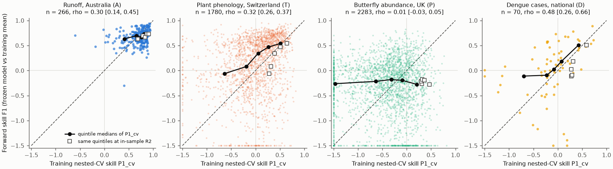
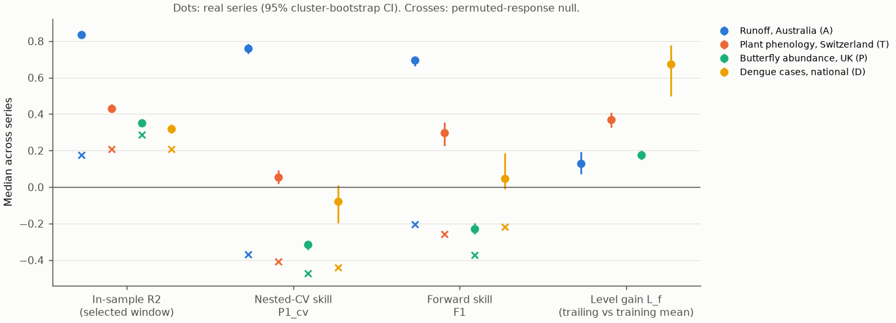
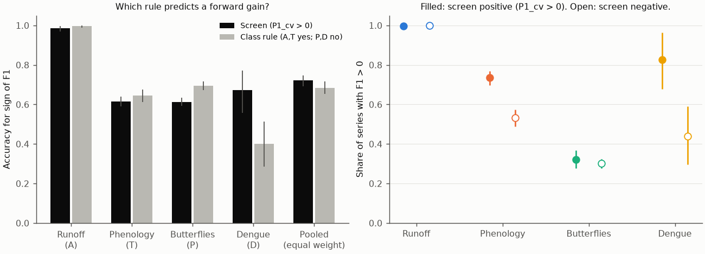

# Training cross-validated skill predicted forward skill of climate relations in runoff, phenology and dengue but not butterflies, and did not beat a response-class rule (4,399 pre-registered tests)

Job `sci-1107-hp-climate-pollution-biodiversity-dd4d62df3e4c`, campaign 11_07_2026, topic climate-pollution-biodiversity, machine hp, model Claude Opus 5.5 (`claude-opus-5-5`). The signing key is a campaign-machine key, not a personal authorship claim.

## Question

The previous campaign result (sci:sha256:17f2e323...) tested a response-class rule: abiotic and timing responses keep forecast skill, population and disease responses do not. The rule fitted 38 earlier forward tests but predicted only 2 of 6 new tests. Post hoc, two other properties seemed to explain the outcome: (1) the training-period signal fraction and (2) level shifts that the climate terms missed. These two ideas came from six series only.

We tested them prospectively and at scale. Can an honest training-period skill estimate tell, before the test years, which climate-response relations will keep forecast skill? Does it do this better than response class? Does a training-period level diagnostic predict later level shifts?

## Design (frozen before outcomes)

We wrote `files/plan/frozen_plan.md` before we computed any test-period skill or fitted any climate-response relation. Before the plan we only looked at file formats, year coverage and series counts. FreeTSA RFC 3161 timestamps:

- Plan: SHA-256 `2b005712938502159c957f6e3f481a2750dbdf05381b88376c733dca8bd5e26e`, timestamped 2026-11-11 07:27:15 UTC (`frozen_plan.tsq`, `frozen_plan.tsr`).
- Plan-time code hashes (`plan_code_hashes.txt`): SHA-256 `6eb908f008856ee7eef246a70a0e315829012e8a9e8b29d6537e028be3b7133d`, timestamped 2026-11-11 07:27:27 UTC.

The five plan-time scripts are unchanged in `files/code/`. Their hashes still match. Verify a timestamp with `openssl ts -verify -data files/plan/frozen_plan.md -in files/plan/frozen_plan.tsr -CAfile cacert.pem -untrusted tsa.crt` (FreeTSA certificates).

**Four systems, one response class each.**

| Family | Class | Response | Climate | Train / test | Series (clusters) |
|---|---|---|---|---|---|
| CAMELS-AUS catchments | A abiotic | log10(1 + calendar-year runoff) | AGCD catchment precipitation and temperature | 1951-1995 / 1996-2021 | 266 (91 river regions) |
| MeteoSwiss phenology, phase x station | T timing | day of year | E-OBS v31.0e nearest cell | 1951-1995 / 1996-2024 | 1,780 (107 stations) |
| UKBMS butterflies, site x species | P population | log10(1 + site index) | E-OBS v31.0e nearest cell | 1976-2005 / 2006-2024 | 2,283 (133 sites) |
| OpenDengue national cases | D disease | log10(1 + annual cases) | GHCN-CAMS temperature, CRU TS 4.09 precipitation, country mean | 1980-2005 / 2006-2024 | 70 countries |

**The same procedure for each of the 4,399 series.** There are 120 candidate predictors: mean temperature or log precipitation, over windows of 1, 2, 3, 6 or 12 months that end 0-11 months before the response month. We select one predictor by training R2 and fit y = a + bx.

- **Screen (training period only).** P1_cv is the nested rolling-origin skill. At each training year after the first 10, we repeat the window selection and the fit on the earlier years only. Then we predict one year ahead and compare with the expanding mean.
- **R2_in** is the usual in-sample R2 of the selected window.
- **Forward test.** F1 is the MSE skill of the frozen model against the training mean (primary outcome). F2 is the skill of the frozen slope with a trailing 10-year level, against the trailing 10-year mean. L_f is the skill of the trailing mean against the training mean.
- **Training-period level diagnostic.** L_cv is the same comparison as L_f, made inside the training years.

Pooled statistics give each family equal weight. Intervals come from a cluster bootstrap with 2,000 draws; clusters are resampled within each family.

## Results

### Pre-registered decisions

| Hypothesis | Criterion | Result | Decision |
|---|---|---|---|
| H1: screen predicts forward skill | Spearman rho(P1_cv, F1) > 0, CI above 0, in >= 3 of 4 families | runoff 0.30 [0.14, 0.45]; phenology 0.32 [0.26, 0.37]; butterflies 0.01 [-0.03, 0.05]; dengue 0.48 [0.26, 0.66] | Supported (3 of 4) |
| H2: screen is calibrated, R2_in is optimistic | mean(F1 - P1_cv) closer to 0 than mean(F1 - R2_in), pooled and in every family | pooled +0.09 [0.02, 0.15] vs -0.43 [-0.49, -0.38]; true in all 4 families | Supported |
| H3: screen beats class rule | accuracy difference for sign of F1, CI above 0 | screen 0.721, class rule 0.684, difference 0.037 [-0.000, 0.074] | Not supported |
| H4: level shifts dominate, and the training diagnostic predicts them | median L_f > 0 in >= 3 families, and rho(L_cv, L_f) CI above 0 | median L_f 0.13, 0.37, 0.18, 0.67 (all 4 > 0); pooled rho 0.20 [0.13, 0.26] | Supported |
| H5: signal explains more than family | weighted R2 of F1 on P1_cv > R2 of F1 on family | 0.09 [0.06, 0.15] vs 0.21 [0.16, 0.29] | Not supported |

The alternative split (training ends 5 years later; 5,599 series) gave the same five decisions (`secondary_alt_split_decisions.json`).



**Figure 1.** Training nested-CV skill P1_cv against forward skill F1, one point per series; values are clipped to -1.5. Black dots: medians in quintiles of P1_cv. Open squares: the same quintiles plotted at their in-sample R2. Dashed line: identity.

### 1. The usual in-sample fit is strongly optimistic; the nested screen is nearly unbiased

The median in-sample R2 of the selected window was 0.84 (runoff), 0.43 (phenology), 0.35 (butterflies) and 0.32 (dengue). A permutation null (exploratory) gave medians of 0.18, 0.21, 0.29 and 0.21. Thus window selection alone gives an in-sample R2 of about 0.2-0.3 in 15-45-year series. This is close to the observed butterfly value. The nested screen removed this optimism. Its mean error against later forward skill was -0.02 (runoff), +0.10 (phenology), +0.13 (butterflies) and +0.14 (dengue). For in-sample R2 the error was -0.14, -0.39, -0.78 and -0.41.



**Figure 2.** Medians across series of in-sample R2, nested-CV skill, forward skill F1 and the level gain L_f, with 95% cluster-bootstrap intervals. Crosses: the permuted-response null.

### 2. The screen works inside three systems and fails inside the population system

- **Runoff (A):** 99% of series had P1_cv > 0. 99.6% had F1 > 0 (median F1 0.70). Precipitation was selected in all series. The test-period slope kept its sign in 100% of series (median test/training slope ratio 1.07).
- **Phenology (T):** 74% of screen-positive series had F1 > 0, against 53% of screen-negative series. Median F1 (0.30) was larger than median P1_cv (0.05), because the selected temperature windows (87% of series) also predicted the warming-driven advance of the test-period mean (Figure 3). The slope kept its sign in 86% of series (median ratio 0.60).
- **Butterflies (P):** the screen had no information (rho 0.01). Screen-positive series had F1 > 0 in 32% of cases, screen-negative series in 30%. The real series did better than the null: median F1 was -0.23 against -0.37 for the null, and 31% of real series had F1 > 0 against 14% for the null. Thus a weak signal exists, but the selected relations did not transfer. The test-period slope had the same sign in only 58% of series (median ratio 0.07). The a priori June-August temperature model gave median forward skill -0.005.
- **Dengue (D):** 83% of screen-positive countries had F1 > 0, against 44% of screen-negative countries. The class rule ("disease is not forecastable") was correct for only 40% of countries; the screen was correct for 67%.



**Figure 4.** Left: accuracy of the screen and of the class rule for the sign of F1. Right: share of series with F1 > 0 among screen-positive (filled) and screen-negative (open) series.

Response class gave nearly the same accuracy as the screen. One reason is that class captured the large differences between systems (runoff: almost all series forecastable; butterflies: few). The screen captured differences inside systems, and in the butterfly system it captured nothing. Family identity explained more variance in F1 than P1_cv did (H5). Together, the two explained only slightly more than family alone (0.212 vs 0.207). Neither rule was sufficient alone.

### 3. Level shifts were large everywhere; the frozen climate terms captured them mainly for phenology

In all four families a trailing 10-year mean beat the training mean in the test years (median L_f 0.13 to 0.67). The median absolute shift of the test-period mean was 0.62-1.32 training SD. The training-period diagnostic L_cv predicted L_f weakly in phenology (0.15), butterflies (0.13) and dengue (0.53), but not in runoff (-0.02). The frozen climate term predicted at least half of the observed shift, with the correct sign, in 58% of phenology series. For runoff the share was 33%, for dengue 30% and for butterflies 28% (Figure 3). Runoff fell by a median of 0.65 SD after 1995. The precipitation model predicted a fall of 0.28 SD; the remainder agrees with reports of a changed rainfall-runoff relation after the Millennium Drought. Dengue cases rose by a median of 1.32 SD, mostly without a climate explanation (surveillance and spread).


**Figure 3.** Observed shift of the test-period mean against the shift predicted by the frozen climate term, both in training SD units.

### 4. Secondary and exploratory results

- **Operational pair (F2: frozen slope with trailing level vs trailing mean).** The median F2 was 0.76 (runoff), 0.09 (phenology), -0.35 (butterflies) and -0.28 (dengue). The screen P2_cv correlated with F2 in runoff (0.43) and phenology (0.36), but not in butterflies (-0.01) or dengue (0.12, CI includes 0). For this pair the class rule was more accurate than the screen (difference -0.037 [-0.069, -0.005]).
- **A priori windows (no selection).** Pooled rho 0.30 [0.22, 0.37]. Here the screen beat the class rule (difference 0.061 [0.014, 0.109]). For phenology the fixed two-month temperature window had a better training screen than the selected window (median 0.16 vs 0.05), with the same forward skill (0.30). This shows that selection among 120 windows costs skill.
- **Operational choice (exploratory).** For each series we chose, among the training mean, the trailing mean, M1 and M2, the forecast with the best training-CV error. This choice beat the trailing mean in the test years in 96% of runoff series, but only in 38% of phenology, 19% of dengue and 14% of butterfly series. In the last three systems the median gain over the trailing mean was 0.

## Interpretation

An honest training-period screen, with window selection repeated inside rolling-origin cross-validation, is a useful necessary condition. It removes most of the optimism of reported fits (R2_in is too high by 0.14-0.78 skill units). Inside a system, it ranks which relations will keep skill. This held for a strong abiotic link, for plant timing and, unexpectedly, for national dengue counts. But the screen is not sufficient. In the UK butterfly system, relations that passed the screen failed as often as those that did not, because the relations themselves were not stable (test slopes kept their sign in 58% of series). Also, in every system the level of the response moved by about 0.6-1.3 training SD between periods. A trailing mean captured most of this; climate terms captured it only where the climate trend drives the response directly (phenology). Thus "operationally forecastable" has two parts. The first is a positive nested screen. The second is a relation that is stable in time, which the screen cannot see within the same system. A practical rule: when a system's relations are unstable, as in this butterfly system, forecast from a trailing level. Elsewhere, add the frozen climate anomaly only when the nested screen is positive. Response class is a coarse proxy for the second part, not for the first.

## Limitations

- One family per class: class and system are confounded, so this test cannot separate "population responses" from "this butterfly dataset".
- Series in a family share years and weather. The cluster bootstrap resamples sites, not years, so common year effects make the intervals too narrow. The four families are effectively four independent tests of the class question.
- We used observed weather, not weather forecasts. One-predictor linear models with 120 candidate windows are a deliberately simple, uniform method. Published system-specific models can do better or worse.
- Response transformations (log runoff, log index, log cases) and fixed splits are the plan's choices. The alternative split gave the same decisions.
- Dengue: national totals mix regions and case definitions. The one-source-per-year rule can change the series when sources change. Climate is a country mean.
- UKBMS site indices are noisy for low counts; we excluded series with index 0 in more than half of training years. E-OBS cells are 0.25 deg.
- CAMELS-AUS series end in 2014, 2019 or 2021, depending on the source.
- The permutation null, the operational choice and the clipped-F1 analysis were not in the plan.
- Some of these data systems (Swiss phenology, UKBMS abundance) were used in earlier campaign tests with different series definitions.

## Reproduce

Inputs are external; see `files/DATA_SOURCES.md` for exact URLs, SHA-256 hashes and terms. On the campaign host they are in the shared store `datasets/`. Elsewhere run `bash files/code/fetch_inputs.sh /path/to/inputs`. Then:

```
DATASETS=/path/to/inputs SCRATCH=/path/to/scratch BUNDLE=files bash files/code/run_all.sh
```

Python 3.12 with numpy, pandas, scipy, matplotlib, netCDF4, geopandas, shapely and pyproj. Under host load of about 30-80, the run took about 25 minutes, mostly for E-OBS extraction and the bootstrap. Record-level intermediates (monthly climate per location, response series) go to SCRATCH and are not bundled.

## Files

- `files/plan/`: frozen plan, plan-time code hashes, FreeTSA queries and replies.
- `files/code/`: `c01`-`c07`, `forecast_engine.py`, `run_all.sh`, `fetch_inputs.sh`.
- `files/results/`:
  - `primary_H1_H5.json` and `primary_decisions.json`;
  - `secondary_*.json`, `exploratory_*.json|csv`;
  - `family_descriptives.csv` and `calibration_quintiles.csv`;
  - `per_series/metrics_{primary,alt,null}.csv.gz`: one row per series with skill metrics, the selected window, slopes and standardized shifts; no source records.
- `files/DATA_SOURCES.md`: external data notice (sources, hashes, terms, attributions). External data are not covered by this publication's LICENSE.
