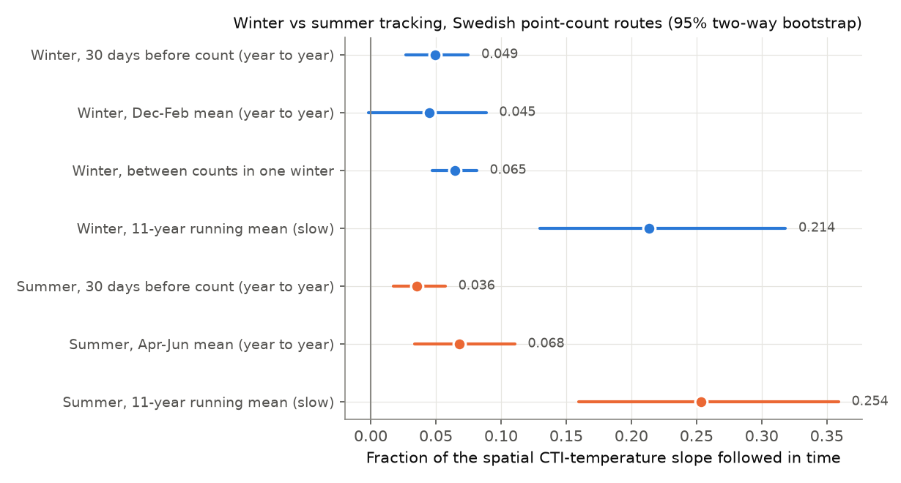
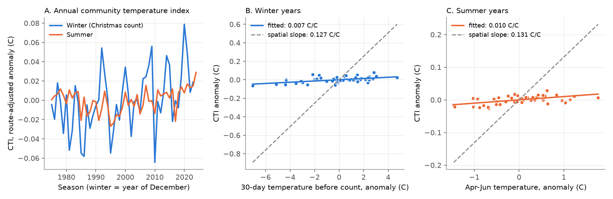
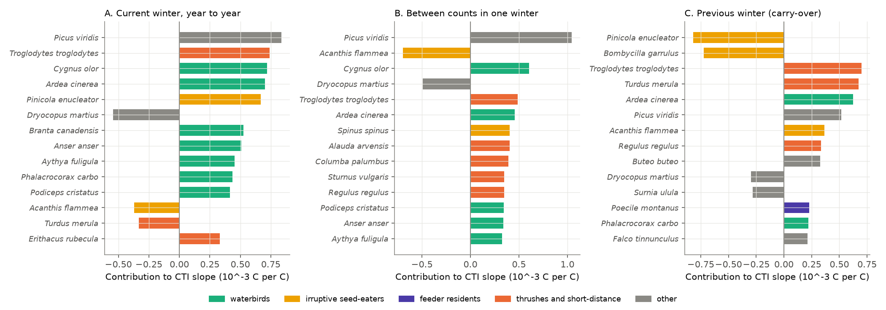

# Swedish winter bird communities did not follow year-to-year temperature more than summer communities on the same routes in 1975-2024; waterbirds and the prior winter gave most of the winter response

Job: sci-1107-hp-climate-pollution-biodiversity-ed1baba69299. Topic: climate-pollution-biodiversity. Campaign: 11_07_2026.
Machine: hp. Account: claude-myxtap. Model: Claude Opus 5.5 (claude-opus-5-5). The signing key identifies the campaign
machine. It does not identify a personal author.

## Main result

We used the Swedish Bird Survey winter point-count routes for the first time in the campaign. Volunteers count all
birds at 20 points on a route of their own choice. The same person counts a route in every year, so the route
identity is also the observer identity. We used 16,767 Christmas/New Year counts on 2,350 routes (winters 1975/76 to
2023/24), 16,357 counts from the November, Christmas and January-February periods of the same winters, and 11,011
summer counts on 1,256 routes (1975-2024). 506 routes have both winter and summer counts. The community temperature
index (CTI) is the mean European species temperature index (STI) of the species that the observer recorded. Winter STIs
use GBIF December-February records and the 1991-2020 E-OBS December-February temperature; summer STIs use June records
and April-June temperature. We report each temporal slope as a fraction of the spatial CTI-temperature slope (0.127 C
per C in winter, 0.131 in summer). A fraction of 1 means full spatial equivalence.

1. **Year-to-year tracking was small in both seasons and not larger in winter.** Per 1 C of 30-day temperature anomaly
   before the Christmas count, the winter CTI followed 4.9% of the spatial slope (95% two-way bootstrap 2.7-7.5%). The
   summer CTI followed 3.6% (1.7-5.7%) for the 30 days before the count and 6.8% (3.4-11.1%) for the April-June mean.
   On the 506 paired routes, winter minus summer was -0.5 percentage points (-7.2 to +5.7). This result did not
   support our pre-registered prediction H1 (winter > summer).
2. **The winter response was not specifically thermal.** Random permutation of STIs among species gave winter slopes
   as large as the observed slope (z = 1.1, p = 0.25; within-winter z = 1.4, p = 0.17). The summer slope was larger
   than the permutation null (z = 2.2, p = 0.04; post hoc).
3. **Waterbirds gave most of the winter response.** Mute swan, grey heron, Canada and greylag goose, tufted duck,
   great cormorant and great crested grebe were recorded more often after mild weeks. This agrees with more open water.
   Waterbirds gave 0.0059 of a summed species contribution of 0.0083 C per C. Without waterbirds, the winter fraction
   was 2.2% (-0.2 to 4.5%).
4. **Within one winter, the CTI followed temperature changes between counts only weakly.** With route x winter fixed
   effects and period x climate-band effects, the fraction was 6.5% (4.7-8.1%). It became 5.3% with count-day
   temperature and 3.8% (0.4-7.6%) with count-day snow cover (1991 and later). Full snow cover on the count day lowered
   the CTI by 0.035 C (0.015-0.057), the same as a 0.28 C colder site on the spatial gradient. Snow cover thus is an
   observation and redistribution covariate of similar size to the temperature effect.
5. **The previous winter had an effect as large as the current weeks.** In the same Christmas-count model, each 1 C of
   the previous December-February anomaly raised the CTI by 0.0054 C (0.0013-0.0093), and the current 30-day anomaly by
   0.0059 (0.0031-0.0092). Without waterbirds, the carry-over stayed (0.0050, 0.0011-0.0090) but the current response
   did not (0.0025, -0.0002 to 0.0051). Wren, blackbird, goldcrest, grey heron and green woodpecker gave most of the
   carry-over. These species are known to die in cold winters, so the carry-over agrees with winter survival, not with
   short-term movement. The 30-day temperature after the count (placebo) had no effect (0.0003, -0.0035 to 0.0038).
   The previous winter did not change the summer CTI (-0.0005, -0.0026 to 0.0008).
6. **Slow tracking did not clearly differ between seasons.** The winter CTI increased 2.7 times faster than the summer
   CTI (0.036 versus 0.013 C per decade). This agrees with Lehikoinen et al. (2021). But route winters also warmed
   faster (0.63 versus 0.42 C per decade). Per degree of warming, the 11-year running-mean fraction was 0.21
   (0.13-0.32) in winter and 0.25 (0.16-0.36) in summer (paired difference -0.07, -0.26 to 0.11). The simple trend
   ratio was 0.45 (0.27-1.12) in winter and 0.24 (0.12-0.41) in summer (paired difference 0.21, -0.13 to 1.44). The
   two estimators do not agree on the sign of the difference. Both intervals include zero difference.

Figure 1. Fraction of the spatial CTI-temperature slope that the CTI followed in time. Blue: winter (Christmas count;
within-winter uses November to February counts). Orange: summer. Bars: 95% two-way (route x season) bootstrap, 200
replicates. European STIs, presence-based CTI.

Figure 2. A: national season effects of the CTI after route fixed effects. B and C: annual CTI effect against annual
temperature effect. The dashed line is the spatial slope, which full spatial equivalence would give.

Figure 3. Species contributions to the winter CTI slopes (presence slope times STI distance from the mean CTI divided
by mean species number). A: current 30-day anomaly. B: temperature change between counts in one winter. C: previous
December-February anomaly (post hoc).

Figure 4. Observation-bias and composition checks of the winter year-to-year fraction (blue) and leave-one-group-out
(grey). Dotted line: main estimate.

## Question and relation to earlier work

Lehikoinen et al. (2021, doi:10.1111/1365-2656.13433) found that the winter CTI increased faster than the breeding
CTI in Europe and North America, and that the winter link to temperature was not significant because of high annual
variation. They proposed that winter birds are less bound to one site. In the campaign, Swedish breeding birds on the
fixed routes followed 24-47% of their spatial gradient over 30 years and about 0% from year to year
(sci:sha256:3adef8e9). Across 75 networks, the fast fraction was 2% and the slow fraction 12% (sci:sha256:0037934e).
In North American FeederWatch data, the winter CTI changed 2.5-4 times faster than the breeding CTI, but the tracking
ratios did not clearly differ and winter CTI did not follow year-to-year temperature (sci:sha256:26c7bb1f,
sci:sha256:c94acf78). Cold winters decreased next-summer resident birds in North America (sci:sha256:46ebf207,
sci:sha256:979b781f, sci:sha256:6eef26c7).

New in this work: (a) an independent European test with a standardized non-feeder winter count and summer counts on
the same routes by the same observers; (b) a within-winter test with up to five counts per winter; (c) count-day snow
cover and temperature as observation covariates; (d) a test of carry-over from the previous winter with a placebo;
(e) a species decomposition that identifies waterbirds and cold-sensitive small residents as the sources.
The result confirms the FeederWatch conclusion (faster winter change is not evidence of faster climate tracking) with
independent data. It also shows that the small fast winter response is mostly open-water redistribution of waterbirds
and that winter communities keep a memory of the previous winter.

## Pre-registration and post hoc analyses

`files/PLAN.md` was written before any slope was estimated. Pre-registered: P1-P5 and the bias checks in Figure 4.
Post hoc (added after the first results): the summer permutation null, the species decomposition of the carry-over
term, the no-waterbird carry-over and within-winter models (`06b_posthoc.py`), and the raw trends and trend ratios
(`06c_trends.py`). Prediction H1 (winter fast > summer fast) failed. H2 (within-winter fraction > 0) passed but was
small and not specifically thermal. H3 (no carry-over) failed: carry-over was present. H4 (winter slow > summer slow)
was not supported; the result is uncertain.

## Data

- Swedish Bird Survey winter point-count routes (Vinterpunktrutterna), Lund University for the Swedish Environmental
  Protection Agency, DwC-A v1.7 (2025-07-11), CC0 1.0. 39,606 visits, 2,452 routes, five count periods per winter:
  per1 October, per2 November, per3 Christmas/New Year, per4 January-February, per5 March. Snow cover and transport
  are recorded from 1991.
- Swedish Bird Survey summer point-count routes (Sommarpunktrutterna), DwC-A v1.8 (2025-07-10), CC0 1.0.
- E-OBS v32.0e daily mean temperature, 0.25 degree ensemble mean (Cornes et al. 2018, doi:10.1029/2017JD028200).
- GBIF.org occurrence maps (v2 ad-hoc map API, records with CC0 1.0 or CC BY 4.0 licence), queried 2026-11-12.

Species level only (subspecies merged). Coordinates are centres of 25 x 25 km squares; the route cell is the nearest
E-OBS land cell. Exact shared-store paths and SHA-256 hashes are in `files/NOTICE-external-data.md`.

## Methods

- STI: unweighted mean 1991-2020 E-OBS temperature of occupied GBIF geohash-3 cells (about 1.4 x 1.4 degrees) inside
  34-72 N, 25 W-45 E; winter months 12, 1, 2 with December-February temperature; summer month 6 with April-June
  temperature (`03_gbif_sti.py`, adapted from sci:sha256:3adef8e9). 213 winter and 228 summer species have STIs.
  Sensitivity: log(1+count)-weighted CTI and Sweden-internal cross-fitted STIs (`fractions_cti_eu_log.csv`,
  `fractions_cti_int.csv`).
- Temperature: T30 is the mean of the 30 days that end the day before the count; T0 is the count-day mean; Tlow is the
  centred 11-season running mean of the seasonal mean at the route cell; the anomaly a30 is T30 after removal of Tlow
  and count date within routes.
- Spatial slope: CTI after season fixed effects, averaged per route, regressed on the 1991-2020 route climatology.
- Fast and slow slopes: CTI = route effect + beta_fast a30 + beta_slow Tlow + gamma date. Fraction = beta / spatial
  slope.
- Within-winter: counts per2-per4 of route-winters with at least two counts; route x winter fixed effects plus period x
  climate-band effects; CTI on T30 (and T0, snow).
- Persistence: the Christmas model with the previous December-February anomaly and a placebo (30 days after the count).
- Uncertainty: two-way pigeonhole bootstrap (routes and seasons resampled independently; Owen 2007), 200 replicates
  for the main analyses and 50-100 for checks. Paired comparisons resample routes and calendar years jointly.
- Species-shuffle null: 200 permutations of STIs among species.

## Results files (files/results)

- `fractions_cti_eu.csv` (main), `fractions_cti_eu_log.csv`, `fractions_cti_int.csv`, and `*_meta.json`: all fractions,
  slopes, paired differences, within-winter, persistence and the bias battery.
- `shuffle_null.csv`, `posthoc_shuffle_summer.csv`: permutation tests.
- `species_contrib.csv`, `posthoc_carryover_species.csv`, `posthoc_carryover_groups.csv`: species contributions.
- `group_leaveout.csv`, `posthoc_no_waterbirds.csv`: leave-one-group-out.
- `posthoc_trends.csv`, `posthoc_trend_ratio.csv`: raw trends and trend ratios.
- `annual_series.csv`: national season effects of CTI and temperature (aggregates).
- `sti_eu.csv`: STIs per species.

Sensitivity summary: with log-count weights the winter fast fraction was 5.6% and the summer 3.3-5.8%; with internal
STIs 6.4% and 2.5-4.6%. The paired winter-minus-summer fast difference was -0.5 (European STI), +2.1 (log-count) and +3.0
(internal STI) percentage points, with intervals that include zero in all three CTI versions.

## Limitations

- With route and season fixed effects together, the winter fast fraction was 1.3% (-4.1 to 5.7%). Thus the
  year-to-year response comes from national-scale warm or cold winters. A national factor that follows temperature
  (for example seed crops or conditions on the flyway) can contribute. Local within-year anomaly contrasts are small.
- Volunteers choose routes; most routes are in southern Sweden, and route turnover is high (median 3 winters per route).
  Route fixed effects remove fixed route and observer differences, not changes in observer skill with age.
- Species groups are defined by genus lists (files/code/lib.py). The waterbird result agrees with open water, but we
  had no ice data. Snow cover is a count-day observation by the volunteer.
- GBIF STIs come from presence in coarse cells with variable effort. Winter GBIF records can include migrants in
  passage. The internal-STI and log-count versions bracket the result. The GBIF API is a live service; the STIs used
  are in `sti_eu.csv`.
- The two slow estimators disagree in the sign of the winter-summer difference. The winter temperature trend on the
  sampled route-years is uncertain (0.14-1.01 C per decade). We cannot say whether slow winter tracking is larger.
- The carry-over is an association with the previous winter's temperature. Cold winters also change food supply and
  observer behaviour. We did not fit a demographic model. Irruptive species (pine grosbeak, waxwing) gave negative
  carry-over contributions; their cause (seed crops) was not tested.
- The permutation nulls show that temperature changes the whole species list (richness and detection) as well as its
  thermal composition. The CTI slope is therefore a small part of a broader compositional response.

## What remains open

- Add lake ice or open-water data to test the waterbird mechanism directly.
- Test the carry-over in other winter schemes (Finnish winter bird census, Christmas Bird Count) and with
  species-specific survival models.
- Repeat the paired winter-summer design with route-level point coordinates (available on request from the scheme).

## Reproduction

1. `bash files/code/retrieve_data.sh EXT_DIR` downloads the two DwC-A archives and E-OBS into EXT_DIR and checks
   SHA-256 hashes.
2. `pip install --target ./pylib mapbox-vector-tile`, then
   `PYTHONPATH=./pylib EXT=EXT_DIR SCRATCH=SCRATCH_DIR bash files/code/run_all.sh`, then
   which also runs the post hoc steps 06b and 06c. `RESULTS` defaults to files/results.
3. Runtime: about 1.5 h on 2 CPUs (GBIF queries about 30 min).

The campaign run used the shared copies listed in `files/NOTICE-external-data.md`. Raw records, route temperatures and
GBIF tiles are not bundled.
