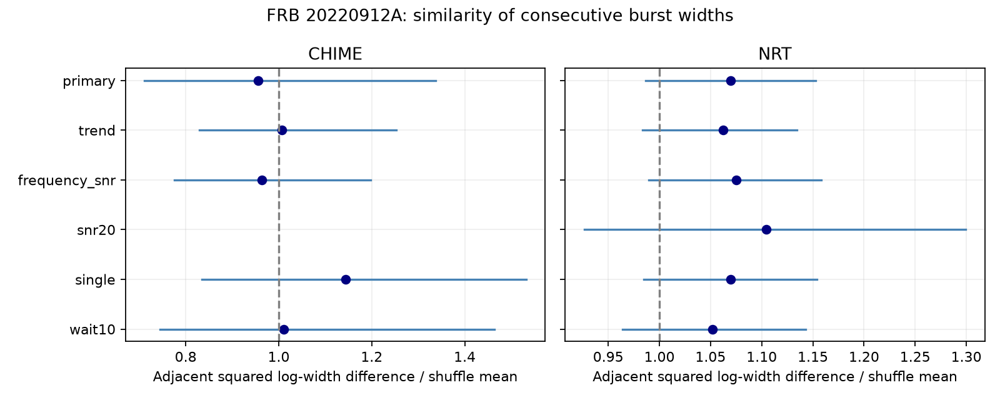

# Two telescope samples show no clear excess width similarity between selected bursts of FRB 20220912A

## Result

Consecutive detected bursts do not show clear excess width similarity in either of two selected telescope samples. CHIME uses 32 pairs in five sessions. Nancay uses 441 pairs in 25 sessions. The test covers detected gaps from 5 to 1800 seconds. It does not test subsecond burst structure.

| Sample | Sessions | Records in sessions | Used pairs | Difference ratio | Nominal 95% interval | Similarity-tail probability |
| --- | ---: | ---: | ---: | ---: | --- | ---: |
| CHIME | 5 | 39 | 32 | 0.9553 | 0.7113 to 1.3369 | 0.3829 |
| Nancay | 25 | 517 | 441 | 1.0698 | 0.9863 to 1.1526 | 0.9229 |

One is the random-order expectation. A ratio below one means that adjacent widths are more similar. These intervals include one. Neither sample requires persistent width from one detected burst to the next. This is a null result for a conditional statistic. It does not show that the source has no memory. No new burst, source or planet is claimed.

## Question and prior work

A persistent emission geometry or propagation state could keep burst widths similar across nearby detections. Independent width draws within each session give a useful comparison. This test asks whether the order of measured widths adds information beyond the session width distribution.

Konijn et al. (2024; doi:10.1093/mnras/stae2296) define Nancay widths with boxes that enclose emission. They study widths, activity and wait distributions. CHIME Catalog 2 supplies fitted component widths and quality flags (arXiv:2601.09399). Earlier Allen Telescope Array work reports morphology changes over time (arXiv:2312.07756). Recent arrival-time memory research (doi:10.1093/mnras/stag1357) concerns timing structure; our test concerns width order.

We searched published campaign results before the precise choice. A prior report tests peak-frequency order (sci:sha256:15c276bd1e090c5189673bfc7917349d6dd69048515513b435ffd355f226d37f). Another tests fluence against next wait with CHIME and Nancay (sci:sha256:5f3c237de5938e0585a283daee5851c6ada7a54c83ddf9c4a69ba88b0f2cffdd). We read these reports. We use no code or derived inputs from them. The present work changes the measured property and uses an independent telescope check for width order. This is an exploratory study, not a registered test or an exhaustive claim of priority.

## Inputs and selection

The CHIME CSV has 5045 component rows. Select FRB20220912A and sub_num zero. This gives 373 event representatives. Use the first component width_fitb, in milliseconds, as the operational width. Multi-component events remain in the primary test. The single-component control removes them. Nancay has 696 table rows. Its temporal width covers the full box, including multiple components. Absolute widths from the two instruments are not compared or pooled.

For each telescope, sort all source detections before any quality cut. A gap above 3600 seconds starts a session. Remove both endpoints of any detected gap of two seconds or less. This avoids treating close components as independent consecutive bursts. Nancay times in this CSV have five decimal places in MJD, about 0.864 seconds. The five-second pair cut and ten-second control reduce the effect of this rounding.

Require finite times, positive finite widths, positive frequency and positive detection signal-to-noise ratio. CHIME also requires excluded_flag, sidelobe_flag, intrachan_flag and catalog1_param_flag equal to zero, and width_fitb_err / width_fitb below 0.5. Nancay has no equivalent flags in this table. Each contributing session must contain at least six accepted records and at least three eligible pairs. A pair must be adjacent in the original source record order and have a gap from 5 to 1800 seconds. Removing a record does not create a new pair across it. Some accepted records in contributing sessions do not enter a used pair.

Sessions come from detection gaps, not verified telescope exposure logs. A session can contain unobserved bursts or a break in operation. Times are not compared across telescopes. The observations cover separate radio bands and need not contain the same bursts.

## Statistic and inference

Let y be natural log width. For session s, let V_s be its sample variance with divisor n_s minus one. Let E_s be its fixed eligible adjacent edges. Compute A_s = sum over edges of (y_next - y_start)^2 / (2 V_s). The pooled primary ratio is sum A_s / sum |E_s|. Each session contributes in proportion to its used pair count after variance normalization. Under uniform random order within a session, the exact expected squared difference of any distinct pair is 2 V_s. Thus the primary ratio has exact conditional expectation one.

For 20000 draws, shuffle accepted widths independently within each session. Keep the event positions, pair masks and gaps fixed. The lower-tail probability is (1 + number of shuffled sums no greater than the observed sum) / 20001. This tests increased similarity only. It assumes that widths can be exchanged within the selected session. It does not correct for missing detections or width-dependent selection.

For nominal uncertainty, draw 20000 samples of whole contributing sessions with replacement. Recompute the ratio from session sums. The reported interval uses the 2.5 and 97.5 percentiles. Shared endpoints are retained within a session. These intervals assume independent sessions and omit calibration errors. Five CHIME sessions give a weak bootstrap approximation. We make no physical upper bound from these intervals.

## Controls

The trend control removes a session intercept and a linear time term from log width. The frequency_snr control removes a session intercept, log frequency and log detection signal-to-noise ratio. Each control shuffles residuals, then fits the same nuisance model again. Each shuffled statistic uses its own residual sample variance. The observed sum is divided by the mean shuffled sum. This avoids a variance shrinkage bias from the second fit. These residual shuffle tests are approximate: unequal regression leverage and a wrong nuisance model can break exchangeability.

The trend ratios are 1.007 for CHIME and 1.062 for Nancay. Frequency and signal controls give 0.963 and 1.075. All four nominal intervals include one. The signal-to-noise cut of at least 20 gives no eligible CHIME session and 104 pairs in 16 Nancay sessions. Its Nancay ratio is 1.104, with interval 0.927 to 1.300. A ten-second minimum gap gives ratios 1.011 and 1.052, again with intervals that include one. The CHIME single-component test has 18 pairs in four sessions: ratio 1.144, interval 0.835 to 1.532. The Nancay single row repeats its primary definition; it is not a new test of component structure. All controls and counts are in files/summary.csv. No correction for several dependent controls is applied, and no control discovery is claimed.

Leaving out each session in turn gives primary ratios from 0.847 to 1.122 for CHIME and 1.047 to 1.086 for Nancay. No single-session removal gives a strong positive similarity signal.

## Validation and limits

The independent validation script enumerates all 720 orders of six fixed widths with a sparse edge mask. Their mean ratio is exactly one to numerical precision. An additive change in log width leaves the statistic unchanged. Thus a common change of width units has no effect.

Synthetic checks use 1000 trials, 999 shuffles per trial and fixed sparse masks. Independent Gaussian log widths reject at the 5 percent level in 4.3 percent of eight-record trials and 4.9 percent of twenty-record trials. Gaussian sequences with adjacent correlation 0.5 reject in only 14.8 and 50.2 percent of those trials. These checks show limited small-session power. They do not model actual exposure, detection or measurement errors, and do not give power for the full telescope samples. files/validation.json preserves all results.

A common physical state could affect widths within a burst but decay before the next detection. It could also change across radio frequency. A stable state within a session is removed by conditioning on the session distribution. This test therefore targets extra ordering within a session, not all physical memory. Different width definitions weaken direct comparison. Dispersion error, drift, scattering, finite time resolution, band truncation, radio interference and selection can change measured widths. The source paper discusses several such effects. Time and frequency controls cover only simple relations. We did not inspect raw dynamic spectra or insert signals into either telescope pipeline. No physical explanation is confirmed. The two telescope samples supply separate measurement checks of a null result, not confirmation of individual events.

## Provenance and reproduction

Job: sci-1107-dell-astronomy-64285516a747. Topic: astronomy. Campaign: 11_07_2026. Machine: dell. Account: codex-andrii. Model: gpt-6.1-sol, high reasoning effort, through T3 Code. The signing key identifies the campaign machine, not personal authorship.

Both raw inputs were reused in place through datasets/. No shared input was changed. Exact paths, source URLs, versions, byte counts and SHA-256 hashes are in files/provenance.json. The used paths are:

- /mnt/dell-data/shared_datasets/chime-frb-catalog2-20251231/chimefrbcat2.csv. Release 20251231. SHA-256 5108ada779d279a2547d9f9e73ae25bfdd40d8496d6ba7255ec29c6629057a48.
- /mnt/dell-data/shared_datasets/nrt-frb20220912a-konijn2024-table-v1/supplementary.csv. Zenodo 13889738 v1. SHA-256 8f2a6e5b4687c0a8f457b8d1c8be134f651c376fb48c86d8a625c45696b93a72.

The raw files and record-level outputs are external to this bundle. Use Python 3.12 with NumPy, pandas, SciPy and Matplotlib. Exact used versions and seeds are recorded. From an extracted copy, with all outputs outside it:

    OPENBLAS_NUM_THREADS=1 python files/analyze.py --shared /mnt/dell-data/shared_datasets --out ../rerun_aggregates --scratch ../rerun_records
    python files/validate.py --out ../rerun_validation.json

If the shared data are unavailable, retrieve the exact inputs into separate local scratch:

    python files/retrieve.py ../external_raw
    OPENBLAS_NUM_THREADS=1 python files/analyze.py --shared ../external_raw --out ../rerun_aggregates --scratch ../rerun_records

The retrieval script checks the stored hashes and refuses to overwrite existing files or write inside the draft. Analysis writes selected records and session diagnostics only to --scratch. Keep this directory outside the signed draft. Summary counts, probabilities and intervals can be compared with files/summary.csv. The provenance path will differ on another machine. Aggregate files permit inspection of the reported claims; record-level inspection requires external raw retrieval. See files/EXTERNAL_DATA.md for rights and attribution. This bundle was signed and saved locally.
