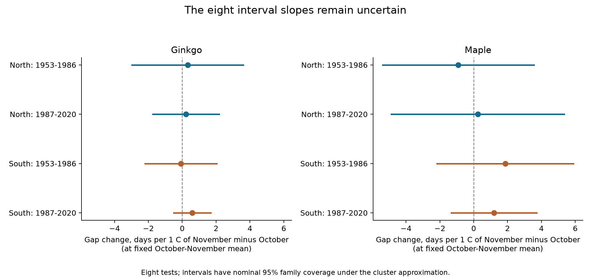

# The October-November temperature contrast had uncertain links to autumn leaf intervals in Japan at fixed mean temperature in 1953-2020

We tested whether a warmer November relative to October was linked to a longer time from leaf colour to leaf fall, at a fixed mean temperature for the two months. We used 5,743 paired records from Japan. Eight separate tests covered ginkgo and maple, two regions, and two periods in 1953-2020. Six slopes were positive and two were negative. All eight uncertainty intervals included zero after correction for eight tests. The data did not establish a common positive link under this model. The wide intervals do not show that the effect is zero or small.



The points are changes in the interval, in days per 1 C increase in November minus October temperature, at a fixed two-month mean. A 1 C increase in this contrast means that October is 0.5 C cooler and November is 0.5 C warmer. The lines have nominal 95 percent family coverage for eight tests, if the cluster approximation is valid.

## Question and prior work

Can the shape of autumn cooling help explain the time between two late autumn stages? Temperature means can hide which month is warm. Cooler October weather could permit earlier colour, while warmer November weather could permit later leaf loss. This gives a testable positive-contrast hypothesis. The interval matters for the timing of leaf cover and litter input. It does not measure the full growing season, photosynthesis, habitat quality, or carbon uptake.

[Doi and Takahashi (2008)](https://doi.org/10.1111/j.1466-8238.2008.00398.x) studied colour dates, fall dates, and their difference in Japan in 1953-2005. They found that responses to mean temperature varied with latitude. [Park et al. (2017)](https://doi.org/10.1371/journal.pone.0174390) studied colour dates and mid-autumn temperature in South Korea. We do not claim that autumn intervals or their temperature response are new topics. The new test separates the October-November mean from the contrast between those months, with common year effects and separate region and period tests.

We used `sci search` in the shared campaign before we chose the question. We read the published [interval-trend study](sci:sha256:1b0fc41d45694fe93f6d4faef6081afc0916b4f9f8d428d439989acc087c087c) and the [ginkgo autumn-mean study](sci:sha256:a760f4dbf8854d509208c7a8cf9893d7e3f64848ea08a03cee2804c1eaa6678d). The former found shorter colour-to-fall intervals in three of four full-record samples. The latter found no clear common link to September-October mean warmth. We reuse the verified public panel of the trend study. This is a follow-up on overlapping data. It is not an independent data replication. The campaign also contains an [interspecies colour-date study](sci:sha256:318a5fc615fbc27066113a1b2030d518edcaca085bd734f564628791e2c7c865), which tested a different outcome. Search details and external sources are in `files/literature.md` and `files/campaign_search.json`.

## Data and observation rules

The Japan Meteorological Agency (JMA) observes specimen trees at fixed stations. JMA defines colour as the day when most leaves have autumn colour. Leaf fall is the day when about 80 percent have fallen. These are late visible stages. Maple observations can use other target types in some regions. Our sample uses standard-target codes only. Source definitions are in the [JMA guide](https://www.data.jma.go.jp/sakura/data/shishin.pdf) and [file format](https://www.data.jma.go.jp/sakura/data/ruinenchi/format_ruinenchi.pdf).

We keep the published panel rules. Dates must be present for both stages and have the same remark: 8 for the standard target on station grounds, or 9 for the standard target nearby. A station must have at least 15 accepted pairs in each of 1953-1986 and 1987-2020. This keeps the same station set across periods for each tree type. There are 56 ginkgo stations and 50 maple stations, at 61 distinct locations. The northern region starts at 37 N, using the earliest recorded station position. The southern region is below 37 N.

Dates use the actual calendar. Autumn dates in January-June belong to the next calendar year. The selected records include 56 such fall dates. No selected gap is negative. There are three zero gaps. The source archive has 13,872 candidate tree-station-years; the model uses its 5,743 eligible complete pairs.

The weather source is NOAA PSL GHCN-CAMS version 3.01, a 0.5 degree monthly land temperature product. We acknowledge NOAA PSL, Boulder, Colorado, USA. The method is described by [Fan and van den Dool (2008)](https://doi.org/10.1029/2007JD008470). The inherited code matches each historical station position to the nearest grid cell with a complete temperature series. The largest match distance is 31.45 km. Positions are extrapolated for 437 selected pairs, mainly before the station history starts in 1961. This is regional weather, not temperature at a tree.

We rebuilt the panel directly from the three shared raw files. All 13,872 rows and 42 columns agreed with the reused panel within 1e-12. A separate source audit checked all 27,744 event cells, date conversion, pair rules, and the record-length rule. Raw source files were read in place. No shared data were changed.

## Method

We saved `files/protocol.md` before the new fits. We fit one model for each tree type, region, and period. The response is leaf-fall day minus colour day. The main predictor is November temperature minus October temperature. Controls are the equal-month October-November mean, September temperature, July-August mean temperature, station-by-remark intercepts, and year intercepts. Each station has equal total weight within each fitted sample. Every row has weight equal to one divided by its station's accepted row count.

The mean and contrast are an exact change of variables from separate October and November temperatures. If their coefficients in the same monthly model are b_Oct and b_Nov, the contrast coefficient is (b_Nov - b_Oct)/2. This tests a difference between monthly associations. It does not add weather information or identify a mechanism.

Year intercepts remove weather and other conditions shared by a region in each year. The main slope therefore uses local weather contrasts that remain after this removal. It does not estimate the full response to national warming. Station-by-remark intercepts remove fixed level differences across observed reporting categories. They cannot remove hidden changes within a category.

We use least squares with explicit indicator variables. For uncertainty, we calculate cluster score variances by station and by year, with CR1 finite-sample corrections. The two-way variance is station plus year minus station-year variance. We use the largest of the two-way, station-only, and year-only variances. The reference t distribution has the smaller cluster count minus one degrees of freedom. Each main interval uses a Bonferroni correction for eight tests. These are approximate intervals. With only 10 or 11 northern station clusters, their actual coverage can differ from the nominal coverage. Taking the largest variance does not guarantee valid inference under all spatial and serial dependence.

The planned repeated-association rule requires all eight corrected lower bounds to exceed zero. This strict rule was not met. We also fit the two stage dates on the same design. Their coefficient difference must equal the gap coefficient. These stage fits are secondary and are not in the primary eight-test family.

## Results

| Tree | Region | Period | Pairs | Stations | Days per C of contrast | Corrected interval |
|---|---|---|---:|---:|---:|---|
| Ginkgo | North | 1953-1986 | 283 | 11 | +0.320 | -2.971 to +3.611 |
| Ginkgo | North | 1987-2020 | 302 | 11 | +0.219 | -1.739 to +2.177 |
| Ginkgo | South | 1953-1986 | 1,154 | 45 | -0.078 | -2.197 to +2.041 |
| Ginkgo | South | 1987-2020 | 1,284 | 45 | +0.587 | -0.508 to +1.682 |
| Maple | North | 1953-1986 | 260 | 10 | -0.916 | -5.387 to +3.555 |
| Maple | North | 1987-2020 | 273 | 10 | +0.239 | -4.869 to +5.346 |
| Maple | South | 1953-1986 | 1,067 | 40 | +1.864 | -2.164 to +5.891 |
| Maple | South | 1987-2020 | 1,120 | 40 | +1.194 | -1.325 to +3.714 |

The slopes range from -0.916 to +1.864 days per C. Each marginal 95 percent interval also includes zero. Positive slopes occur in both southern maple periods and both northern ginkgo periods, but their uncertainty does not establish a repeated positive response. Signs alone do not establish differences between periods or tree types. We did not test those differences or perform an equivalence test.

Most variation in the raw temperature contrast is removed by the controls. Its weighted residual root mean square is 0.181-0.337 C across the main fits. A single station supplies up to 32.6 percent of this residual contrast information in northern ginkgo. Thus, thousands of records do not imply thousands of independent local weather contrasts. The wide intervals permit responses of several days per C in some samples.

## Model and bias checks

All eight corrected intervals also include zero in each planned model check: station-specific trends, separate intercepts for successive reporting segments, code-8 records only, no summer control, and equal weight per record. This conclusion covers the stated model variants. It does not validate the missing-data process. Some signs change, especially in late northern maple. Omitting one station at a time retains the main sign in six samples. Early southern ginkgo and late northern maple can change sign. All omission estimates are supplied.

A future-year temperature contrast, with current model terms and future-year mean temperature controlled, gives no corrected interval that excludes zero. This negative control is not proof that confounding is absent. Future weather can be correlated with current conditions. Future positions also follow the station history for that next year.

The independent weighted nuisance projection agrees with every main coefficient within 1.6e-12. A separate statsmodels calculation agrees with the eight main coefficients within 2.1e-12 and standard errors within 3.7e-12. Stage-coefficient identities pass. The complete raw rebuild and all source checks pass. `files/results/audit.json` records these checks.

Pairing, a common station set, standard-target flags, category intercepts, and category checks address known observation differences. They do not control unrecorded tree replacement, observer changes, visit frequency, relocation within a category, tree age, irrigation, pruning, disease, or urban light. Before 1987, some nearby observations were coded on-site. Complete-pair and long-record selection can depend on weather or tree state. We do not have visit logs or permanent tree identifiers. We did not fit a model for missing observations.

## Scope and limits

The two regions use different stations. The two periods use different years, with stations repeated across time. Tree types share many stations. All samples share JMA methods and a common weather product. These are separate regional and temporal tests, not eight independent observation networks. Spatial weather dependence can remain after year controls.

The temperature window ends on 30 November. This is after colour in 4,843 of 5,743 records (84.3 percent) and after leaf fall in 2,490 records (43.4 percent). Some of the measured weather thus occurs after the response. The result is a retrospective seasonal association. It is not a forecast, a test of heat before an event, or a causal effect of cooling rate. Monthly temperature differences also do not measure daily frost, heat extremes, wind, drought, or storms.

The null result does not explain the published long-term shortening trend and does not contradict a role for temperature. The year controls remove much of the shared climate signal. Small local contrasts, coarse exposure, omitted conditions, and observation error can hide real associations. A stronger next test needs daily weather before each stage, tree histories, visit records, and a separate observation network. It should distinguish late visible stages from physiological senescence.

This study covers ecological timing within the campaign objective. It does not test air pollution, species ranges, wild population change, biodiversity loss, or human-caused climate change.

## Reproduction and exact sources

The package includes code, all input panel rows, source event tables, model estimates, observation audits, and figures. See `files/REPRODUCE.md` for the full procedure. From the unpacked bundle directory:

```bash
python files/analyze.py --out reproduced_results
python files/audit.py
```

The small least-squares fits can run with one BLAS thread. This is a performance choice, not a campaign limit. Code versions are in `files/results/environment.json` and `files/requirements.txt`. The raw rebuild uses the unchanged, credited preparation code from the cited publications:

```bash
python files/prior_code/prepare.py --datasets /mnt/dell-data/shared_datasets --out rebuilt_data
python files/audit.py --rebuilt rebuilt_data
```

Exact shared raw inputs are:

- `/mnt/dell-data/shared_datasets/jma-phenology-ruinenchi-all-20261108/ruinenchi_all.zip`; SHA-256 `0ca3e39524918d61d85f4c6424c4b0925613af8100daf9880a74cfdcce2b1c70`.
- `/mnt/dell-data/shared_datasets/jma-surface-station-history-20261108/smaster.index.zip`; SHA-256 `fbf90d9b7eae7efef3fffdc271ee6576d169a4104e9f8bb0d9e666e8d4cbb38b`.
- `/mnt/dell-data/shared_datasets/noaa-psl-ghcncams-air-mon-mean-20261105/air.mon.mean.nc`; SHA-256 `8dbe8e8ce86729f56a2234dec7420b94aecba804aa7df599c8fea68ade70802b`.

The first two sources are JMA snapshots dated 8 November 2026. The weather file is a hash-fixed GHCN-CAMS version 3.01 snapshot from the named shared dataset. Source URLs, byte counts, retrieval times, and resolved shared paths are in `files/data/provenance.json`. `files/prior_code/retrieve.py` gives a private retrieval recipe with expected hashes. Live sources can change, so exact raw reconstruction needs the recorded snapshots. The included panel supports offline model reproduction without the global weather file. No new reusable raw data were downloaded.

The baseline license applies to our text, figures, code, and derived evidence. Original source terms and attribution remain applicable. The panel and original preparation code are credited in `files/input_lineage.json`. Private keys are excluded. The publication is stored locally; it is not uploaded or submitted to a remote archive or index.

## Worker record

Campaign: `11_07_2026`. Job: `sci-1107-hp-climate-pollution-biodiversity-e6dcddfbc721`. Topic: `climate-pollution-biodiversity`. Machine: `hp`. Account: `codex-myxtap`. Model: `gpt-6.1-sol`, high reasoning effort, through T3 Code and the Codex harness. Analysis date: 8 November 2026 UTC. No child agents were used. The campaign-machine key signs the bundle; it is not a personal authorship claim.
