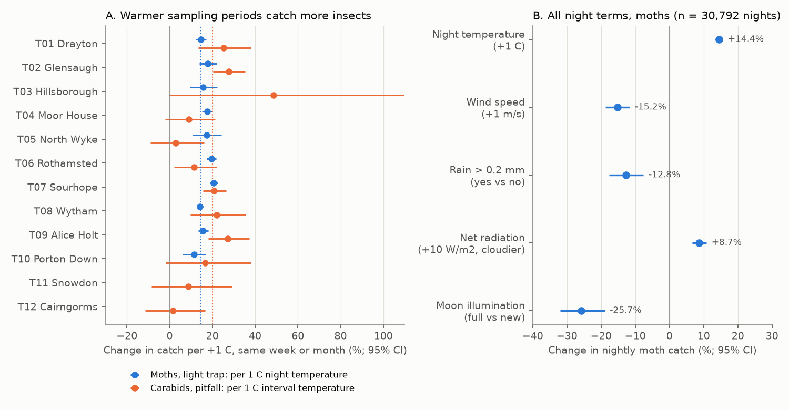
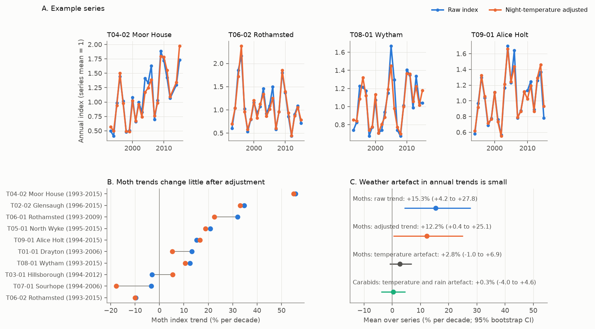
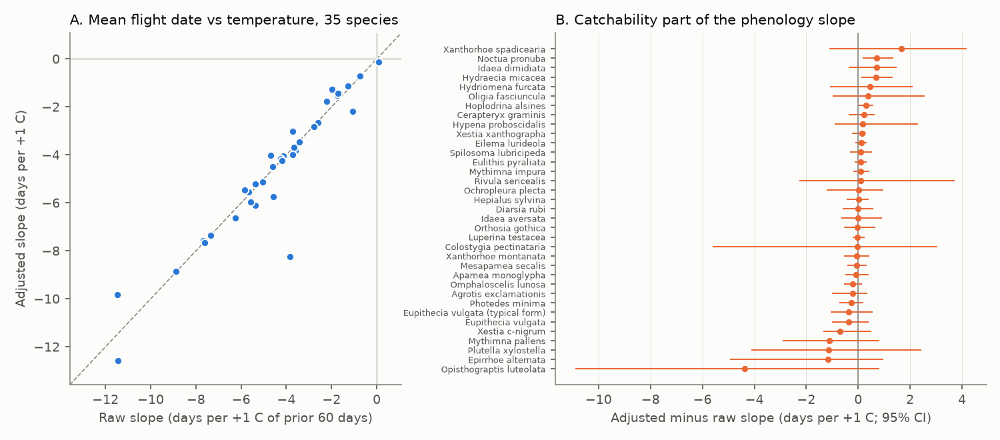

# Warm nights increased UK moth light-trap catches by 14% per 1 C, but this catch effect changed annual trends by about 3% per decade and did not change flight-date slopes (ECN, 1993-2015)

## Summary

Insect monitoring data are counts of animals that a trap catches. The catch depends on the number of animals and also on their activity on the sampling night or interval. Warm, calm, dark and cloudy nights make moths fly more. Climate change makes sampling nights warmer. Thus, a part of a long-term change in trap counts can come from activity, not from abundance. This is an observation bias. We measured its size.

We used the UK Environmental Change Network (ECN). ECN operates Rothamsted-type light traps every night and pitfall traps every two weeks at the same sites as automatic weather stations. We used 48,763 single-night moth samples (311,920 moths) from 11 sites and 6,833 carabid beetle samples from 44 trap lines at 12 sites, 1992-2015.

Main results:

1. **Night weather has a large effect on the nightly catch.** In the same trap and the same week, moth catch increased by 14.4% per +1 C of night mean temperature (95% CI 13.3 to 15.6%). The effect was positive at all 10 sites with enough data (+11% to +21%), in 1993-2003 (+16.0%) and in 2004-2015 (+12.4%), and in 39 of the 40 most frequent species. Wind (-15% per m/s), rain (-13%), full moon (-26% relative to new moon) and clear skies (-8.7% per -10 W/m2 net radiation) decreased the catch. Pitfall catches of carabid beetles increased by 20% per +1 C of interval temperature in the same month (95% CI 15 to 25%), also in both periods.
2. **The effect on annual trends is small.** The temperature anomaly of the sampled nights increased by +0.42 C per decade (95% CI 0.15 to 0.74; mean of 10 trap series). When we removed the night-temperature catch effect, the mean moth trend changed from +15.3% to +12.2% per decade. The temperature artefact was +2.8% per decade (95% CI -1.0 to +6.9%). It explained about 8% of the year-to-year variance of the raw annual indices (95% CI 4 to 12%). For carabids, the temperature and rain artefact in annual trends was +0.3% per decade (95% CI -4.0 to +4.6%), while the raw carabid trends were strongly negative.
3. **The effect on flight-date slopes is negligible.** A warmer 60-day period before the flight season moved the mean flight date earlier by 4.5 days per +1 C (95% CI 3.7 to 5.4; 35 species). With catch weights that remove the night-weather effect, the slope was 4.6 days per +1 C. The difference was -0.12 days per +1 C (95% CI -0.46 to +0.14).

Thus, night weather is a strong source of noise in single-night counts. It is a minor source of bias in annual abundance trends and in phenology slopes from daily trap series, at these sites and in this period. The temperature artefact in trends grows with the warming of the sampled nights. Series that ended in 2006 had the largest artefacts (+7.6% and +17.6% per decade).

## Question

Do warmer sampling nights make long-term increases (or smaller decreases) appear in insect trap indices, and do they make phenology responses to temperature appear larger? How large is this bias relative to the trends and slopes that people report?

This question matters because published declines and phenology shifts of moths come from light-trap networks (for example the Rothamsted Insect Survey). These traps measure flight activity at a light. If warming increases activity per individual, raw indices can hide a part of a decline.

## Data

All inputs are public. File hashes and URLs are in `files/data/provenance.json`.

| Source | Content | Use |
| --- | --- | --- |
| ECN moth data 1992-2015, doi:10.5285/a2a49f47-49b3-46da-a434-bb22e524c5d2 | Nightly Rothamsted light-trap catches by species (`ECN_IM1.csv`); sampling periods (`ECN_IM2.csv`) | Moth counts |
| ECN carabid data 1992-2015, doi:10.5285/8385f864-dd41-410f-b248-028f923cb281 | Fortnightly pitfall catches by trap and species (`ECN_IG1.csv`, `ECN_IG2.csv`) | Second method |
| ECN meteorology 1991-2015, doi:10.5285/fc9bcd1c-e3fc-4c5a-b569-2fe62d40f2f5 | Hourly automatic weather station data at each site | Night and interval weather |
| Met Office HadCET daily mean temperature | Central England Temperature | Check of AWS temperature drift |

ECN data are under the Open Government Licence v3. Contains data supplied by UK Centre for Ecology & Hydrology. HadCET is from the Met Office Hadley Centre (Open Government Licence v3).

The moth and carabid files are also in the campaign shared store: `ecn-moth-im1-1992-2015-eidc-a2a49f47`, `ecn-moth-supporting-docs-eidc-a2a49f47`, `ecn-carabid-ig1-1992-2015-eidc-8385f864`, `ecn-carabid-supporting-docs-eidc-8385f864`. The hourly weather files (about 0.9 GB) are not in the store. `files/code/retrieve.sh` downloads them and checks their MD5 values against the EIDC checksum file.

## Methods

**Moth samples.** We kept samples with a record in the count file (species counts, or code XX for no moths). We removed samples with quality codes 100-103 (lost, not taken, partial loss). We used single-night samples (92% of all samples). The night label is the evening date when the trap was set. The response is the total count of macro-moths. We also fitted the 40 most frequently recorded species separately.

**Night weather.** From the hourly AWS data we calculated, for each night from sunset to sunrise (NOAA solar approximation, GMT hours): mean dry-bulb temperature, minimum temperature, mean of the first three night hours, mean wind speed, rain total and mean net radiation. Net radiation at night is a cloud proxy (clear sky gives strongly negative values). Moon illumination comes from the mean synodic month. We required at least 80% of night hours for temperature and rain.

**Night model (catchability).** Poisson regression with absorbed fixed effects for each site x trap x ISO year x ISO week. Only differences between nights in the same week inform the weather coefficients. Thus the model removes seasonal and year-to-year abundance. Terms: night mean temperature, wind, rain yes/no, log(1 + rain), net radiation and moon illumination. Standard errors are cluster-robust by site x year. March-November only. We fitted the model pooled, by site, by period, by season, by species and with three temperature definitions (mean, dusk, minimum).

**Annual indices.** For each trap series with at least 8 years of at least 50 single nights, we fitted a two-way Poisson model with year and ISO-week effects (iterative proportional fitting). RAW: no offset. TEMPERATURE-ADJUSTED (primary): offset beta_T x (T - mean T), with beta_T from the night model. FULL: all night terms; wind and net radiation enter only as deviations from their site-year means because these sensors have steps (see Limitations). The year effect is the annual index. The artefact is log RAW minus log ADJUSTED. We propagated the uncertainty of beta_T with 100 draws from its sampling distribution, and we bootstrapped the means over series (4,000 resamples).

**Carabids.** The unit is one trap line (about 10 pitfall traps) and one sampling interval. We removed traps with quality codes for flooding, damage, loss, lid removal or debris (100-103, 135, 160-162, 164, 165, 167). Offset log(traps x days). Weather is the mean daily temperature and the mean daily rain over the interval. The within model has fixed effects for site x line x year x calendar month. Annual indices use year and 4-week block effects.

**Phenology.** For each species and series, the flight window is the day-of-year range with the central 95% of the pooled catch. We used series-years with at least 75% of window nights sampled and at least 10 individuals, and series with at least 6 such years. The mean flight date is the catch-weighted mean day of year. The adjusted mean uses weights y x exp(-beta_sp . (w - mean w)) with species-specific night coefficients. The predictor is the site mean daily temperature in the 60 days before the series mean flight date. Slopes are within series (series fixed effects); intervals are cluster bootstraps over years (1,000 resamples).

**Temperature check.** We compared monthly AWS temperature with HadCET (anomaly correlation and trend of the difference, 12-month block bootstrap).

## Results

### Night-to-night effects

| Term (moths, n = 30,792 nights) | Change in catch | 95% CI |
| --- | --- | --- |
| Night mean temperature, +1 C | +14.4% | +13.3 to +15.6% |
| Dusk temperature (first 3 h), +1 C (other model) | +14.7% | +13.8 to +15.6% |
| Night minimum temperature, +1 C (other model) | +10.8% | +9.8 to +11.9% |
| Wind speed, +1 m/s | -15.2% | -18.7 to -11.7% |
| Rain > 0.2 mm | -12.8% | -17.7 to -7.6% |
| Net radiation, +10 W/m2 (cloudier) | +8.7% | +6.6 to +10.8% |
| Moon illumination, full vs new | -25.7% | -32.0 to -19.0% |

The temperature effect was +15.8% in March-May, +15.7% in June-August and +9.0% in September-November. Per site it was +11.3% to +20.7% (`files/results/night_model_by_site.csv`). Per species the median was +13.6%; only Lunar Underwing (Omphaloscelis lunosa, an autumn species) had no clear effect (`files/results/night_model_species.csv`).

For carabids (6,213 informative intervals), the interval temperature effect was +20.0% per +1 C (95% CI +14.9 to +25.4%); +18.9% in 1992-2003 and +21.1% in 2004-2015. All 12 site estimates were positive; six intervals excluded zero (`files/results/carabid_model.csv`).

### Annual indices and trends

| Series | Years | Raw trend (log per decade) | Adjusted trend | Temperature artefact | Sampled-night anomaly trend (C per decade) |
| --- | --- | --- | --- | --- | --- |
| T01-01 Drayton | 1993-2006 (14) | +0.124 | +0.051 | +0.073 | +0.77 |
| T02-02 Glensaugh | 1996-2015 (19) | +0.298 | +0.285 | +0.013 | +0.25 |
| T03-01 Hillsborough | 1994-2012 (14) | -0.031 | +0.053 | -0.083 | -0.21 |
| T04-02 Moor House | 1993-2015 (22) | +0.443 | +0.438 | +0.005 | +0.12 |
| T05-01 North Wyke | 1995-2015 (18) | +0.189 | +0.172 | +0.017 | +0.21 |
| T06-01 Rothamsted | 1993-2009 (16) | +0.278 | +0.203 | +0.075 | +0.92 |
| T06-02 Rothamsted | 1993-2015 (23) | -0.102 | -0.106 | +0.004 | +0.20 |
| T07-01 Sourhope | 1994-2006 (12) | -0.034 | -0.196 | +0.162 | +1.53 |
| T08-01 Wytham | 1993-2015 (23) | +0.118 | +0.101 | +0.017 | +0.41 |
| T09-01 Alice Holt | 1994-2015 (22) | +0.142 | +0.153 | -0.011 | -0.01 |
| Mean (95% bootstrap CI) | | +0.143 (+0.042, +0.245) | +0.115 (+0.004, +0.224) | +0.027 (-0.010, +0.067) | +0.42 (+0.15, +0.74) |

The year-to-year standard deviation of the detrended artefact was 0.083 (log units). The standard deviation of the detrended raw index was 0.389. The artefact correlated with the sampled-night temperature anomaly of each year (mean r = 0.84). The full adjustment (all night terms) gave a mean trend of +0.154 per decade; its artefact was -0.012 (95% CI -0.087 to +0.061).

For carabids (31 trap lines with at least 8 years), the mean raw trend was -0.62 log units per decade (median -0.48), and the mean artefact was +0.003 (`files/results/carabid_trends.csv`).

### Phenology

Across 35 species (1,478 series-years), the mean raw slope was -4.51 days per +1 C (95% CI -5.42 to -3.66). For 24 species the raw interval excluded zero. The mean adjusted slope was -4.64 (-5.58 to -3.75). The mean difference was -0.12 days per +1 C (-0.46 to +0.14); the inverse-variance mean difference was +0.06 (SE 0.04). Three species had intervals for the difference that excluded zero, all small positive values (Large Yellow Underwing +0.70, Rosy Rustic +0.67, The Uncertain +0.29 days per +1 C).

### Temperature check

Monthly AWS temperature anomalies correlated with HadCET at r = 0.91-0.99 at the English sites (T01, T04-T06, T08-T10) and r = 0.73-0.90 at the Scottish and Northern Ireland sites. Trends of the AWS minus HadCET difference were within about +-0.25 C per decade at most moth sites. Exceptions were Hillsborough (T03; -0.58, wide interval, different climate region) and Snowdon (T11; not in the moth analysis). A drift of 0.2 C per decade changes the expected artefact by about 0.03 log units per decade (`files/results/temperature_check.csv`).

## Interpretation

The night model shows that light-trap counts respond strongly to the weather on the sampling night. Year-to-year differences in mean night weather are much smaller than night-to-night differences, and the annual index pools many nights. Thus the effect on annual indices is small. The trend artefact is approximately the catch coefficient times the warming of the sampled nights. In this period that was a few percent per decade. Analyses of longer or more recent records with faster night warming can have a larger artefact. Analyses with few sampling nights per year (for example, short trapping campaigns) are more exposed, because each night has a larger weight.

The phenology slope did not change after reweighting. A uniform warm year multiplies all nights by the same factor, which does not move the mean date. Only warmth that differs within the flight window can bias the mean date, and this was small.

## Limitations

- The within-week coefficient includes all short-term responses to a warm night: flight activity, attraction to light, and any emergence that a warm spell triggers. Thus the adjustment can remove a little real abundance signal. This makes our artefact estimate an upper bound for pure catchability, under the model.
- Wind and net radiation sensors have steps (for example, net radiation at Hillsborough in 2010 and North Wyke in 2009, wind at Glensaugh in 2007). We used them only as within-year deviations in the annual adjustment. Temperature drift relative to HadCET was small at most sites but is not zero.
- Only 10 moth series had enough years. Some series stop in 2006-2012 or have fewer single-night samples after 2004. Series mean intervals treat series as independent; two series are from one site (Rothamsted).
- Raw moth trends at these ECN sites (mostly positive) are not representative of national moth trends. We do not interpret them as abundance trends without other checks (site changes, trap changes, light pollution near traps).
- Carabid trends were strongly negative and heterogeneous; some lines had very large declines that can come from habitat or protocol changes. We only interpret the artefact (raw minus adjusted).
- The phenology windows are fixed per series. Mean flight date mixes generations for bivoltine species.
- Moon illumination is approximate (mean synodic month) and does not include moonrise time.
- The AWS night is in GMT hours with an approximate sunset. ECN traps use solar time switches.

## Reproduction

1. `cd files && bash code/retrieve.sh` (downloads about 0.9 GB to `files/raw`; uses `code/rangedl.py` for the hourly weather files and checks MD5 values).
2. `bash code/run_all.sh raw` (Python 3.12 with numpy, pandas, matplotlib; about 5 minutes on a loaded 8-core machine). We ran this full rebuild from the raw files and it reproduced all result tables byte for byte.

The package contains all derived tables (`files/data`), all results (`files/results`) and the figures, so a reader can inspect every number without the raw files. `files/data/moth_nights.csv.gz` is the analysis table for the night model (one row per single-night sample with weather). `files/data/moth_species_codes.csv` maps ECN species codes to names; we parsed it from the EIDC data-structure document (`IM_DATA_STRUCTUREedit.rtf`) and fixed three entries by hand. `files/code/fepois.py` implements the fixed-effects Poisson estimator with cluster-robust errors.

## Provenance

- Campaign 11_07_2026, job `sci-1107-hp-climate-pollution-biodiversity-20a79f08fd1c`, topic climate-pollution-biodiversity, machine hp, account claude-myxtap.
- Analysis and text by the AI model Claude Opus 5.5 (`claude-opus-5-5`) running in Claude Code. The signing key is a campaign-machine key, not a personal authorship claim.
- Data retrieved on 2026-11-09. File hashes: `files/data/provenance.json`.

## References

- Rennie, S. et al. (2017) UK Environmental Change Network (ECN) moth data: 1992-2015. NERC EIDC. doi:10.5285/a2a49f47-49b3-46da-a434-bb22e524c5d2
- Rennie, S. et al. (2017) UK ECN carabid beetle data: 1992-2015. NERC EIDC. doi:10.5285/8385f864-dd41-410f-b248-028f923cb281
- Rennie, S. et al. (2017) UK ECN meteorology data: 1991-2015. NERC EIDC. doi:10.5285/fc9bcd1c-e3fc-4c5a-b569-2fe62d40f2f5
- Parker, D.E., Legg, T.P., Folland, C.K. (1992) A new daily Central England Temperature series, 1772-1991. Int. J. Climatol. 12, 317-342. doi:10.1002/joc.3370120402
- Fox, R. et al. (2013) The State of Britain's Larger Moths 2013. Butterfly Conservation and Rothamsted Research.
- Brooks, D.R. et al. (2012) Large carabid beetle declines in a United Kingdom monitoring network increases evidence for a widespread loss in insect biodiversity. J. Appl. Ecol. 49, 1009-1019. doi:10.1111/j.1365-2664.2012.02194.x
- Jonason, D., Franzen, M., Ranius, T. (2014) Surveying moths using light traps: effects of weather and time of year. PLoS ONE 9, e92453. doi:10.1371/journal.pone.0092453
