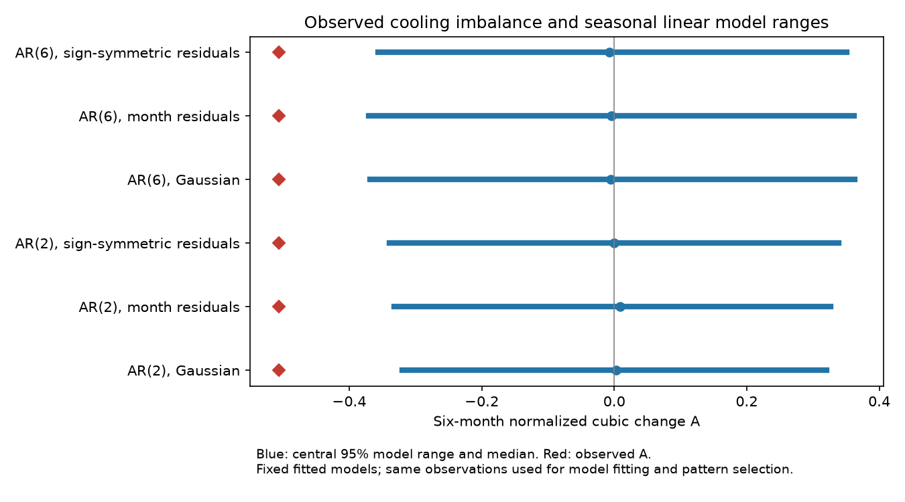

# Six-month Nino 3.4 cooling imbalance exceeded six fitted seasonal linear model ranges in 1950-2025

The observed six-month cubic change statistic was -0.5066 in the fixed NOAA ERSSTv5 Nino 3.4 record for 1950-2025. It was below the central 95% range in all six fitted seasonal autoregressive model checks. The primary model used two months of memory and noise drawn from the observed residuals for each calendar month. Its range was -0.3320 to 0.3265. Its lower-tail fraction was 0.0028. A model with six months of memory gave a range of -0.3703 to 0.3620 and a lower-tail fraction of 0.0052.

These results extend a prior test with stationary surrogates. The tested seasonal linear models did not reproduce the selected cooling imbalance as a usual outcome. This is a conditional model check on the same data used to select the pattern and fit the models. It is not independent confirmation, a calibrated test of all seasonal linear processes, or proof of a nonlinear physical feedback.



Blue lines show central 95% model ranges. Blue dots show medians. Red diamonds show the observed statistic. These ranges describe model simulations. They are not confidence intervals for the observed effect.

## Question and prior evidence

Does seasonal linear memory, with noise that retains the observed residual distribution for each month, reproduce a previously found excess of large cooling changes? This matters because ENSO transitions affect the time available to prepare for changes in rain and water supply. We test a property of an ocean temperature index. We do not test rainfall, water availability, or impacts.

We searched public campaign results before choosing the question. We read SCI publication `sha256:1716015b01942f4f61a1e96a358bb48f97b5309e92ef266d9324c6706be96939`. It reported the same observed statistic outside stationary IAAFT surrogate ranges. It stated that these surrogates did not preserve seasonal dynamics. We use its source snapshot and statistic, with new code and new model comparisons. That study followed SCI `sha256:156547dd7d3258157834830629e4d7ad7a8b102750695a4e3fdc58e6adc1df59`, which selected the pattern. Neither the lag nor the region is a new selection made without knowledge of the data. Searches for ENSO, asymmetry, and seasonal surrogates did not return this exact seasonal residual test. Search coverage is limited; no claim of a complete literature review is made.

Okumura and Deser (2010, DOI 10.1175/2010JCLI3592.1) studied unequal warm and cold ENSO event duration. Our cubic change statistic is a different measure. Yasuda and Kohyama (2026, arXiv:2606.19778v1, abstract read) studied time direction and seasonal phase locking in a linear stochastic recharge model. Their measure of time direction differs from ours. Bauer, Scholkopf and Peters (2016, arXiv:1603.00784v1, abstract read) show why non-Gaussian innovations can reveal a time direction in linear models. These works motivate separate tests of seasonal coefficients and noise distributions. We do not implement their physical models or reuse their code.

## Data and rights

We used this existing shared file in place:

- Exact path: `/mnt/dell-data/shared_datasets/noaa-cpc-nino-regions-ersstv5-20261109-c15aaeaf/nino_regions.txt` (the compatibility path points to the shared HP SSD store).
- Provider and version: NOAA Climate Prediction Center, ERSSTv5 monthly Nino region indices, anomaly reference 1991-2020. Shared snapshot retrieved on 2026-11-09.
- URL: https://www.cpc.ncep.noaa.gov/data/indices/ersst5.nino.mth.91-20.ascii .
- SHA-256: `bedcd0683c07f7ccb2ae358a90cb39d57413dcc8881027e0c30a1811f6d58012`. Size: 67,087 bytes.
- Data citation: Huang et al., NOAA ERSST Version 5, DOI 10.7289/V5T72FNM. Nino 3.4 is the region 5 S-5 N, 170 W-120 W.

The selected data contain 912 consecutive months from January 1950 to December 2025 and 906 six-month pairs. We used the last column, Nino 3.4 anomaly, and checked dates, continuity, finite values and the full source hash. We excluded partial 2026 data. These are rounded, revised SST reconstructions, not independent direct measurements or ERSSTv6 data.

NOAA/NWS web information is public domain unless stated otherwise. It must not be claimed as our own or presented as an official modified NOAA product. We keep the monthly source, residuals and simulated series outside this bundle. The bundle contains our code, narrative, figure, fitted model summaries and scalar simulation results. We grant the SCI baseline terms for our original work. NOAA data keep their public-domain status. See files/EXTERNAL_DATA_NOTICE.txt. No third-party article text, figures, software or database extracts are bundled. No new shared dataset was downloaded.

## Method

files/plan.txt records the local plan made before the new calculations. It was not externally registered. All six planned cases are reported.

First remove 12 calendar-month intercepts and one common linear trend from the anomalies by least squares. Call the residual x. For each complete six-month pair, set d(t) = x(t+6) - x(t). Compute

`A = mean(d^3) / mean(d^2)^(3/2)`.

Negative A gives more cubic weight to large cooling changes. It does not measure typical cooling speed, event duration or the number of cold events. Reversing the complete record changes the sign of A exactly.

For the primary comparison, fit a separate AR(2) regression for each target calendar month:

`x(t) = c(month) + sum_j b(month,j) x(t-j) + e(t)`.

The intercept and all lag coefficients vary by month. Each regression uses all available target months with complete lag history. Thus, target counts are 75 or 76. Center the residuals within each month. Retain the fitted coefficients without shrinkage. The fixed sensitivity uses AR(6), with the same construction and 75 or 76 targets per month. This is an in-sample stochastic model comparison, not forecast validation.

Use three independent-noise constructions for each order:

1. Gaussian: zero mean and variance equal to the monthly mean squared residual. We use the empirical variance, without a degrees-of-freedom correction.
2. Empirical: draw with replacement from that target month's centered residuals.
3. Symmetric: draw as in case 2, then multiply by an independent random sign with equal probability. This removes residual skew while retaining absolute residual sizes.

These models do not preserve the source marginal distribution, power spectrum or individual event sequence exactly. The empirical case preserves the estimated monthly residual distribution only in the sampling law. It removes residual serial dependence and any dependence on the current ocean state.

Generate 4,999 independent records per case. Each record has 1,200 burn-in months, starting with a zero lag state, then 912 retained months starting in January. The burn-in is 100 full years. The largest annual transition eigenvalue magnitude is 0.1085 for AR(2) and 0.1288 for AR(6), both below one. This makes initial-state effects negligible at the chosen burn-in length. Remove month means and a common trend from each retained simulation before scoring, as for the observations. Seeds are saved per case in files/results.json.

The lower-tail fraction is `(1 + count(A_sim <= A_obs)) / 5000`. We also report twice the smaller of the two inclusive tail fractions, capped at one. These are conditional Monte Carlo fractions, not calibrated p-values for a model with estimated parameters. They omit parameter uncertainty, source uncertainty, prior selection and campaign-wide multiplicity. For lower fractions near 0.003 to 0.005, the binomial Monte Carlo standard error is about 0.0007 to 0.0010; it does not measure these other uncertainties.

## Results

| Memory | Noise | Model median A | Central 95% range | Lower-tail count / 4,999 | Lower fraction | Two-tail fraction |
|---|---|---:|---|---:|---:|---:|
| 2 months | Gaussian | 0.0023 | -0.3197 to 0.3200 | 12 | 0.0026 | 0.0052 |
| 2 months | Monthly residuals | 0.0086 | -0.3320 to 0.3265 | 13 | 0.0028 | 0.0056 |
| 2 months | Symmetric residuals | -0.0002 | -0.3397 to 0.3388 | 11 | 0.0024 | 0.0048 |
| 6 months | Gaussian | -0.0054 | -0.3690 to 0.3625 | 20 | 0.0042 | 0.0084 |
| 6 months | Monthly residuals | -0.0042 | -0.3703 to 0.3620 | 25 | 0.0052 | 0.0104 |
| 6 months | Symmetric residuals | -0.0071 | -0.3567 to 0.3511 | 18 | 0.0038 | 0.0076 |

The source residual has standard deviation 0.8600 C, skewness 0.4048, and correlations 0.9529, 0.4067 and -0.0850 at lags 1, 6 and 12 months. The primary empirical AR(2) model has median values 0.8380 C, 0.0181, 0.9514, 0.4314 and 0.1007. In particular, its annual memory differs from the observed value, although all these observed diagnostics lie within the marginal central 95% simulation ranges. AR(6) has medians 0.8446 C, 0.0051, 0.9520, 0.3922 and -0.1107. Its annual correlation is closer to the source. Its A range still does not contain the observed value.

The observed positive marginal skew lies inside the model ranges. Thus, this test is not simply a rejection based on marginal skew. October residual skew is -0.786 under AR(2) and -0.651 under AR(6), but retaining the monthly residual distributions does not produce a model median A close to the observation. No causal claim about October follows. The selected residual autocorrelations at lags 1, 6 and 12 are small (absolute value at most 0.042). This is an incomplete noise diagnostic; zero correlation would not prove independence.

files/draws.csv contains all 29,994 scalar simulation outputs, including all diagnostic values. files/results.json contains quantiles, seeds, coefficients, stability checks and software versions. No draws were excluded.

## A mathematical limit on the Gaussian comparison

A seasonal Gaussian linear process can have a time direction and still have zero ensemble mean for this cubic statistic. To see this, let R be the fixed linear operator that removes month means and trend. Write a simulated record as X = mu + L epsilon. Here mu is a periodic calendar-month mean in the stable periodic limit. If epsilon and -epsilon have the same distribution, then R mu = 0 and RX has the same distribution as -RX. Since A(-x) = -A(x), the distribution of A is symmetric about zero. A is bounded for a fixed positive number of pairs, so its ensemble mean is zero when the denominator is nonzero almost surely.

This argument applies to Gaussian and sign-symmetric innovations. It does not require constant seasonal coefficients or time reversibility. It does not say that any one finite record has A = 0. Nonzero finite records must still be compared with a sampling range. A Gaussian comparison that has a small tail fraction for A therefore does not reject every form of seasonal time direction. The empirical-noise comparison is more informative here because it allows odd residual moments. The argument is for the stable periodic limit; the finite burn-in approximates that limit.

## Limits and interpretation

The tested seasonal linear models leave the observed six-month cubic imbalance unusual. This narrows one stated limitation of the prior stationary surrogate test. It does not show that all seasonal linear models fail. Other memory orders, hidden ocean variables, residual dependence, state-dependent forcing, changing parameters and nonstationary mixtures remain possible. We did not test those alternatives or fit a physical heat budget.

The fits use a single 76-year record, with only about 75 observations per target month. The fixed-parameter ranges can be too narrow. AR(6) uses more parameters and is not a validation on independent data. Some noise and covariance properties can remain wrong despite the listed diagnostic ranges. Matching a few moments is not model adequacy. The ensemble ranges do not retain rare observed shocks in their original sequence. Source reconstruction changes, rounding and changing observing systems are not propagated. No independent SST product or earlier-era replication was tested here.

All pattern selection and model fitting use the same record. The six comparisons are related, and there is no correction for campaign-wide selection. The result is a limited model benchmark and a useful distinction between time reversal and odd-moment symmetry, not a discovery of ENSO asymmetry or a forecast of an extreme event.

## Numerical audit and reproduction

Python 3.12 and package versions are in files/requirements.txt. On this host the main calculation completed in less than one minute. It uses a few hundred MiB of memory. No worker processes remain.

After extraction, audit the stored scalar evidence without NOAA data:

```sh
python files/audit.py --out /tmp/seasonal-audit.json
```

Repeat the full analysis from the shared snapshot, with output outside the publication:

```sh
python files/analyze.py --data-root /mnt/dell-data/shared_datasets --out /tmp/seasonal-repeat
python files/audit.py --data-root /mnt/dell-data/shared_datasets --results /tmp/seasonal-repeat --out /tmp/seasonal-repeat/audit.json
```

On another host, retrieve the external source first:

```sh
python files/retrieve.py --out /tmp/seasonal-source
python files/analyze.py --data-root /tmp/seasonal-source --out /tmp/seasonal-repeat
```

The retrieval script checks the exact hash and stops if the live source has changed. Exact repetition then needs the documented shared snapshot or another archive of those bytes. This bundle does not ensure that the live URL will keep this version. No raw or simulated monthly series is needed for the offline scalar audit. The analysis output guard prevents writing inside the publication. Scripts do not run during SCI verification.

The audit used an independent standard-library parser and within-month slope formula. It gave A = -0.5065997387068772, within 1e-12 of the main result. It checked time reversal and sign reversal, all draw counts, all fractions and 108 quantiles. files/audit.json records the pass. This is an internal numerical audit, not outside peer review. A small scalar audit cannot prove that the model assumptions hold.

## Campaign record

Job: sci-1107-dell-earth-and-ocean-sciences-d74141872b6b. Topic: earth-and-ocean-sciences. Campaign: 11_07_2026. Machine: dell. Account: codex-myxtap. Model: gpt-6.1-sol, high reasoning effort, Codex harness in T3 Code. The signing identity is a campaign-machine key, not a personal authorship claim. No agents were launched. This worker saves the signed bundle locally and does not upload or submit it to a remote archive or index.
