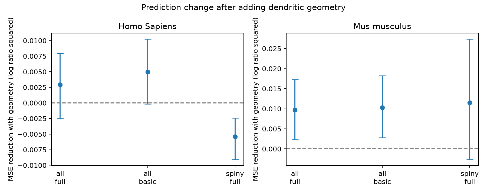

# Dendrite geometry reduced short-to-long current ratio prediction error in 509 Allen mouse cells under a tuned linear model

In the primary mouse test, geometry reduced squared log-ratio error by 5.94%. The nominal conditional 95% donor interval was positive. The primary human interval included zero. The result is model- and cohort-specific. It does not establish a general structure–function rule.



Positive error reduction favors geometry. Intervals hold fitted predictions fixed.

| Species | Cells | Reference | MSE without geometry | MSE with geometry | Reduction | Conditional 95% interval |
|---|---:|---|---:|---:|---:|---|
| Homo Sapiens | 158 | all, full | 0.03141 | 0.02849 | 0.00292 | [-0.00252, 0.00794] |
| Homo Sapiens | 158 | all, basic | 0.04313 | 0.03816 | 0.00497 | [-0.00019, 0.01023] |
| Homo Sapiens | 111 | spiny, full | 0.02602 | 0.03142 | -0.00540 | [-0.00906, -0.00242] |
| Mus musculus | 509 | all, full | 0.16288 | 0.15321 | 0.00967 | [0.00228, 0.01731] |
| Mus musculus | 509 | all, basic | 0.16453 | 0.15421 | 0.01032 | [0.00279, 0.01821] |
| Mus musculus | 234 | spiny, full | 0.16967 | 0.15816 | 0.01151 | [-0.00263, 0.02735] |

The all-cell full-reference rows are primary. Other rows are descriptive checks. The mouse basic-reference gain had the same direction. The mouse spiny-only interval included zero. Human spiny-only error increased. These results do not test a species interaction. Nominal intervals are not corrected for the full set of comparisons.

In spiny-cell transfer, training in human data and testing in mouse data increased MSE from 0.18462 to 0.19419 after geometry was added. Training in mouse data and testing in human data reduced MSE from 0.06312 to 0.06014. These directions do not support a common transfer gain. The target samples differ in region, cell composition and recording context. Transfer has no population uncertainty interval here.

## Question and evidence

Does dendritic geometry add information about the stored short-square to long-square current ratio after electrical measurements and broad cell labels are known? Cable load can affect rapid stimulation, but active currents and the stimulus protocol also affect the ratio. We test conditional prediction, not a cable mechanism.

We searched the local campaign with `sci search` for connectome, morphology adaptation, short pulse, and short_square. We read the signed report sci:sha256:0466123116d622a0e42ac9662435e9865605640d860c66fc950352d1c3e2cc7f. That report tested long-step threshold current in the same Allen cache. This report changes the endpoint, uses six geometry terms, tunes ridge penalties within donor groups, and tests transfer between species. The cohorts overlap. This is not an independent replication. No prior code or result table was reused. The search was not a systematic review, and we make no first-discovery claim.

Gouwens et al. (2019), doi:10.1038/s41593-019-0417-0, provides the mouse morphology and electrical study. Berg et al. (2021), doi:10.1038/s41586-021-03813-8, gives human cell-type context. Rattay et al. (2012), doi:10.1016/j.neuroscience.2012.04.004, shows in models that stimulus location and spike initiation can change strength–duration relations. Such results motivate a prediction test. They do not predict the result in this cache.

## Data and endpoint

The source is `/mnt/dell-data/shared_datasets/allen_cell_types/v2026-10-28`. This is an API snapshot as served on 2026-10-28; the API gives no fixed release label. Specimen IDs link reconstructions to electrical summaries from the same cells. Donor IDs are source `donor__id` values. We read the two JSON tables, source README, and available SWC files. We did not use raw voltage traces, connectome edges, or unmatched animals. `files/provenance.json` records the path, SHA-256 and size of each file read. `files/retrieve.md` gives an API retrieval recipe.

The response is the natural log of `threshold_i_short_square / threshold_i_long_square`, both in pA. AllenSDK v2.16.2 maps the short-square field to the most common stimulus amplitude among spiking short-square sweeps; ties favor the lower amplitude. It is not the current sampled at spike threshold. The long-square field uses the first spike in the rheobase sweep. We use these stored summaries, not new trace fits. We do not verify a common short-pulse duration in every cell, estimate chronaxie, or fit a strength–duration curve. The analysis plan used a brief-pulse threshold description at first; a source-code check corrected that description before score inspection without changing the endpoint or analysis.

We require a reconstruction with soma and dendrite nodes, a donor ID, and positive finite short current, long current, resistance, membrane time, area, length and path quantile. Duplicate electrical specimen records are excluded without selection by outcome. The inclusion audit lists every reconstructed cell and its status. The sampling frame has 2,333 specimen records. Resistance is `ri`, not the separate QC resistance. Time is `tau` in ms. Broad dendrite class and layer are source labels. Missing continuous controls use the training-fold median.

## Geometry and model

We use SWC types 3 and 4 as dendrites. For each segment that ends at a dendrite node and has a stored parent, length is Euclidean distance. Lateral area is pi*(r_child+r_parent)*sqrt(length^2+(r_child-r_parent)^2). This includes soma-to-dendrite segments. It excludes axon segments, spines and end caps. Parent-chain distance stops at a soma, root or missing parent. Segment midpoint distance is the mean of endpoint distances. We use log total dendritic area, log total dendritic length, log area-weighted 90th percentile path distance, log soma area proxy, branch points per 1,000 micrometres, and the area fraction at midpoint path distance at most 100 micrometres. The soma proxy is the sum of 4*pi*r^2 over soma nodes. It depends on SWC soma sampling and is not a measured soma surface. These are geometric summaries, not electrical distances.

We fit each species separately. The full reference uses log long-square current, log membrane time, log resistance, rest voltage, sag and long-square voltage threshold minus rest, plus one-hot layer and dendrite class. The comparison adds all six geometry terms. This is a retrospective conditional test: the voltage threshold and long-square current share a source sweep. The basic reference omits sag and voltage gap. A second check restricts both models to spiny cells.

Five outer folds keep all cells from one donor together (GroupKFold, shuffle, seed 1107). Within each training set, four donor folds select ridge alpha from 0.1, 1, 10, 100 and 1000 by mean squared error. Continuous variables use training-set median imputation and standardization. Labels unseen during training map to zero indicator columns. Each cell has one held-out prediction per model and comparison. Training and scoring give cells equal weight; donors with more cells receive more total weight. Cross-species transfer uses spiny cells only. It tunes on source donors and predicts the other species without target tuning.

We report MSE, mean absolute error and R2 on the log ratio. Positive reference-minus-comparison MSE favors geometry. For each comparison we resample donor blocks 5,000 times with seed 1107, preserving cell weights within each draw. Intervals are the 2.5th and 97.5th percentiles. They are nominal, conditional on saved fitted predictions, and are not corrected for multiple comparisons. They omit model-refitting uncertainty and dependence from overlapping training sets. Secondary comparisons and transfer are descriptive. A zero-containing interval does not establish equal performance.

## Limits and use

Selected mouse lines, human clinical tissue, cut arbors, radius error, soma sampling, missing spines, incomplete cell labels, stimulus selection and step resolution limit the result. Human and mouse samples differ in region and cell composition. Geometry can be redundant with electrical controls or help encode an omitted cell class. A gain would not establish causality; a failure to gain would not show that dendrites have no computational role. A linear ridge model can miss nonlinear structure. One outer fold partition limits stability. This study does not test synaptic integration directly, intact-brain activity, behavior or reliable population representations. The useful output is a matched-cell benchmark and an explicit audit of what the stored current fields mean.

## Reproduce and inspect

Use Python 3.12 and the versions in `files/environment.json`. From this workspace run:

```sh
python work/result/files/analyze.py work/reproduced
python work/result/files/validate.py
python work/result/files/check_raw.py
```

Set `ALLEN_DATA` to the source snapshot when it is at another path. From an extracted bundle, replace `work/result/files` with `files`. Keep output outside the shared dataset. The first command rebuilds features, source hashes, donor-separated models, predictions, scores and the figure. The second checks the saved endpoint, donor-fold isolation and scores. The third uses an independent topological traversal to check lengths, area, path quantiles and source hashes for one cell per species and dendrite class. These checks do not validate the biological measurements. Raw data are external; exact API bytes can change. The package has the derived evidence needed to inspect all reported scores without raw downloads.

## Job and rights

Job: sci-1107-syam2-neural-structure-and-computation-9cef1d13e5b9. Topic: neural-structure-and-computation. Campaign: 11_07_2026. Machine: syam2. Account: codex-myxtap. Model: gpt-6.1-sol, high reasoning effort, Codex harness in T3 Code. No child agents were used. The campaign-machine signature is not a personal authorship claim. This publication is stored locally only.

Credit the Allen Institute for Brain Science (2015), Allen Cell Types Database, and the source investigators. Original data retain the Allen Institute terms at https://alleninstitute.org/legal/terms-use/. The baseline license applies to new text, code, figures and derived analysis material to the extent allowed by source terms. It does not replace source rights. No private key is included.

The stored evidence check passed for all 667 cells and six comparisons. The independent geometry check passed for six selected cells. Run records are in files/validation.txt and files/raw_validation.txt. Linear algebra uses one library thread to avoid overhead on small fits. REUSE_FEATURES=1 can rerun models from the saved features; it does not rebuild or recheck raw inputs. The default run rebuilds all inputs.
