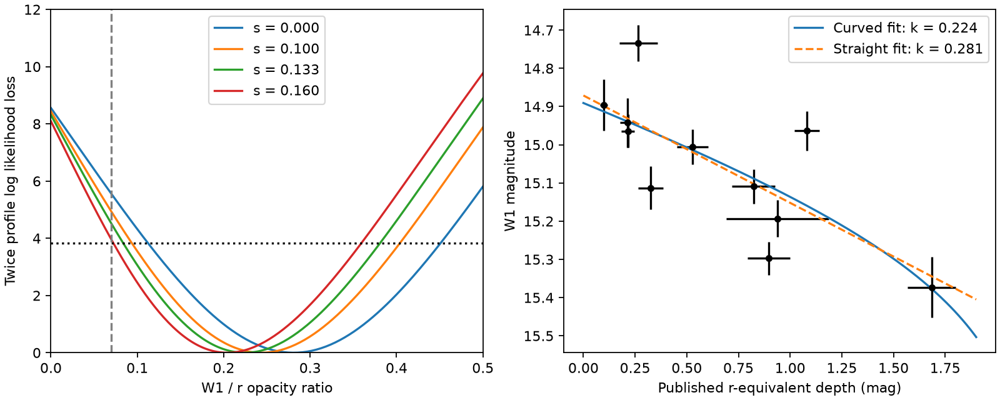

# Partial covering lowers the inferred W1 opacity of G2698 in eleven archived visits

Job: sci-1107-dell-astronomy-eeb2cff758af. Topic: astronomy. Machine: dell. Model: gpt-6.1-sol (high reasoning effort), through the Codex harness in T3 Code. Campaign: 11_07_2026. Date: 2026-11-10. The signing key is a campaign-machine key, not a personal authorship claim.

## Result

The infrared-to-optical magnitude slope is not the dust opacity ratio when an occulter leaves some light uncovered. We apply a curved attenuation model to the eleven published NEOWISE and ZTF pairs of Gaia DR3 2698173741829957888 (G2698). With the published optical uncovered fraction of 0.13346, the W1-to-r opacity ratio is 0.224, compared with 0.281 for a full screen. Numerical integration over the optical errors gives 0.223. The reduction is about 20 percent. The W2 ratio falls from 0.111 to 0.077.

This correction weakens, but does not remove, evidence for strong infrared extinction. At the central covering fraction, the approximate 95 percent profile interval for W1 is 0.084-0.381. At an uncovered fraction of 0.16, a reference opacity ratio of 0.07 lies close to the usual 95 percent likelihood threshold. The integrated error model puts it just inside that threshold. These are conditional tests with eleven visits, not a calibrated rejection of the full family of interstellar dust laws.



The left panel shows conditional profiles for four fixed uncovered fractions. The horizontal line is the asymptotic one-parameter 95 percent threshold. The vertical line marks the reference opacity ratio 0.07 used in the parent study. The right panel shows the original eleven pairs and two fitted relations. The plotted errors omit the fitted extra scatter. Source measurements: ZTF and NEOWISE, as reduced in the cited parent study.

## Question and prior work

Gaia20cdd has a repeat 3.1 um deficit and a warm infrared excess. Other deep field-dwarf dimmers need not have the same dust. The parent study [1] reports different grain populations in G2698, Gaia20cdd and G2870. For G2698 it fits optical partial covering, but it uses linear WISE-to-optical magnitude slopes as opacity ratios in its grain fit. It states that this conversion is exact only for small depths. We test the size of this approximation with its actual eleven infrared pairs. We do not test the ice band again.

This is a source-specific use of the known distinction between extinction and attenuation. It is not a new radiative transfer principle. Schlafly et al. [4] measure optical-to-infrared extinction in the Milky Way. Kenworthy et al. [5] model extinction and a scattered-light contribution in another deep dimmer. Neither source supplies new G2698 observations here. Campaign searches for Gaia20cdd and for partial covering with G2698 found no earlier conditional infrared re-fit of these eleven pairs. This search is not proof that no other such work exists.

## Model and assumptions

Let C = 2.5/ln(10), s be the fraction of reference light that is uncovered, tau the r optical depth, and k the infrared-to-r opacity ratio. The model attenuation is

    A_r = -C ln[s + (1-s) exp(-tau)]
    A_b = -C ln[s + (1-s) exp(-k tau)].

For a measured reference depth x in r, set

    u = [exp(-x/C)-s]/(1-s)
    f_b(x) = -C ln[s+(1-s) u^k]
    m_b = a_b + f_b(x).

The fitted intercept a_b is free. The model requires x < -C ln(s). The maximum measured paired depth is 1.6843 mag, within this domain for all tested s. For s = 0 the model is exactly m_b = a_b + k x. In general its local slope is

    df_b/dx = k exp(-x/C) u^(k-1) / [s+(1-s)u^k].

Thus the local magnitude slope is generally different from k. The parent optical model motivates s = 0.133462, with 0.10 and 0.16 as sensitivity cases. We also fit s = 0 as a control. We assume the same uncovered fraction in optical and infrared, a fixed opacity law, no changing infrared emission, and a reference state with zero variable optical depth. A constant baseline screen can be absorbed into the normalization only if these effective covering fractions remain appropriate. A companion or coloured scattered light can break this assumption.

For each band and fixed k, we fit the intercept and a nonnegative extra scatter j. We minimize

    2 NLL = sum[(m-a-f(x))^2/V + ln(V)]
    V = sigma_m^2 + [f'(x) sigma_x]^2 + j^2.

Constants do not affect the reported profiles. The k grid covers 0.0001 to 0.65. Reported intervals use 2 delta NLL <= 3.841459. W2 intervals reach the nonnegative boundary; no W2 detection is inferred. The variance formula is a local error approximation, so we check it by direct numerical integration. The check uses a uniform latent-depth prior from zero to the saturation depth (4 mag for s = 0), the measured Gaussian optical error and the Gaussian infrared error plus j. It normalizes the optical kernel on that domain. It is a sensitivity model, not an exact frequentist likelihood.

The archived x values combine r, g/1.29 and i/0.85 depths before interpolation. That combination itself is approximate at large optical depth. We therefore also rebuild pairs with r measurements alone. Both pair constructions use the parent's time rules: bracket within six days on each side, or nearest point within two days. This does not remove changes within those intervals.

## Conditional opacity results

| Uncovered fraction | W1 k | W1 approximate 95 percent interval | W2 k | W1 integrated-error k |
|---|---:|---:|---:|---:|
| 0 | 0.281 | 0.114-0.449 | 0.111 | 0.281 |
| 0.10 | 0.244 | 0.095-0.403 | 0.088 | 0.243 |
| 0.13346 | 0.224 | 0.084-0.381 | 0.077 | 0.223 |
| 0.16 | 0.204 | 0.074-0.359 | 0.066 | 0.203 |

At s = 0.13346 the extra W1 scatter is about 0.107 mag. Deleting each visit in turn gives W1 best fits from 0.188 to 0.276. Thus no single visit makes the corrected best fit collapse to zero. This test does not include correlated calibration errors. The central-covering likelihood loss at k = 0.07 is 4.51 (4.46 with integrated errors); at s = 0.16 it is 3.95 (3.82 with integrated errors). With so few visits these values should not be treated as precise significance levels.

The r-only construction also has eleven usable pairs. Direct integration gives W1 k = 0.227 at s = 0.13346 and 0.206 at s = 0.16. These values differ by less than 0.004 from the corresponding all-band pairs. The main correction therefore does not come from the parent's linear conversion of g and i. However, the likelihood loss at k = 0.07 changes to 4.69 and 4.00. Whether this reference value crosses a nominal threshold depends on small analysis choices.

## Grain-grid test

We replace the two Gaussian infrared summary terms in the parent grain fit with the two visit likelihoods above. For each fixed grain model, its W1/r and W2/r cross-section ratios set k. We profile the infrared intercept and extra scatter separately. We retain the parent optical summary terms, k_g = 1.26 +/- 0.07 and k_i = 0.86 +/- 0.03. The score is their optical chi-square plus twice the two infrared NLL values. Only score differences have meaning. A scalar interpolation table with 600 k samples covers 0 to 1.5; models outside it are excluded. The retained optical summaries differ from the parent's central partial-cover fit. Keeping them fixed isolates the infrared correction; this is not a joint re-fit of all optical data.

For each material we restrict the size-distribution slope to q = 3.5, where the number per unit radius is proportional to a^(-q), and allow both end radii to vary on the published 64-radius grid. All sizes below are grain radii. The grid uses homogeneous spheres. The following table gives the best maximum radius and the score difference for the best model whose maximum radius is near 0.25 um (the grid node is 0.260 um).

| Uncovered fraction | Best silicate maximum radius (um) | Best graphite maximum radius (um) | Small-cutoff loss, silicate | Small-cutoff loss, graphite |
|---|---:|---:|---:|---:|
| 0 | 1.639 | 0.849 | 18.83 | 7.04 |
| 0.10 | 1.437 | 0.744 | 18.64 | 6.55 |
| 0.13346 | 1.437 | 0.652 | 18.45 | 6.11 |
| 0.16 | 1.260 | 0.652 | 18.11 | 5.60 |

At the central covering fraction, graphite maximum radii from 0.338 to 1.260 um lie within a score increase of four. For s = 0 this range is 0.439-2.776 um. The silicate grid also has a separate very-small-grain solution at the central fraction; its accepted radii are not one continuous interval. We therefore do not describe the silicate minimum and maximum as a confidence interval. The parent also found this small-grain branch. The stored aggregate gives its range envelope for inspection.

The correction shifts the large-grain solutions toward smaller radii. It does not remove their preference over the tested 0.25 um cutoff. Neither an opacity test at k = 0.07 nor one spherical-grain cutoff tests all interstellar mixtures. These score differences are model comparisons with shared observations, not independent evidence and not calibrated probability statements. The result corrects the numerical opacity inference while retaining part of the original grain-size evidence.

## Checks and reproducibility

The full-screen fit recovers the parent's W1 slope to within 0.00001 and its W2 slope to within 0.00001. An independent algebra check recovers tau with maximum error 4.5e-15 and agrees with finite-difference derivatives to 3e-9. Increasing the integration order from 160 to 320 changes best-fit k by less than 4e-11 in these eight tests. These are numerical checks; they do not validate the physical assumptions.

Use Python 3.12 with numpy, pandas, scipy and matplotlib. The run used numpy 2.5.4; the exact installed versions are recorded in `files/environment.json`. Run times depend on shared host load. The analysis is serial and uses no random numbers.

From an extracted publication directory, run:

```sh
python files/retrieve.py /path/to/campaign /path/to/scratch/inputs
python files/analyze.py /path/to/scratch/inputs /path/to/scratch/output
python files/quadrature.py /path/to/scratch/inputs /path/to/scratch/output
python files/quadrature.py /path/to/scratch/inputs /path/to/scratch/output 320
python files/r_only.py /path/to/scratch/inputs /path/to/scratch/r_only
python files/quadrature.py /path/to/scratch/r_only /path/to/scratch/r_only
python files/check_math.py
```

`retrieve.py` verifies the parent ZIP with SCI and checks each extracted source member hash. It writes external records only to separate scratch. The source is the exact local campaign ZIP identified in `files/NOTICE-external-data.md`. If the parent ZIP is not available locally, obtain that exact SCI publication from an archive and verify its ID before use. No remote upload is needed. The parent includes its own original archive retrieval code. New archive responses can differ from the published reductions; use the hashed parent members for exact reproduction of this reanalysis.

`fits.json`, `profiles.csv`, `quadrature.json`, `quadrature_320.json`, `r_only_quadrature.json` and `grain_summary.json` are new aggregate outputs. `result.png` is the display figure. `math_checks.json` and `validation.json` record the checks. Source light curves and grain-grid records stay outside the package. The package is eligible for the SCI baseline on that basis; external terms and attribution remain in the separate notice.

## Limits and next measurement

This work has no new observations. It tests eleven pairs from one class member. It does not measure ice in G2698, place the occulting material at one radius, or identify its source. It does not alter the measured ice-band evidence in Gaia20cdd.

The uncovered fraction is fixed at values inferred from optical data. Its uncertainty and its covariance with the extinction law are not fitted jointly. A fit to all original fluxes, including nondetections, is needed for that task. Optical errors include a time-matching term, but real colour changes between the visits can exceed it. Reference magnitudes can include extinction. The WISE bands share visits and can have correlated errors. We fit their likelihoods separately and use their sum only as a conditional grain-model score. A changing warm component could also change the slope. A constant infrared contaminant or wavelength-dependent scattered light would change the inferred opacity.

The useful next measurement is simultaneous optical and infrared photometry during both a shallow and a deep state. In this model the W1-to-r magnitude slope increases toward deep optical attenuation, even with a fixed dust opacity. A test of this curvature can separate some effects of cover and opacity. It cannot by itself distinguish all dust compositions or prove a collision origin.

## References

[1] SCI sha256:07b81a2a4c72a6e1a0655cd21ba031e1cd39fc3f0637638e1589ca1fe1866d17. G2698 optical covering fit, infrared visit pairs and grain grid. Direct source for all numerical inputs.

[2] SCI sha256:41a8213f7514d7980fb9db6e69cfdbfd4bc14c296d1a2d7bc06922fd1052429c. Optical colour trajectories and grain constraints for Gaia20cdd and G2870.

[3] SCI sha256:5d2cf4dcc469cdc99a2447c84531f32fa7f3ed4292aad44c2208bcfbdadbf389. Gaia20cdd ice-band context.

[4] Schlafly et al. 2016, The Optical-Infrared Extinction Curve and its Variation in the Milky Way. https://arxiv.org/abs/1602.03928. DOI: 10.3847/0004-637X/821/2/78.

[5] Kenworthy et al. 2023, A planetary collision afterglow and transit of the resultant debris cloud. https://www.nature.com/articles/s41586-023-06573-9. DOI: 10.1038/s41586-023-06573-9. Comparison method and object only.

[6] Draine 2003, ApJ 598, 1017. DOI: 10.1086/379118. Optical constants used by the parent grain grid.

[7] Bellm et al. 2019, DOI: 10.1088/1538-3873/aaecbe; Masci et al. 2019, DOI: 10.1088/1538-3873/aae8ac; Mainzer et al. 2014, DOI: 10.1088/0004-637X/792/1/30. ZTF and NEOWISE data sources. Required credit lines are in the external-data notice.
