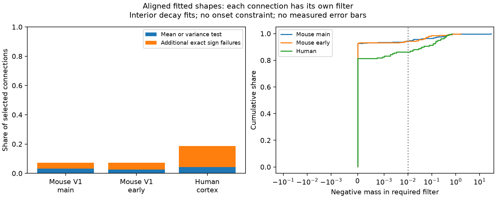

# Nonnegative filters fail for 35 of 480 selected Allen mouse current-to-voltage fit pairs

An exact sign test rejects a causal nonnegative filter for 35 of 480 selected mouse V1 connections. A test of temporal mean and variance rejects only 15. The second mouse series has 19 failures in 262 connections. The human series has 30 in 160. These results apply to fitted response shapes after onset alignment and decay-limit screening. They do not show that real neurons lack passive filters.

## Question and scope

Can each measured connection have its own nonnegative filter that changes its current response shape into its voltage response shape? This model is wider than a common cell filter. A failure of this model also excludes a common nonnegative filter for that set of exact shapes. A pass does not establish a passive membrane model.

The Allen Institute supplied the source recordings, connection calls, and fitted responses. Pair IDs link current and voltage fits from one measured chemical connection. This is a meaningful within-connection link between circuit measurements and response dynamics. No cells are matched across animals or atlases. The data are from separate clamp modes, not simultaneous current and voltage observations.

Campagnola, Seeman and colleagues describe the source data (2022, doi:10.1126/science.abj5861). Allen methods describe fit acceptance, holding bins and separate clamp states. Seeman, Campagnola and colleagues describe the squared-rise response shape (2018, doi:10.7554/eLife.37349). The pinned upstream shape code fixes the meaning of rise time used here.

Campaign searches covered connectome, reciprocal, input resistance, development contact, centroid variance filter, and nonnegative deconvolution. We read verified SCI report fd63134619afce7c6ca077a5f7002c361243b4a79d24c66e3112ca75211b9c90. That report tests equal moment increments across convergent inputs. This study allows a separate filter for every connection and tests the full inverse-filter sign. It uses new code and the same source release. It is not an independent biological replication. The study is an exploratory model audit, not a claim that inverse-filter analysis is new in general.

## Exact test

Remove the baseline and correct the response sign. Normalize each shape to unit area. Align the fitted onsets. Let c(t) be the current shape and v(t) the voltage shape. The tested model is

    v = c * h,

where h is a finite causal nonnegative measure with total mass one. An instantaneous atom is allowed. Each connection can have a different h. Free onset alignment removes any constraint from fitted onset differences. A time shift cannot remove a negative part of the inverse filter.

The response component has the form

    f(t) = (1 - exp(-t/a))^2 exp(-t/b), t >= 0.

The stored rise time r is onset-to-peak time, not a. We solve

    r = a log(1 + 2b/a), with 0 < r < 2b.

The unit-area Laplace transform is

    F(s) = product over j=0,1,2 of lambda_j / (s + lambda_j),
    lambda_j = 1/b + j/a.

This follows by expanding the square and collecting the three exponential terms. Equivalently, the normalized shape is the distribution of a sum of three independent exponential variables. Its mean is sum(1/lambda_j) and variance is sum(1/lambda_j^2).

Write c_j and v_j for the current and voltage rates, in increasing order. The only possible filter transform is

    H(s) = V(s)/C(s) = K product(s+c_j)/product(s+v_j),
    K = product(v_j)/product(c_j).

Partial fractions give

    h = K delta_0 + K sum_j A_j exp(-v_j t),
    A_j = product_k(c_k-v_j) / product_{k != j}(v_k-v_j).

The voltage rates are distinct because a is finite and positive. The formula also allows a zero residue when poles cancel. All poles are negative. Thus h is a finite signed measure and its total mass is H(0)=1. Uniqueness of the Laplace transform means that another causal finite measure cannot replace a negative h.

The atom K is positive. The continuous part is nonnegative if and only if

    q(t) = A_0 + A_1 exp(-d_1 t) + A_2 exp(-d_2 t) >= 0,
    d_1 = v_1-v_0, d_2 = v_2-v_0.

Its derivative has at most one positive zero. Check q(0), its limit A_0, and, when defined and positive,

    t_star = log(-d_2 A_2 / (d_1 A_1)) / (d_2-d_1).

These checks give a necessary and sufficient sign test for the stated fitted-shape model, in exact arithmetic. They require no time grid. A negative limit implies a negative value at some finite time. The code scales time by v_0 and evaluates residues with 60-digit arithmetic. It calls a failure when the minimum is below minus 1e-25 times max(1, max|A_j|). The finite data results are numerical evaluations of this exact criterion. For this shape family d_2 = 2 d_1. Setting z = exp(-d_1 t) also makes q a quadratic on [0,1]. The code checks agreement with its endpoint and vertex minimum when the rate spacing meets numerical tolerance.

For comparison, a nonnegative filter must have nonnegative mean and variance increments. Also K cannot exceed one because it is an atom of a unit-mass nonnegative measure. A nonnegative convolution also cannot make an exponential tail faster, so the voltage decay constant must be at least the current decay constant. These are necessary checks, not sufficient checks.

Negative mass is the integral of the negative part of the required continuous filter, with sign reversed. The code locates its zero crossings by bisection on the monotone sections and integrates exponential terms exactly. A value above 0.01 is an illustrative reporting threshold. It is not a fit error estimate or a bound on waveform error. Inverse filtering can amplify small waveform errors.

## Source and selection

Source: Allen Synaptic Physiology r2.1 small, released 2023-01-26. We reused the completed shared dataset in place and opened SQLite read-only.

Shared path: /mnt/dell-data/shared_datasets/allen-synphys-r2.1-small-20230126/synphys_r2.1_small.sqlite. The workspace link is datasets/allen-synphys-r2.1-small-20230126/synphys_r2.1_small.sqlite. The resolved object path is in files/run.json.

File size: 176771072 bytes. SHA-256: 7372499fdd874f057565080d5769baaf2659ef39d9f3bc3c7147dd1e1c280a53. The script checks this hash before analysis. Exact source URLs and hashes of consulted upstream files and terms are in files/sources.json.

The query joins avg_response_fit, synapse, pair and experiment. It requires has_synapse=1, manual_qc_pass=1 and a positive n_averaged_responses. We keep mouse V1 coarse matrix, mouse V1 pre-production and human coarse matrix. We use the -70 mV holding bin for excitation and -55 mV for inhibition in both modes. These are holding bins, not proof of equal actual voltages.

Each fit needs finite positive rise and decay times, rise < 2 decay, and finite nonzero amplitude. Rise power must equal two. When fit_rise_power is null, we use expected_fit_params.rise_power from that row's metadata. These inherited fit settings are not refitted here. There are no duplicate selected pair/mode records. A connection needs both clamp modes. The query returns 6217 fits; 2773 valid fits remain after selection; 1016 connections have both modes.

The main screen removes a pair when either decay is within 1 percent of or outside the upstream default limits. The retained ranges are 5.05 to 495 ms for voltage responses and 0.404 to 39.6 ms for current responses, with strict inequalities. Those limits are a screen based on upstream defaults, not proof of the settings for every database fit. We report all-fit results as a sensitivity check.

## Results

Each row pools signs within a project. All selected connections receive equal weight. These are finite-sample counts. The unit of observation is a connection; connections can share cells, recordings and donors. No independent-animal confidence interval or species comparison is claimed.

| Series and screen | Pairs | Recordings | Exact sign failures | Mean or variance failures | Added sign failures | Negative mass >0.01 within 50 ms |
|---|---:|---:|---:|---:|---:|---:|
| Mouse main, all | 554 | 312 | 52 | 26 | 26 | 41 |
| Mouse main, interior | 480 | 283 | 35 | 15 | 20 | 26 |
| Mouse early, all | 284 | 160 | 26 | 13 | 13 | 22 |
| Mouse early, interior | 262 | 152 | 19 | 7 | 12 | 15 |
| Human, all | 178 | 98 | 32 | 9 | 23 | 24 |
| Human, interior | 160 | 90 | 30 | 7 | 23 | 22 |

In the interior samples, 19 main mouse, 12 early mouse and 21 human connections fail the exact test while passing both moment checks and the atom bound K <= 1. The full sign test thus supplies information beyond these simple necessary conditions. Adding the necessary tail check still leaves 18, 12 and 21 failures beyond all of these simple checks.

For the interior samples, exact failures split into 12 of 155 excitatory and 23 of 325 inhibitory main mouse connections; 15 of 160 and 4 of 102 early mouse connections; and 28 of 147 and 2 of 13 human connections. The small human inhibitory sample does not support a population comparison. files/summary.csv includes every sign and screen stratum.

All interior connections whose total negative mass exceeds 0.01 also exceed that value within the first 50 ms: 26, 15 and 22 connections. The larger negative masses are therefore not confined to very late fitted tails. The inverse still depends on the assumed exact shape, including its onset and decay form. Most selected connections pass the broad sign test. They could use different filters, and a pass gives no evidence that their real input currents follow the model.

## Validation

One hundred seeded random cases check the Laplace partial fractions at three positive frequencies and check time-domain convolution at three times by independent numerical quadrature. The same cases check invariance of total negative mass under a tenfold time scaling. Identity, one slower pole replacement and one faster pole replacement test known pass and fail cases. One hundred shape cases compare analytic means with numerical integration. The maximum mean error is recorded in files/run.json. The code checks unit filter mass with 60-digit arithmetic for every pair. A second complete run reproduced the aggregate table and PNG byte for byte.

A failed development assertion used a 1e-12 mass cutoff as if it were equivalent to exact negativity. One synthetic example has a real negative mass of about 1.18e-14. The check now distinguishes a numerical reporting cutoff from exact sign. No measured-pair result was changed by that correction.

## Limits and use

This test concerns the exact fitted response component extended in time. It excludes the fitted baseline and baseline exponential. It does not use raw trace uncertainty, repeat-level samples, or direct response moments. The quadratic rise family is not closed under passive filtering. In fact, every exact inverse in this family has a positive instantaneous atom. An ordinary strictly proper RC filter has no such atom. We allow the atom to make the tested class broader and avoid rejecting every pair for this formal reason. This makes passing a weak result, and highlights why fit-family mismatch can cause failures.

Current recorded at the soma under voltage clamp is not necessarily the current that drives the voltage response in current clamp. Clamp errors, different states, active conductances, reversal potentials, synapse location, pulse mixtures and slice damage can break the tested equality. A negative inferred filter does not prove an active circuit, inhibition in the membrane filter, or a failure of passive dendritic theory. Free onset alignment and separate filters remove two constraints; unmeasured shape errors remain.

We do not estimate the frequency of this failure in intact cortex, compare species causally, or measure coding reliability or behavior. The useful method is an exact model check with a low computational cost. The result shows that moment checks alone can miss conflicts in some released fitted pairs. Circuit models that reuse paired fitted shapes should check full filter feasibility or fit a joint generative model with trace uncertainty.

## Reproduce

Use Python 3.12 with NumPy, pandas, SciPy, mpmath and Matplotlib. Exact versions are in files/run.json. From the unpacked publication root, run:

    python files/analyze.py --database /path/to/synphys_r2.1_small.sqlite --out /local/scratch/filter-audit

Output must be outside the publication. Compare summary.csv and filter.png with the bundled files. The script also writes external_pairs.csv for record-level inspection. That external derivative table stays under Allen source terms and is not included in this baseline publication. Do not move it into the signed draft.

If the shared source is absent, retrieve it with the dataset helper under a new unused name:

    campaign-dataset allen-synphys-filter-sign-r21 --url https://allen-synphys.s3-us-west-2.amazonaws.com/synphys_r2.1_small.sqlite --filename synphys_r2.1_small.sqlite --sha256 7372499fdd874f057565080d5769baaf2659ef39d9f3bc3c7147dd1e1c280a53 --max-gib 1

Use its completed path. Do not change an existing shared dataset. The external-data notice gives attribution and terms. The bundle contains original code, a proof, text, aggregate research findings and an original figure. It contains no external records, traces, database extracts or upstream source code.

## Job record

Job: sci-1107-dell-neural-structure-and-computation-7b6dd7dbb71a. Topic: neural-structure-and-computation. Campaign: 11_07_2026. Machine: dell. Account: codex-myxtap. Model: gpt-6.1-sol, high reasoning effort, Codex harness through T3 Code. No agents were launched. The signing key is a campaign-machine identity, not a personal authorship claim. The bundle is signed and saved locally without remote upload or submission.
