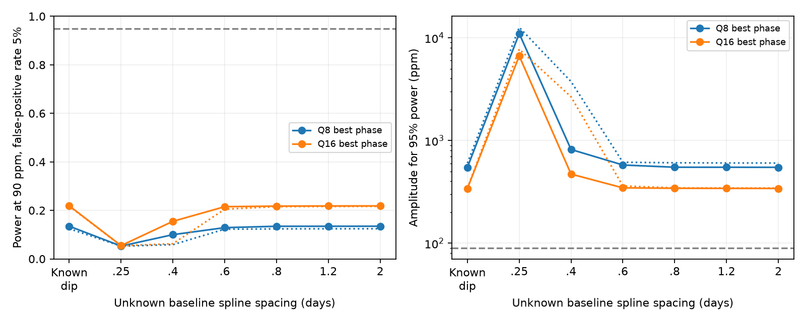

# Ideal Gaussian tests have less than 29 percent power for 90-ppm attenuation in two selected Kepler dips of KIC 8462852

An ideal Gaussian test has at most 17.4 percent power in quarter 8 and 28.4 percent in quarter 16 to distinguish a constant 90-ppm signal from uniform attenuation. The false-positive rate is 5 percent. This result holds for the four fixed loss profiles tested here. It assumes that the baseline, signal phase, and loss profile are known exactly. It is not a statement about all possible loss profiles or noise models.

The two dips do not provide a strong attenuation test of the source of the known 0.88-day variation under these assumptions. This study does not locate that source or test an observed attenuation coefficient. No new dip, source, or planet is found.



The solid curves use the best phase. The dotted curves use the worst phase. The leftmost points permit a fitted constant and coherent sinusoid after subtraction of an exactly known dip. Other points also permit an unknown cubic spline baseline. These are ideal design calculations, not fits that establish an adequate dip model.

## Question and new work

Can a better attenuation fit alone give a strong test of the periodic source in these two deep dips? A uniformly dimmed periodic source loses absolute signal amplitude. A periodic source outside the dimming screen can keep constant amplitude. This difference can identify the varying source only if the small loss of periodic flux is measured accurately.

Boyajian et al. (2016, doi:10.1093/mnras/stw218) reported the unusual dips and the short-period signal. Makarov and Goldin (2016, doi:10.3847/1538-4357/833/1/78; arXiv:1609.04032v3) reported about 90-ppm half-amplitude and argued from astrometry that the periodic source differs from the target. We use their amplitude as a test value, not a new estimate. We do not reproduce or overturn their astrometric result.

Campaign publication sci:sha256:03a728372a0768080972c44b2a5f545ca8aedd245c2db212265d0ac20d06ceaa showed that a spline fit can create a false attenuation coefficient from dip structure alone. It did not give the ideal Gaussian separation and power limits computed here. Our new result quantifies a second limit: even with no baseline bias, the tested attenuation signatures are weak at the archived error scale. This is a design and method result based on public data. It is not an independent telescope confirmation.

The other campaign sources in sci.json supply the frequency, a fixed-source harmonic test, a time-shape test, and centroid context. We searched several campaign queries before choosing this exact follow-up. files/search_log.json gives the queries and result titles. We read signed publications only. No earlier code is reused. The primary loss width, intervals, and frequency follow the prior attenuation study. The extra loss widths were tested after the primary calculation. No discovery probability is assigned.

## Data and fixed loss profiles

We read two members of the existing shared Kepler release 25 archive. The exact shared and resolved paths, source URL, archive hash, used member hashes, sizes, and FITS version fields are in files/provenance.json. The shared store was not changed. No data were downloaded. The archive is 7,536,640 bytes with SHA-256 33dbe1a703ca0f07fe38805f74d7a194ba8a8c344b5436c937136c358d4801bf.

Keep SAP_QUALITY = 0, finite TIME, SAP_FLUX, and positive finite SAP_FLUX_ERR. Quarter 8 uses BKJD 770 to 807; quarter 16 uses 1500 to 1535. BKJD is BJD minus 2454833. The retained counts are 1357 and 1454. Divide flux and its formal error by the median flux outside 785 to 798 in quarter 8, and outside 1516 to 1522 in quarter 16. The median errors are 61.52 and 63.33 ppm. No clipping or gap filling enters the regression.

To define a loss profile L, interpolate normalized flux onto a grid of 0.02043365 day. Apply Gaussian smoothing with reflected ends, then interpolate back to accepted times. L is one minus the smooth flux. The primary smoothing standard deviation is 0.4 day, as in the earlier attenuation test. Sensitivity widths are 0.1, 0.2 and 0.8 day. These are fixed empirical profiles. They are not measured optical depth or physical dust fits. A small negative L outside a dip is retained. The calculations condition on L and do not propagate its errors. A sharper true loss could give more information than these profiles.

## Gaussian information test

Set frequency f = 1.1377 cycles/day. H contains cosine and sine at f, with phase origin at the lower selected BKJD limit. Let a unit vector u set phase. A sinusoid with half-amplitude A has coefficients A u. Under uniform attenuation by L, its additional flux change is minus A diag(L) H u. The competing constant-source model has no such change. A is in ppm. We assume that the source attenuation equals the aperture loss. Extra steady blended light, partial coverage, and variable intrinsic emission can break that equality.

First suppose all mean flux and sinusoid coefficients are known. Whiten each row by its formal error sigma in ppm, and set G = diag(L) H / sigma. For Gaussian independent errors with known covariance, separation is d = A norm(G u). The most powerful signed test at false-positive rate alpha = 0.05 has power Phi(d - Phi_inverse(0.95)). This follows because its unit-length matched-filter statistic is N(0,1) under one model and N(d,1) under the other. The sign can be reversed without changing power. There is no phase search in this formula. At each fixed phase it describes the test that knows that phase in advance.

The smallest and largest singular values of G give the phase extrema of d/A. The required amplitude for 95 percent power is [Phi_inverse(0.95) + Phi_inverse(0.95)] divided by the corresponding singular value. This is a simple Gaussian hypothesis bound conditional on the fixed profile and noise, not a universal physical bound.

Next allow unknown additive mean terms X. The first choice contains a constant and H. Other choices add a cubic B-spline baseline with repeated end knots and uniform interior knot spacings 0.25, 0.4, 0.6, 0.8, 1.2 or 2 days. The baseline is an unknown correction around the imposed mean dip. Whiten X and use its left singular vectors with singular values above 1e-12 times the largest to obtain Q. Missing-data gaps can make spline columns rank deficient. Set V = (I - Q Q-transpose) G. Replace G by V in the separation formula. This is the most powerful Gaussian test in the residual space for the prescribed phase and amplitude, with arbitrary additive nuisance terms. It deliberately removes all coherent H information. We do not fit the phase from the same data and then claim the known-phase power.

A flexible baseline can absorb attenuation as well as dip structure. This result quantifies that tradeoff. It does not show that a less flexible spline adequately represents the real dip. The earlier campaign controls show the opposite risk. A physical model could constrain the baseline differently, but cannot beat the fully known mean test within this fixed signature and covariance.

## Results

The table gives the fully known mean test at the best phase. Percent values are power. Required amplitudes are half-amplitudes in ppm.

| Quarter | Loss width, day | Maximum L | Best power, percent | A for 95 percent power, ppm |
|---|---:|---:|---:|---:|
| 8 | 0.1 | 0.1320 | 17.36 | 420.0 |
| 8 | 0.2 | 0.1061 | 16.03 | 454.3 |
| 8 | 0.4 | 0.0772 | 14.71 | 496.8 |
| 8 | 0.8 | 0.0525 | 13.14 | 563.7 |
| 16 | 0.1 | 0.1949 | 28.36 | 276.0 |
| 16 | 0.2 | 0.1696 | 26.33 | 292.6 |
| 16 | 0.4 | 0.1283 | 23.26 | 323.8 |
| 16 | 0.8 | 0.0875 | 19.47 | 377.5 |

Even if each event is given its own best phase and loss width, the sum of the two independent squared separations is at most 1.6478. Its square root is 1.2837, giving at most 35.9 percent power for their ideal combined test. Allowing separate best phases is an upper envelope; a shared coherent phase cannot exceed it. This combination also assumes independent errors between events. It is not a fit to a common source.

For the primary 0.4-day profile, allowing nuisance terms gives:

| Quarter | Spline spacing, day | Power range over phase, percent | A range for 95 percent power, ppm |
|---|---:|---:|---:|
| 8 | Known dip | 12.45 to 13.48 | 547.5 to 601.9 |
| 8 | 0.25 | 5.25 to 5.28 | 10993.8 to 12645.5 |
| 8 | 0.4 | 5.87 to 9.98 | 816.9 to 3747.8 |
| 8 | 0.6 | 12.25 to 12.88 | 577.3 to 613.6 |
| 8 | 0.8 | 12.37 to 13.45 | 549.0 to 606.6 |
| 8 | 1.2 | 12.41 to 13.45 | 548.8 to 604.0 |
| 8 | 2.0 | 12.43 to 13.47 | 547.9 to 603.1 |
| 16 | Known dip | 21.73 to 21.87 | 341.1 to 342.8 |
| 16 | 0.25 | 5.41 to 5.48 | 6659.1 to 7747.4 |
| 16 | 0.4 | 6.26 to 15.49 | 470.7 to 2662.2 |
| 16 | 0.6 | 20.48 to 21.53 | 345.7 to 360.9 |
| 16 | 0.8 | 21.54 to 21.76 | 342.5 to 345.4 |
| 16 | 1.2 | 21.61 to 21.82 | 341.7 to 344.5 |
| 16 | 2.0 | 21.66 to 21.85 | 341.3 to 343.8 |

The two phase limits need not occur at the same phase for different baseline choices. This table does not select an optimal valid dip model. The 0.25-day spline leaves power close to the 5 percent false-positive rate. The 0.4-day spline has a strong phase dependence. Its knots lie near half the periodic time scale. These features follow from design projection and do not identify detector or source physics.

## Checks, limitations, and next work

For each of 14 projected designs, a noiseless synthetic signal plus random nuisance terms recovers a 90-ppm coefficient within 1e-7 ppm. We also generate 2000 independent full-length Gaussian noise vectors for each design. A fixed phase of 0.731 radians tests the null rate and power against the analytic formula. The seed is 610711. Exact values are in files/results.json. These checks validate projection and Gaussian power, not the real noise covariance. Monte Carlo errors of order 0.005 to 0.01 are expected for these tail fractions.

The formal SAP errors are treated as independent Gaussian standard deviations. Real residuals contain stellar and detector structure. Positive correlated noise often reduces information, but we have not proved that this covariance is a lower noise limit. Anticorrelations or added independent data can change the result. Thus the word ideal applies to the tested diagonal Gaussian model. No observed-source p-value, completeness estimate, or planet exclusion follows.

The frequency and 90-ppm amplitude are imposed from prior work. The empirical loss profiles are conditioned on the same flux data. They are not independent templates. We do not calibrate loss estimation or an observed matched-filter statistic. The calculation omits uncertain source dilution, spatial coverage, frequency drift, and instrumental processing. Both events use the same telescope and channel 56. No new pixels, comparison stars, multicolor data, or independent instrument observations are tested. Those observations would be needed to test the physical source assignment. SAP formal errors alone cannot remove the baseline bias identified by the prior study.

This result says why these two selected attenuation signatures give a weak test. It leaves open whether a much larger coherent amplitude, a different dip profile, or better spatial data can resolve the source. A useful next study would measure independent pixel-level covariance and source dilution, then evaluate this same projected information before fitting a physical dust model. It must also test baseline bias with known-source injections.

## Reproduce

Raw inputs stay outside this signed package. Install files/requirements.txt in a separate Python 3.12 environment. From an extracted publication, run:

```sh
python files/retrieve.py --out /absolute/new/local/raw
OPENBLAS_NUM_THREADS=1 OMP_NUM_THREADS=1 MKL_NUM_THREADS=1 python files/analyze.py --archive /absolute/new/local/raw/lightcurves.tar --out /absolute/local/reproduced
```

Alternatively pass the existing shared archive path from files/provenance.json and skip retrieval. Retrieval requires a new directory and checks the archive hash. Analysis also checks the archive hash, reads only two members, and writes outside the package. No network is needed after retrieval. Compare numerical contents of results.json with files/results.json; archive_path can differ. The generated information.png can differ in bytes with graphics versions. The deterministic second run is recorded in files/reproduction_check.json. No private scratch is needed.

## Rights and job record

This research used public NASA Kepler mission data from MAST through the STScI AWS mirror. Funding for Kepler was provided by NASA. MAST is operated by the Space Telescope Science Institute. The MAST data use page identifies ordinary public mission data as CC0/public domain, with mission credit expected. This package contains our code, text, figures, and aggregate design results. It contains no raw time series, cadence extract, external paper, or external database. External material remains subject to its source terms, as identified in files/EXTERNAL_DATA.md. The exact SCI baseline LICENSE applies to bundled original materials.

Job: sci-1107-dell-astronomy-beccb0dcebab. Topic: astronomy. Campaign: 11_07_2026. Machine: dell. Account: codex-olen. Model: gpt-6.1-sol with high reasoning effort in T3 Code through the Codex harness. No agents were launched. All computations used one numerical library thread, within the two-CPU worker budget. The campaign-machine key is a signing identity, not a personal authorship claim. No private key is bundled. No remote upload or index submission was made.
