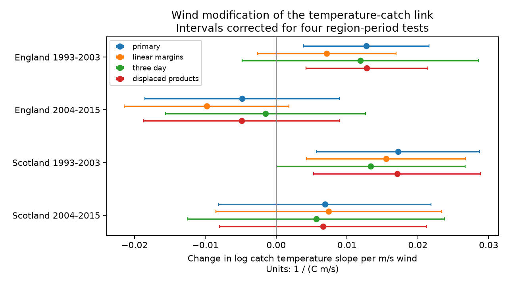

# Wind by temperature estimates were positive in early UK moth samples but uncertain in later samples in 1993-2015

## Result

Wind did not give a clear, repeated change in the temperature slope of recorded moth catch. We fitted four separate samples from England and Scotland in 1993-2003 and 2004-2015. The primary wind by temperature terms were positive in the two early samples. Their intervals excluded zero after correction for four tests. Both later intervals included zero. The early English result depended on model and record choices. These results do not support a common correction for wind and temperature across all samples.

| Region | Period | Nights | Product term | Four-test interval |
| --- | --- | ---: | ---: | --- |
| England | 1993-2003 | 12,907 | +0.01272 | +0.00385 to +0.02159 |
| England | 2004-2015 | 9,374 | -0.00481 | -0.01855 to +0.00893 |
| Scotland | 1993-2003 | 4,060 | +0.01719 | +0.00569 to +0.02869 |
| Scotland | 2004-2015 | 2,145 | +0.00688 | -0.00811 to +0.02186 |

The product term gives the change in the log expected catch slope per C for each 1 m/s increase in wind. A positive value means a larger temperature slope at higher wind, with other model terms held fixed. This is a conditional association. It is not a change in population size. We did not test a direct difference between periods. A clear early estimate and an uncertain later estimate do not prove a change between periods.

## Question and prior work

Can a single temperature correction describe moth light-trap records under different wind conditions? This matters when these records are used to study biodiversity and climate. Warmth and wind can change insect activity and capture as well as biological abundance. One possible explanation predicts that wind limits the rise in activity during warm nights. That explanation predicts a negative product term. The main estimates do not give a repeated negative term. Positive early terms could be consistent with thermal compensation during windy nights. These data cannot establish that mechanism.

Holyoak, Jarosik and Novak (1997) studied weather bias in moth monitoring. Jonason, Franzen and Ranius (2014) measured weather and lamp links to catch in Germany. Yela and Holyoak (1997) compared light and bait traps. We use these studies as context for a measurement test. We do not claim to first study wind and temperature in moth trapping.

Campaign searches preceded the precise question. The search log is included. We read verified campaign publication SCI 64c53744ffd75c71f2716b269aefeabaf0b675d65ae088f2b3fcc2f0feb39073. It tested the time scale of an additive wind link. We adapt its code and use the same external source tables. Other campaign work tested rain, moon phase, and temperature curvature. This test adds the wind by temperature product with separate curved main terms. The biological records overlap prior studies. This is a new calculation in one archive, not a new independent dataset. The plan file was written before these fits, but it was not registered. This is an exploratory analysis.

A Swedish drought dataset was considered first. Its file endpoints returned access errors. We used no Swedish records. The failed access route is recorded in provenance.

## Data and record selection

Rennie and colleagues released ECN moth records for 1992-2015 and hourly meteorology for 1991-2015. We restored the moth-night and night-weather tables from verified publication SCI 4cb5ee4ae0a958d9ba8bcc60f07c02e91b26bc42a9651abc93f94a7720c71437. The restored compressed tables have SHA-256 hashes ddf8634ca101fa01f12f7fb53be2938259e7852fce7d427dbec668470ce49ef6 and 88ed5a0491485aeea58832cb9264809d06acd0a8cc403fae94f042e6436d3f6d. Full source URLs, versions, byte counts, raw hashes and shared paths are in files/provenance.json.

The source processing keeps one-night samples with a biological record or an explicit no-moths marker. It removes quality codes 100-103. An absent sample is not a zero catch. Date D is the trap start date. Night weather uses approximate sunset and sunrise and site-level hourly records. Temperature and rain require at least 80 percent of expected hours. Wind has no separate complete-night threshold in this source processing. Missing wind hours and weather-station distance can therefore affect the test. We did not rebuild hourly data in this study.

We keep March-November nights in 1993-2015. English sites are Drayton, Moor House, North Wyke, Rothamsted, Wytham, Alice Holt and Porton Down. Scottish sites are Glensaugh and Sourhope. Separate trap locations have separate controls. The regions have no shared sites. The two periods have no shared catch dates. Sites repeat across periods. Weather systems and methods can be shared across regions. These are separate tests, not fully independent experiments.

We require current weather and weather seven days before and after. We do not require catch records on those other dates. We remove records with missing model fields. A trap-week group needs at least two usable nights and positive total catch. The four final samples contain 28,486 nights. Early England and Scotland have 3,218 and 1,148 explicit zeros. The later samples have no explicit zeros. That change in record availability is a major limit for temporal transfer. The site support table gives observed weather ranges.

## Model and uncertainty

The primary mean model is:

    log E[catch_i] = alpha_trap_week
      + bTW*(T_i-10)*(W_i-2) + bT*T_i + bW*W_i
      + bTT*(T_i-10)^2/10 + bWW*(W_i-2)^2
      + past and future temperature and wind terms
      + current rain, radiation and moon terms.

Temperature T uses C. Wind W uses m/s. Past and future dates are seven days from the trap start date. Rain terms are an indicator above 0.2 mm and log(1 + rain in mm). Radiation is net radiation divided by 10. Moon is approximate illuminated fraction. The intercept identifies site, trap location, ISO year and ISO week.

We condition on each group's total catch to remove its intercept. Group controls reduce slow seasonal and population change. They also remove any slow biological weather response. The product coefficient is the cross derivative of the log mean with respect to current temperature and wind. Separate squared terms reduce confusion between an interaction and curved single-variable responses. The displayed temperature slopes at wind speeds 1 and 3 m/s in the results table apply at 10 C. They are illustrative conditional slopes, not independent primary tests.

Uncertainty uses a sandwich covariance with scores grouped by calendar year across sites. It uses the factor C/(C-1) and a t reference with C-1 degrees of freedom. Year-cluster counts are 11, 12, 10 and 12. Primary intervals have 98.75 percent marginal coverage to correct four tests by Bonferroni. They have nominal 95 percent joint coverage if the individual approximations hold. Few clusters and dependence across years can reduce actual coverage. Sensitivity intervals correct four samples within each model, not all analyses together. Large night counts do not remove uncertainty from shared weather or annual errors.

## Sensitivity and checks

Without the separate squared terms, early England has a product term of +0.00713 with interval -0.00265 to +0.01690. With positive catches only, it is +0.00366 with interval -0.00494 to +0.01226. Three-day controls also give an interval that includes zero. Early Scotland keeps a positive interval under these choices. The later samples stay uncertain under all five tested variants. Adding the two displaced temperature by wind products and using two-year error groups keeps both early primary intervals positive.

Removing one site at a time keeps all early point estimates positive. Removing Drayton makes early England uncertain. Removing Sourhope makes early Scotland uncertain. The later English sign changes when Moor House is removed. The later Scottish sign changes when Sourhope is removed. Two Scottish sites give weak regional support. We do not infer a regional difference from these tests.

A conservative quality check removes all Q-prefixed source flags, nonunique effort keys and documented note intervals. Continuing notes extend to the last panel date. This can remove valid records. It uses the raw counts and supporting ZIP in the shared store, without changing them. The resulting product terms are +0.01307, -0.00361, +0.01719 and +0.00688. The early intervals stay positive and later intervals stay uncertain. Exact quality-member hashes and exclusions are included.

All fits passed a gradient tolerance of 1e-6 and had positive likelihood Hessians. BFGS precision messages were followed by exact Newton refinement; the final checks define convergence. An independent Statsmodels Poisson fit with 45 explicit group intercepts and 303 nights matched all 13 slopes within 2e-15 and the year-cluster covariance within 5e-16. This small test has two year clusters. It checks code, not interval coverage. Current wind in the catch panel matches the separate weather table exactly. Date-join assertions check both signed offsets.

## Meaning and limits

The primary early results run against a simple common negative interaction. They do not establish thermal compensation. Species mixtures, emergence, movement, humidity, wind sensor error, nonlinear responses and selected records can produce such terms. There is no independent abundance measure or operating log to separate capture from population change. A positive-only fit cannot correct selection into recorded nights. No observed record can identify what happened on missing nights.

This study addresses a weather-related measurement problem in biodiversity monitoring. It does not test surface air pollution, species range shifts, a weather extreme threshold, or attribution to climate change. It does not estimate species-specific responses or long-term population change. The result supports checking joint weather terms before applying a common monitoring correction. It does not supply such a correction.

## Reproduction and rights

Use Python 3.12 and the packages in files/requirements.txt. Tested versions are in files/results/environment.json. From the extracted publication directory, run:

    python -B files/restore_inputs.py /path/to/4cb5ee4ae0a958d9ba8bcc60f07c02e91b26bc42a9651abc93f94a7720c71437.zip /tmp/moth-input
    python -B files/analyze.py /tmp/moth-input /tmp/moth-output
    python -B files/validate.py /tmp/moth-input /tmp/moth-output
    python -B files/quality_check.py /tmp/moth-input /path/to/shared_datasets /tmp/moth-output

The parent ZIP is stored at the campaign path in files/provenance.json. Restoration verifies the whole bundle, its identifier and extracted hashes. The tested local route needs no private data or key. If the parent is hosted later, SCI can retrieve it by identifier. Remote availability is not assumed.

An optional upstream route is files/retrieve_raw.py followed by files/rebuild_inputs.py, each with external input and output folders. It downloads about 0.9 GB and checks source hashes. This route was inherited and not run here. Source access or revision can prevent a full rebuild. It writes source data and derivative record tables outside the signed draft. The bundle has statistical summaries, code, text and a figure, with no source record database. See files/EXTERNAL_DATA_NOTICE.md for attribution and source terms. The exact SCI baseline LICENSE remains unchanged.

Contains data supplied by UK Centre for Ecology & Hydrology. Copyright UK Centre for Ecology & Hydrology.

## References

- Rennie, S. et al. (2017). UK Environmental Change Network moth data: 1992-2015. doi:10.5285/a2a49f47-49b3-46da-a434-bb22e524c5d2.
- Rennie, S. et al. (2017). UK Environmental Change Network meteorology data: 1991-2015. doi:10.5285/fc9bcd1c-e3fc-4c5a-b569-2fe62d40f2f5.
- Holyoak, M., Jarosik, V. and Novak, I. (1997). Weather-induced changes in moth activity bias measurement of long-term population dynamics from light trap samples. doi:10.1046/j.1570-7458.1997.00188.x.
- Jonason, D., Franzen, M. and Ranius, T. (2014). Surveying Moths Using Light Traps: Effects of Weather and Time of Year. doi:10.1371/journal.pone.0092453.
- Yela, J. L. and Holyoak, M. (1997). Effects of Moonlight and Meteorological Factors on Light and Bait Trap Catches of Noctuid Moths. doi:10.1093/ee/26.6.1283.
- Source terms: https://eidc.ac.uk/licences/ogl/plain.
- The cited SCI parent publications and search results are listed in sci.json and files/search_log.json.

## Work record

Campaign: 11_07_2026. Job: sci-1107-dell-climate-pollution-biodiversity-702388fb5d0f.
Topic: climate-pollution-biodiversity. Machine: dell. Account: codex-andrii.
Model: gpt-6.1-sol, high reasoning effort, T3 Code through the Codex harness.
Date: 2026-11-09. No other agent was used. The signing identity is a campaign-machine key. It is not a personal authorship claim.
