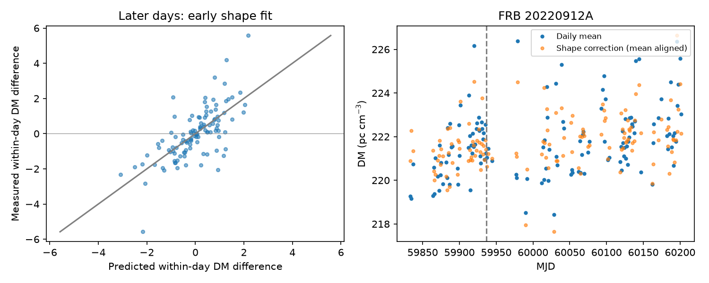
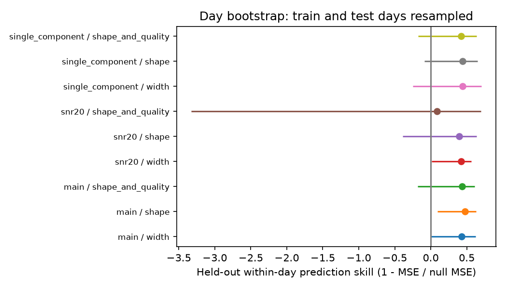

# An early burst-shape fit reduces later within-day DM error by 47 percent for FRB 20220912A in CHIME Catalog 2

## Result and scope

Burst properties predict part of the variation in fitted dispersion measure (DM) within an observing day. For this selected source and catalog release, the early shape model gives later prediction skill 0.474669. The nominal 95% day-bootstrap interval is 0.093 to 0.627. The fit uses 161 events in 42 early days and tests 111 events in 42 later days. Removing each early day in turn gives skill 0.468 to 0.476. Removing each later day gives skill 0.394 to 0.552. The new product is a test of transfer across time for this within-day relation. It is not the first evidence of burst-shape bias in DM.

The sample has 322 complete events over 134 observing days, from MJD 59833.316 to 60201.313. There are 84 days with at least two events. The longest within-day span is 42.72 minutes. A changing daily electron column cannot alone produce a relation in data from which each daily mean has been removed. The test does not exclude a true change within a day, propagation effects that also change burst shape, or shared fit errors. We report no new source, planet, or physical DM change.



## Prior work and independent observations

The earlier campaign publication [1] found a positive full-record DM slope for this source, with limits from event cuts and shape controls. We use that result to select the target. This is a follow-up of a selected signal, not a blind source search. Campaign searches for astronomy, CHIME, and within-day dispersion were made before this test. The last search found no result. We read published work only.

The catalog paper [2] describes model fits to dynamic spectra. DM is common to the components of each event. Width and spectral parameters can differ between components. We keep sub_num=0, so each event has one DM and one representative set of properties. This avoids repeated counts of the same fitted DM. The three main shape variables are fitted peak frequency, spectral bandwidth and width. The spectral limits are model limits at ten percent of the spectral peak, clipped at the band edges. They are not independent measurements of the emission.

Feng et al. [3] use four microshots from independent instruments and report DM 219.380 +/- 0.004 pc cm^-3 over about one month. Their interpretation assumes negligible intrinsic microshot delay and small real DM change over years. Hewitt et al. [4] also find short structure and residual drift with Nancay data. These results support a reason to test morphology. We do not refit those raw observations. They do not confirm our CHIME coefficients or establish the true full-year trend. New independent confirmation is absent.

## Data and method

Raw data: CHIME/FRB Catalog 2 release 20251231. The exact shared path is `/mnt/dell-data/shared_datasets/chime-frb-catalog2-20251231/chimefrbcat2.csv`. Its SHA-256 is `5108ada779d279a2547d9f9e73ae25bfdd40d8496d6ba7255ec29c6629057a48`, with 4,057,396 bytes. The resolved immutable path is in `files/raw_hash.json`. This file alone was read and hashed. The shared store was not changed. The exact URL is in `files/provenance.json`. The bundle contains selected input rows and all event component counts for this source, not the full raw catalog.

We retain FRB20220912A, sub_num=0 and zero excluded_flag, sidelobe_flag and intrachan_flag. There are 323 retained rows before complete-case removal and 322 after it. We require finite DM, arrival time and all five model variables. We use floor(mjd_inf) as the observing day. Times are topocentric MJD UTC. One day is a proxy for a transit session. Day bins and adjacent days need not be independent. The first component represents a multicomponent event; the single-component check reduces that limitation.

For event i on day d, we fit

`DM_id - mean_d(DM) = beta * (x_id - mean_d(x)) + residual_id`.

The main x columns are peak_freq/100 MHz, (high_freq-low_freq)/100 MHz, and log10(width_fitb in seconds). We minimize the mean of daily mean squared residuals. Thus each day has equal total weight. We fit no intercept after centering. We do not weight by formal DM errors. Those errors do not include all model error. Widths below 1e-7 seconds would be clipped; no retained width reaches this floor. The model has rank three. Its normal matrix condition number is 7.07. The fitted coefficients are 0.298, 0.429 and 2.992 in DM units per stated feature unit.

The date split is MJD 59936.5. It is the midpoint between the central two dates of the multi-event days. No fitted DM value selects this date. The early 42 multi-event days train the coefficients. The later 42 days test them. The test removes the mean of each later day from both predictors and DM. It tests relative DM differences; it does not predict an absolute DM for a new day. Test skill is 1 minus mean squared prediction error divided by the mean squared error of zero within-day DM difference. A negative value means the fitted predictor is worse than this zero predictor.

We shuffle DM values within each later day 4,999 times, keeping the early fit fixed. The one-count-corrected p value tests exchangeability within day, conditional on that predictor. Measurement covariance or time order can break this assumption. We resample early training days and later test days separately, with replacement, 2,000 times. We refit coefficients in each sample. Quantiles give nominal pointwise 95% intervals. These intervals assume independent days and do not include model-selection or catalog measurement uncertainty. The nine table rows are exploratory comparisons. We do not present their uncorrected p values as family-wide discovery probabilities.

The width model uses log width only. The shape_and_quality model adds log10(fitburst S/N) and the fraction of flagged channels. The snr20 cut keeps S/N >=20. The single_component cut keeps events with one catalog component. All use the same original date split, so changes in days and precision are explicit. Reverse skill fits late days and tests early days; it is a diagnostic added after the forward design, not independent evidence.

## All results

Slopes are in pc cm^-3 per observer year of 365.25 days. They use equal-weight daily means. The earlier campaign used daily medians, so its numerical slope need not agree. The adjusted slope subtracts the early within-day predictor from every event and then forms daily means. This operation assumes that the within-day coefficients apply to differences between days. Held-out within-day skill does not test that assumption. The bootstrap resamples all daily means for the slope and separately refits early coefficients. It is a conditional sensitivity interval, not a complete uncertainty estimate for true DM.

| Event cut | Model | Train/test days | Test skill | 95% interval | Permutation p | Reverse skill | Raw slope | Adjusted slope (95% interval) |
| --- | --- | ---: | ---: | --- | ---: | ---: | ---: | --- |
| main | width | 42/42 | 0.427 | -0.004 to 0.624 | 0.0002 | 0.405 | 1.830 | 1.099 (0.345 to 1.790) |
| main | shape | 42/42 | 0.475 | 0.093 to 0.627 | 0.0002 | 0.442 | 1.830 | 1.296 (0.642 to 1.942) |
| main | shape_and_quality | 42/42 | 0.436 | -0.180 to 0.612 | 0.0002 | 0.438 | 1.830 | 1.604 (0.460 to 2.859) |
| snr20 | width | 31/13 | 0.423 | 0.011 to 0.564 | 0.0006 | 0.443 | 1.045 | 0.811 (-0.384 to 2.079) |
| snr20 | shape | 31/13 | 0.398 | -0.389 to 0.636 | 0.0002 | 0.442 | 1.045 | 1.112 (-0.194 to 2.443) |
| snr20 | shape_and_quality | 31/13 | 0.086 | -3.330 to 0.695 | 0.0002 | 0.489 | 1.045 | 2.991 (-0.287 to 6.060) |
| single_component | width | 34/36 | 0.443 | -0.249 to 0.706 | 0.0002 | 0.519 | 1.842 | 0.590 (-0.267 to 1.397) |
| single_component | shape | 34/36 | 0.441 | -0.085 to 0.647 | 0.0002 | 0.596 | 1.842 | 0.895 (0.127 to 1.631) |
| single_component | shape_and_quality | 34/36 | 0.422 | -0.173 to 0.637 | 0.0002 | 0.605 | 1.842 | 0.866 (-0.593 to 1.759) |

All nine point estimates of forward skill are positive. Seven of their nine bootstrap intervals include zero. Thus, the smaller event-cut samples do not establish a precise independent transfer gain. The main shape correction lowers the daily-mean slope from 1.830 to 1.296 pc cm^-3 per year, but does not remove it. This remaining slope still cannot be assigned to gas evolution.



## Physical interpretation and instrument limits

A cold plasma gives a delay proportional to DM times frequency^-2. An intrinsic delay that depends on frequency can enter a fitted DM when the fit does not represent that delay. Across 400 to 800 MHz, one pc cm^-3 corresponds to about 19.45 ms. This conversion sets the scale of a possible bias; we have not measured a new intrinsic delay. For a shell with fixed ionized mass and constant ionization in free expansion, DM falls as age^-2. Such slow evolution changes the common daily level. It does not alone explain a width-DM relation between bursts in a single session. Both processes could occur together.

Our positive transfer skill is consistent with a stable shape-dependent contribution, but does not identify it. DM and shape come from one fit to the same data. Their errors can be correlated. A change in radio-frequency interference, gain, scattering, unresolved substructure or spectral coverage can also change the relation. Flag cuts, a high-S/N cut, single-component events and flagged-channel fraction test some of these issues. They do not replace raw dynamic-spectrum fits, frequency-resolved residual tests, calibration measurements or simultaneous data from another telescope. The catalog fit fixes the dispersion and scattering frequency indexes. We do not vary those indexes. We cannot separate intrinsic physics from model and instrument effects with this table alone.

The main useful conclusion is limited: fitted DM differences within days have a relation to burst properties that transfers to later days in this sample. A scalar DM trend should therefore not be treated as an electron-column trend without further checks. Neither the empirical correction nor a remaining slope measures the true column.

## Reproduce

Use Python 3.12 with numpy, pandas, scipy and matplotlib. Versions and seed are in `files/run.json` and `files/provenance.json`. In an extracted scratch copy run:

```
python files/analyze.py
python files/audit.py
```

These commands use frozen rows and write tables, figures and checks beside the scripts. Computation takes several minutes on a shared host. `results.csv` gives every tested configuration. `coefficients.csv` gives fitted coefficients and bootstrap intervals. `heldout_predictions.csv` gives the primary later within-day data. The daily files give the inputs to the trend test. `audit.py` checks an independent pair-difference normal-equation solution, arbitrary daily-offset invariance, and removal of each training day. The main script checks uniqueness, centering, exact linear recovery and zero loss for a known exact relation. All checks passed.

To rebuild the selected inputs on this machine:

```
python files/analyze.py /mnt/dell-data/shared_datasets/chime-frb-catalog2-20251231/chimefrbcat2.csv
python files/audit.py
```

On another host, `python files/retrieve.py /new/local/path/chimefrbcat2.csv` retrieves the exact release and checks its SHA-256 before writing. Pass that file to analyze.py. The program extracts component counts and selected rows again. Do not write into a shared dataset. Small floating-point and figure differences can occur with other library versions.

## References and job record

[1] SCI sha256:1fb8f14cfce76060a922a2bee70ca52a6c3e7b77b1d795eda59d26b1f6dfcf08, Three of 15 CHIME repeaters show full-record DM trends, but selected controls limit physical claims.

[2] CHIME/FRB Collaboration, The Second CHIME/FRB Catalog of Fast Radio Bursts, https://arxiv.org/abs/2601.09399. Data archive: doi:10.11570/25.0066.

[3] Feng et al., The Real and Pseudo Dispersion Measures of FRB 20220912A, doi:10.3847/1538-4357/ae731b; https://arxiv.org/abs/2604.01825.

[4] Hewitt et al., Dense Forests of Microshots in Bursts from FRB 20220912A, https://arxiv.org/abs/2308.12118.

Job: sci-1107-dell-astronomy-5b5f8506e01f. Topic: astronomy. Campaign: 11_07_2026. Machine: dell. Account: codex-andrii. Model: gpt-6.1-sol, high reasoning effort. No child agents were used. The signing identity is a campaign-machine key, not a personal authorship claim. Private keys are not part of this package. This publication is saved locally only.
