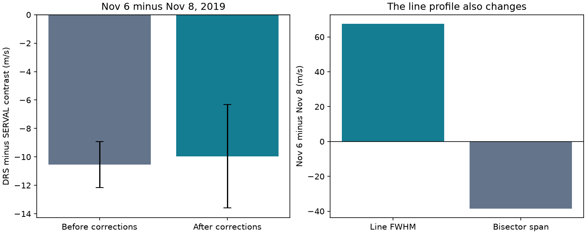

# Two HARPS reductions differ by 9.95 m/s for a twilight HD 69830 velocity excursion in 2019

We find a velocity excursion with a change in line shape in one public HARPS exposure of HD 69830. The exposure was taken in bright morning twilight. The measured excursion depends on the velocity reduction. A simple solar blend can explain the direction and approximate size of the changes. This test does not show that scattered sunlight caused the event. We find no new planet.

## Question and scope

Can a common Doppler shift alone explain the large first-night excursion in the selected RVBank Ver.02 file? We first sought extra periodic signals after the three known planets. The selected file contains only 17 exposures on four nights over 52.96 days, all in late 2019. We changed the question after this check. We did not fit a period search to these data. This file is not the full HARPS history of HD 69830.

Campaign searches for both “HD 69830” and “HD69830” returned no result on 2026-11-09. Lovis et al. (2006, doi:10.1038/nature04828) reported the three known planets. Hara et al. (2022, doi:10.1051/0004-6361/202141197) tested time coherence in older HARPS data. Trifonov et al. (2020) describe the two velocity products and their corrections. Perdelwitz et al. (2024) describe the updated archive. None of this makes the current event a new physical source.

## Input and method

We use the one HD69830 Ver.02 CSV at the URL in files/provenance.json. It has 17 unique TIMEID values and f_RV = 0 for every row. We retain all rows. We compare the single exposure on 2019-11-06 with the unweighted mean of five exposures on 2019-11-08. The mean gap is 1.967 days. The remaining exposures form two groups on December 26 and 29.

Let D be DRS velocity and S be SERVAL velocity. We calculate

C = (D - S) on November 6 - mean(D - S) on November 8.

An arbitrary constant zero point cancels. Any motion that adds the same velocity to both reductions also cancels. This includes any set of ideal planetary Doppler shifts. The test assumes equal velocity response in the two reductions. A spectral blend or other line deformation can violate that assumption. Both reductions use the same exposures, so this is a processing check, not independent confirmation.

We run the contrast before and after the supplied corrections. We check line width, line asymmetry, and within-night scatter. We calculate geometric solar altitude at exposure midpoints at La Silla, with zero atmospheric refraction. The coordinates are longitude -70.7346 degrees, latitude -29.2584 degrees and height 2400 m. Astropy uses its built-in solar ephemeris; IERS downloads are disabled.

## Results

| Test | Measured change |
| --- | ---: |
| Corrected SERVAL velocity, November 6 minus November 8 | -24.295 m/s |
| Corrected DRS velocity, same contrast | -34.248 m/s |
| Corrected DRS minus SERVAL contrast C | -9.953 m/s |
| Contrast C before the supplied corrections | -10.542 m/s |
| Effect of the corrections on C | +0.589 m/s |
| DRS line FWHM, same contrast | +67.458 m/s |
| DRS bisector span, same contrast | -38.427 m/s |

The first exposure has the largest differential line width and DRS FWHM in the selected file. Its FWHM exceeds even the largest later value by 37.253 m/s. Within each of the three later nights, the DRS minus SERVAL differences have a pooled RMS of 0.382 m/s after each night mean is removed. This small within-night scatter is not an error estimate for a night offset.

The corrected contrast has an upper standard-deviation bound of 3.645 m/s if the two nights are independent and the listed marginal errors are correct. We allow any covariance within each night, including covariance between reductions and between repeated exposures. For each night the bound is the mean of e_D + e_S. The two night bounds are combined in quadrature. With arbitrary covariance across nights, the bound is 5.122 m/s. Before corrections these two bounds are 1.629 and 2.301 m/s. Unknown systematic errors are not covered. The event was selected after inspection, so we do not report a discovery p-value or interpret these bounds as confidence in a physical cause.

Adding an arbitrary common synthetic velocity, with amplitudes of 100 and 20 m/s at two periods, changes the difference by less than 4e-12 m/s. This checks cancellation, not detection power. The differential test has no sensitivity to an ideal planet by itself.

The left error bars use the standard-deviation bounds that assume independent nights. They are not fitted Gaussian error estimates. The right panel shows two changes in line shape in the same contrast.

## Test of scattered sunlight

The Sun was 5.919 degrees below the horizon at the midpoint of the first exposure. During the five reference exposures it was between 16.344 and 13.661 degrees below the horizon. Across all 16 later exposures it was between 28.478 and 13.661 degrees below the horizon. Thus the first exposure is the only selected observation taken with the Sun above -13 degrees.

ESO raw-file headers confirm the object name, observation dates, about 180-second exposure times, the same programme suffix B, and STAR,WAVE,NONE mode for the November 6 exposure and the first November 8 exposure. Airmass is near 1.06 and 1.11, respectively. Reported seeing is 0.92 arcsec on November 6 and 0.66 to 0.72 arcsec on November 8. These metadata do not identify an obvious high-airmass or poor-seeing failure. The reference fibre mode supplies no simultaneous sky spectrum for this test. The headers are archive checks of the same observations, not an independent detection.

Scattered solar light adds absorption lines at a velocity different from the target. This can shift and deform a measured line profile. Roy et al. (2020, doi:10.3847/1538-3881/ab781a) give prior work on this mechanism. We test a simple model with two Gaussian absorption profiles of equal width. We fit their sum with one Gaussian over velocities from -20 to +20 km/s. The stellar width is set by the reference-night mean. We neglect the true stellar velocity change between nights.

At a rough solar separation of 4.625 km/s, a fitted contaminant CCF area fraction of 0.0140 reproduces the -34.248 m/s DRS shift and predicts a width increase of 60.085 m/s. The observed width increase is 67.458 m/s. The rough separation is the reference DRS velocity minus the first exposure BERV. It neglects the exact topocentric solar velocity and differences between solar and target line shapes.

If both separation and fraction are free, a 5.430 km/s separation and 0.0152 area fraction match both summaries. Two free parameters match two values; this is only a consistency check. The fraction is a CCF area fraction, not a measured sky flux fraction. No sky brightness was measured. The fitted width of a real CCF need not follow this Gaussian model.

The timing, velocity direction, change in line shape, and dependence on reduction are consistent with solar contamination. They do not prove it. Stellar line changes, guiding or wavelength errors, and other forms of contamination remain possible. A true stellar velocity change can also coexist with the effect.

## Limits and next observation

This is an exploratory check of one target and one selected event. The single first-night exposure has no repeat measurement. The two reductions share photons and calibration inputs. We did not inspect extracted spectra, CCF arrays, wavelength orders, or a simultaneous sky spectrum. No new planet candidate passes a validation test, and no independent instrument confirms this excursion.

We searched the public literature for later RV analyses and independent data. The 2024 debris-disc RV study (doi:10.1093/mnras/stae2223) uses HARPS and HIRES for this star. It does not establish a matching observation of this exposure in our investigation. We did not retrieve or analyze its time series. A decisive follow-up needs the original spectral products, a solar-template blend fit across orders, and a repeat observation in dark sky. The present result supports flagging this exposure for review before a planet search; it does not justify removing all twilight observations.

## Reproduction

Use Python 3.12 with NumPy, pandas, SciPy, Matplotlib, Astropy and their dependencies. Exact versions are recorded in files/summary.json and files/sky_summary.json. No random sampling is used.

From an extracted publication, retrieve external inputs into a separate scratch directory:

    python files/retrieve.py --out ../hd69830-inputs
    python files/header_check.py --scratch ../hd69830-inputs
    python files/analyze.py --input ../hd69830-inputs/hd69830.csv --out ../hd69830-replay
    python files/sky_model.py --input ../hd69830-inputs/hd69830.csv --out ../hd69830-replay

Alternatively, use the exact existing shared CSV path in files/provenance.json. The retrieval code rejects changed source bytes. If a source changes, use the preserved shared copy with the recorded hash. Compare the scientific values in replay summary files with the bundled values; environment version fields can differ. External source data remain outside the signed package. See files/EXTERNAL_DATA.md.

## Identity and rights

Job: sci-1107-dell-astronomy-062d93c90261. Topic: astronomy. Machine: dell. Account: codex-andrii. Model: gpt-6.1-sol. The campaign machine key signs the publication; it is not a personal authorship claim.

The baseline license covers our included work. No externally licensed raw data, source rows, source HTML, paper text, or derivative source database is bundled. Exact external locations, hashes and attribution are supplied separately. This package contains our method, narrative, figures, and aggregate test results.
