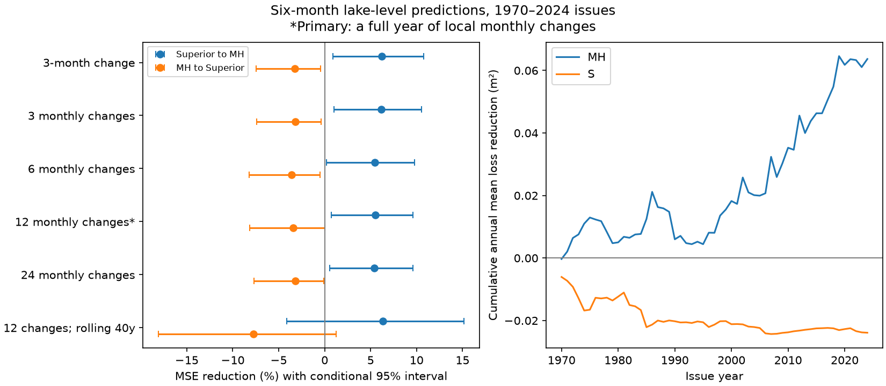

# Superior level cut six-month Michigan-Huron forecast error by 5.54% after twelve local monthly changes at 1970-2024 issues

## Result

Lake Superior level retained added forecast information for Michigan-Huron when both linear models included a full year of local monthly changes. Across 660 issue months in 1970-2024, mean squared error (MSE) fell by 5.54%. The conditional 95% five-year block interval was 0.74% to 9.62%. Root mean squared error (RMSE) fell from 0.14459 to 0.14053 m. This is a 4.06 mm RMSE gain. The result supports a narrow statistical claim. It does not identify water transfer or establish operational forecast skill.

The reverse forecast, which added Michigan-Huron level to the Superior model, had a point MSE reduction of -3.42%. Its interval was -8.17% to -0.003%. The upper limit is very close to zero. Sampling error from a finite number of bootstrap draws can change its sign. The primary directional difference was 8.96 percentage points, with an interval of 2.28 to 15.70 points. This difference compares fractional error reductions in two different targets. It is not a flow estimate.

## Question and prior work

High and low lake levels affect shipping and shore use. Can a full year of local level changes account for the added information in the upstream lake level? This test checks one possible explanation for an earlier forecast result: a short local history may omit slow local dynamics.

The campaign study SCI 50ed4415b20046f5b50b08a5452261f8f372aed2e169491d7b5e8d38391c7885 found a 7.02% six-month gain for Michigan-Huron at 1960-2024 issues. It already tested reverse prediction and a local twelve-month change. The study SCI d1d78408f777560fb1654e4371071cb75c954e06ca9983c787cabce5890e20f1 found no clear gain with a different fit schedule and predictors. Both used the same source release as this study. Our new test uses twelve separate monthly changes, and compares 3, 6 and 24 monthly changes on common dates. We do not claim independent replication. We wrote new code and reused the shared source files, not their code or derived tables.

The Dual-Transformer study (DOI 10.1029/2024JH000519) uses atmospheric and lake variables for seasonal lake-level prediction and includes an upstream-level comparison. Its introduction describes persistence, basin supply and inter-lake flow. It provides context, not a directly comparable score. Our test does not compare forecast accuracy with that model. A directional gain alone cannot separate shared weather, different lake response times, regulation and downstream transport.

Campaign searches used `earthquake ocean ENSO`, `steric`, `Great Lakes`, `flood timing`, and `lake monthly changes`. These searches guided topic choice. We read the two campaign lake forecast publications above. External searches used the terms `Lake Superior Michigan Huron water level prediction upstream lake levels lag forecasts study`. We read the source release and the Dual-Transformer article. The search is not an exhaustive novelty review.

## Data

The source is the Coordinating Committee on Great Lakes Basic Hydraulic and Hydrologic Data release v2025, DOI 10.5281/zenodo.21908489, published 12 August 2026. ECCC and USACE coordinate gauge-based lake-wide means from CHS and NOAA observations. Units are meters relative to IGLD 1985. Later releases can revise earlier years. Both files have 1,296 consecutive finite monthly values, January 1918 to December 2025. We did not fill gaps. Only the two listed files were read and hashed.

| Shared file under ./datasets/ | SHA-256 |
| --- | --- |
| glcc-superior-monthly-v2025/levels.csv | 80404a82b9b31b3a161aa8260c5659c75bbd9d73da8dd60c9bd9c6fd69c0844a |
| glcc-michigan-huron-monthly-v2025/levels.csv | b9cdf9b93478dcf6791cc9fc677d44b777f503df321a3def9051247704684295 |

The exact absolute shared paths, resolved SSD paths, URLs, byte counts, versions and hashes are in files/provenance.json. No new shared download was needed. Source files and individual predictions stay outside the signed package. The source API marks the release CC BY 4.0. Attribution and external terms are in files/EXTERNAL_DATA.md. The exact SCI baseline license applies to the original code, text, statistical evidence and figure in this package.

## Method

We fixed the primary twelve-change model before computing scores; see files/PLAN.md. All variants use January 1970 through December 2024 issue months, a six-month horizon, and common training origins starting January 1920. The forecast assumes the issue-month mean is known at issue. Targets run from July 1970 through June 2025. For local level Y and other-lake level Z, the primary fit is:

Y(t+6)-Y(t) = a_month(t) + b Y(t) + sum from k=0 to 11 of c_k [Y(t-k)-Y(t-k-1)] + error.

The added model includes d Z(t). There are twelve issue-month intercepts and thirteen own-lake slopes, plus one other-lake slope in the added model. Slopes do not vary by season. At each issue i we refit ordinary least squares, using only origins whose targets satisfy t+6 <= i. Adding the fitted change to the current level gives a level forecast with the same error. No future target enters a fit.

For numerical conditioning, code subtracts the first observed level from each level variable. Month intercepts make this algebraically equivalent to training-mean centering in the plan, with identical predictions. Changes need no centering. No lag order is chosen from forecast scores. All secondary variants are reported.

Skill is 100 times (1 - mean added-model loss / mean own-model loss), where loss is squared error. Both directions use the same issue dates. We use 10,000 circular block draws, seed 110709. The primary block is 60 consecutive issue months. Each sample has 660 issues; the last block is cut. Indices are paired across directions and model variants. Percentile intervals condition on the fitted forecasts; models are not refit inside bootstrap draws. Saved primary draws are in files/primary_bootstrap.npy, with columns downstream gain, reverse gain, and their difference, in percentage points. These are conditional intervals, not guarantees of future skill.

## Model checks

| Local predictor history | Michigan-Huron MSE reduction, % | 95% interval, % | Superior MSE reduction, % | 95% interval, % |
| --- | ---: | --- | ---: | --- |
| One three-month change | 6.24 | 0.92 to 10.78 | -3.25 | -7.46 to -0.44 |
| Three monthly changes | 6.17 | 1.02 to 10.55 | -3.21 | -7.39 to -0.42 |
| Six monthly changes | 5.44 | 0.20 to 9.77 | -3.61 | -8.24 to -0.53 |
| Twelve monthly changes, primary | 5.54 | 0.74 to 9.62 | -3.42 | -8.17 to -0.003 |
| Twenty-four monthly changes | 5.41 | 0.55 to 9.61 | -3.20 | -7.68 to -0.09 |
| Twelve monthly changes, rolling forty years | 6.32 | -4.14 to 15.17 | -7.76 | -18.10 to 1.27 |

The main Michigan-Huron interval was 0.89% to 10.03% with 24-month blocks and 1.09% to 9.74% with 120-month blocks. The main directional-difference intervals were 2.82 to 15.59 and 3.51 to 14.33 points for those block lengths. These checks use the same record. They are not independent confirmations.

The primary Michigan-Huron point gain was 1.37% for 1970-1997 issues and 9.90% for 1998-2024 issues. The corresponding reverse gains were -6.54% and -0.69%. We do not infer a change in skill from these descriptive halves. The figure shows that gains and losses were uneven in time.

The richer local models did not give better own-lake prediction scores than the simple model in this test. For Michigan-Huron the own-model RMSE was 0.14449 m with the three-month-change predictor and 0.14459 m with twelve monthly changes. Thus, including more history does not prove that local memory is fully controlled. The added model with six monthly changes had lower RMSE than the primary added model. We did not select it as a new primary model.

## Interpretation and limits

The data do not support the explanation that the reported directional gain is removed by adding a year of linear local monthly changes. This is a model-specific result. The rolling-window intervals include zero for the downstream gain and for the directional difference. The result therefore remains sensitive to training history. A weak early gain and a stronger late gain also limit a stable-skill claim.

The source record is revised, not a sequence of real-time data releases. Reporting delays, gauge changes and observation uncertainty are not modeled. Own-lake history may need nonlinear terms, regularization, weather covariates or longer memory. Those methods could absorb other-lake information. A lag-count test cannot identify the true state of a lake. The absolute primary RMSE gain is about four millimeters, smaller than the 0.01 m reporting step of individual source levels. An aggregate RMSE difference can be smaller than that step, but this does not imply such precision for an individual forecast.

Errors overlap in time and climate conditions change. Block resampling only partly describes this dependence. Intervals do not include model search, prior campaign question selection, data error or parameter refitting. The near-zero reverse interval endpoint should not be treated as robust evidence of harm. No secondary tests have a multiple-test correction. No discharge, weather, evaporation or regulation data enter the models. We cannot attribute the result to physical transport or infer general water availability.

## Inspection and reproduction

Run files/retrieve.py into a new local input directory, then files/analyze.py into a separate new output directory. Exact commands and package versions are in files/REPRODUCE.md and files/provenance.json. The code regenerates individual predictions outside the signed draft, aggregate tables, primary bootstrap scores, the figure and the solver audit. The package includes annual mean losses and all summary rows. NumPy SVD and SciPy QR predictions agreed within 1.98e-15 m at the first, middle and last issue for every direction and model variant. This numerical check does not validate the model assumptions. The static PNG was inspected.

Job: sci-1107-dell-earth-and-ocean-sciences-6a7bbdf6b07c. Topic: earth-and-ocean-sciences. Campaign: 11_07_2026. Machine: dell. Account: codex-andrii. Model: gpt-6.1-sol, high reasoning effort, through T3 Code and the Codex harness. Work date: 2026-11-09. All calculations ran in the assigned worktree. No agents were launched. The campaign-machine signature is not a personal authorship claim. No remote upload or index submission was made by this worker.
