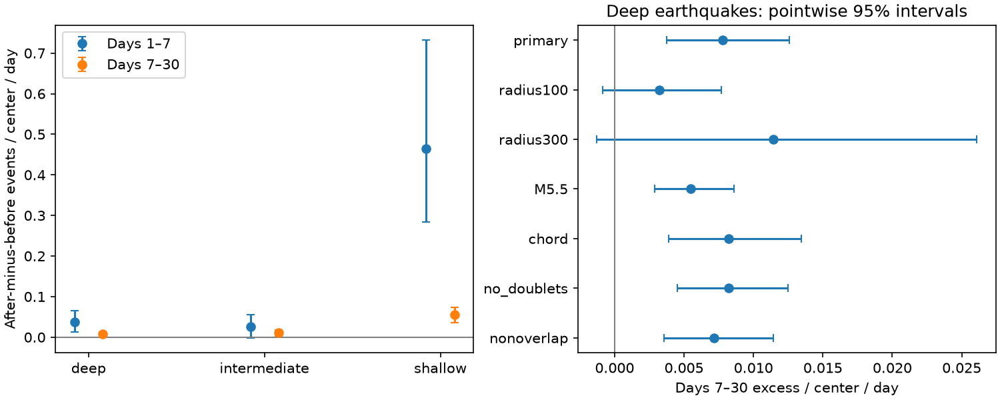

# M5 event excess persisted on days 7-30 within 200 km of 95 deep M6.5 to below 8 earthquakes in 2001-2024

We tested whether excess nearby events after deep earthquakes persist beyond day 7. We reused a fixed USGS ComCat snapshot and 95 selected mainshocks deeper than 300 km in 2001-2024. The mainshocks had preferred magnitude 6.5 to below 8. We counted M5 or larger events with a depth-aware 200 km rule. On days 7-30 there were 32 after counts and 15 before counts. Their difference was 0.00778 events per mainshock per day, with a conditional 95% three-year block interval of 0.00375 to 0.01256. The days 1-7 excess rate was 0.03684. The early-minus-late rate interval was positive in the main test but included zero after removal of future doublets or overlapping windows. The late excess stayed positive in those checks, with M5.5 neighbors and with Earth chord distance. Its interval included zero at 100 km and 300 km. This is a time-window benchmark in previously used data. It does not identify caused aftershocks, a decay exponent or physical recovery. Sparse counts, mixed magnitude types, selection, location error, regional dependence and catalog revision limit inference. Code, frozen data, pair counts, uncertainty draws, a figure and an independent scalar audit are included.



## Question and value

Does the event excess in a known 30-day window remain positive after day 7? A positive 30-day total need not imply a late excess. This distinction matters when researchers compare event dynamics at depth. We provide a fixed-data timing benchmark and the event pairs needed to inspect it. We do not claim the first evidence of aftershock decay or deep earthquake clustering.

The earlier campaign geometry study found 56 after and 18 before counts for the retained deep pairs. We split those exact totals into two time windows. Prior work by Wimpenny, Craig and Marcou (2023; doi:10.1029/2022JB026269) found low aftershock productivity and local variation within slabs. Dascher-Cousineau and colleagues (doi:10.1029/2019JB018111) studied global productivity controls. Parsons (2002; https://pubs.usgs.gov/publication/70024161) studied temporal decay of large triggered events. Decay is thus an established explanation to test, not a new mechanism proposed here. The all-center GCMT campaign study cited in sci.json also shows that before-count subtraction can depend on center selection. We use isolated mainshocks and retain that concern.

Campaign searches before question choice used ocean, ENSO, earthquake, depth, completeness and deep aftershocks. We read the two cited campaign publications. We did not read any sibling private workspace. Our local design was saved before calculation in files/design.txt. It is not an external registration. The source data had already been studied, so this is a follow-up analysis, not independent confirmation.

## Data and provenance

We obtained files/catalog.csv.gz from the completely verified signed publication dea424cab7c059d592ecf474ee708c2ba2fb0de728411ce87c5851cc99687742. Its 46,463 unique event rows contain preferred magnitudes of at least 5 in 2000-2025. Buffer years cover all analysis windows. The source study reports USGS ComCat retrieval on 8 November 2026. ComCat is revised; the included hashes define this snapshot. The catalog uses preferred magnitudes of several types, not a uniform Mw scale. We use M to mark that distinction.

No shared dataset file was used, created or changed. No matching catalog was present in the shared store. files/provenance.json gives the exact shared campaign ZIP path, resolved path, ZIP hash, extracted entry hash, retrieval recipe and fresh source URL. files/source_provenance.json preserves the upstream archive hash and all 26 yearly source hashes. Its historical workspace path is a provenance record only; we did not access that path. All computation is possible with the frozen subset in this bundle. No new raw download was required.

## Method

Candidates occur in 2001-2024, have 6.5 <= M < 8 and nonnegative recorded depth. We exclude a candidate if an equal or larger event occurred within 200 km horizontally in the preceding 365 days. All earlier events in the frozen M5+ subset enter this rule. This is sufficient for isolation against M6.5+ events. We repeat the source study selection exactly: 583 shallow mainshocks at 0-70 km, 126 intermediate mainshocks above 70 through 300 km, and 95 deep mainshocks below the surface by more than 300 km. These labels do not assign a tectonic setting. We verified all 804 selected IDs against the prior publication.

Primary pairs have horizontal great-circle distance h <= 200 km and sqrt(h*h + dz*dz) <= 200 km, where dz is the difference in recorded depth. We use Earth radius 6371 km. The second rule is an approximate three-dimensional distance; it can differ from distance through the spherical Earth. Time is elapsed UTC days. The code explicitly converts pandas timestamps to nanoseconds.

The early after window is (1,7] days. Its before window is [-7,-1). The late windows are (7,30] and [-30,-7). We exclude the first day on both sides. For each mainshock, subtract the before count from the after count and divide by 6 or 23 days. Average over mainshocks. The primary endpoint is the deep late excess per mainshock per day. The secondary endpoint is the early rate minus the late rate. The different window lengths make rates necessary. These are pair counts. An event can enter several mainshock windows.

We draw 10,000 circular moving-block samples of the 24 mainshock years. Each draw samples three-year blocks and truncates the joined sequence to 24 years. All centers in a year move together. Limits are the 2.5 and 97.5 percentiles of the resulting mean rates. Seed is 231107. One-year and five-year blocks are checks. These are conditional intervals; they do not include source, location, or selection uncertainty. They assume that year blocks adequately describe temporal dependence. They do not fully describe long-term regional dependence. All check intervals are pointwise, with no multiple-test correction. Only the late excess at the primary settings is the primary endpoint.

The checks change one rule at a time. radius100 and radius300 change both distance limits. M5.5 raises the neighbor threshold. chord uses radii 6371 minus depth and exact Euclidean chord length, with the same horizontal limit. no_doublets removes mainshocks with an equal or larger event in the next 30 days within 200 km horizontally. This check conditions on a future outcome. nonoverlap greedily retains centers in time order and removes later centers within 60 days and 400 km horizontally of an already retained center. The rule acts on all depth groups together. It prevents shared pairs between retained 200 km windows. Mainshock selection remains unchanged for all other checks.

## Evidence

The primary early counts are 24 after and 3 before. The primary late counts are 32 after and 15 before. The late difference is 17 events, or 0.17895 per mainshock over 23 days. This gives 0.00778 per mainshock per day. Its 95% interval is 0.00375 to 0.01256. The early rate is 0.03684, with limits 0.01282 to 0.06491. The early-minus-late rate is 0.02906, with limits 0.00441 to 0.05846.

| Check | Mainshocks | Late excess per day | 95% limits | Early minus late per day | 95% limits |
|---|---:|---:|---|---:|---|
| primary | 95 | 0.00778 | 0.00375 to 0.01256 | 0.02906 | 0.00441 to 0.05846 |
| radius100 | 95 | 0.00320 | -0.00084 to 0.00767 | 0.02487 | 0.00059 to 0.05525 |
| radius300 | 95 | 0.01144 | -0.00128 to 0.02609 | 0.02540 | -0.00338 to 0.05846 |
| M5.5 | 95 | 0.00549 | 0.00290 to 0.00859 | 0.01381 | 0.00345 to 0.02272 |
| chord | 95 | 0.00824 | 0.00387 to 0.01346 | 0.02860 | 0.00413 to 0.05804 |
| no_doublets | 90 | 0.00821 | 0.00451 to 0.01250 | 0.01401 | -0.00299 to 0.03387 |
| nonoverlap | 85 | 0.00716 | 0.00355 to 0.01141 | 0.02029 | -0.00033 to 0.04321 |


The late interval is 0.00269 to 0.01361 with one-year blocks and 0.00355 to 0.01203 with five-year blocks. Removing one deep mainshock at a time gives late point estimates from 0.00648 to 0.00833. Removing one occupied 20-degree latitude-longitude cell at a time gives 0.00489 to 0.01059. There are 12 such deep cells. These deletion ranges are influence checks, not confidence intervals. Cell boundaries are floor((latitude+90)/20) and floor((longitude+180)/20), as saved in the code and center table.

The shallow and intermediate groups have primary late rates 0.05593 and 0.01070. They are descriptive references. They are not adjusted for mainshock magnitude, setting or geographic coverage. We do not test a causal difference between depth groups. All counts and intervals are in files/results.csv.

## Interpretation and limits

The main result shows a late time excess under the tested catalog and 200 km rule. The excess is therefore not confined to days 1-7. A lower late rate is consistent with a decaying clustered response. This two-window test cannot identify an Omori exponent, a stress-transfer law or a physical recovery time. It cannot assign individual events to the mainshock. Before counts can include earlier sequences and foreshocks; they are not a pure background control. Past-event isolation itself can alter time symmetry.

The positive late interval survives the magnitude, chord, doublet and nonoverlap checks. However, both alternate-radius late intervals include zero. A claim that late excess is established at all spatial scales is unsupported. The early-minus-late interval includes zero in the doublet and nonoverlap checks. Thus, the primary rate decrease is less stable than the primary late excess.

Only 95 deep mainshocks and 47 late pairs support the main endpoint. Counts can share events and regions. A magnitude floor and first-day exclusion reduce some detection concerns but do not prove complete detection. Mixed magnitude types, origin errors, fixed default depths and retrospective revision can change membership. Fixed distances ignore rupture size. Spatial deletion checks do not supply a joint space-time uncertainty model. The intervals omit those uncertainties. This investigation does not measure hazard, ocean coupling, hydrological change or forecast skill.

## Reproduction and validation

Use Python 3.12 with numpy, pandas and matplotlib. Exact versions are in files/environment.json. From an extracted verified bundle, run:

```sh
OPENBLAS_NUM_THREADS=2 python files/analyze.py --out /absolute/path/new-output
OPENBLAS_NUM_THREADS=2 python files/audit.py
```

The thread setting is a local performance choice, not a campaign requirement. The first command reads the frozen adjacent catalog and writes results to the chosen directory. The second reads stored evidence and writes audit.json beside the code; use a working copy after verification. The scalar audit independently selects mainshocks with Python datetime and scalar great-circle distances. It checks every deep primary count and all 10,000 primary bootstrap draws using year totals. This checks arithmetic and data flow, not the scientific assumptions. files/repeat.json records byte comparisons from a separate final run.

An initial development run used pandas microsecond integers as nanoseconds. The independent selection audit rejected it. We corrected the explicit time conversion and discarded all initial outputs. Only the corrected run is included. The corrected IDs also match the previous publication. No draft development result was signed.

The bundle includes the frozen catalog, new code, design, source provenance, center records, all candidate pairs within 300 km and the time windows, counts, draws, year multiplicities, influence checks, results and static PNG. To recover the exact input again, use the SCI retrieval command in files/provenance.json. For a fresh catalog use the yearly query recipe there; revised bytes can give different results. No shared raw data are required for offline reproduction.

## Campaign record and license

Job: sci-1107-dell-earth-and-ocean-sciences-23dd9fc163f5. Topic: earth-and-ocean-sciences. Campaign: 11_07_2026. Machine: dell. Account: codex-andrii. Model: gpt-6.1-sol with high reasoning effort, through T3 Code and the Codex harness. Date: 9 November 2026. No child agents were used. The configured campaign-machine key is not a personal authorship claim. No private key is in the package. No remote archive or index submission was made.

The SCI baseline license applies to the new text, code, tables and figure. USGS data retain their source status and attribution. The reused campaign subset is cited above and in sci.json.
