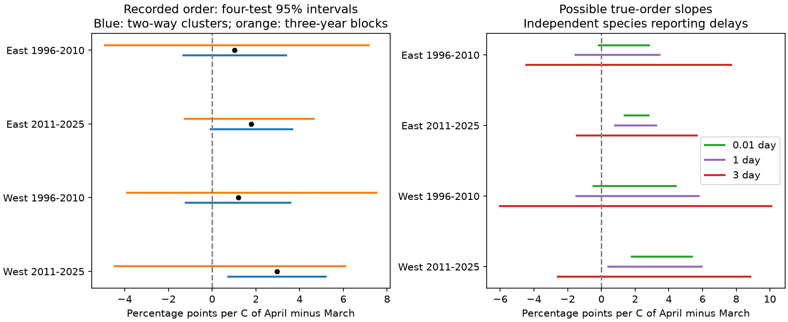

# Three-day date delays permitted both warmth slope signs for birch and beech leaf order in four Swiss samples in 1996-2025

Job: sci-1107-dell-climate-pollution-biodiversity-4b29527c7bbe. Topic: climate-pollution-biodiversity. Campaign: 11_07_2026. Machine: dell. Account: codex-andrii. Model: gpt-6.1-sol, high reasoning effort. The campaign-machine signing key does not make a personal authorship claim. This worker used no agents.

## Main result

The data did not establish a common positive link between April warmth relative to March and beech leaf unfolding before birch. All four point slopes were positive. All four family intervals from station and three-year block resampling included zero. Independent reporting delays of up to three days permitted both signs of the fixed-record slope in all four samples. This result limits a claim about species order based on reported daily dates.



## Prior work and added test

[Menzel and colleagues](https://doi.org/10.1007/s00484-007-0113-8) studied species differences in the growing season and its temperature links in Germany and Slovenia. [Zohner and colleagues](https://doi.org/10.7554/eLife.40214) studied warming and timing spread among individuals. These studies motivate tests of relative timing but do not validate the Swiss order outcome here. Differences in heat, chilling or day-length requirements could produce changes in species order. The present records do not separate those mechanisms.

[The prior campaign study](sci:sha256:15f3b2a23c4d869770428d38e9d9502ecd19097b13b3540894cc522e655c1c72) tested the signed birch-beech date gap and later-year estimation errors. We reuse its sample rules, source snapshots, weather design and panel builder. The records fully overlap. This is not independent validation of that study. Our added test uses strict species order, which depends on the position of records near zero rather than only the mean gap. The new bounds respect the binary outcome. The linear bound method itself is not new. A sign change across weather values is not necessarily a reversal at an individual tree.

## Data and sample

Source: MeteoSwiss. Data provided by NOAA/OAR/PSL, Boulder, Colorado, USA, from https://psl.noaa.gov/. Neither provider endorses this study.

`files/provenance.json` records the four exact source files, shared paths, URLs, snapshot versions, sizes and SHA-256 hashes. All four hashes were checked before analysis. No data were downloaded or changed in the shared store. The previous-year phenology snapshot was retrieved on 2026-11-09 and includes 2025. Phase 606 is European beech (Fagus sylvatica) leaf unfolding at 50 percent. Phase 642 is silver birch (Betula pendula) leaf unfolding at 50 percent. Source metadata confirm these definitions. Records have one date per station, phase and year. They do not track individual trees.

We checked unique station-year-phase keys and agreement between date, year and day of year. We retained days 1-182 in 1996-2025 and paired the two species at the same station and year. There were 3,042 complete pairs before the station screen. Each retained station needed at least five complete pairs in each period. The sample has 2,615 pairs at 104 stations: 59 East and 45 West. East means longitude at least 8.2 E. West means longitude below 8.2 E. Periods are 1996-2010 and 2011-2025. Selection uses record counts, not outcome signs. The eight-pair screen retains 87 stations and 2,315 pairs. Missing years remain.

Nearest 0.5-degree GHCN-CAMS grid centres supply monthly temperature. The source version is 3.01, with coverage from January 1948 to October 2026. This study uses January-April in 1996-2025. Temperatures are converted from Kelvin to C. Each region uses 15 weather cells; three cells are shared. The prior study found a 0.980 correlation between annual regional April-minus-March means on these same records. Regions have separate stations and periods have separate years. They are not independent climate experiments.

## Model and uncertainty

Let g be recorded beech day minus recorded birch day. The outcome Y is 1 if g < 0, and 0 otherwise. Ties count as 0. Each separate linear probability fit has station intercepts, M=(March+April)/2, D=April-March, W=(January+February)/2, and year minus 2010. The target is the D slope. A one-C rise in D at fixed M means April is 0.5 C warmer and March is 0.5 C cooler. It is not a one-C rise in April alone. Each row has weight one divided by the station's number of pairs in that sample. Stations have equal total weight.

We report coefficients as percentage points per C. The model is a weighted linear projection for slope analysis. It is not a bounded probability forecast. Between 11 and 27 percent of fitted values lie outside [0,1]. We do not clip predictions. A logistic fit would answer a different parameter question and would not have these exact linear bounds.

Two-way station and year cluster intervals use a t reference with 14 degrees of freedom and a Bonferroni correction for four D slopes. A second method uses 4,999 crossed resamples of stations and circular three-year blocks across all stations, seed 110720264. Original weights are multiplied by resampling counts. Each replicate removes station means using its new weights and refits all slopes. Family percentile endpoints are 0.00625 and 0.99375. All draws had full rank. Fifteen years per sample give limited information about serial dependence and tail uncertainty. Both interval methods rely on assumptions and are not exact finite-sample tests.

| Region | Period | Pairs | Slope, points/C | Two-way family 95% interval | Block family 95% interval |
| --- | --- | --- | --- | --- | --- |
| East | 1996-2010 | 751 | 1.03 | [-1.32, 3.38] | [-4.90, 7.16] |
| East | 2011-2025 | 794 | 1.80 | [-0.07, 3.66] | [-1.24, 4.65] |
| West | 1996-2010 | 516 | 1.20 | [-1.19, 3.59] | [-3.89, 7.51] |
| West | 2011-2025 | 554 | 2.96 | [0.74, 5.18] | [-4.45, 6.10] |

Only later West has a two-way family interval above zero. No block family interval is above zero. The planned rule of a positive slope in all four samples is not met. These data do not prove that all slopes are zero.

## Exact bounds for assumed date delays

Assume recorded date r_s = true date t_s + delay_s, with each species delay in [0,L]. Delays can differ by species, station and year and can depend on weather. Then true gap lies in [g-L,g+L]. The minimum possible true Y is l=1(g+L<0). The maximum is u=1(g-L<0). This strict inequality treats a true tie as 0. The date index is continuous in this sensitivity model, even though reports are daily.

For fixed records, design and weights, let a_i be the linear influence of Y_i on the D slope. The minimum slope assigns l_i when a_i>=0 and u_i when a_i<0. The maximum reverses those choices. Each outcome assignment is feasible through separate species delays. Thus the bounds are sharp for this model. They describe possible slopes, not their likelihood. A common additive delay on both species at a station-year cancels; the bounds require differences between species delays. Actual visits and errors are unknown.

| Region | Period | Three-day slope bounds, points/C | Weighted percent with uncertain order |
| --- | --- | --- | --- |
| East | 1996-2010 | [-4.46, 7.70] | 22.3 |
| East | 2011-2025 | [-1.45, 5.66] | 17.1 |
| West | 1996-2010 | [-6.01, 10.09] | 33.6 |
| West | 2011-2025 | [-2.58, 8.83] | 29.6 |

Only 17-34 percent of weighted records need an uncertain order for these bounds to cross zero. No record is dropped. One-day bounds permit both signs in both early samples but stay positive in both later samples. At L=0.01 day, only recorded ties can change order. These tiny-delay bounds already cross zero in both early samples. This is a diagnostic of a discontinuous strict-order outcome at daily ties. It is not evidence that observers can resolve 0.01 day, or that such errors occurred. A model with integer true dates and integer delays would have no change below one day and would not give this tiny-delay result. At L=3 days all four bounds permit both signs under either continuous or integer dates. `files/bounds.csv` also gives zero-, one- and seven-day results. Bounds do not combine date error with sampling uncertainty.

## Checks and limits

All point slopes remain positive when ties are excluded, the station screen is stricter, the trend is removed, or any one year is omitted. Year effects change three of four point signs to negative; all four family intervals then include zero. That specification uses spatial weather differences within a year and does not confirm a broad annual weather link. Checks are secondary, not new discovery tests. Their full outputs are in `files/sensitivity.csv` and `files/checks.json`.

`files/validate.py` passed 38 checks: reconstruction from aggregate normal equations; enumeration of all allowed binary assignments in a small tied example; independent full-design least-squares fits; and independent influence calculations for all 20 bounds. Direct refits of both bound endpoints also passed during the main analysis. The panel audit restores source float32 weather precision after CSV reload. All design matrices had full column rank.

The sample shares one reporting network. Stations were selected for records in both periods. Missing observations, observer changes, tree replacement and wrong phase judgments can affect estimates. The delay bounds do not cover errors outside their assumed cap or missing records. No visit logs or observer identities are present. Coarse monthly mountain weather may differ from plant exposure. Much of April weather follows recorded leaf unfolding: in the prior audit of the same sample, 65-94 percent of birch and 57-80 percent of beech dates were before May 1. Therefore these fits are estimates with known monthly weather, not causal pre-event effects or real-time forecasts. No within-tree ordering change, long-term order trend, competition, frost injury, air pollution or biodiversity loss was tested. The result supports caution when a temperature link in a date gap is used to claim a change in species order.

## Reproduce and inspect

The package contains code, aggregate model results, figures, source hashes and the internal plan. Raw inputs and the derived station-year panel stay in separate scratch. `files/EXTERNAL_DATA.md` gives attribution, source rights and code reuse. The exact SCI baseline LICENSE applies unchanged to the package. No private keys or third-party article text are included.

Use Python 3.12 and `files/requirements.txt`; exact observed versions are in `files/versions.json`. From an extracted package:

```sh
python files/validate.py
python files/analyze.py --data-root /path/to/shared_datasets --out /path/to/scratch/results
python files/validate.py --results /path/to/scratch/results --panel /path/to/scratch/results/external_panel.csv
```

To retrieve external inputs on another machine:

```sh
python files/retrieve.py /path/to/scratch/raw
python files/analyze.py --data-root /path/to/scratch/raw --out /path/to/scratch/results
```

All outputs must be outside the signed publication. Default draws and seed reproduce published intervals. Lower draws are only for code checks. Live source files can change; a hash mismatch stops exact reproduction. In that case use the retained shared snapshots or exact external copies. No private scratch file is needed beyond the documented sources. Aggregate normal equations permit inspection of all four point slopes without downloading raw data.
