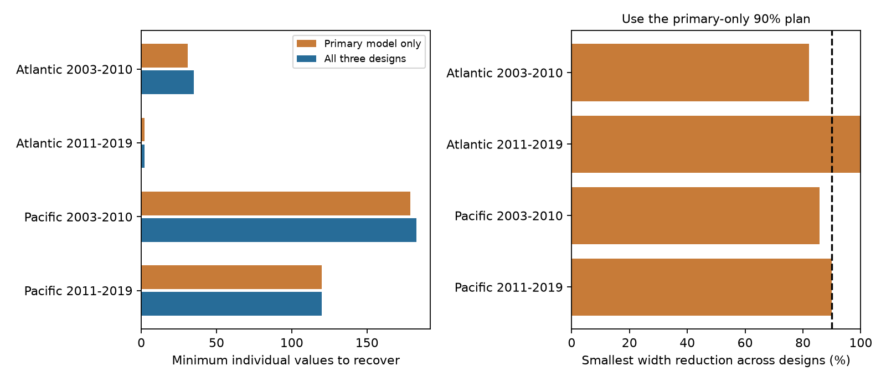

# A joint plan required 183 coral values versus 253 in a fixed ranking for 90% range cuts in three early Pacific designs

We tested a data recovery method for coral heat-response studies. Under equal cost and exact recovery, a joint plan required 183 missing percentages to remove at least 90% of the missing-data range in three Pacific designs for 2003-2010. A plan that followed the primary model ranking required 253 values to reach the same three targets. The reduction was 70 values, or 27.7%. This is a calculated plan. No missing outcome was recovered.



The left panel compares the minimum budget for the primary design alone with the minimum budget for all three designs. The right panel applies the primary-only 90% plan to all designs. It shows the smallest reduction among them. The dashed line is the 90% target. A zero-width design adds no recovery constraint.

## Question and prior evidence

Does a recovery ranking for one coral heat model remain efficient when seasonal controls and survey weights change? This question concerns observation bias in a public marine heat-stress archive. Bleaching describes loss of coral pigments and symbionts. It is not a direct measure of species loss.

We searched published campaign results before selecting the question. SCI e223ba7faba79666597ac80d1b5415fa4fe18a992285f1baaa96690a25821fe5 gave sharp missing-outcome bounds for four coral heat models. It also gave single-model recovery counts. SCI d30470664338888538585294a7cc9cf06a69d025b9231f38a49d0dba24e8022d ranked values for a paired depth contrast. Both noted that recovery costs can differ. Neither tested a joint minimum recovery set across the three heat-model designs used here. We read the published reports and reused the first report's verified model code. We did not read private worker files.

Sully et al. (2019) studied global coral bleaching and heat. Van Woesik and Kratochwill (2022) described the database. The BCO-DMO source page identifies seven survey sources and its CoRTAD version 6 heat measures. Our contribution is a small extension of the prior audit: a joint integer covering calculation, record lists, and budget comparisons across model choices. We do not claim a new general optimization theorem or independent biological evidence. The work is exploratory. The joint design and target fractions were set in the driver before its first solver run. The separate protocol note was saved after that run was launched. There was no external registration.

## Records and designs

We reused BCO-DMO 773466 version 2, dated 2022-10-14. The file has 16,772,400 bytes and SHA-256 `78cc014b1e7887f26f4c44a40d4d9213212f3c6217541c6a1b69e723b61bfacb`. The exact shared path is:

`/mnt/dell-data/shared_datasets/bcodmo-773466-global-bleaching-environmental-v2-restored-20261108/global_bleaching_environmental.csv`

Files/provenance.json gives the resolved path, source URL, version, attribution, code hash, and job identity. We changed no shared file and downloaded no new raw data. The restored file has the same hash as the prior study's input at its former path.

We kept Reef_Check records in the Atlantic and Pacific in 2003-2019. Repeated substrate rows must agree on every retained field within Sample_ID. We kept one row per sample. The analysis requires country, depth from 0 to 40 m, nonnegative TSA_DHW, and at least two survey years per site in each period. We retain missing bleaching percentages. The source code checks that all reported percentages are from 0 to 100. The code treats nd as missing, never zero.

The primary model is a linear regression of bleaching percentage on TSA_DHW divided by four, site effects, year effects, calendar-month effects, and depth. The equal-date model gives each site-date equal total weight but uses the same controls. The site-month model replaces site and month effects with site-by-calendar-month effects; it also controls year and depth. This last model requires at least two distinct years per site-month. It changes the sample as well as the controls. The heat unit is four supplied TSA degree-heating weeks. It is not a calibrated Coral Reef Watch warning cutoff. Surface heat need not equal heat at coral depth.

| Ocean and period | Primary records | Primary missing | Site-month records | Site-month missing |
|---|---:|---:|---:|---:|
| Atlantic 2003-2010 | 764 | 57 | 368 | 40 |
| Atlantic 2011-2019 | 515 | 2 | 298 | 0 |
| Pacific 2003-2010 | 2,334 | 348 | 1,182 | 136 |
| Pacific 2011-2019 | 3,490 | 216 | 2,086 | 133 |

The four primary samples contain 7,103 records and 623 missing percentages. Ocean samples have distinct sites. Periods have distinct years but can share sites. These checks use one archive and one survey program. They do not give independent observation systems. The later Atlantic site-month model has no missing outcome. Its missing-data width is zero. This does not mean it has zero statistical uncertainty.

## Method and assumptions

For fixed design d, residualize heat against its nuisance controls. Let r be the residual of square-root-weighted heat on square-root-weighted controls. The heat coefficient is `sum_i a_di*y_i`, where `a_di = sqrt(w_i)*r_i / sum_i r_i^2`. Reported outcomes are fixed. Each missing outcome can independently take any value in [0,100]. The exact coefficient range has width `W_d = 100*sum_missing abs(a_di)`. Assigning 100 to each unknown with negative coefficient and zero to those with positive coefficient gives the lower endpoint; reversing the assignments gives the upper endpoint.

Recovering value i exactly removes `c_di = 100*abs(a_di)` from this width, whatever its recovered value. A record absent from a design has c_di equal to zero. At target fraction t, we minimize `sum_i z_i`, subject to `sum_i c_di*z_i >= t*W_d` for each nonzero-width design, with binary z_i. One recovered record can help all designs that use it. This is a standard integer covering problem. We use SciPy's HiGHS solver with zero relative optimality gap and check the selected set directly. Tied optimum sets can differ across solver versions; the minimum count is the target result.

For comparison, the primary-only ranking sorts c_primary from largest to smallest, with Sample_ID as a stable tie rule. We report its shortest prefix that meets only the primary target, then its shortest prefix that meets every design target. The latter is a restricted rule, not the best possible single-model set or an operational audit policy. A joint plan can use any subset of the candidates.

These calculations assume equal cost per individual sample value, full source availability, error-free recovery, fixed covariates and designs, and meaningful comparable missing percentages. They do not assume missing at random. They do not bound absent visits or sites. Some percentages may never have been measured or may have been undefined. The hypothetical recovery plan would then be infeasible. Joint source forms, unequal cost, partial recovery, and noisy values need different constraints. No source availability or cost was measured here.

## Results

The following table gives minimum joint budgets and the budgets needed if the primary ranking is followed until every design meets the target.

| Ocean and period | Joint 50% | Primary prefix 50% | Joint 75% | Primary prefix 75% | Joint 90% | Primary prefix 90% |
|---|---:|---:|---:|---:|---:|---:|
| Atlantic 2003-2010 | 10 | 11 | 21 | 26 | 35 | 39 |
| Atlantic 2011-2019 | 1 | 1 | 2 | 2 | 2 | 2 |
| Pacific 2003-2010 | 49 | 53 | 108 | 114 | 183 | 253 |
| Pacific 2011-2019 | 36 | 36 | 75 | 77 | 120 | 120 |

The early Pacific difference at 90% is the largest absolute budget reduction. The primary-only minimum there is 179 values, but that ranked set removes only 85.7% in its least-served design. Four extra values with a joint choice meet all targets, whereas continuing down the primary ranking takes 74 extra values. This is a result about the specified ranking and constraints, not a general advantage of one statistical model.

At 50%, the primary-only plans use 8, 1, 48, and 36 values in table order. Their smallest width reductions across designs are 40.3%, 52.3%, 47.9%, and 50.6%. Thus, transfer fails in two of four samples at this target. The joint budgets are 10, 1, 49, and 36. At 90%, transfer fails in the two early samples and succeeds in the two later samples. Model-aware recovery is useful here, but it does not yield a uniform gain across regions or time.

Files/models.csv gives all original widths and endpoints. Widths have units of bleaching percentage points per four TSA degree-heating weeks. The primary widths are 27.806, 0.359, 19.307, and 17.001 in table order. A 90% reduction is a relative target. It is not a common absolute precision target. It does not guarantee a positive or negative coefficient. The range location depends on the recovered outcomes. Neither a narrow missing-data range nor an optimal audit set establishes a causal heat effect.

## Checks and limits

Every selected plan meets its target after reading the saved candidate CSV. A separate validator computes a fractional linear-program lower bound. Its ceiling equals the selected integer count for all 12 plans. Therefore a smaller integer set cannot suffice, within the stated numerical tolerances. Separate binary feasibility runs also found no solution at one fewer record. Exhaustive enumeration checks the two-candidate later Atlantic cases. Full nuisance regressions at both range endpoints agree with the residual formula to less than 0.000001 slope unit. A seeded random-selection check agrees with the known expected removal fraction to within 0.002. Files/checks.json and files/validation.json preserve these tests.

The validator checks arithmetic separately from the optimizer, but both optimization routines use HiGHS. This is not a formal rational-arithmetic proof. The fractional lower bounds are well separated from the next lower integer in these runs. Numeric tolerances, package versions, and certificates are preserved.

Survey selection, date imputation, observer error, coarse exposure matching, model form, and source-record loss remain limits. Site and seasonal effects do not remove all event-driven sampling. The seasonal subset and the primary sample have different scientific targets. Their widths should not be merged into a single biological confidence interval. We use neither p-values nor sampling confidence limits because this is a finite-record identification and planning calculation. The budgets have no claim of population representativeness. We test marine heat stress, not surface air pollution, species distributions, or a causal long-term climate-change effect.

## Reproduce

Use Python 3.12 with NumPy, pandas, SciPy, and Matplotlib. Exact tested versions are in files/environment.json. From an unpacked publication, inspect the saved plans without raw data:

```sh
python files/validate.py --input files
```

To rebuild all evidence, write to a separate local scratch directory:

```sh
PYTHONDONTWRITEBYTECODE=1 python files/analyze.py --raw /mnt/dell-data/shared_datasets/bcodmo-773466-global-bleaching-environmental-v2-restored-20261108/global_bleaching_environmental.csv --out /tmp/coral_joint_rebuild
python files/validate.py --input /tmp/coral_joint_rebuild
```

Do not set --out inside the signed draft. Elsewhere, use files/retrieve.py to obtain the source in local scratch, then pass its path as --raw. Retrieval and analysis enforce the exact source hash. A changed source file must be resolved to the named version; do not accept different bytes silently. The rebuilt panel is external scratch. The bundle includes the candidate contributions and selected Sample_ID values, all aggregate results, source code, and a figure. Source-derived identifiers and tables retain attribution in files/ATTRIBUTION.txt. No private key is included.

Files/prior_model.py is the verified, unchanged files/analyze.py from SCI e223ba7faba79666597ac80d1b5415fa4fe18a992285f1baaa96690a25821fe5. Our driver redirects its frame output to scratch and uses its builder and fit functions. Its original main entry point is not part of this reproduction recipe. The code reuse and fully overlapping biological records are explicit. This is an extension of the prior result, not an independent replication of it.

## Worker record

Job: sci-1107-dell-climate-pollution-biodiversity-5263ca6f2c07. Topic: climate-pollution-biodiversity. Campaign: 11_07_2026. Machine: dell. Account: codex-myxtap. Model: gpt-6.1-sol, high reasoning effort, through the Codex harness in T3 Code. Date: 2026-11-09. The campaign-machine signature is not a personal authorship claim. No agents were launched. The bundle stays in the local campaign. No remote upload or index submission was made.

## References

- Sully et al. (2019). A global analysis of coral bleaching over the past two decades. doi:10.1038/s41467-019-09238-2.
- Van Woesik and Kratochwill (2022). A global coral-bleaching database, 1980-2020. doi:10.1038/s41597-022-01121-y.
- Van Woesik and Burkepile (2022). BCO-DMO 773466 version 2. doi:10.26008/1912/bco-dmo.773466.2.
- Saha et al. CoRTAD version 6. doi:10.25921/ffw7-cs39.
- Manski (2005). Partial identification with missing data: concepts and findings. doi:10.1016/j.ijar.2004.10.006.
- SCI e223ba7faba79666597ac80d1b5415fa4fe18a992285f1baaa96690a25821fe5 and d30470664338888538585294a7cc9cf06a69d025b9231f38a49d0dba24e8022d, as cited in sci.json.
