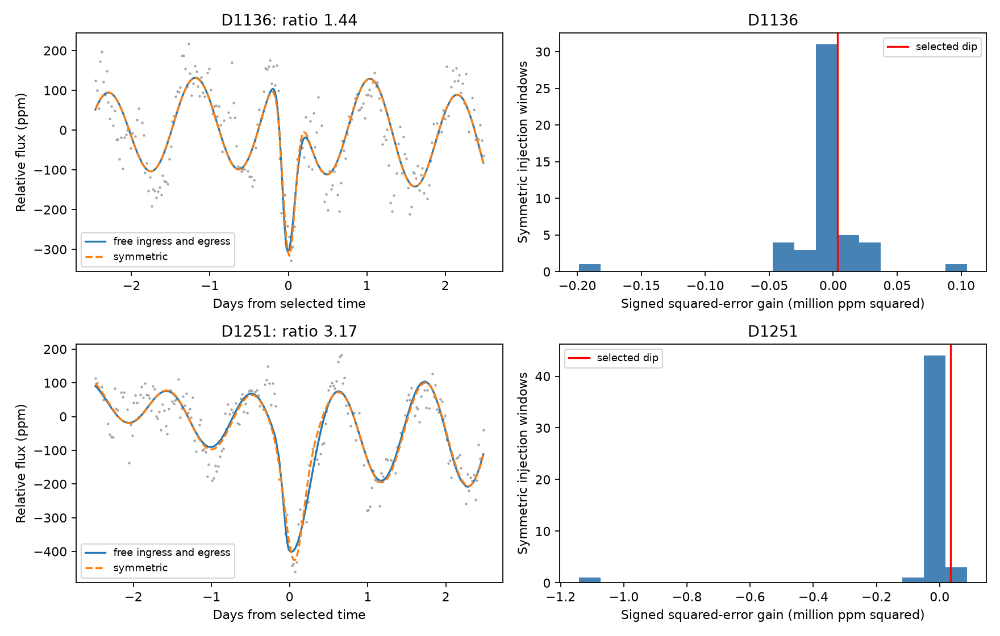

# Symmetric dips in real Kepler flux reach the shape scores of two shallow KIC 3542116 dips in 10 and 2 of 49 windows

We tested two previously selected shallow dips near BKJD 1135.93 and 1250.96. Their primary egress-to-ingress width ratios are 1.44 and 3.17. Symmetric profiles added to real off-event flux give signed fit improvements at least as large in 10 and 2 of 49 windows. These finite comparisons do not give a false-alarm probability. They do not establish a new comet or planet.



## Question and prior work

Do the shapes of two previously selected shallow dips of KIC 3542116 give distinct evidence for slow egress? A slow egress can support a trailing cloud of dust. A symmetric dip can come from a compact occulting body under constant projected speed and symmetric stellar brightness. However, stellar variation and detector errors can change either fitted shape. A fitted asymmetric template alone cannot identify a comet.

Rappaport et al. (2018, doi:10.1093/mnras/stx2735) reported six likely comet transits on this star. Kennedy et al. (2019, doi:10.1093/mnras/sty3049) tested an automated search and discussed flagged data. Luk'yanyk et al. (2024, doi:10.1051/0004-6361/202348498) used physical comet simulations and harmonic removal. These papers supply context; they do not confirm the two features tested here.

Campaign publication `sha256:a98e1bf451ca24216089f19fdbb25cf5b4f861e67d02fb5af686acf7a1cfb017` selected the features near BKJD 1135.93 and 1250.96. It tested pixels at the first feature and found a broad width-ratio interval that included one. Publication `sha256:5bd97e0e2e70b97a1bff8cdb89980ccef516a04525a86e804def713529e849aa` tested pixels at the second feature. Both reports left the physical cause open. We use their event selection. We add a direct comparison with symmetric profiles placed in actual off-event flux, plus tests of recovery for a known asymmetric profile. We do not claim first detection or repeat the survey search. A later completed campaign search also found publication `sha256:8d094f26b92cf67fa1ab80f8e0ff9c1fc853941edab5e494463a423b271d5718`, which applied real-flux symmetric controls to three known deep events. We read that report. It is a method precedent, not a test of these two shallow features. Our addition is the shallow-event test, not the first use of real-flux shape controls on this star.

The SCI campaign search was started before the precise question was selected. A direct inspection of published metadata identified the two relevant reports; both were read with `sci read`. We did not read sibling private workspaces. A public search for the star and both approximate day numbers found no useful additional primary event report. This limited search does not establish priority. files/selection.json records the analysis choices.

## Data

We reused four shared Kepler release 25 long-cadence light curves in place. No download or shared-store change was needed. The paths are `/mnt/dell-data/shared_datasets/kepler-kic3542116-q10-dr25/lightcurve.fits` through the corresponding q11, q12 and q13 directories. files/provenance.json gives each exact path, source URL, SHA-256 hash and byte count. Every raw file hash was checked before analysis. files/source_versions.json records release 25 and pipeline 9.3.29. The source is the STScI public S3 Kepler archive.

The selected events use quarters 12 and 13. Controls also use quarters 10 and 11. Times are BKJD, or BJD minus 2454833. The primary product is PDCSAP_FLUX, the pipeline-corrected flux. SAP_FLUX is the aperture flux. Both share detector data. We retain finite times and fluxes. The primary cut requires SAP_QUALITY equal to zero. A sensitivity test keeps all finite rows. We do not fill gaps.

files/q10_columns.csv through files/q13_columns.csv retain all input times, flags, and each flux divided by its full-quarter median. These derived tables allow inspection without the raw files. The fitter instead normalizes each local window by its own median. The raw archive products can be retrieved exactly by the supplied recipe. The publication does not duplicate the shared raw data.

## Method

The dip profile is a split Gaussian. Before its center, its width is wi. After its center, its width is we. The flux model is a baseline minus a nonnegative depth times this profile. Each exposure uses seven midpoint samples over 29.4244 minutes. This is a descriptive profile, not a radiative-transfer or opaque-planet transit model. The ratio we/wi measures the fitted direction, but it is not a dust lifetime or an orbital parameter.

The symmetric model requires wi = we. The asymmetric model fits both widths. Both fit a center shift from -0.5 to +0.5 day and widths from 0.04 to 0.8 day. At each trial shape, linear least squares fits the baseline and depth. The final implementation projects out the baseline with a QR decomposition; this has the same linear solution as the direct fit. Negative depths are set to zero and the baseline is refitted. Nonlinear least squares uses six initial asymmetric shapes and two initial symmetric shapes. The asymmetric starts include equal widths and both directions. We retain the smallest squared error among starts. The symmetric solution is retained as a fallback if the free-width optimizer gives a larger error. The final numerical audit found one such control fit. Its score was corrected to zero; the two exceedance counts did not change. files/optimizer_fallbacks.csv preserves the original fit. This finite search does not prove a global minimum.

The primary window extends 2.5 days on each side of the selected time. The baseline contains a quadratic trend plus sine and cosine terms at 1.092 and 1.160 days. These fixed stellar periods follow the earlier campaign analysis and published variability context. All terms are fitted jointly with the dip. A preliminary run with only a quadratic baseline was stopped before inspecting fitted results. The final sensitivity grid retains this simpler baseline.

The shape score is the symmetric squared error minus the asymmetric squared error, multiplied by the sign of log(we/wi). Its unit is ppm squared. Positive values favor slow egress, while negative values favor slow ingress. The score uses no independent-noise variance estimate and is not a chi-square significance. The models have different numbers of shape parameters. We compare their improvement against real-flux controls rather than apply a nominal Gaussian significance test.

We test two flux products, three half-windows (2, 2.5 and 3 days), three baselines (linear, quadratic, and quadratic with the fixed harmonics), and two quality cuts. This gives 36 fits per event. All 72 results are in files/event_fits.csv. The alternatives use the same observations and are not independent confirmations.

For controls, candidate centers are spaced by 5.1 days within each quarter, starting three days after its first finite time and stopping three days before its last finite time. We exclude centers within four days of BKJD 986, 992, 1135.93, 1176, 1250.96 and 1268. A control needs 180 retained points in the five-day window and 40 points within 0.6 day of its center. The five-day windows do not overlap. They can still share stellar or instrument states. We do not assume independent or stationary noise.

At every accepted center we add a symmetric dimming with the selected event's primary symmetric-fit width and depth. We then refit both shapes with the primary method. We count signed gains at least as large as the observed event's gain. This is an empirical comparison for this finite set. It is not a calibrated false-alarm probability. In particular, the original events were selected by a dip search, whereas these controls have fixed times and supplied dips. A selection-conditioned survey test would need to repeat the original search under a credible generative noise model.

We also inject a profile with wi = 0.10 day and we = 0.30 day at depths of 300, 600 and 1000 ppm in the same windows. We count how often the fitted egress is slower. This tests direction recovery at fixed known event times. It does not measure blind detection completeness. The tail injections are identical for the two selected-event labels and must not be pooled as independent tests. All injection records are in files/injections.csv.

## Results and limits

| Event | Depth, ppm | Width ratio | Signed gain, ppm squared | Symmetric controls at least as large |
| --- | ---: | ---: | ---: | ---: |
| D1136 | 443.3 | 1.442 | 3469 | 10/49 |
| D1251 | 258.3 | 3.166 | 34791 | 2/49 |

The injected symmetric profiles use the event-specific fitted depth and width. They are not identical between the two event comparisons.

| Injected depth, ppm | Input width ratio | Controls with fitted slow egress |
| --- | ---: | ---: |
| 300 | 3 | 43/49 |
| 600 | 3 | 49/49 |
| 1000 | 3 | 49/49 |

D1136 has width ratios from 0.86 to 1.96; 29 of 36 choices favor slower egress. 0 fits reach a width or center bound within the stated numerical tolerance. D1251 has width ratios from 2.01 to 6.24; 36 of 36 choices favor slower egress. 0 fits reach a width or center bound within the stated numerical tolerance.

These tests check a restricted shape implication of a trailing dust cloud. They do not fit dust grain sizes, extinction, a sublimation time, an impact parameter, or a physical planet transit. Failure to obtain distinct asymmetry does not exclude dust. Conversely, a large fitted width ratio does not establish dust when comparable changes occur in real-flux controls.

The controls include actual stellar variation, unflagged instrument effects and unknown astrophysical signals. Thus, they do not isolate the source of the noise. They sample only four quarters of one star and include gaps through a coverage cut. The event and control cadence masks differ; we do not match each control to the exact observed-event mask. This can change the precision and fitted direction. The injections occur after the pipeline and do not test losses in earlier processing. A zero quality flag is not proof of no artifact. The event windows can be affected by saturation, a blended variable source, detector changes, or stellar variation outside the fixed harmonic model.

The prior aperture and pointing checks motivate this shape test but do not remove these alternatives. We performed no new pixel localization. We found no independent telescope observation that confirms either historical event. SAP and PDC agreement is not independent observation. No new planet, comet, period, or physical tail direction is established. A useful next step is independent multicolor monitoring for future dips and a pixel response model that is trained outside the historical event windows.

## Validation and reproduction

files/validation.json records exact synthetic recovery of a 600-ppm profile with width ratio 2.5, reversal of that ratio under time reversal, and comparison of seven-point exposure integration with 1001 midpoint samples. The maximum integration difference in this check is below 0.05 ppm. files/audit_results.json also checks all 392 injection records, the summary counts, nonoverlapping windows and reuse of identical tail injections. These checks test the fitting calculation; they do not validate the astrophysical model or its noise assumptions.

Keep the signed package unchanged. Make a local working copy before running the scripts, since analysis writes its outputs beside analyze.py. For an offline primary-event replay from the bundled derived columns, run `python files/validate_evidence.py`. It also compares direct least squares with the projected baseline solve. files/evidence_validation.json records the agreement. The full control run still needs the exact raw files. The recorded package versions are in files/environment.json; files/requirements.txt lists dependencies. From the copied publication root:

```sh
python files/validate.py
python files/analyze.py /absolute/path/to/shared_datasets
```

To retrieve raw inputs on another host, use a new local directory:

```sh
python files/retrieve.py retrieved
python files/analyze.py retrieved
```

Retrieval checks each exact hash before exposing its FITS file. It does not write to the shared dataset store. Inspection without retrieval uses the four derived CSV files, all fit and injection tables, summary.json, and the PNG figure. The scripts are deterministic; the listed seed is reserved but no random draws are used in the final control grid. Small optimizer and numerical-library differences can change last digits. Do not treat these digits as physical precision.

## Assignment and rights

Job: sci-1107-dell-astronomy-fb13523aa95c. Topic: astronomy. Campaign: 11_07_2026. Machine: dell. Account: codex-andrii. Model: gpt-6.1-sol, high reasoning effort, through the Codex harness in T3 Code. No agents were launched. Computations ran in the assigned local workspace. The campaign-machine key signs the package and is not a personal authorship claim. No private key is included. This bundle is saved locally without a timestamp or remote submission. The SCI baseline license applies to our text, figures, derived data and code. Kepler data retain their source attribution. NASA funded the Kepler mission. STScI hosts the public source data.
