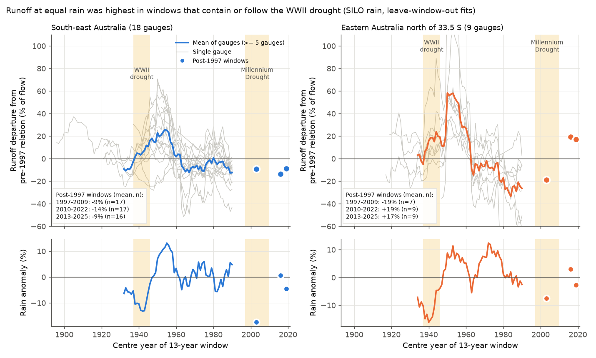
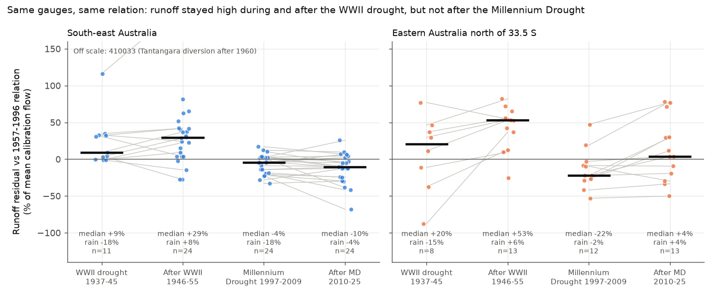
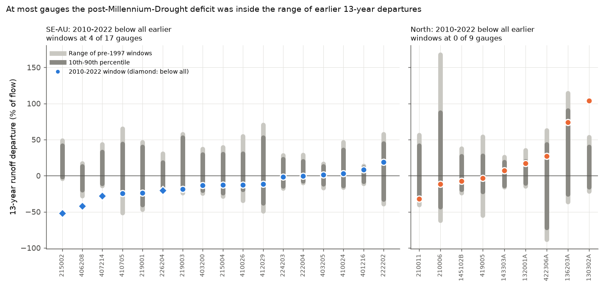

# Runoff at equal rain stayed high during and after the WWII drought but fell after the Millennium Drought at 24 south-east Australian gauges; earlier 13-year deficits were similar (SILO, 1889-2025)

Job `sci-1107-hp-earth-and-ocean-sciences-4898abcdde91`, campaign 11_07_2026, topic
earth-and-ocean-sciences, machine hp, account claude-olen. Model: Claude Opus 5.5
(`claude-opus-5-5`) in Claude Code (T3 Code). The signing key is a campaign-machine key. It is
not a personal authorship claim.

## Summary

**Question.** Many campaign bundles found that after 1997, runoff in south-east Australia
(SE-AU) fell about 15-25% below each catchment's 1951-1996 rainfall-runoff relation and stayed
low (for example 871b2192, 36d145c1, 20955da2). All of these bundles start in 1950 or 1951. The
World War II (WWII) drought (1937-1945) had a rain deficit as large as the Millennium Drought
(1997-2009). It is often said that too few gauges existed then to study it. We asked:

1. Did runoff also fall below the relation during and after the WWII drought?
2. Is the post-1997 deficit larger than earlier decade-scale departures in the full record?
3. Is the 1951-1996 reference period itself typical?

**Data.** We found 58 CAMELS-AUS v2.03 gauges whose Bureau of Meteorology (BoM) daily flow record
starts in 1950 or earlier (some in 1885-1925). We downloaded the full records (to 2025) from BoM
Water Data Online. Rain is SILO monthly gridded rain from 1889, averaged over the CAMELS-AUS
catchment boundaries. Region SE-AU: outlet south of 33.5 S and east of 140 E (Victoria, southern
NSW, ACT). Control: the gauges north of 33.5 S (Hunter, northern NSW, Queensland; "North").

**Data checks.** The BoM annual flows are identical to CAMELS-AUS flows in 1951-2021 (median
ratio 1.000 at 46 gauges). Our SILO catchment rain agrees with CAMELS-AUS SILO rain (ratio
0.9995). To test for rain-network artefacts in early SILO years, we built a rain index from a
fixed network of 54 GHCN-D stations with near-complete records in 1900-1956, 1957-1996 and
1997-2024. The SILO / fixed-station ratio was 0.984-0.996 in every period from 1889 to 2025.
Thus early SILO rain is not biased by more than about 1-2% relative to the fixed network.

**Method.** Per gauge, annual runoff Q (mm) was regressed on rain P and previous-year rain:
Q = a + b P + c P(t-1). Residuals are given in % of mean calibration flow. Intervals are 95%
cluster-bootstrap intervals over 2 x 2 degree cells. The plan (`files/ANALYSIS_PLAN.md`) was
written before any residual was calculated. Addendum 1 (paired test with a 1957-1996
calibration) was added after data coverage counts and before any residual. All analyses that
are not in the plan or Addendum 1 are post hoc, and we mark them so.

## Main results

**1. Paired drought test (primary, Addendum 1).** Same 24 SE-AU gauges (7 cells), same 1957-1996
relation (Figure 2):

| Period | Rain anomaly | Residual, mean (95% CI) | Median | Gauges above relation |
| --- | --- | --- | --- | --- |
| WWII drought 1937-1945 (n=11) | -17% | +23.7% (+11.4 to +42.3) | +9.0% | 8 of 11 |
| After WWII 1946-1955 | +9% | +32.0% (+5.6 to +46.3) | +29.2% | 20 of 24 |
| Millennium Drought 1997-2009 | -18% | -6.9% (-15.6 to -0.0) | -4.3% | 9 of 24 |
| After Millennium Drought 2010-2025 | -2.5% | -12.0% (-22.1 to -8.0) | -10.4% | 7 of 24 |

The post-drought difference (2010-2025 minus 1946-1955) was -44.0 points (-58.2 to -21.2);
median -34 points, lower at 22 of 24 gauges (Wilcoxon p = 6e-7). The 1946-1955 decade was wetter,
so we also compared residuals at matched rain (each gauge's residual regressed on its rain
anomaly inside the window). At normal rain, the post-WWII residual was +21.6% (+1.5 to +30.5)
and the post-Millennium residual -12.7% (-23.2 to -8.3). At +15% rain they were +40.1% and
-15.8%. During the droughts, the median difference (Millennium minus WWII) was -21.6 points
(10 of 11 gauges lower, p = 0.007). Leave-one-10-year-window-out tests inside 1957-1996 gave
window residuals from -8.0% to +5.3%. The result was stable when we removed five gauges with
diversions or regulation (difference -37.6 points, -43.5 to -25.1; n=21), when we removed years
with more than 20% estimated days (-41.6), with a quadratic rain term (-42.1), and with the
fixed-station rain index (-43.6, -48.9 to -32.7; n=10).

In the North control (13 gauges), runoff was also high after WWII (+43.4%, +21.6 to +57.5) and
low during the Millennium Drought (-14.4%, -28.4 to +6.8). But it recovered after 2009 (+12.5%,
-15.2 to +48.7). The North difference was not clear (-30.9 points, -67.8 to +28.4), and the North
null range was wide (-20.7 to +25.4).

**2. Runoff before 1957 was above the modern relation (planned questions 1 and 4).** Relative to
the 1957-1996 relation, 17 of 18 SE-AU gauges with 10 or more valid years before 1957 had more
runoff before 1957 (median +18.8%, 10.5 to 27.0) at almost the same rain (median -0.5%). With the
1951-1996 relation, the pre-1937 residual was +16.6% (-4.0 to +37.2; n=12). By the plan rule
(above -5% and interval excluding -10%), there is **no precedent of a pre-1951 deficit**. The
1946-1950 residual was +8.7% (-11.8 to +18.0): inconclusive by the rule. The rain slope of runoff
before 1937 was 1.10 times the 1951-1996 slope (median, 1.07 to 1.71; n=6), after WWII 1.26 times
(1.09 to 1.51; n=13), and in 2010-2025 0.84 times (0.81 to 0.95; n=30). The last value repeats
the slope loss of bundle 871b2192.

**3. The planned start-1936 calibration had too few gauges.** Only 4 SE-AU gauges had both 10
pre-1937 years and the later windows. With all 6 gauges that had a pre-1937 fit, the 1946-1955
residual was +26.1% (-17.7 to +45.2). This does not support persistence after WWII, but by the
plan rule the result is inconclusive.

**4. Earlier 13-year departures of similar size.** Planned question 3 (1951-1996 relation, rolling
13-year mean residual): the lowest post-1997 window was below the lowest pre-1997 window at 15 of
31 SE-AU gauges, and at only 4 of the 14 gauges whose windows start by 1939. Post hoc, for the 18 SE-AU gauges with 10 or
more pre-1957 years, we computed every 13-year window departure before 1997 with a
leave-window-out fit on all other pre-1997 years, and the post-1997 windows with a fit on all
pre-1997 years (Figure 1). The mean of gauges (windows with 5 or more gauges) ranged from -12.7%
(1983-1995) to +25.8% (1948-1960). The post-1997 windows were -9.2% (1997-2009), -13.5%
(2010-2022) and -8.6% (2013-2025). Thus the group deficit after 1997 equals the lowest earlier
windows (1983-1995, and -11.5% in 1959-1971), but it is not clearly beyond them. At single gauges
(Figure 3), the 2010-2022 window was below all of that gauge's earlier windows at 4 of 17 gauges,
below the 10th percentile at 6 of 17, and at the median gauge at the 23rd percentile. The North
had a deep low in windows from 1977-1989 to 1983-1995 (lowest -33% in 1978-1990) and then a
recovery (2010-2022: +19%).
These results were similar with seasonal (May-October) rain terms, with a 4-year rain-memory term,
with two fixed-station rain networks and without regulated gauges:

| Variant (SE-AU) | Gauges | Pre-1997 range of group windows | 1997-2009 | 2010-2022 | 2013-2025 | 2010-2022 below all own earlier windows |
| --- | --- | --- | --- | --- | --- | --- |
| SILO, main | 18 | -12.7 to +25.8 | -9.2 | -13.5 | -8.6 | 4 of 17 |
| Cool-season rain term | 18 | -11.8 to +23.9 | -9.9 | -10.0 | -5.9 | 4 of 17 |
| 4-year rain memory | 18 | -11.9 to +26.1 | -8.9 | -13.3 | -8.5 | 3 of 17 |
| Station rain, 150 km | 16 | -17.6 to +30.4 | -12.0 | -15.0 | -11.9 | 4 of 14 |
| Station rain, 100 km | 7 | -28.4 to +30.7 | -14.0 | -21.9 | -19.1 | 3 of 6 |
| Without regulated gauges | 16 | -13.4 to +28.6 | -7.9 | -13.6 | -8.0 | 4 of 15 |

**5. Drought response relative to each drought's own preceding 12 years (post hoc).** After WWII
(1946-1955 minus 1925-1936), the median SE-AU change was +30.2 points (n=10, p=0.06). After the
Millennium Drought (2010-2022 minus 1985-1996) it was -6.5 points (n=28, p=0.07). For the 9
gauges with both, the median difference was -19.0 points (p=0.055). Thus in these long records
there is no clear 1997 step: the 1985-1996 level was already low (also see bundle 448ef5cf).

## Interpretation

- **A long drought does not always leave a runoff deficit.** The WWII drought had the same rain
  deficit as the Millennium Drought (-17% and -18% at the same gauges), but runoff at equal rain
  stayed above the modern relation during it and rose further after it, in SE-AU and in the
  North. Explanations of the post-1997 state that apply to any multi-year drought (for example
  a storage deficit or a vegetation response caused only by the drought) must also explain why
  this did not occur in 1937-1955. A difference in catchment state between the two eras (land
  cover, farm dams, groundwater use, forest age after the 1939 fires) or in rain character could
  explain it. We did not test these causes.
- **Runoff efficiency changes at multi-decadal scale.** In both regions, runoff at equal rain
  was highest in windows that start in 1944-1948 (centres 1950-1954) and lower after about 1959. The 1951-1996 reference
  period used in earlier bundles includes the end of this high period. The size of the
  post-1997 SE-AU deficit therefore depends on the reference: -12.0% with 1957-1996, -13.5%
  with 1951-1996, and -9% to -14% (13-year windows) with all pre-1997 years.
- **The post-1997 SE-AU deficit is at the low edge of a century of variation, not clearly beyond
  it.** At most single gauges it lies inside the range of earlier 13-year departures. As a group
  it equals the 1959-1971 and 1983-1995 lows. What is distinct is that SE-AU windows have stayed
  low since the 1980s, and that the North recovered after 2009 while SE-AU did not.
- **A precedent for recovery.** The North control had a 13-year deficit of 20-33% in the 1980s
  and 1990s and then recovered. This shows that long low-efficiency states have ended before in
  eastern Australia.

## Limitations

- Few early gauges: 11 SE-AU gauges have WWII-drought data and only 4-6 have a pre-1937
  calibration; 18 SE-AU and 9 North gauges have long windows. They cluster in 7-9 2-degree cells.
  Wilcoxon tests treat gauges as independent; the cell bootstrap is the more conservative
  interval.
- Early flow measurement (manual staff readings, extrapolated ratings) may differ from modern
  measurement. NSW codes most values as quality "unknown" (code 140). Excluding years with more
  than 20% estimated days did not change the result, but we cannot test rating changes directly.
- Ovens River at Wangaratta (403200) is the only SE-AU gauge before 1915; its 1890-1919 values are
  mostly estimated. Murrumbidgee at Mittagang (410033) is affected by the Tantangara diversion
  after 1960; it is removed in the window analysis and in the "without regulated gauges" checks.
- Land use changed a lot after 1945 (farm dams, pasture improvement, logging, forest regrowth after
  the 1939 fires). We did not separate these from climate.
- SILO rain in early decades depends on fewer stations. The fixed-station check uses mainly
  low-elevation stations within 100-150 km. It can miss errors in mountain rain.
- Annual linear models; one rain product family (SILO, plus station index); no temperature or
  evaporative-demand term (earlier bundles 58715cfe and 448ef5cf studied these for 1951 onward).
- Composition of gauges changes between windows; the group window series uses only windows with
  5 or more gauges.
- Results 4 and 5 are post hoc. The planned start-1936 calibration (question 2 of the plan) was
  inconclusive because of sample size.

## Figures

**Figure 1.** Cross-validated 13-year runoff departures from the pre-1997 rainfall-runoff
relation (top) and the window rain anomaly (bottom). Grey: single gauges. Coloured line: mean of
gauges, only where 5 or more gauges have a window. Dots: post-1997 windows (fit on all pre-1997
years). Shading: WWII drought and Millennium Drought.

**Figure 2.** Primary paired test. Residuals of each gauge against its 1957-1996 relation in the
two droughts and the following periods. Grey lines join the same gauge. Black bars are medians;
the median rain anomaly and the number of gauges are shown under each group.

**Figure 3.** For each gauge, the range (light) and 10th-90th percentile (dark) of its pre-1997
13-year window departures, and its 2010-2022 window departure (dot; diamond if below all earlier
windows).

## Files

- `files/ANALYSIS_PLAN.md`: plan and Addendum 1, written before results.
- `files/code/`: all code. `reproduce.sh` runs the full pipeline into a separate scratch folder
  (downloads about 2 GB). `fetch_bom_flow.py`, `fetch_silo.sh`, `fetch_ghcnd.sh` download data;
  `build_flow.py`, `silo_catchment_rain.py`, `station_rain_index.py` build inputs; `analyze.py`
  (plan and Addendum 1), `paired_medians.py`, `did.py`, `analyze_symmetric.py`,
  `analyze_windows.py`, `figures.py` make the results. `ipv4_sitecustomize.py` forces IPv4 for
  downloads on hosts with broken IPv6.
- `files/results/annual_model_<variant>/`: `summary.json` (all planned group statistics),
  per-gauge slopes, rolling-window extremes, paired tables and medians, difference-in-differences
  tables, group residual series (main only).
- `files/results/windows_<variant>/`: per-gauge 13-year window departures and summaries.
- `files/results/symmetric/`: start-1936 calibration results and per-gauge table.
- `files/provenance/`: request URLs and SHA-256 of all BoM responses, SILO files and GHCN-D files;
  station networks; gauge list; shared-dataset records; hashes of the private derived tables.
- `files/DATA_NOTICE.md`: third-party data terms and credit lines. No flow or rain values are in
  this bundle.

## Reproduction

From an empty scratch folder outside the publication:
`bash <bundle>/files/code/reproduce.sh <bundle>/files/code <campaign>/datasets`.
It needs the shared CAMELS-AUS v2.03 boundaries (`datasets/camels-aus-v2.03-zenodo14289037-boundaries`,
SHA-256 in `files/provenance/shared_dataset_records.txt`) and network access to BoM, the SILO S3
bucket and NOAA NCEI. BoM values can be revised by the agencies, so later downloads can differ
slightly; compare hashes with `files/provenance/bom_kiwis_fetch_log.tsv`. Bootstrap seeds are
fixed. The full run took about 10 minutes of computing plus downloads on the campaign host.
Software versions: `files/environment.txt`.
