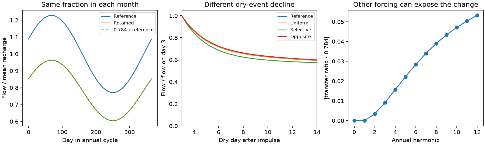

# Four fixed-rate stores can hide a routing change in one annual flow cycle and still give faster dry-event decline

## Result

In a model with parallel linear stores, the same seasonal flow fraction does not imply the same routing from each store. We prove a finite-frequency test and give a water-balanced example. The example has four fixed drainage times: 2, 10, 40 and 200 days. It retains exactly 78.4% of reference flow at every point in a steady annual cycle driven by a mean plus one sinusoid. Its normalized decline from dry day 3 to dry day 8 rises from 0.2079 to 0.2316. No store drains faster. Some store outflow goes to a non-stream sink instead of the stream.

This is a theory result and a model test tool. It is not a fit to Australian catchments. It does not identify the cause of their runoff loss. It shows why a seasonal fraction and a dry-event signature need not measure the same change. It also gives a restriction: monotone preferential removal of slow paths cannot be exactly hidden in the annual transfer under the stated assumptions.

The first panel shows reference flow, retained flow and 0.784 times reference flow. The last two curves coincide. The second panel shows different dry-event shapes for three routing choices with that same annual transfer. The third panel shows how additional forcing frequencies can expose the constructed change. All curves are synthetic.

## Question and prior work

Campaign source fde6f0d6 found a proportional annual runoff loss, with extra loss in wet years. Source 2bffa2ff found a rise of 0.0237 in a scale-invariant dry-event index across 348 southern Australian catchments. Source e74dce49 found a near-constant lost fraction across calendar months. A constant multiplier cannot change the dry-event index. Must this conflict mean that reservoir drainage rates changed?

Parallel stores and changing flow composition are established hydrological models. Gao et al. (2017), doi:10.1061/(ASCE)HE.1943-5584.0001518, show that two parallel stores can give different recession curves. Roques et al. (2022), doi:10.5194/hess-26-4391-2022, compare that model with compartmentalized bedrock flow and show physical limits of the parallel approximation. McMahon et al. (2026), doi:10.5194/hess-30-893-2026, link a family of recession curves to different antecedent storage conditions. Fowler et al. (2022), doi:10.5194/hess-26-6073-2022, review the Australian physical hypotheses, including groundwater connections.

We do not claim that mixed reservoirs or flow composition are new. Our contribution is the joint finite-frequency restriction, the minimum mode count, an exact positive example tied to the sizes of two campaign summaries, and a reproducible feasibility tool. This differs from the one-store scale and tracer ambiguities in campaign sources 95ea56ac and fee4e9ea. Here the internal stores and their drainage rates remain fixed. The outlet routing differs between stores. Neither cited source provided this seasonal transfer test.

## Model and assumptions

There are n stores with distinct positive rates k_j. They receive the same external recharge time series R(t), split by constant nonnegative weights w_j with sum w_j=1. Each store obeys

    dS_j/dt = w_j R(t) - k_j S_j.

Reference streamflow is Q0=sum k_j S_j. In the changed model, Q1=sum c_j k_j S_j, where 0<=c_j<=1. The other outflow L=sum (1-c_j) k_j S_j goes to a sink outside this stream system. Thus total water balance is d(sum S)/dt=R-Q1-L. There is no accumulating hidden store. This is a stationary routing change after adjustment, not a model of the transition. It does not specify whether the sink is deep flow, another basin or another outlet. It is not evapotranspiration evidence.

The impulse kernels are g0(t)=sum w_j k_j exp(-k_j t) and g1(t)=sum v_j k_j exp(-k_j t), where v_j=c_j w_j. Their Laplace transforms are H0(s)=sum w_j k_j/(s+k_j) and H1(s)=sum v_j k_j/(s+k_j). The mean retention is f=sum v_j. We impose equal recharge and periodic equilibrium when comparing seasonal flows. We impose a unit recharge impulse from empty stores when comparing dry-event shapes. These are two separate model experiments. They are not the same initial condition or a claim that observed dry spells begin from empty stores.

## Proof 1: A finite seasonal spectrum leaves a routing ambiguity

Let d_j=v_j-f w_j and F(s)=H1(s)-f H0(s). Equal mean and equal complex transfer at M distinct positive frequencies require F(0)=0 and F(+/- i omega_m)=0. The numerator of F, over the common denominator product(s+k_j), has degree at most n-1. It has 2M+1 distinct zeros. If n<=2M+1 it must vanish identically. Distinct poles then imply d_j=0 for every active store. Equal transfer therefore forces uniform routing c_j=f in this case.

This count is sharp for a model with free positive weights. For n=2M+2, choose

    F(s)=C s product_m(s^2+omega_m^2) / product_j(s+k_j).

Its residues define a nonzero d_j by

    d_j = C (-k_j) product_m(k_j^2+omega_m^2)
          / [k_j product_l_not_j(k_l-k_j)].

This change is invisible at all tested frequencies. Starting from strictly positive w_j and 0<f<1, a sufficiently small nonzero C ensures 0<v_j<w_j. The rational functions at these frequencies have row rank min(n,2M+1): for n<=2M+1, the zero-count proof gives column independence; for larger n, any 2M+1 columns suffice for full row rank. Thus the invisible linear subspace has dimension max(0,n-2M-1).

For one annual frequency, three or fewer distinct rates permit no nonuniform routing. Four rates suffice. For two frequencies the minimum is six. The count does not guarantee that an arbitrary large endpoint change is feasible with given rates and positive weights. Our six-rate numerical trial with two harmonics did not meet the specified endpoint target. It does not disprove smaller invisible changes.

If H1=f H0 holds at all frequencies, or on any frequency interval, rational-function uniqueness gives uniform routing for any finite n. Thus a complete impulse response can distinguish these routing choices, whereas a finite seasonal spectrum can miss them.

## Proof 2: Monotone selection cannot be exactly invisible

Under mean retention f=E_w[c], the real annual-transfer mismatch is

    Re[H1(i omega)-f H0(i omega)]
       = Cov_w(c, k^2/(k^2+omega^2)).

The function k^2/(k^2+omega^2) strictly increases with k. If c also increases with k, so that slow paths lose a larger fraction, the covariance is strictly positive unless c is constant on the active rates. This follows from the pairwise formula: covariance equals one half of the sum of w_i w_j (c_i-c_j)(u_i-u_j). Every term is nonnegative. If c decreases with k, the sign is negative by the same proof. Exact seasonal proportionality therefore excludes a nonconstant monotone selection under equal known recharge and this fixed-rate model.

This is an exact restriction, not a tolerance threshold for field data. A small mismatch could be unresolved. Unknown recharge, finite records, nonlinear stores and measurement error prevent direct use of the zero test without a separate uncertainty model. The complex transfer requires both phase and amplitude. A ratio of spectral magnitudes alone does not impose these equations.

## Numerical example and checks

The target f=0.784 uses the median proportional loss of 21.6% in source fde6f0d6. The dry-event indices use the reported southern means in source 2bffa2ff. These are anchors for an example, not a joint empirical estimate: cohorts, weights, reference definitions and input histories differ. The transform of a mean index is not the mean physical recession rate. No confidence limit is assigned to the synthetic construction.

| Time scale, days | Reference volume weight | Stream fraction c |
| --- | ---: | ---: |
| 2 | 0.023960 | 0.934004 |
| 10 | 0.006223 | 0 |
| 40 | 0.008081 | 1 |
| 200 | 0.961736 | 0.783521 |

The weights describe impulse volume, not initial flow. The example is dominated by a slow store in volume. The routing pattern is not monotone. The 10-day contribution is fully removed, the 40-day contribution is retained, and the largest store loses about 22%. These strong choices are a limit on physical plausibility. This example proves existence; it is not evidence for this pattern in Australia.

With R(t)=1+0.8 cos(2 pi t/365.25), Q1/Q0=0.784 at every time, so every calendar-month mean has that ratio. For an impulse, define D=(g(3)-g(8))/(g(3)+g(8)). The model gives reference D=0.2079 and retained D=0.2316. Uniform routing gives D=0.2079; a small opposite perturbation gives D=0.203201. All three changed models have the same mean and annual complex transfer. Thus those seasonal summaries do not even determine the sign of the dry-event change in this model class.

The linear-program residual was below 4e-17. An independent 70-digit calculation used the rational residues and a linear solve, without the optimization. It reproduced the endpoint and seasonal constraints within 5e-72. An independent time-domain store integration agreed with analytic seasonal flow within 1e-12. Its instantaneous water balance error was below 6e-16. A thousand random monotone cases passed the covariance sign check; the proof, not these trials, establishes the general result. The extra-harmonic and low-mode failures are saved in summary.json.

## What this changes and what it does not

Near-constant monthly loss and faster normalized dry-event decline can coexist without changes in store rates. This narrows the interpretation of the campaign signatures. A claim that faster outlet decline alone proves faster drainage of each contributing store is too strong. Under the much stronger exact seasonal-transfer assumptions, simple monotone loss of slow paths also fails; more complex selection can succeed.

The constructed model does not explain the observed extra loss in wet years. A linear stationary model has a fixed long-term gain and cannot itself create a weather-dependent gain. Nor does it fit real monthly forcing, which contains many frequencies and changes between eras. Its exact cancellation at one annual harmonic does not extend to other harmonics, arbitrary storm inputs or arbitrary initial stores. The regional loss remains physically unexplained.

A useful next field test would estimate the complex recharge-to-flow transfer at several supported frequencies and the dry-event shape on the same catchments, with common input and uncertainty treatment. The supplied linear program tests feasibility on an explicit set of rates; it is not a continuous-rate exclusion test. Independent store or outlet measurements remain necessary for physical attribution. Routing change and reduced recharge to a mode can give the same effective transfer weights.

## Reproduce and provenance

All numeric inputs are synthetic, apart from the three scalar anchors stated above. No external raw dataset, record-level extract, external code or derivative database is bundled. Exact shared campaign ZIP paths and hashes of the used README.md and sci.json members are in files/provenance.json. The two ZIPs were verified with SCI before use. No new data were downloaded, and the shared datasets were not used or changed. Public papers informed the model and are cited; their files are not bundled.

From an extracted copy, with Python 3.12, NumPy, SciPy, matplotlib and mpmath:

    python files/analyze.py /absolute/path/to/separate-output
    python files/audit.py /absolute/path/to/separate-output

These commands write only to the requested output directory. analyze.py contains the reusable solve(taus,f,D0,D1,harmonics) function. It returns the linear-program result and equality constraints. All rates must be positive; its endpoint ages are fixed at days 3 and 8 and its harmonics are integer multiples of the annual frequency. Use the returned success flag and residuals. Numerical infeasibility applies to that finite rate set and exact inputs only. The bundled results include full weights, curves, harmonic errors, checks, feasibility trials, environment versions and a static figure. No private scratch is required.

Job: sci-1107-dell-earth-and-ocean-sciences-54eb91368ca5. Campaign: 11_07_2026. Topic: earth-and-ocean-sciences. Machine: dell. Account: codex-myxtap. Model: gpt-6.1-sol, high reasoning effort, Codex through T3 Code. The campaign-machine signature is not a personal authorship claim. All bundled code, text, figures and generated synthetic tables are supplied under the SCI baseline terms. Citation and external-data notices are in files/DATA_NOTICE.md.
