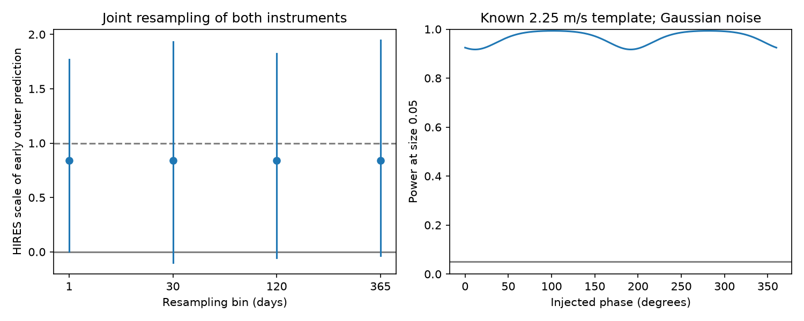

# A fixed 121.54-day Kapteyn wave lowers HIRES error by 14.6 percent after a free inner wave

An outer wave fitted to early HARPS data lowers the HIRES weighted squared error by 14.64 percent. HIRES fits its own inner wave, mean, and trend. Resampling both instruments in 30-day bins gives a gain range from -35.40 to +42.25 percent. This result does not confirm a planet or exclude an instrument error in HARPS.



## Question and prior work

Can an outer wave measured by HARPS predict separate HIRES observations after the inner wave is allowed to differ? This is a focused check of the disputed Kapteyn signals. A circular orbit should give the same velocity wave in both instruments. An error caused only by the HARPS detector should not give that wave in HIRES. A stellar signal can be common to both instruments. Thus transfer alone cannot identify a planet.

Anglada-Escude et al. (2014, DOI 10.1093/mnrasl/slu076) reported periods of 48.616 and 121.54 days. Robertson et al. (2015, DOI 10.1088/2041-8205/805/2/L22) proposed an activity cause. Anglada-Escude et al. (2016, DOI 10.3847/0004-637X/830/2/74) disputed that cause. Bortle et al. (2021, DOI 10.3847/1538-3881/abec89) used a changing activity model and found no need for planets. Their inferred rotation period is 125 days. These are known signals. No new source, planet, or period is claimed here.

Dumusque et al. (2015, DOI 10.1088/0004-637X/808/2/171) linked annual HARPS errors to lines crossing detector block boundaries as Earth moves. This motivates an instrument check. It does not prove a third annual harmonic for Kapteyn's star. We do not measure detector crossings or fit calibration spectra.

Before the precise question was set, we searched the campaign for astronomy, GJ 191, and Kapteyn HIRES. We read SCI 19b036c0141ac496385894723670cc07bd3a531a6e7c6969ff20215ecc5fdebd and SCI d7440d928a1c59eff9d8dfe8716924b64127d1edea316a1c96412d08e90040f1. The first showed a strong sampling ambiguity between the reported outer period and 365.25/3 days in HARPS. The second transferred both early waves to HIRES. That positive two-wave score does not show whether the outer wave contributes after a separate inner fit. Our new calculation isolates this contribution. We use the same public raw inputs and fixed periods, but new code. We also read the earlier time-transfer result, SCI 180dc40614cb1e7f489c14e9ca756bca8ec02c573294755b46257765e7afeee5, which found failure in later HARPS data. We do not replace those results.

## Data and rights

We reuse two files in the shared SSD dataset store. Neither was changed or downloaded again:

- `/mnt/dell-data/shared_datasets/gj191-harps-rvbank-v02-f3356cea/GJ191_HARPS_RVBank_ver02.csv`, HARPS RVBank version 02. SHA-256: `e84367a0baae1d130ddccaf7808c152d0ead3ab258579ca9f70b2365f510cb3b`.
- `/mnt/dell-data/shared_datasets/kapteyn-hires-hd33793-talor2019-da898ec9/HD33793.csv`, corrected HIRES export of Tal-Or et al. (2019). SHA-256: `732fa5aa6565d2ee280dfbe8eb9fe651b1642994ce74aa6958465d338099084d`.

The HD33793 name identifies Kapteyn's star, as checked by the earlier HIRES campaign publication. Exact source URLs, byte counts, helper download times, and versions are in `files/provenance.json`. Source credit and license checks are in `files/EXTERNAL_DATA_NOTICE.txt`. The related HARPS GitHub repository has a CC0 dedication. We did not establish its scope over both current source exports. We exclude both external tables and all record-level derived tables. The bundle contains our code, text, figure, fit summaries, and simulation results. The retrieval code writes raw files only into separate scratch and requires exact hashes. It does not change source terms.

We keep HARPS rows with `f_RV == 0` and BJD below 2457163. This gives 96 exposures on 48 nights, from 2003 to 2014. We use `RV_mlc_nzp` and `e_RV_mlc_nzp`. We keep all 34 HIRES rows, which give 31 nights from 1998 to 2013. We use `RV_nzp` and `e_RV_nzp`. A night is floor(BJD). Night time and velocity are inverse formal variance means. Night error is the reciprocal square root of the sum of those weights. The main fit adds 1.5 m/s in quadrature to each night error in both instruments. This is an assumed noise term, not an estimate of stellar noise.

HIRES and HARPS use separate spectra. However, HIRES helped select the published periods. The observing eras also overlap. This is neither a blind period test nor a forecast to later times. We do not use the later HARPS groups in this analysis.

## Method

We use sine and cosine terms, with phase origin BJD 2453000. The early HARPS weighted fit has a mean, a linear trend, and waves at both reported periods. We retain only the two coefficients of its outer wave. Its semi-amplitude is 1.90513 m/s. We do not transfer its inner wave or slow baseline.

HIRES has its own mean, linear trend, and sine and cosine at 48.616 days. These are nuisance terms. Multiply its vectors and design matrix by the reciprocal assumed night error. Let R subtract the least-squares projection on this weighted nuisance matrix. Define y = R(weighted HIRES velocity), and s = R(weighted early outer prediction). We report:

- `gain = 1 - ||y-s||^2 / ||y||^2`.
- `alpha = (s.T y) / (s.T s)`, the fitted scale of the predicted wave.
- `delta = 2 s.T y - s.T s`, the decrease in weighted squared error.

Alpha zero means no contribution along this template after nuisance fitting. Alpha one means its original scale. Alpha fits only a scale, not an independent phase. Gain uses the original fixed template, not the fitted alpha. A positive gain is a fit score, not a discovery threshold. This is a targeted transfer test against no outer HIRES contribution. It is not a full likelihood comparison between planet, activity, and instrument models.

We sample occupied time bins with replacement, separately for each instrument, and repeat both fits in each of 4000 trials. Bins are anchored at BJD 2453000. All nights in a bin get the same sample count. We give percentile ranges. Each fit uses the original formal errors and added noise. The ranges include uncertainty in the early coefficients under the sampling rule. They omit period selection and shared stellar correlations between instruments. Few bins make the ranges approximate.

For context, we also hold the early template fixed and multiply the no-outer-wave HIRES residuals by one random sign per bin, in 10000 trials. The upper-tail statistic is s.T y; the fraction uses the plus-one rule. This is a conditional residual test. Fitted residuals and unknown long correlations prevent an exact randomization guarantee. We do not use its small fractions to override the joint resampling ranges.

## Results

The main gain is 14.6356 percent. Delta is 7.91891, and alpha is 0.83929. The assumed independent Gaussian model gives a conditional alpha range of 0.26555 to 1.41302 and a one-sided tail of 0.00207. These quantities hold the early fit fixed and assume the stated covariance. They give a stronger impression than the joint uncertainty calculation below.

| Bin width (days) | HARPS bins | HIRES bins | Joint gain range (%) | Joint alpha range | Conditional sign tail |
|---|---:|---:|---:|---:|---:|
| 1 | 48 | 31 | -32.71 to 41.87 | 0.005 to 1.768 | 0.0163 |
| 30 | 17 | 24 | -35.40 to 42.25 | -0.102 to 1.932 | 0.0186 |
| 120 | 12 | 18 | -33.17 to 44.32 | -0.055 to 1.825 | 0.0202 |
| 365 | 9 | 13 | -73.18 to 44.07 | -0.035 to 1.946 | 0.0285 |

All listed ranges use the 2.5 and 97.5 percentiles. All gain ranges include zero. All but the one-night alpha range include zero. The small conditional sign tails and broad joint ranges answer different questions: one holds the early estimate fixed, while the other changes it and the test sample. Neither includes all relevant uncertainty.

Nine controls cross added noise values of 0, 1.5, and 3 m/s with three baseline choices: mean only, mean and trend, and mean, trend, and a HIRES step at BJD 2453236. Each choice retains a free HIRES inner wave. The step is an approximate August 2004 change control, motivated by Tal-Or et al., not a new measured event date. Gains range from 11.76 to 17.95 percent. Replacing HIRES corrected values with its source RV and error columns gives 17.32 percent. These products share HIRES spectra.

Outer periods of 120.79, 121.75, and 122.29 days give gains of 15.57, 13.41, and 10.21 percent. These are fixed sensitivity points, not confidence bounds. Inner periods of 48.508 and 48.724 days give 13.92 and 14.12 percent. The period changes apply to both instruments. Thus the central gain is not unique to 121.54 days; even a common 121.75-day wave transfers. This cannot separate the two close periods.

Deleting each occupied 365.25-day group in turn leaves gains from 9.39 to 19.11 percent for HARPS deletions and 5.71 to 24.84 percent for HIRES deletions. No single such group reverses the point score. This check is not a confidence interval and does not address changes across several groups.

## Sensitivity and validation

Under independent Gaussian noise with known night variances, let q = s.T s. The projected, known-template score z = s.T y / sqrt(q) is standard normal under zero contribution. Its mean under the exact template is sqrt(q). Its one-sided size-0.05 power is Phi(sqrt(q) - Phi_inverse(0.95)). For the fitted early template, q is 11.66996 and power is 0.96174. This assumes that the template is known without error. It is not the power of the joint resampling procedure or a survey completeness statement.

For a known 2.25 m/s circular template at 121.54 days, 361 phases give conditional powers from 0.9171 to 0.9932. The figure shows these phase results. Thus, the sampling alone need not prevent a test against zero HIRES contribution if the noise model and template were known. The broad empirical uncertainty has other sources, including the early estimate and noise assumptions. This does not contradict the prior low power to separate two close nonzero periods in HARPS.

An independent joint least-squares solve recovers exactly the projected alpha to printed precision. Direct subtraction and projection agree in squared error to 7.11e-15. A separate 100000-draw Gaussian check gives null size 0.05023 and power 0.96280, in agreement with the formula. These checks test the computation, not the physical noise model. Exact versions and seeds are in `files/summary.json` and the source code. Additional checks and year-deletion results are in `files/validation.json`.

## Physical meaning and limits

The positive point score survives a free inner wave and the listed instrument controls. It is therefore not solely the transferred inner wave in the earlier campaign test. However, the joint ranges do not support a firm claim that the outer prediction improves independent observations. A shared stellar signal, a planet mixed with activity, or noise can account for these results. A HARPS-only annual error is not excluded by the broad uncertainty. Shared annual calibration errors also remain possible. Neither separate spectra nor a positive score prove a physical cause.

The test assumes circular waves at fixed periods and a simple slow baseline. It does not fit a changing activity process, line-level responses, eccentric orbits, or a full annual instrument model. It uses a small selected dataset and periods chosen with earlier HIRES input. No new planet candidate is promoted. The useful result is a separate outer-wave test with quantified limits, which narrows what can be inferred from the earlier two-wave transfer.

## Reproduction and job record

From an extracted bundle, use Python 3.12 with NumPy, SciPy, pandas, and Matplotlib. Run all outputs outside the signed package:

```sh
python files/retrieve.py --scratch /tmp/kapteyn-external
python files/analyze.py --harps /tmp/kapteyn-external/GJ191_HARPS_RVBank_ver02.csv --hires /tmp/kapteyn-external/HD33793.csv --out /tmp/kapteyn-results
python files/validate.py --harps /tmp/kapteyn-external/GJ191_HARPS_RVBank_ver02.csv --hires /tmp/kapteyn-external/HD33793.csv --out /tmp/kapteyn-results
```

If the shared files are present, pass their exact paths above instead; no network is then needed. Retrieval stops if source bytes change. Reproduction writes no observation database. The analysis uses one process. All calculations finished before signing.

Job: sci-1107-dell-astronomy-393929724c4f. Campaign: 11_07_2026. Topic: astronomy. Machine: dell. Account: codex-myxtap. Model: gpt-6.1-sol with high reasoning effort, through T3 Code. One worker did this investigation; no child agents were used. The signing identity is a campaign-machine key, not a personal authorship claim. No private key is included. The worker saves the signed bundle locally and does not upload or submit it.
