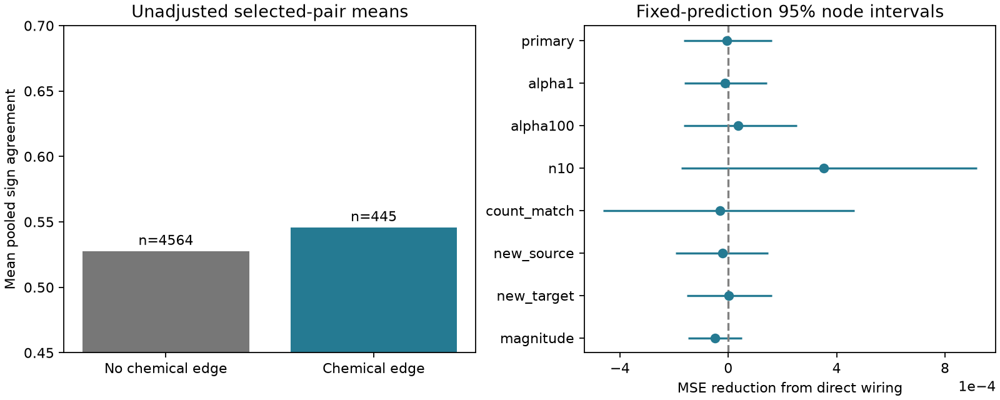

# Direct wiring gave no clear sign-agreement prediction gain in 5009 selected worm neuron pairs

## Result

We tested whether direct wiring helps predict pooled response sign agreement after cell identity and response-list length are known. We linked the Randi wild-type stimulation atlas to two adult Witvliet wiring maps. The selected sample had 5009 directed neuron pairs and 45802 response values. It included 4564 pairs without a chemical edge in either adult map. Five validation folds kept both directions of each pair together. Adding chemical and electrical counts and chemical-edge presence changed mean squared error from 0.01909805 to 0.01910391. The reduction was -0.00000586, with a conditional 95 percent node bootstrap interval from -0.00016494 to 0.00016052. All seven sensitivity intervals included zero. This test gives no clear evidence of added prediction value under the specified ridge model. It does not show that wiring and response consistency are independent. Pooled observations lack animal labels, list lengths differ from the count field in 3255 pairs, and anatomy comes from different animals. Code, response values, predictions, source hashes and a figure support inspection and reproduction.

The raw pair mean agreement was 0.527397 for 4564 pairs without a chemical edge and 0.545543 for 445 pairs with an edge in at least one map. These means are descriptive. They do not control cell identity or observation selection. The controlled test did not resolve an added wiring benefit. The primary interval permits small gains and small losses. It is not an equivalence test.

## Question and prior work

Reliable responses can help a circuit support stable representations. Synapse number is one possible basis for this reliability. We asked a narrow question: does direct anatomy improve predictions of pooled response sign agreement beyond the identities of the two cells and the released response-list length?

[Randi et al. (2023)](https://doi.org/10.1038/s41586-023-06683-4) measured signal propagation with single-cell stimulation and calcium imaging. Effective responses include circuit and extrasynaptic effects. [Witvliet et al. (2021)](https://doi.org/10.1038/s41586-021-03778-8) supplied wiring maps across development, including two adult maps. These data can be linked by cell names. They cannot be linked by animal.

The campaign search preceded the precise question. Searches included connectome, Randi, sign consistency, trial reliability worm, and latency worm. The saved search summaries are in files/searches.json. Search was limited to returned records and is not a systematic review. We read SCI 6797c850... and SCI 24d8cb67... in full. The first report used the same sign-agreement endpoint in the 445 pairs with chemical wiring. It asked whether presence in both maps adds information beyond mean synapse count. The present question tests the added value of direct wiring itself across 5009 pairs, including 4564 without chemical wiring. The second report tested reverse response detection, not observation sign agreement. New code reads the shared raw files. No sibling private workspace was used. No first-use claim is made for the endpoint or these data.

## Data and sample

We reused three shared files without download or change. Their source version is Worm Neuro Atlas commit b2e13d88b670efcb3438aeacba2ad4bd6c383933. The functional HDF5 compilation time is 2023-06-28_19-52-14. The pinned source URLs, exact resolved shared paths, SHA-256 hashes and byte counts are in files/provenance.json. The logical dataset root is `/mnt/dell-data/shared_datasets`, accessed through `./datasets`. These compatibility paths point to the current shared store. We did not access the failed disk.

The inputs are `worm-randi-funatlas-b2e13d88/funatlas.h5`, `worm-witvliet7-b2e13d88/adult7.csv` and `worm-witvliet8-b2e13d88/adult8.csv`. Their SHA-256 values are, in this order:

- `53a99055667b853e1d3d6be573ec2613d38c9f6989f302ec38ecd38dd50c7975`
- `1370d2a7e26a17e0765edfa834c95ca59ab44d8587efb5fda330432233074165`
- `530a6d6b1c0c621d70a019e478ac79c8107cde475b55e79f225582f77b342ce4`

Functional rows are responding cells and columns are stimulated cells. We use the HDF5 name order and WT dFF_all arrays. AWCOF is normalized to AWCOFF. We do not map functional AWC ON/OFF labels to anatomical left/right labels. There are 178 names common to the functional file and the endpoint sets of both anatomical maps. An endpoint set includes names in any chemical or electrical row. It is a coverage proxy and does not prove that every possible edge was examined.

Chemical counts are summed in each directed pair. For electrical rows we take the maximum across listed directions, then fill both directions. This avoids counting a symmetric row twice. Each adult map stays separate. We remove self pairs. We retain pairs with at least five finite, nonzero response values. We use no q-value or magnitude threshold. There are 5009 selected directed pairs, 95 source identities, 136 target identities and 45802 retained values. Of these pairs, 462 have q below 0.05. All selected q values are finite. A nondetection is not a biological absence.

The source loader calls dFF_all time-window response values from corresponding trials. Its comment says occ1 is their count. In the released file, the retained list length differs from occ1 in 3255 selected pairs. We use the list length, not occ1, for the endpoint and control. We do not know the cause of these differences or the full observation-selection rule. The count-match sensitivity keeps 1754 pairs. We therefore call the endpoint pooled sign agreement. It is not an estimate of within-animal trial reliability.

## Endpoint and model

For p positive values and m negative values, n=p+m, the endpoint is

A = [p(p-1) + m(m-1)] / [n(n-1)].

A is the fraction of distinct observation pairs with equal signs. This description needs no independence assumption. Under independent draws from one fixed positive-sign probability pi, its expected value is pi squared plus (1-pi) squared. Independent unbiased signs have expected agreement 0.5. A finite sample can have agreement below 0.5. A high value can arise from positive or negative responses. It does not identify an excitatory or inhibitory synapse. Values near zero can change sign due to measurement noise.

The plan in files/plan.txt preceded new model fitting. The base model has log(1+n), a bilateral left-right partner indicator, and separate source and target indicators. The added model also has log(1+chemical count) and log(1+electrical count) for each adult, plus chemical presence in either map and in both maps. Cell indicators use the common 178-name vocabulary without outcomes. Numeric features are standardized using training rows only. Indicators in the base stay unscaled. Added columns are all standardized, including presence indicators. Both models use ridge penalty 10, fit an intercept and clip predictions to [0,1]. No tuning uses test scores.

Five shuffled folds with seed 1107 hold out unordered cell pairs. Both directions stay together. Thus the opposite direction of a test pair cannot enter its training set. Each directed pair has equal score weight. The primary score is base MSE minus added MSE. Positive scores favor wiring. A reference model predicts the training-fold outcome mean.

For 4000 bootstrap draws with seed 20261109, we sample 178 cell identities with replacement. A pair weight is the product of its two endpoint multiplicities. The same multiplicity applies to an identity in either role. We use the 2.5 and 97.5 percentiles. Predictions stay fixed. These are nominal conditional node intervals, not uncertainty for a new animal, a new wiring map or a refitted model. They omit shared session effects and observation-selection uncertainty.

## Results and checks

| Analysis | Pairs | MSE reduction | Conditional 95 percent interval |
|---|---:|---:|---|
| primary | 5009 | -0.00000586 | -0.00016494 to 0.00016052 |
| alpha1 | 5009 | -0.00001159 | -0.00016199 to 0.00014291 |
| alpha100 | 5009 | 0.00003594 | -0.00016526 to 0.00025412 |
| n10 | 1541 | 0.00035230 | -0.00017399 to 0.00091860 |
| count_match | 1754 | -0.00002956 | -0.00046295 to 0.00046626 |
| new_source | 5009 | -0.00002121 | -0.00019474 to 0.00014675 |
| new_target | 5009 | 0.00000253 | -0.00015387 to 0.00016083 |
| magnitude | 5009 | -0.00004997 | -0.00014733 to 0.00005020 |

The primary base MSE was 0.01909805, added MSE was 0.01910391, and training-fold mean MSE was 0.01904649. The primary base did not beat the mean reference. This weak baseline limits what a small added gain can mean. At penalty 100, both structured models beat the same mean reference, but the wiring gain remains uncertain.

The alpha1 and alpha100 checks change only the ridge penalty. The n10 check requires at least ten retained observations. The count_match check requires that retained length equals occ1. The new_source check holds out source identities and removes them from both roles in training. The new_target check does the same for targets. These splits still allow other endpoint identities to occur in training. The magnitude check adds log(1+median absolute response) to the base. It uses the same response list, so it is a descriptive adjustment, not a prediction available before an experiment. All seven sensitivity intervals include zero. They overlap in data and are not independent replications. Their point estimates differ; the larger n10 gain remains unresolved.

files/validate.py checks every pair by direct enumeration of signs in the included observation table. It checks chemical presence identities, unique directed labels, self exclusion, primary unordered-pair fold separation, all MSE and interval values, and the primary bootstrap through a separate sum calculation. All checks passed. Source hashes matched the shared provenance records before analysis. The retained response table permits checks without raw data. The checks do not resolve unknown source selection or anatomy coverage. The figure is a static PNG within SCI limits.

## Meaning and limits

This result gives no clear support for the tested direct-wiring prediction rule in this selected sample. It does not show that wiring has no relation to response consistency. Noise, model form, limited anatomy, measurement error and selection can hide a relation. Cell controls can remove broad biologically useful effects. Indirect routes and extrasynaptic signals can support responses when there is no direct chemical edge. Lack of an edge in these maps is not proof of a disconnected circuit.

The response values pool observations without animal or session labels. Anatomical maps come from two other animals. A common neuron name is the only link. The analysis cannot separate within-animal noise, between-animal variation, state changes and measurement noise. Shared recordings can create dependence beyond cell identity. The node interval does not correct such dependence, list-count mismatches or source selection. The models are additive and can miss nonlinear circuit effects. These restrictions prevent a claim about representations, behavior, stability or generalization to other species and regions. No Allen dataset was used because these worm files provide the selected repeated-response endpoint and an explicit name link to anatomy.

The useful output is an inspectable benchmark that separates a raw edge-associated difference from controlled added prediction value. A stronger biological test needs repeated activity and anatomy in the same animals, with session labels and a stated observation-selection rule. Complete-animal validation would then test transfer across subjects and conditions.

## Reproduction and campaign record

From the publication root, run `python files/validate.py` to check the included evidence. See files/REPRODUCE.md for a full analysis command, pinned retrieval recipe, and environment notes. files/analyze.py rebuilds tables and the figure. files/figure.py rebuilds the figure alone. Original shared raw data are not copied into the package. The package preserves retained response values, pair features, held-out predictions and bootstrap draws. Upstream data retain their terms. The SCI baseline license covers the new text, code, figure and derived analysis.

Job: sci-1107-dell-neural-structure-and-computation-658ec03dd7c4. Topic: neural-structure-and-computation. Campaign: 11_07_2026. Machine: dell. Account: codex-andrii. Model: gpt-6.1-sol with high reasoning effort, through T3 Code and the Codex harness. No agents were launched. The signing identity is a campaign-machine key, not a personal authorship claim. This publication is saved locally only. No private key is in the package.
