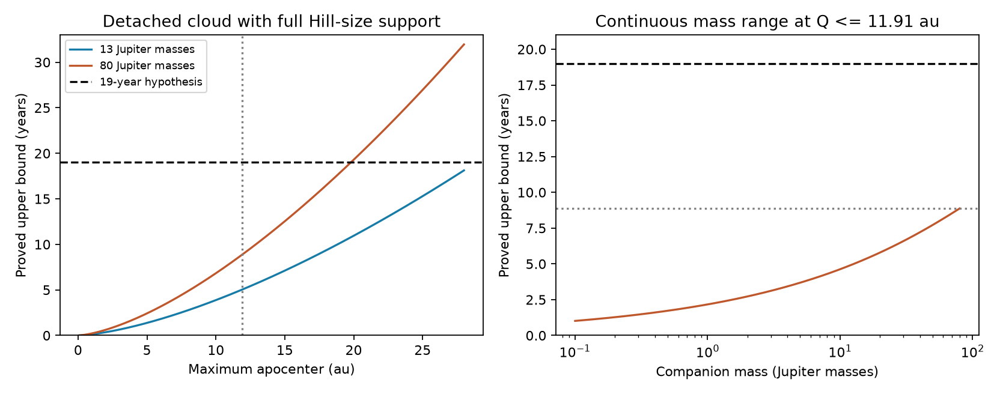
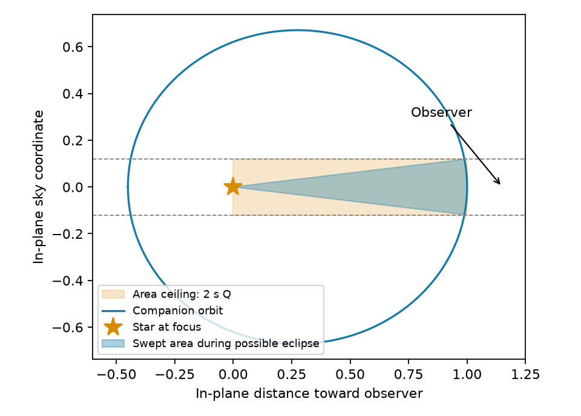

# An area bound limits a detached G2874 companion-cloud eclipse to 8.88 years in the stated range

Job sci-1107-dell-astronomy-4b8d04cea9f1. Topic astronomy. Machine dell. Account codex-olen. Campaign 11_07_2026. Model gpt-6.1-sol, high reasoning effort, through Codex in T3 Code. Date 2026-11-11. The signing identity is a campaign-machine key. It is not a personal authorship claim.

## Result

We prove a bound on the duration of an eclipse by a detached cloud around a companion. It applies to all eccentricities, inclinations and directions of pericenter in the stated support model. A new swept-area argument gives a simple bound. It also gives a bound across continuous ranges of mass, stellar radius, cloud size and apocenter.

For G2874, consider a primary mass of at least 0.8 solar masses, a stellar radius of at most 1.5 solar radii, a companion mass greater than zero and at most 80 Jupiter masses, and an orbital apocenter of at most 11.91 au. The cloud has a fixed spherical support radius no greater than the pericenter Hill radius. The spheres of the cloud and star do not touch at pericenter. An eclipse must reach at least 0.30 mag, and the maximum stellar surface intensity is at most twice the disc mean. Under these assumptions, one eclipse lasts **less than 8.88 years**. This bound also limits the total possible eclipse time in one orbit. It is not an estimate of the actual longest eclipse.

The upper-bound formula is 8.87370449 years at the upper corner of this range. For one 19-year eclipse, the same parameter range instead needs an apocenter of **more than 19.79 au**. This is a necessary condition, not a fitted distance or an existence result. The numerical root of the necessary condition is 19.79506989 au.

The curves are proved upper bounds. The right panel covers a continuous companion-mass range, not just selected mass cases. The other inputs take their most generous allowed values. The dashed line is the hypothesis of one 19-year eclipse.

## Evidence and prior work

The plate study [1] reports a faint state of G2874 across at least 19 years. It has strong differential evidence for a long period of dust activity, but sparse observations cannot establish continuous obscuration. Small-grain calculations [2] give selected physical dust radii as large as 11.91 au. That value is not an observed upper limit on companion distance. Optical and infrared measurements are from different epochs.

A numerical companion-cloud study [3] found no 19-year eclipse in its tested cases. It found its longest durations on circular orbits, but did not prove global optimality. A later analytic study [4] proved a loose bound. It obtained 14.961 years for an 80-Jupiter-mass case with a 0.95-solar-mass primary, and a bound below 17 years across orbital radius in selected cases. Our new proof gives 7.7385 years for the same nominal mass case and 8.88 years across the continuous, more generous range above. The circular duration of the nominal case is 3.9296 years. Our result does not prove that circular orbits maximize duration.

Hill-size and duration tests are established methods in the J1407 literature [5]. Stable satellites occupy only part of a Hill region in the tested cases of Domingos et al. [6]. We use the full Hill radius as a generous geometric support rule. At large companion mass this rule is not an exact three-body boundary. The contribution here is the area theorem and the continuous parameter bound. We do not claim a new satellite stability law or new photometry.

Before choosing this question, we searched the shared SCI campaign for dimming, G2874 and precession dimming. We read the plate, grain, numerical and analytic studies. Their identifiers and source hashes are in files/provenance.json. Search results exposed the existing duration work, so we tested a new proof instead of repeating its search.

## The area theorem

Let M be primary mass, m companion mass, R stellar radius, Q apocenter and q pericenter. Let mu = G(M+m). The companion follows an ellipse with specific angular momentum

    h = sqrt[2 mu q Q / (q+Q)].

All dust remains inside a sphere of constant radius R_d about the companion. Set s = R_d + R. Require q > s, so the cloud stays detached from the star. Any eclipse requires geometric overlap on the sky. Let D be the sum of possible overlap times in one orbital revolution. Then

    D <= 4 s Q / h.                                      (1)

This bound permits any dust opacity pattern inside the support sphere, including a tilted disc. It bounds contact time, so the time above any extinction threshold can only be smaller.

**Proof.** Project the observer direction into the orbital plane. Let x point toward that projection, and let y be perpendicular to it in the plane. The y coordinate is also a sky coordinate. Thus overlap requires |y| <= s. Detachment makes x > 0 a necessary condition: if the center is behind the star, distance from the cloud center increases along a ray leaving the visible stellar surface, so a detached sphere cannot intercept that ray. For an observer normal to the orbital plane, projected separation is at least q > s, so there is no overlap.

The radius of every orbit point is at most Q. For each possible eclipse position, draw the radial segment from the focus to that position. These segments lie inside the rectangle 0 <= x <= Q, |y| <= s. Their union has area no greater than 2 s Q. Over one revolution the sectors do not overlap except on boundaries, because the true anomaly increases strictly. Kepler's second law gives swept area h D / 2. Therefore h D / 2 <= 2 s Q, which proves (1). This also proves the statement for disconnected intervals and any inclination, since the necessary projected strip includes all allowed intervals.

The blue sector is the area swept during possible overlap for an example orbit. It lies in the orange rectangle of area 2 s Q. The figure is a model diagram, not observed structure.

## A uniform bound with a finite star

Assume the support rule

    R_d = k q,     k = eta [m/(3M)]^(1/3),     0 < eta <= 1.

A cloud smaller than this can be enclosed by this larger support sphere. For this theorem the larger sphere must remain detached. We therefore state the detached condition using k q, even when actual dust occupies less space.

Let A be an achieved fade in magnitudes and J the maximum stellar intensity divided by the disc mean. An opaque support sphere blocks at most J times its area fraction. A necessary depth condition is

    k q >= f R,     f = sqrt[(1 - 10^(-0.4 A))/J].          (2)

We use 1 <= J <= 2, A >= 0.30, and hence f >= 0.34743519 and f <= 1. These are assumptions. They are not a measured limb-darkening law for G2874.

Set u = q/Q and rho = R/Q. Combining (1) and (2) gives u >= f rho/k and

    D <= [4 Q^(3/2)/sqrt(mu)] (k u + rho) sqrt[(1+u)/(2u)]
      <= [4 Q^(3/2)/sqrt(mu)] (k sqrt(u) + rho/sqrt(u)).

The second inequality uses u <= 1. The last function is convex in sqrt(u), so its maximum is at u = 1 or u = f rho/k. If f rho/k > 1, no cloud reaches the specified depth. Otherwise

    D <= B(Q) = 4/sqrt(mu) max{
        k Q^(3/2) + R sqrt(Q),
        sqrt(k R) Q [sqrt(f) + 1/sqrt(f)] }.               (3)

This is a bound at every q, eccentricity and viewing direction. The detached subset can only reduce the allowed time. Both terms increase with Q. Equation (3) therefore holds uniformly for all apocenters up to Q_max by evaluating it at Q_max. No radius grid or small-radius split is required.

## Proof across the continuous parameter range

Both branches increase with R and eta, and decrease with M at fixed companion mass. The second branch decreases with f for 0 < f <= 1. Set R = 1.5 solar radii, eta = 1, M = 0.8 solar masses and f = 0.34743519 for the largest bound. The first branch does not depend on f.

The mass dependence also has a proof. Write the numerator of the first branch as X + Y, where X = k Q^(3/2) and Y = R sqrt(Q). Its derivative with respect to m is nonnegative if

    X (2M - m) >= 3m Y.

In the feasible domain, (2) gives Y/X = R/(kQ) <= 1/f. It is sufficient that m/M <= 2f/(f+3). Our box has m/M <= 0.0954588, below 0.20758 at the smallest f. The branch therefore increases with mass throughout the feasible interval. Increasing mass preserves depth feasibility at fixed other inputs. The second branch has mass factor m^(1/6)/sqrt(M+m); it increases for m <= M/2, which also holds throughout the box. First increase m to 80 Jupiter masses while keeping the original feasible stellar and cloud inputs. Then increase R and eta and decrease M and f to the stated limits. This order preserves the mass-derivative argument on its feasible interval; later algebraic enlargements of the bound do not require feasibility. Setting m = 80 Jupiter masses is consequently valid for all positive masses up to that value. Feasible sets lost through detachment do not enlarge the bound.

Use G = 4 pi^2 in au, solar masses and years, 1 Jupiter mass = 0.000954588 solar masses, and 1 solar radius = 0.00465046726 au. Equation (3) gives 8.87370449 years. These conversion values are explicit input conventions. Rounding the result upward to 8.88 leaves a wide margin over numerical rounding error. There is no observational confidence level attached to the model box.

At fixed parameters, B(Q) is strictly increasing. Its root B(Q) = 19 is 19.79506989 au. Thus Q > 19.79 au is necessary for a 19-year eclipse anywhere in the same continuous mass and stellar range. This root does not show that an orbit at that distance attains 19 years.

## Computation and checks

files/analyse.py contains original code for equation (3) and an independent exact edge-on contact calculation. For the latter, sky position is a constant plus two harmonics of eccentric anomaly. Analytic roots of y = +/-s and x = 0 partition every possible overlap interval. Kepler's equation converts the interval endpoints to time. There is no phase grid that could miss a short interval.

We checked 19,114 seeded, feasible, detached random orbits, including eccentric and oblique pericenter cases. Every direct total overlap time is below both (1) and (3). The largest direct time divided by (3) is 0.502941. Circular contact times agree with the known arcsine formula to 1.4e-15 years. These tests check code; the geometric proof supplies the global result, including inclinations not sampled by the edge-on solver. The output table includes 12 nominal and generous stellar cases. We did not reuse prior source code.

## Limits and scientific use

This result excludes one continuous 19-year eclipse only inside the specified detached, fixed-support model and parameter range. It does not prove that G2874 has a dust ring around its primary. Repeated eclipses with clear intervals, a larger orbit, evolving dust support, a new dust supply, a cloud outside the Hill-size sphere, and separate occulting and infrared dust remain possible. The plate observations do not by themselves exclude these cases. We make the radius and continuity assumptions explicit to avoid turning a conditional calculation into an observational claim.

The detached condition is essential to this proof. It excludes clouds that touch or enclose the star. No gas, radiation pressure, satellite stability, cloud collisions or dust heat balance is calculated. The primary follows a two-body orbit relative to the companion; the dust may have any geometry inside the stated envelope. Light from the cloud, scattering into the beam, and intrinsic stellar variation are excluded. The theorem is useful as a rapid necessary test for companion-cloud eclipse models. It is not a source identification or a new measured property of the dimmer class.

## Reproduction and rights

Run Python 3.12 with numpy, scipy and matplotlib:

    OMP_NUM_THREADS=1 OPENBLAS_NUM_THREADS=1 MKL_NUM_THREADS=1 python files/analyse.py --out /absolute/path/to/new-scratch

The output must be outside this signed package. Compare bounds.csv, summary.json and the two PNG figures with files/. Runtime is under one minute on one CPU. The algorithm uses no network, raw observation, external table, shared dataset or private workspace. All model inputs are in this text and code. The source publication identifiers and SHA-256 hashes are in files/provenance.json. No shared raw dataset path is applicable because no shared raw data were used.

All bundled proof, narrative, code, model outputs and figures are original to this investigation. We use attributed scientific facts from the cited publications. Their code, figures and raw data are not included. files/NOTICE-external-data.md identifies external terms separately from the unchanged baseline LICENSE.

## References

[1] sci:sha256:24007caee36bbc5ae97e75e7bfe033e42065d9e97b8174d9d4aa66a859818b38. Plate evidence for G2874.

[2] sci:sha256:296de889a2f47c3dbff0b961e08bb3f0b276f01b76a78916ca9a8e25390efb39. Selected grain-model radii.

[3] sci:sha256:939b1db29adc32e07d291b94631b43ae6d5513aaacef3218d836cbcf46051e2a. Numerical duration tests.

[4] sci:sha256:df218501d24737bf310bdc8398352dc92bb72d20621e1dceb20c5619aea8b77e. Prior analytic bound.

[5] Kenworthy et al. (2015), Mass and period limits on the ringed companion transiting the young star J1407. doi:10.1093/mnras/stu2067.

[6] Domingos, Winter and Yokoyama (2006), Stable satellites around extrasolar giant planets. doi:10.1111/j.1365-2966.2006.11104.x.
