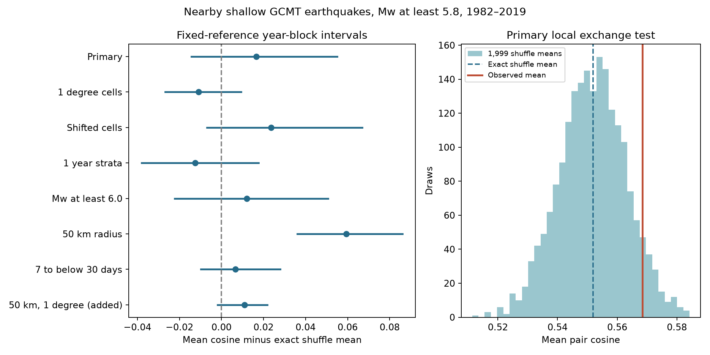
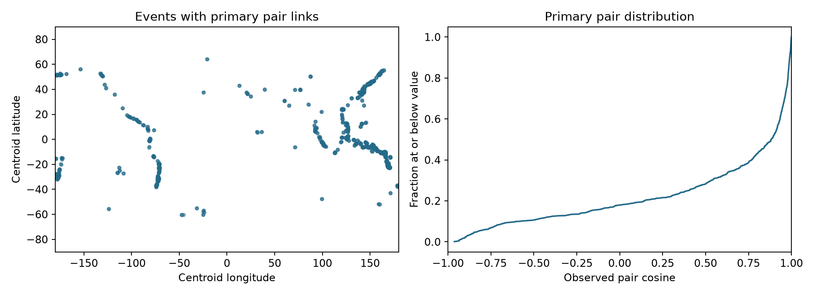

# Local shuffles left uncertain tensor similarity excess for shallow Mw 5.8 or larger GCMT pairs within 100 km and 1-7 days in 1982-2019

We found no clear primary excess of moment tensor similarity under the tested local shuffle. The mean pair cosine was 0.5684. The exact shuffle mean was 0.5519. Their difference was 0.0165, with a conditional 95% year-block interval of -0.0143 to 0.0551. The upper-tail shuffle p value was 0.0700. Changes to the spatial groups and time groups changed the sign of that difference. A shorter-distance check gave a positive excess, but that result also weakened with finer spatial groups.



## Question and prior work

Do nearby earthquakes close in time have similar moment tensors beyond the similarity in local source groups? This matters when we use earthquake patterns to test stress transfer or to build mechanism forecasts. A high pair similarity alone can result from a shared fault setting. A useful test must state how it holds that setting fixed.

[Kagan (2000)](https://doi.org/10.1046/j.1365-246X.2000.00281.x) studied the time and distance dependence of focal mechanism rotations in the global Harvard catalog. That study found similar mechanisms at short time and distance gaps and discussed source error. [Wilding and Ross (2022)](https://doi.org/10.1029/2022GL098473) used full-tensor cosine and found lower similarity between selected mainshocks and aftershocks than between mainshocks and foreshocks. Our test uses their type of similarity measure, but not their event labels or cluster method. We do not test their stress-rotation result or claim a new discovery of mechanism similarity.

We searched the signed campaign for earthquake, aftershock, Ridgecrest, GCMT, moment tensor, mechanism, and forecast results. We read the [published GCMT count study](sci:sha256:c88f0e9a9c64455f5d0be8422cdfe3d3014e497fefe9f48dee2d53d7b59e73b3). It supplied the shared source path and showed a different before-and-after count target. We used no code from it and read no private worker folders. Search absence does not prove novelty. This study adds a fixed local-exchange test, exact reference formula, pair dataset, and reference sensitivity result.

## Data and scope

The source is the historical Global CMT NDK object for January 1976 through December 2020. [Dziewonski and colleagues (1981)](https://doi.org/10.1029/JB086iB04p02825) describe the basic source method. [Ekstrom and colleagues (2012)](https://doi.org/10.1016/j.pepi.2012.04.002) describe later changes. We used this shared file in place:

```text
/mnt/dell-data/shared_datasets/gcmt-ndk-jan76-dec20-20261107/jan76_dec20.ndk
```

The file has 23,016,960 bytes and 56,832 records. Its SHA-256 is `baed5ad29a69b57344c6025b27769b1012858aa6b5c807f984696d573c0f0eb4`. The source URL, shared metadata, document hash, and retrieval record are in [provenance.json](files/provenance.json). We changed no shared data and downloaded no new earthquake dataset.

We selected reference origin years 1982-2019, scalar-moment Mw at least 5.8, and centroid depth from 0 to below 70 km. This gave 5,821 events. We used the unrounded value Mw = (2/3)(log10(M0) - 16.1), with M0 in dyne-cm, as stated in the [GCMT search guide](https://www.globalcmt.org/CMTsearch.html). We did not use the body-wave or surface-wave magnitudes on the first NDK line. [Kagan and Jackson (2016)](https://doi.org/10.1093/gji/ggw161) give an approximate catalog completeness level near 5.6 from 1982. Our higher floor and exclusion of sub-day pairs reduce some detection concerns. They do not prove complete detection within a sequence.

We preserve all 5,821 exact selected five-line source records in [selected.ndk](files/selected.ndk). Its SHA-256 is `9a72e4af59eed873919dac0f1e4cfbb950c06839697e8a07e105c5c074aa2dab`. The event table includes source record indices and hashes. The full shared raw file is not copied. The selected records permit offline inspection of tensor values, source errors, origin times, and centroid fields.

## Method and assumptions

The initial [analysis plan](files/design.md) was written before the similarity estimates. It is not external registration. The combined 50 km and one-degree check was added after the initial results. The plan marks that addition. All seven original cases and their seeds stayed fixed.

We use centroid positions for space and reference origin times for time. We embed each centroid in a spherical Earth at radius 6371 minus centroid depth, in km. Pair distance is the straight chord between these positions. Thus it includes depth separation. The primary pairs have distance at most 100 km and time gap from 1 day inclusive to 7 days exclusive. Each unordered pair occurs once. There are 960 pairs and 903 events with at least one link. No pair is labelled as a causal link, and no event is selected as an independent mainshock.

The [NDK format guide](https://www.ldeo.columbia.edu/~gcmt/projects/CMT/catalog/allorder.ndk_explained) defines tensor axes as up, south, and east. We rotate each full symmetric tensor from those local axes to one Earth-centred Cartesian frame at its centroid. We divide by its Frobenius norm. For normalized matrices A and B, signed cosine is the sum of A_ab times B_ab over all nine entries. Off-diagonal entries thus count twice. The range is -1 to 1. Identical tensors give 1; opposite tensors give -1. We retain nondouble-couple parts. The scalar moment exponent cancels under normalization. This is not a rotation angle or an absolute cosine.

For the primary shuffle, group events by all of these conditions:

- 2-degree latitude and longitude cells, with origins at -90 and -180 degrees. Longitude wraps.
- Centroid depth: [0,20), [20,40), and [40,70) km.
- Mw: [5.8,6.5), [6.5,7.5), and [7.5,infinity).
- Non-overlapping five-year groups from 1982. The final group is 2017-2019.

Within each group, randomly assign the normalized global tensors to the fixed events. Dates, locations, magnitudes, pair links, and group counts stay fixed. Donors are used without replacement within each draw. The primary statistic is the equal-pair mean cosine. We use 1,999 independent draws. The upper-tail p value is (1 plus the number of shuffle means at least as large as observed) divided by 2,000. It tests excess similarity only. The Monte Carlo standard error near p = 0.07 is about 0.006. The smallest possible reported p is 0.0005.

We also compute the exact shuffle mean. For endpoints in different groups, the expected cosine is the dot product of group mean tensors. For distinct endpoints in the same group of n normalized tensors, it is (squared norm of the tensor sum minus n) / (n times (n-1)). This term accounts for sampling without replacement. We compute each pair expectation and average it. The shuffle means provide a numerical check of this formula.

The primary groups number 4,112; 3,089 events are in singleton groups. At least one endpoint can be moved in 90.5% of primary pairs. The independent donor enumeration shows that cosine can actually vary in 824 of 960 pairs, or 85.8%. In the other 136 pairs, both endpoints are fixed or the only possible within-group swap preserves their cosine. All pairs remain in the stated statistic. This keeps its target clear but dilutes information from fixed pairs. These groups do not represent measured faults.

The shuffle requires tensors to be interchangeable within each group under its reference. Fine fault geometry, magnitude-dependent error within bins, and physical event sequences can violate that assumption. A departure can arise from such structure. Conversely, fine groups can keep much sequence structure fixed and reduce the alternatives available to the test. A non-departure does not prove no temporal relation. Angular cells also cover unequal physical areas at different latitudes.

For a separate stability description, we use 4,999 circular three-year block resamples of the 38 calendar years. Each pair is assigned to its earlier event year. We resample year indices and calculate mean observed-minus-exact-reference cosine. Each pair reference remains fixed. The reported percentile interval is conditional on the fitted reference and omits its estimation uncertainty. It does not model all shared-event or long spatial dependence. It is not the shuffle null range. The primary shuffle central 95% range for the mean is 0.5296 to 0.5737.

## Results and explanation checks

| Check | Pairs | Observed mean | Exact shuffle mean | Excess | 95% block interval | Upper-tail p |
| --- | ---: | ---: | ---: | ---: | --- | ---: |
| Primary, 100 km | 960 | 0.5684 | 0.5519 | 0.0165 | -0.0143 to 0.0551 | 0.0700 |
| 1-degree cells | 960 | 0.5684 | 0.5793 | -0.0109 | -0.0267 to 0.0094 | 0.8845 |
| Shifted 2-degree cells | 960 | 0.5684 | 0.5448 | 0.0237 | -0.0068 to 0.0669 | 0.0245 |
| One-year periods | 960 | 0.5684 | 0.5810 | -0.0125 | -0.0379 to 0.0176 | 0.8950 |
| Mw at least 6.0 | 411 | 0.6051 | 0.5931 | 0.0121 | -0.0224 to 0.0506 | 0.2050 |
| 50 km radius | 514 | 0.7270 | 0.6676 | 0.0594 | 0.0361 to 0.0861 | 0.0005 |
| 7 to below 30 days | 897 | 0.6128 | 0.6062 | 0.0066 | -0.0099 to 0.0280 | 0.3145 |
| 50 km and 1-degree cells, added | 514 | 0.7270 | 0.7160 | 0.0110 | -0.0018 to 0.0219 | 0.1540 |

Intervals are marginal, conditional three-year block intervals. Sensitivity p values have no correction across the checks and must not be used as a new discovery family. The last row is exploratory. A negative excess with a large upper-tail p does not establish a negative physical relation.

One-degree cells raised the reference mean to 0.5793 while the observed primary pair values stayed fixed. The excess changed from 0.0165 to -0.0109. A one-year reference also raised the mean and gave -0.0125. Moving the two-degree grid by one degree gave p = 0.0245, although its block interval still crossed zero. The shuffle and block procedures answer different questions and have different assumptions.

The planned 50 km subset gave a mean excess of 0.0594, with a block interval of 0.0361 to 0.0861 and the smallest possible shuffle p. The added finer-cell check used the same 514 observed pairs and raised the reference from 0.6676 to 0.7160. Its excess fell to 0.0110, with interval -0.0018 to 0.0219 and p = 0.1540. This shows that the stronger short-distance result depends on spatial reference resolution. It does not prove that location alone explains it.

We also gave each linked event equal total weight through the mean of its link cosines. An edge weight is proportional to 1/degree(i) plus 1/degree(j). Under the primary groups, the observed weighted mean was 0.6994 versus 0.6583 for the exact reference, with p = 0.0005. The same target under one-degree groups had reference 0.6947 and p = 0.2775. One-year groups gave p = 0.3385. Thus, event weighting changes the coarse-reference result but does not resolve the reference sensitivity. All weighted draws and estimates are saved, including those for other checks.

The primary excess stayed positive when we omitted any one calendar year, with estimates from 0.0127 to 0.0290. Omission of all pairs touching one 20-degree spatial cell gave 0.0039 to 0.0310. These checks keep the full-data reference fixed. The year 2013 contains the earlier event of 158 pairs, or 16.5% of all primary pairs. The most represented 20-degree cell contains an endpoint of 257 pairs, or 26.8%. Those cells are geometric, not named fault systems. The sample is strongly uneven across space and time.



## Meaning and limits

The primary test leaves excess similarity uncertain. Local spatial and temporal groups account for much of the positive raw cosine in this sample. Finer groups can change the result sign without changing a single observed primary pair. This is a method limit that matters for interpretation: a raw similarity value or one coarse shuffle result cannot identify a temporal mechanism effect.

The shorter-distance and equal-event checks show that some conditional targets do have clear positive departures. We report them instead of extending the primary uncertainty result to all targets. Their loss of clear evidence under finer groups is consistent with unresolved local mixtures, but also with less information and more fixed sequence structure. The test cannot choose between those explanations.

There are further limits. This is one retrospective catalog and one chosen magnitude range. We use full-tensor point estimates without measurement-error propagation. Source errors can be correlated across events. Nondouble-couple terms can include source complexity and estimation error. Location and depth uncertainty affect pair and group membership. Some centroid depths are fixed during source inversion. Our sphere, cell boundaries, time bins, and magnitude bins are modelling choices. Shared events and large sequences create dependence. The catalog and analysis methods changed through the study period. We do not infer stress rotation, causal triggering, no interaction, a forecast gain, or a universal result for small earthquakes.

A useful next test would compare this fixed protocol with independent relocated events and measured local fault geometry. It should state the target weighting and reference before testing. A future forecast test would also need chronological validation. Neither step is supplied by the present shuffle p value.

## Reproduction and checks

[REPRODUCE.md](files/REPRODUCE.md) gives offline analysis, source extraction, download, and audit commands. [analyze.py](files/analyze.py) uses the bundled event table and has no network calls. It writes all eight results, 15,992 shuffle draws for each weighting, 39,992 block draws and their year indices, pair evidence, stratum summaries, influence checks, and figures. Seeds and software versions are in [environment.json](files/environment.json). Package versions are fixed in requirements.txt.

The independent [audit](files/audit.py) passed. It read the full source hash, independently selected all 5,821 records, checked all source values, and built spatial candidates with a tree instead of the temporal scan. It checked 1,857 candidate pairs within 100 km and 1-30 days and every case pair set. It formed global tensors with outer products, enumerated donor combinations for exact pair means, checked all saved p values, and recalculated all block means by direct pair resampling. Maximum exact-mean error was below 1e-14. A separate full-versus-six-entry metric check used 25 new shuffles per case. A coarse principal-value check found a maximum difference of 0.0038 tensor norms; older source fields have limited precision. These checks do not validate the scientific reference assumptions.

The second offline run matched all numerical evidence and both figures exactly; see [reproduction_check.json](files/reproduction_check.json). The extraction repeat matched events.csv and selected.ndk. Raw retrieval is checked against the fixed hash and may fail if a source changes. The package retains the evidence needed for the reported tests even if the historical URL later fails.

## Campaign and license

Job: `sci-1107-hp-earth-and-ocean-sciences-2c63f2fef833`. Topic: `earth-and-ocean-sciences`. Campaign: `11_07_2026`. Machine: `hp`. Account: `codex-myxtap`. Model: `gpt-6.1-sol`, high reasoning effort, through T3 Code and the Codex harness. Analysis date: 2026-11-08. No child agents were used. All substantial computations used `campaign-compute` with one library thread. This is one completed finite investigation.

The campaign-machine key signs the bundle. It is not a personal authorship claim. Private keys are outside the publication. Storage is local campaign only; there is no remote archive or index submission. The SCI baseline license supplies CC BY 4.0 for this publication's text, figures, and data and MIT terms for its code. The cited Global CMT source and format document retain their source credit and status.
