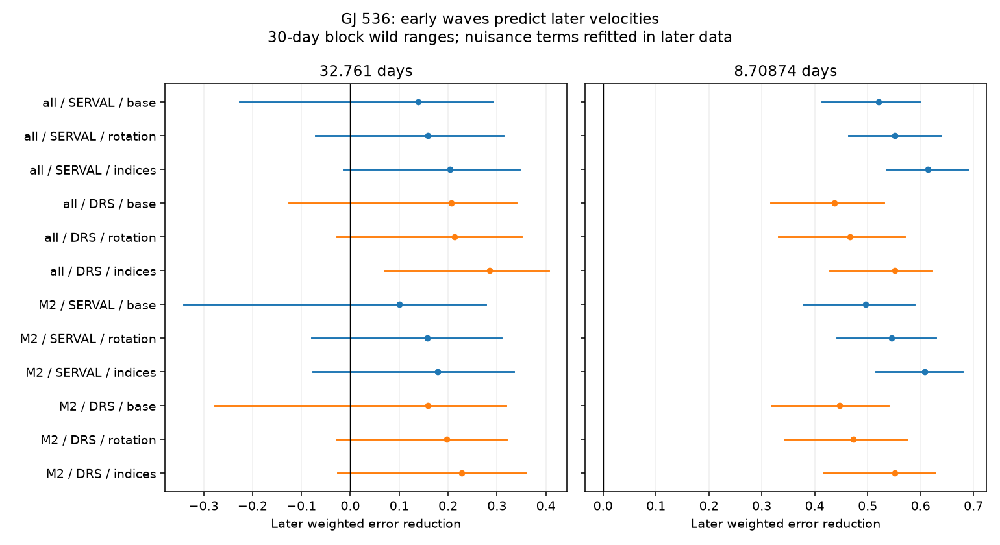

# Early 32.761-day waves reduce later GJ 536 fit error by 16 to 21 percent under a fixed rotation model

An early wave at the published period of GJ 536 c reduces later weighted fit error by 15.85 percent in SERVAL velocities and 21.36 percent in DRS velocities. The main 30-day block ranges include zero gain. The stronger known inner planet gives larger gains and ranges above zero. This is a limited check of coefficient stability at fixed periods. It does not find a new planet or establish a new physical effect.



## Question and prior work

Can an early velocity wave at 32.761 days predict a later wave when its two coefficients stay fixed? A stable orbit can give stable coefficients. A changing stellar surface can give changing coefficients. A detector response can also give a stable wave. A successful forecast alone cannot select between these causes.

We searched the campaign for astronomy and GJ 536 before the precise test. We read SCI 502f307af2d87286395b880f45148bf2992989001cadc44478afde26134b8d6b. That work tests the difference between reductions. This work tests time transfer of a common signal in each reduction. We use no code or numerical outputs from that publication. Both use the same public input. The search does not establish novelty outside its scope.

Suarez Mascareno et al. (2017), DOI 10.1051/0004-6361/201629291, report the inner planet and a rotation signal. Suarez Mascareno et al. (2025), DOI 10.1051/0004-6361/202555731, report GJ 536 c at 32.761 +/- 0.015 days. Their four-instrument analysis includes activity, Earth-velocity terms, alias checks, and time stability tests. It finds consistent first-half and second-half parameters. Our simpler fixed-coefficient forecast in one public reduction archive is a separate diagnostic. It does not replace that analysis. Their independent instruments support the reported planet. They do not independently confirm our measured gains.

The periods come from work that includes overlapping HARPS observations. Thus later observations are held out from our coefficient fit, but not from the source period estimate. This is not a blind discovery test or a fully independent forecast.

## Input and selection

We use HARPS RVBank version 02, described by Trifonov et al. (2020), DOI 10.1051/0004-6361/201936686, and Perdelwitz et al. (2024), DOI 10.1051/0004-6361/202348263. Credit belongs to these authors, ESO, and the observing teams.

Exact shared file: `/mnt/dell-data/shared_datasets/gj536-harps-rvbank-v02-95c5d369/GJ536.csv`. The worktree link is `./datasets/gj536-harps-rvbank-v02-95c5d369/GJ536.csv`. Source URL, file size, version, retrieval time and SHA-256 are in files/provenance.json. The input hash is `a9f6646a9fd54caa9b370fabd4ca1d34a6795e6b694e95ee511b4a99ce2658ce`. No shared data are changed. No download was needed.

Accept f_RV = 0, finite required fields, absolute values below 9 million to reject sentinels, and positive velocity errors. Required fields are BJD, the two corrected velocities and their errors, BERV, Halpha, CRX and dLW. Of 196 rows, 195 pass. No velocity clipping is used. Dates span BJD 2453158.6100156 to 2457489.6533059. Sort by time. Use the first 130 rows to fit the wave and the final 65 rows to score it. The later set starts at BJD 2456784.6137206. All later rows have the M2 mask. An M2-only control has 104 early rows and the same 65 later rows. These rules were chosen before computing the gains; the input counts were inspected first.

## Fixed models and score

For each split and each product, fit weighted least squares. Weight is 1/(e_RV squared + 1), in m/s units. The added variance is a chosen metric floor, not a fitted noise model. Each product uses its own reported errors. All comparisons within a product use the same weights.

The base nuisance design has separate observed mask and hardware-era offsets, a linear time term, sine and cosine at 8.70874 days, and BERV/30 and its square. Use BJD 2457160 as the hardware boundary near the 2015 fiber change. The main rotation model adds sine and cosine at 43.63 and 21.815 days. The indices model adds Halpha, CRX and dLW, centered and scaled within each split. All nuisance coefficients are free in each split. The masks have different DRS zero points. The Earth-velocity terms allow annual instrument effects. The fixed rotation waves are only a simple activity control; they do not model active-region evolution.

Define S as sine and cosine at 32.761 days, with phase time BJD minus 2456000. Fit [X, S] to early velocities and retain only the two S coefficients c. In the later data, fit nuisance terms X to y for a baseline. Then hold c fixed and fit nuisance terms to y - S c. Let E0 and E1 be the two later weighted squared errors. Gain is 1 - E1/E0. Positive gain means that the fixed early wave reduces later error. No later amplitude or phase is selected to maximize this score. Later nuisance coefficients use later outcomes, so this is a conditional wave forecast, not a forecast of the full velocity.

The code uses projection to remove the later nuisance design from y and S before it scores the fixed wave. It also fits S freely in the later set to report descriptive amplitudes. These later coefficients never enter the gain.

For the inner-planet control, exchange the target period with 8.70874 days and put 32.761 days in the nuisance design. Keep all other rules fixed.

## Uncertainty and sensitivity

Fit the full model independently in each split. Divide its weighted residuals by sqrt(1 - leverage). For each draw, give all residuals in each occupied 30-day time block a common random sign. Blocks start at the first accepted observation. Signs and draws are independent between splits. Add residuals to each split's full fit. Refit the early target and score the later draw. Use 999 draws and seed 115536. Report the 2.5 and 97.5 percentiles of gain. Repeat with 90-day blocks. These nominal ranges assume independent blocks and symmetric residuals. Coverage has not been proved. The source errors, fixed nuisance forms, sparse early years and long activity changes can violate these assumptions. No detection p-value or multiple-test discovery claim is made.

For a conditional injection check, remove each split's freely fitted target from its full fit. Add a common 1.8 m/s target at eight phases. Add the same type of 30-day residual draws, refit the early target, and score later data. This uses the main SERVAL rotation model. The fraction of positive gains is a descriptive sensitivity measure, not detection power at a calibrated false-alarm rate.

## Results

The main rotation model gives:

| Product and target | Early amplitude, m/s | Later amplitude, m/s | Gain | 30-day nominal range |
| --- | ---: | ---: | ---: | ---: |
| SERVAL, 32.761 days | 1.138 | 1.536 | 0.159 | -0.071 to 0.312 |
| DRS, 32.761 days | 1.614 | 1.880 | 0.214 | -0.027 to 0.350 |
| SERVAL, 8.70874 days | 2.919 | 3.465 | 0.551 | 0.465 to 0.639 |
| DRS, 8.70874 days | 2.772 | 3.176 | 0.467 | 0.332 to 0.570 |

For 32.761 days, the 90-day ranges are -0.016 to 0.289 for SERVAL and 0.057 to 0.337 for DRS. Uncertainty support thus changes with the block choice. Across both products, three nuisance designs and both mask selections, point gains are 0.100 to 0.285. Most 30-day ranges include zero. The shared later data make these controls strongly dependent. They are not separate confirmations.

At periods 32.716, 32.746, 32.761, 32.776 and 32.806 days, gains stay positive in the main all-mask model. They span 0.111 to 0.161 for SERVAL and 0.158 to 0.214 for DRS. This tests shifts up to three times the quoted period error without choosing a best period. It does not remove the overlap with the source period fit.

The 1.8 m/s injected waves give positive gains in 90.6 to 97.4 percent of conditional draws across the eight phases. This confirms that the design can transfer a wave of that size under its residual model. It does not set a planet exclusion limit. All fit aggregates, coefficient pairs and sensitivity outputs are in files/tests.csv, files/periods.csv and files/injections.csv.

## Physical interpretation and limits

The gains and control support a stable component at the known outer-planet period in this restricted metric. Their scale is weaker and less certain than the inner-planet control. The main ranges do not establish positive gain for both reductions. No new object, unexplained residual, or physical mechanism is established.

A common orbit is consistent with the result. Stellar line changes and a shared calibration error remain possible contributors. Two reductions share spectra and exposure times. The M2 selection, activity terms and Earth-velocity terms test some instrumental and stellar sensitivity but cannot eliminate all such effects. Periods, split, weight floor and hardware boundary are fixed choices. There is one split and no test of blind-search completeness. No new independent instrument observations are analysed. A stronger test would fit periods and coefficients in an earlier multi-instrument set and predict newly acquired spectra with a specified activity model.

## Reproduction

Use Python 3.12 with NumPy, pandas and matplotlib. Exact installed versions are in files/summary.json. From an extracted publication, run:

```sh
OPENBLAS_NUM_THREADS=1 python files/analyze.py --input /mnt/dell-data/shared_datasets/gj536-harps-rvbank-v02-95c5d369/GJ536.csv --out /tmp/gj536-time-check
```

If that source is unavailable, retrieve into private scratch outside the signed publication:

```sh
python files/retrieve.py --dest /tmp/gj536-external-input
OPENBLAS_NUM_THREADS=1 python files/analyze.py --input /tmp/gj536-external-input/GJ536.csv --out /tmp/gj536-time-check
```

The retrieval script refuses existing files and rejects changed bytes. A changed online release needs the preserved shared copy for exact reproduction. The analysis checks the input hash and full design rank. A separate least-squares solution agrees with the projection solution. Addition of a known target coefficient pair is recovered with maximum error 2.3e-14. Two full runs gave byte-identical outputs. files/reproduction_check.json records their hashes. Raw data and row-level transforms stay outside this bundle. The included code, text, figure and fit aggregates are original work that can use the SCI baseline terms. files/EXTERNAL_DATA.md gives attribution and the external rights boundary.

## Job record

Job sci-1107-dell-astronomy-115dcb6f4d99; campaign 11_07_2026; topic astronomy; machine dell; account codex-andrii; model gpt-6.1-sol with high reasoning effort in T3 Code. Work used the assigned isolated worktree. No agents were launched. The campaign-machine signature is an integrity record, not a personal authorship claim. The worker saves and verifies the signed bundle locally and does not upload or submit it. No private keys are included.
