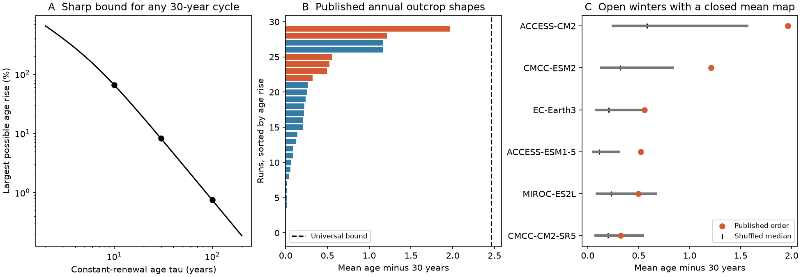

# A repeating 30-year renewal cycle raises mean water age by at most 8.20 percent when mean renewal time is 30 years

Job: sci-1107-dell-earth-and-ocean-sciences-04a037252975. Topic: earth-and-ocean-sciences. Campaign: 11_07_2026. Machine: dell. Account: codex-olen. Model: gpt-6.1-sol, high reasoning effort, Codex harness in T3 Code. Date: 2026-11-11. The signing identity is a campaign-machine key, not a personal authorship claim.

## Result

In a well-mixed renewal box, constant renewal gives the smallest cycle-mean water age at a fixed mean renewal rate. We prove a sharp upper bound for any nonnegative periodic renewal rate. If its period is T and its mean rate is 1/tau, the periodic mean age satisfies

    tau <= mean age <= (T/2) coth[T/(2 tau)].

A constant rate gives the lower limit. A single pulse per cycle, with duration that tends to zero, approaches the upper limit. Thus, even complete gaps between pulses cannot give an arbitrary increase in mean age at fixed mean renewal rate and fixed period. This result concerns cycle means, not age at one time.

For a 30-year cycle, the maximum age increase is 65.72% at tau=10 years, 8.20% at tau=30 years, and 0.75% at tau=100 years. The effect becomes small when mean renewal time is long relative to the cycle. This is a conditional result for a simple model, not a measured ocean-age limit.

We apply the bound to the shape of annual winter outcrop area in the published CMIP6 historical aggregates for 1985-2014. Each run is normalized to the same mean renewal rate, so this test isolates temporal variation from differences in mean area. For cumulative outcrop area at or above sigma0 26.5, 30 of 40 accepted runs have some positive area. At tau=30 years, their median mean-age increase is 0.175 years (0.583%); the largest is 1.964 years (6.546%, ACCESS-CM2). In the six runs with a closed mean winter map but open individual winters, mean ages range from 30.323 to 31.964 years. Occasional contact and substantial renewal are different claims: area alone does not set tau.

Figure: A shows the sharp relative upper bound for a 30-year cycle. B shows exact periodic age increases for 30 published cumulative-area histories at tau=30 years. Orange marks six runs with zero outcrop in the mean winter map. The dashed line is the universal bound. C compares these six histories with 1,000 random permutations of their own annual areas. Grey lines span the central 95% of the permuted ages. These are ordering experiments, not confidence intervals.

## Question and prior work

The campaign relates North Pacific oxygen loss on sigma0 26.5 to a smaller winter outcrop. Mecking and Drushka (2024, doi:10.5194/bg-21-1117-2024) linked upstream outcrop changes to downstream oxygen. Campaign publication sci:f2580a7a compared mean-map outcrops and interior properties in 40 CMIP6 runs. Publication sci:87a14fca then found six runs with closed mean maps but open individual winters. That study correctly stated that surface contact does not establish renewed volume.

We ask what intermittency alone can do once mean renewal rate is fixed. This extends the temporal-operator audit into a renewal-age test. The main contribution is a sharp conditional bound plus its application to published annual histories. General ocean age and ventilation distributions have a long history; see Primeau and Holzer (2006, doi:10.1175/JPO2919.1). We do not claim to introduce age-distribution theory or to prove that this scalar model describes North Pacific flow. Campaign searches for outcrop and intermittency renewal age preceded this choice. This investigation is exploratory and was not registered in advance. An initial possible ALOHA timing test was dropped because the source study already did it.

## Model and proof

New water has age zero. A well-mixed box has mean age a(t), with

    da/dt = 1 - h(t) a(t).

The hazard h is nonnegative and periodic. Its integral over T years is H=T/tau>0. In the unique periodic state, age is the integral of survival over all prior durations. Split each duration into complete cycles and a remainder u. The cycle-average survival for the remainder has a lower bound from Jensen's inequality and an upper bound from the chord of exp(-x) on [0,H]. Integrating these two bounds gives the stated result. files/PROOF.md gives the full derivation, equality cases, finite-memory caveat and exact annual solver.

Under constant oxygen use J and zero AOU in renewed water, AOU=J*a in this model. The age bound then also bounds mean AOU. We do not select J or use this relation to attribute observed oxygen loss. Changes in respiration, saturation, circulation or source age need further terms.

## Data and method

Inputs are two unchanged aggregate CSV entries in the verified baseline SCI publication sci:sha256:f2580a7a9707b955afb41852fae4c8e54807eaf63b6f3f6e605071200ca9f13f: files/results/model_outcrop_annual.csv and files/results/model_table.csv. Exact ZIP and entry hashes and the resolved shared campaign path are in files/provenance.json. No shared raw dataset is read. Upstream model versions, raw chunk hashes, masks and regeneration code remain in that publication.

We retain the source's 40 accepted models and omit its excluded NESM3 and MCM-UA-1-0, even though some annual rows exist for excluded models. Each retained record has exactly the 30 years 1985-2014. We use both cumulative area >=26.5 and band area 26.4-26.7, from the source open North Pacific mask. Areas are in 10^12 square metres. The source defines winter density as the maximum of January-April monthly sigma0. These are outcrop proxies, not measured subduction fluxes.

For each positive-area history, set h(year)=area(year)/mean(area)/tau. Test tau=10,30,100 years without fitting. Repeat the observed 30-year sequence forever. Solve the piecewise constant age equation exactly in its periodic state, with continuous age growth through each year. Integrate age over the entire cycle, rather than averaging year-end samples. A zero-area history cannot be normalized and has no finite periodic age under an area-only renewal law. Such histories are listed separately; no epsilon is added to create renewal.

For each history, 1,000 permutations retain the annual areas but change their order. Their age range tests clustering at a fixed area distribution and mean hazard. The permutations do not represent random ocean realizations and give no causal P value. Seed: 110704. We run no model selection, fit to oxygen or significance test.

## Numerical results

| Area metric | Positive runs | tau (years) | Median extra age (years) | Largest extra age (years) | Sharp upper limit (years) |
|---|---:|---:|---:|---:|---:|
| >=26.5 | 30 | 10 | 0.469 | 5.243 | 6.572 |
| >=26.5 | 30 | 30 | 0.175 | 1.964 | 2.459 |
| >=26.5 | 30 | 100 | 0.053 | 0.598 | 0.749 |
| 26.4-26.7 | 32 | 10 | 0.267 | 6.141 | 6.572 |
| 26.4-26.7 | 32 | 30 | 0.101 | 2.298 | 2.459 |
| 26.4-26.7 | 32 | 100 | 0.031 | 0.700 | 0.749 |

The largest band effect is in INM-CM5-0 for all three tau choices. The largest cumulative effect is in ACCESS-CM2. At tau=30, the median difference between the published cumulative-area order and each run's shuffled median is +0.080 years; the largest absolute difference is 1.383 years. Thus clustering matters in some runs but changes little at the median. These are deterministic calculations on published processed areas. No observation-error or model-error interval is implied.

All 2,000 random nonnegative hazard histories used in numerical checks satisfy the bounds. Constant-hazard cases match tau. Cycle rotation and reversal preserve mean age. Narrow-pulse sequences approach the sharp upper bound. Twelve separate adaptive ODE integrations check the closed-form solver to within 1e-7 years (files/audit.py). These checks support the implementation; the proof establishes the continuous result.

## Meaning and limitations

Intermittency gives a positive age correction under the specified renewal law. Its maximum size depends on the period relative to the renewal time, not on a mean-map opening classification. With slow renewal and short repeating gaps, mean area can summarize cycle-mean age well even when a mean density map gives the wrong contact classification. At fast renewal, a pulse history can differ greatly from its constant-rate counterpart.

This does not show that real model age is set by the tested outcrop. Each run is assigned the same tau by normalization. Small outcrops can correspond to a very small actual renewal rate; normalization cannot establish that rate. No CMIP6 ideal-age or oxygen field is used to validate the scalar model. Model-family dependence is irrelevant to the algebra but prevents treating the 40 runs as independent evidence about nature.

The repeated 30-year cycle is a strong assumption. With tau=30, 36.79% of an initial-age difference remains after one cycle; with tau=100, 74.08% remains. A finite 30-year history without a bound on initial age therefore gives no finite upper age bound. Longer gaps, secular outcrop loss, delayed renewal, mixing of several sources, an aged source, changing volume and spatial pathways fall outside the theorem. We cannot infer actual present age, a deoxygenation share, or future oxygen from these conditional age increases. The normalization and repetition remove the long-term trend that motivates the wider research objective. They are useful to isolate intermittency, not to simulate that trend.

## Reproduce and inspect

From an unpacked publication, use Python 3.12 with numpy, pandas, scipy and matplotlib. The exact analysis versions are in files/provenance.json. Supply the campaign directory containing the cited source ZIP and a separate output directory:

    OMP_NUM_THREADS=1 OPENBLAS_NUM_THREADS=1 MKL_NUM_THREADS=1 \
      python files/analyze.py /path/to/campaign /tmp/renewal-check
    python files/audit.py

The script runs sci verify on the input ZIP before reading it. It regenerates the result CSV, summary JSON, figure, source hashes and mathematical checks in the external output directory. Do not use the signed publication as output. Compare numerical outputs; provenance paths and runtime versions can differ. No download is required. Raw-field regeneration, if desired, follows the code in the cited source publication.

The package contains all new code, the proof, the derived results, the figure and provenance. Attribution and upstream data terms are in files/NOTICE.md. The exact SCI baseline LICENSE applies. No external raw data or restricted record-level database is bundled.
