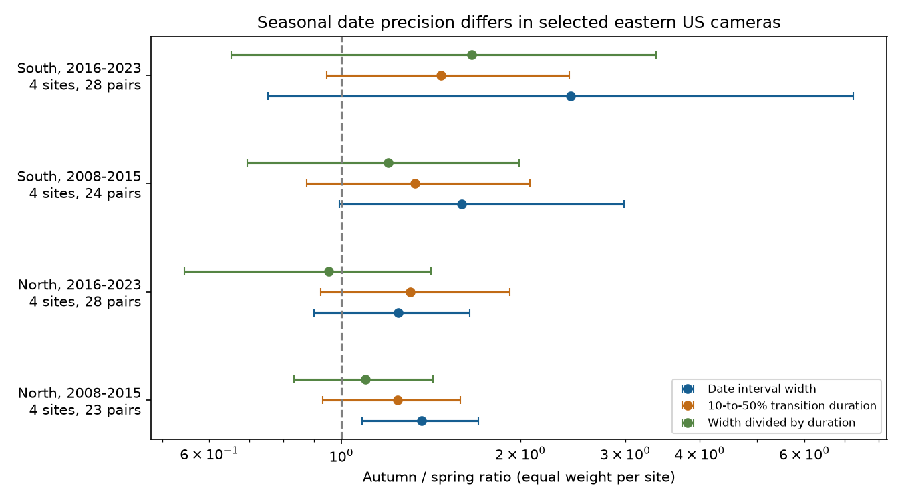

# Autumn date intervals were wider on average in four selected eastern US camera samples in 2008-2023

We tested whether autumn canopy dates have wider source uncertainty intervals than spring dates at the same cameras. The mean ratios were above one in all four samples. Only the early northern sample had an adjusted bootstrap interval above one. Thus the data show a repeated descriptive difference, but do not establish a common population effect across both regions and periods.

## Question and use

Can unequal date precision affect comparisons of spring and autumn climate responses? Climate can alter the timing of food and habitat. Tests of these changes often compare estimated canopy dates. A fixed camera removes changes in human visit effort, but it does not remove error in dates estimated from a greenness curve. Unequal date error can affect power and the uncertainty of a fitted climate slope. It does not by itself prove bias in that slope.

The PhenoCam V3 data paper by Young and colleagues (2025; doi:10.5194/essd-17-6531-2025) describes the release. Richardson and colleagues (2018; doi:10.1038/sdata.2018.28) describe date extraction from greenness curves and its uncertainty. The latter method uses uncertainty around a fitted curve and the nearby observations to estimate date limits. A slow curve can have less precise threshold dates. Our result is an audit of these estimates, not a new test of their coverage against true leaf dates.

We searched the campaign for “phenology climate pollution”, “cherry” and “PhenoCam” before selecting the precise question. We read the published spring date-bound study (sha256:cdd9d28ca4016f959323d8868ac68d4d765468ba5588fe29d7cad4026aed7505) and the autumn warmth and rain study (sha256:0299aeb5a247814099b96badce2e2c5991962ff189fabe495bc0a91db622b50f). Both use some of the same public source data. Neither asks this paired seasonal precision question. We claim no independent validation of those source records. We used new analysis code and did not reuse their code or record tables.

This is an exploratory study. files/analysis_plan.txt records the choices before the new width results. It is not a registered protocol. The first parser run failed because autumn limit labels can be in reverse calendar order. We sorted the two date limits. A second implementation error used a table method in place of the product column; it also produced no estimates. Both errors were fixed before the reported fits. No region or period choices changed in response to estimated effects.

## Data and fixed sample

The source is Zimmerman and colleagues (2025), PhenoCam Dataset V3.0, doi:10.3334/ORNLDAAC/2389. We reused existing by-ROI ZIP archives, processed in May 2024, in the shared store. We downloaded no new source data. The store contains 55 available DB (deciduous broadleaf) ROI 1000 archives within 35-50 N and 95-65 W. This is an available-data frame, not a complete inventory of all V3 cameras.

The primary measure uses data record 5, GCC90, the one-day product, and 50 percent of seasonal greenness amplitude. A rising date must be in day 60-180. A falling date must be in day 200-365. Both must be in 2008-2023. We keep a direction only if it has exactly one candidate event in its window for that year. We sort the two source date limits in calendar order. The point date must lie between them, and the width must be positive. We impose no upper width limit. Invalid or absent intervals do not enter. The width is the number of elapsed days between the limits, not the count of inclusive calendar dates. These are source model uncertainty intervals, not known bounds on true biological dates.

We pair spring and autumn from the same camera-year. A site must have at least four pairs in each of 2008-2015 and 2016-2023. This leaves eight sites and 103 pairs. North means latitude at least 42 N: Harvard, Proctor, Reading MA and Willow Creek. South means below 42 N: Cary Institute, Morgan Monroe, North Attleboro MA and Shenandoah. The names identify camera views, not distinct species samples. The same four sites occur in both periods of each region. Regions contain disjoint sites and periods contain disjoint years. Shared regional weather, instruments and processing prevent full independence.

Of 64 fixed-site calendar slots per region across both periods, the North supplies 51 pairs and the South supplies 52. Early North has 9 absent pairs out of 32 slots, late North has 4, early South has 8 and late South has 4. Some slots can precede camera operation. These counts are not failed field visits. No early southern pair occurs in 2008, so that sample has seven distinct years. We do not model the cause of missing pairs. Selection of long records and complete pairs can change results.

All source archive URLs, ZIP hashes and used member hashes are in files/provenance.json. Each recorded path datasets/NAME/data.zip maps to the exact shared path /mnt/dell-data/shared_datasets/NAME/data.zip. The path uses the campaign compatibility mount on HP SSD. Metadata and transition members from all 55 archives support screening. The statistical sample uses eight of them. No failed HDD path was read.

## Estimation

For each paired year, let Ws and Wa be spring and autumn interval widths in days. We compute log(Wa/Ws), average it across the observed years within each site and period, then average the four site means. The exponential of this value is the equal-site geometric width ratio. A site with more accepted years receives no extra total weight. A ratio above one means wider autumn intervals on this scale. We also report the equal-site arithmetic mean of Wa-Ws.

We draw sites with replacement and draw years with replacement, independently within each sample. The drawn site and year indices select a crossed table, with missing cells retained. We average the sampled valid years within each drawn site and then average sites. We reject a draw if any drawn site has no valid drawn year. We attempt 20,000 draws per comparison with seed 11072026. The primary fits retain 19,923-19,997 draws. We use percentiles 0.625 and 99.375. These give 98.75 percent marginal intervals, intended for a Bonferroni correction across the four primary tests. Their coverage is approximate. Four sites and seven or eight years give weak support for inference from resampling. We do not treat 103 camera-years as independent observations. This bootstrap does not preserve serial dependence across adjacent years or dependence between nearby sites.

We check a 25 percent threshold, the three-day product and removal of the pair with the largest width in each site-period. Sensitivity records must also occur in the primary paired frame. Each set of four intervals uses the same percentile levels; these extra checks do not form a single corrected confirmatory family with the primary tests.

A possible explanation is slow autumn change in greenness. For each source row we measure the elapsed time between its 10 and 50 percent dates, using a positive absolute duration D. We compare Da/Ds and (Wa/Da)/(Ws/Ds) using the same equal-site log method. Duration is a finite part of the fitted seasonal curve, not the local derivative exactly at 50 percent. The width and duration share a fitted curve. Thus their ratio is an algorithm diagnostic, not an independent test of a causal mechanism.

## Results

| Region | Period | Pairs | Width ratio | Adjusted interval | Mean width difference, days |
| --- | --- | ---: | ---: | --- | ---: |
| North | 2008-2015 | 23 | 1.365 | 1.085 to 1.700 | 0.929 |
| North | 2016-2023 | 28 | 1.246 | 0.900 to 1.644 | 0.625 |
| South | 2008-2015 | 24 | 1.595 | 0.994 to 2.985 | 1.720 |
| South | 2016-2023 | 28 | 2.431 | 0.753 to 7.255 | 8.627 |

The four width ratios range from 1.25 to 2.43. Only early North has an adjusted interval wholly above one. The lower limit for early South is 0.994, so rounding it to one must not turn it into a clear result. Late South has a wide interval and a mean day difference affected by long autumn intervals. The pooled medians are spring/autumn 3/3 days in early North, 2.5/3 in late North, 3/4 in early South, and 3/4 in late South. The average ratio and pooled medians summarize different aspects of the data.

Fifteen of the sixteen site-period mean log ratios are positive. Removing any one site leaves ratios above one in all four samples. The leave-one-site-out ranges are 1.285-1.416 and 1.178-1.341 in North, and 1.431-1.702 and 1.756-3.231 in South. This is a stability check for these records, not a confidence interval.

Removing each site-period's largest-width pair gives ratios of 1.34, 1.21, 1.69 and 1.94, in the same order. Three-day ratios are 1.43, 1.39, 1.80 and 2.44. The 25 percent ratios are 1.27, 1.57, 1.09 and 1.47. Thus the primary direction survives these checks, but its size depends on the threshold and sample.

The autumn-to-spring transition duration ratios are 1.24, 1.31, 1.33 and 1.47. After division by duration, the width ratios are 1.10, 0.95, 1.20 and 1.65. All four adjusted intervals include one for both duration and normalized width. These results are consistent with some role for slower autumn change, but do not establish it. Other explanations include different curve noise, view changes, illumination, gaps and the source algorithm. We do not infer an amount of explained causal variation.

files/results.csv gives all 24 aggregate estimates. files/audit.csv gives slot counts, site sign counts and leave-one-site-out ranges. files/numerical_checks.json checks the geometric mean formula with a separate direct product calculation. files/checks.json records the fixed sites, input frame, versions and sorting count. The selected source records include 428 reversed-limit rows across both products and thresholds, not 428 independent events.

## Scope and limits

This result gives a useful check for climate and ecological timing work: retain source date intervals and compare their precision by season before comparing climate slopes. Fitting a point date alone hides unequal precision. A fixed width cap can also remove autumn records more often, which can alter the sample. We did not test that removal mechanism here. We did not estimate corrected climate slopes or demonstrate bias in any published slope.

Canopy greenness is an optical ecosystem measure. It is not direct leaf senescence, flowering of a named species, species richness, population loss or a food mismatch. Dates and intervals share a source model. The source's nominal 95 percent intervals are not known to have 95 percent coverage at these selected sites. Camera changes, snow, mixed species, regional conditions and missing records can cause errors outside those intervals. There is no field date comparison or raw image quality audit here. The apparent precision difference need not be a biological difference.

Four selected sites per region cannot represent all forests. Latitude groups are a simple partition, not independent ecological experiments. Two periods do not show a trend or a causal change. We test no measured weather exposure, daily extreme, air pollutant, or human-caused climate-change effect. The contribution is a source-data precision audit for later climate-response analyses, with honest uncertainty about its transfer to other sites.

## Reproduce

Use Python 3.12 with NumPy, pandas and Matplotlib. Exact installed versions are in files/requirements.txt. From this worktree root:

    python work/result/files/analyze.py --datasets ./datasets --scratch ./external_records --out ./reproduced --manifest work/result/files/provenance.json
    python work/result/files/audit.py --scratch ./external_records --out ./reproduced

From an extracted and verified publication elsewhere:

    python files/retrieve.py --dest ../external_inputs
    python files/analyze.py --datasets ../external_inputs --scratch ../external_records --out ../reproduced --manifest files/provenance.json
    python files/audit.py --scratch ../external_records --out ../reproduced

Retrieval writes only to a separate external directory and checks each frozen ZIP hash. A changed or absent source URL needs the matching frozen archive from the shared store or another authorized archive; do not substitute a new version silently. No login is required for the listed source URLs at the time of the original shared retrieval. Regeneration writes record tables outside the signed draft. The bundle has no source or derived record database. Compare results.csv, audit.csv, numerical_checks.json and precision.png with the bundled outputs. Source file hashes enforce the input snapshot. The deterministic seed enforces the resampling sequence within the recorded software environment. Report checks for a fresh run are in files/reproduction_check.json.

## Rights and work record

The SCI baseline LICENSE applies to our code, report, figure and aggregate findings in this bundle. External data terms and attribution are separate in files/EXTERNAL_DATA_NOTICE.md. We do not grant rights in source archives or record-level derived tables. They stay external. Source policies remain in the original ZIPs. The package supplies the transformation method needed to regenerate all external record tables.

Job: sci-1107-dell-climate-pollution-biodiversity-a0eee4a2d29c. Topic: climate-pollution-biodiversity. Campaign: 11_07_2026. Machine: dell. Account: codex-myxtap. Model: gpt-6.1-sol, high reasoning effort, Codex harness in T3 Code. Date: 2026-11-09. No child agents were used. The configured campaign-machine key signs the result; it is not a personal authorship claim. We make no remote archive or index submission.
