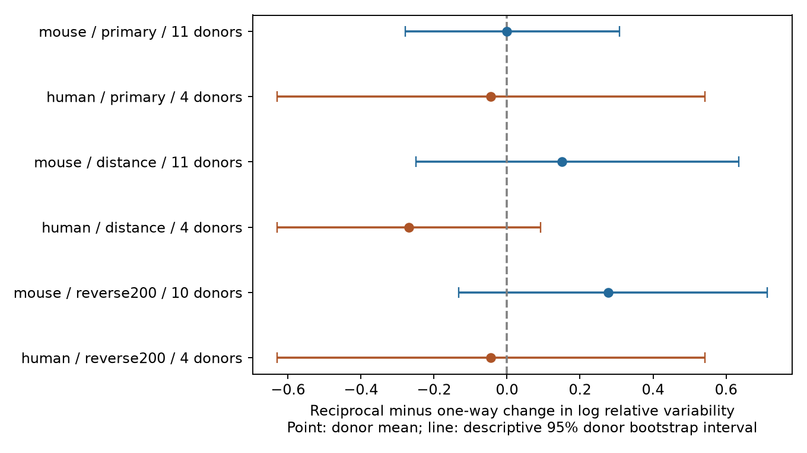

# Matched Allen slice data do not resolve a reciprocity difference in the change of response variability during 50 Hz stimulation

## Result

We tested whether reciprocal excitatory connections differ from one-way excitatory connections in the change of relative response variability from rest to repeated stimulation. Neither the mouse visual-cortex sample nor the human temporal-cortex sample gave clear evidence of a difference. Both primary exact sign-flip p-values were 1.0. This result does not establish equal changes or exclude effects of practical size.

| Sample | Reciprocal / one-way directed connections | Recordings / inferred donors | Contrast | Descriptive 95% interval | Holm p |
| --- | ---: | ---: | ---: | --- | ---: |
| Mouse VisP | 21 / 20 | 12 / 11 | -0.000073 | -0.279 to 0.308 | 1.0 |
| Human TCx | 7 / 11 | 4 / 4 | -0.0440 | -0.630 to 0.542 | 1.0 |

The contrast is reciprocal minus one-way change in log relative variability. A negative value means a smaller increase, or a larger decrease, in reciprocal connections. The test uses medians within matched groups and gives each donor equal weight. The near-zero mouse point estimate is not an equivalence result. Its interval still spans a range of about 0.59 log units.



Figure 1. Points show equal-donor contrasts. Lines show unadjusted percentile donor bootstrap intervals. The distance check adds distance matching. The reverse200 check requires at least 200 test spikes for the reverse connection call. Each check can change the selected connections. These intervals do not have simultaneous coverage.

## Question and prior evidence

A reciprocal connection can return a signal to its source. A relation between this circuit structure and the change in response variability during repeated input could help set noise rules in circuit models. Resting variability and mean short-term response changes cannot by themselves establish such a relation. We therefore test a change in relative variability on the same measured connections. We do not measure a feedback computation, population noise correlations, or representation accuracy.

Campagnola, Seeman, and colleagues describe the Allen synaptic physiology data and identify strength and variability as major axes of synaptic variation (2022, doi:10.1126/science.abj5861). Song and colleagues report nonrandom reciprocal connectivity and strong reciprocal connections in rat visual cortex (2005, doi:10.1371/journal.pbio.0030068). These studies motivate the question; they do not supply the present estimates. The [Allen data registry](https://registry.opendata.aws/allen-synphys/) describes the public mouse and human slice survey.

We searched the local campaign for connectome, reciprocal, variability, reciprocal plasticity, and variability change before fixing the test. A first candidate, distance versus resting variability, had already been tested. We read the published reciprocal resting-variability study (SCI decef28e21bcd9cb9de6e4ded9aa55988e4ca24c56c263841e8b29af56b711a5), reciprocal plasticity study (SCI e51d11cc35cf7df1744e77c7c3fcc7c321e46bcc3c66d3f68e128007f871696e), shared-neuron variability study (SCI 2d5154c104221cb8c0445b435ec790f7de7ad193fe910837bceeaf5959f9d9f8), and distance-delay study (SCI 2405b942827aa469febd8caff7e828eeb4896a36c1f112aa2356a799dfebcf99). The current study extends the matched reciprocal comparison to a different endpoint. Its matching method follows those publications; the code is new. No numerical tables or code were copied. We read no private worker workspace. External searches covered Allen synaptic physiology, reciprocal connectivity, strength, distance, and variability. A direct PMC page fetch met an access challenge; the search results, data registry, published campaign reports, and pinned source definitions supplied the context used here.

## Data and direct link

The raw database is the Allen Synaptic Physiology r2.1 small release, schema 22. Its source Last-Modified date is 2023-01-26. We used this exact shared file in place:

`/mnt/dell-data/shared_datasets/allen_synphys/r2.1_small_2023-01-26/synphys_r2.1_small.sqlite`

Source: https://allen-synphys.s3-us-west-2.amazonaws.com/synphys_r2.1_small.sqlite . Size: 176771072 bytes. SHA-256, checked by the analysis:

`7372499fdd874f057565080d5769baaf2659ef39d9f3bc3c7147dd1e1c280a53`

SQLite was opened in read-only mode. We changed no shared data and downloaded no new data. The pair and cell identifiers directly link detected connectivity with response measurements within each recording. These are small detected chemical connection graphs in slices. They are not complete anatomical connectomes. We make no link across animals or atlases.

We also read the shared `dynamics.py` and `schema_dynamics.py` files at AllenInstitute/aisynphys commit `b264d8b61abf11d015222865ca081f80655d33d4`, plus their README. Their exact shared paths, byte counts, hashes, and source URLs are in `files/source_provenance.json`. The database build commit is unknown. This check supports the field interpretation but does not validate every source fit.

For a response set x, the source implementation defines relative variability as:

`v(x) = ln(sqrt(var(x) - var(background noise)) / abs(median(x)))`.

The stored fields are already logarithms. Negative values are valid. We do not log them again. The implementation uses a median denominator despite a nearby comment about a 90th percentile. Resting responses follow a prior-pulse interval greater than eight seconds. The late-state measure pools pulse positions 5 to 8 in 50 Hz trains. The endpoint is the stored late-state value minus the resting value. We verify that identity for every eligible connection.

The source normally queries current-clamp fitted responses. Dynamics QC requires ten fitted QC-passed events overall. This does not guarantee ten resting trials or ten late trials. The late-state collection is separate from the stored pulse-amplitude arrays with the known shared-list problem in this release. We use no such arrays. Importantly, pooling late pulse positions can add systematic pulse-to-pulse response changes to the measured variance. The endpoint is a change in pooled relative variability, not pure trial noise, release probability, or transmission failure probability.

## Fixed test and sample

`files/analysis_plan.txt` was written before computing the selected outcome contrasts. This is an exploratory analysis, not an externally registered study. The code selects a detected forward excitatory monosynaptic connection, nonsynaptic excitatory class on both cells, a dynamics record, and an explicit reverse chemical connection call. The reverse join swaps the cell identifiers within the same experiment. An unknown reverse call is not a negative call. We restrict mouse records to VisP and human records to TCx.

This join gives 281 mouse and 114 human directed connections. Dynamics QC and finite resting, late-state, and change values retain 164 mouse and 76 human connections. Exact matching retains 41 and 18, respectively: 25.0% and 23.7% of eligible connections. Missing outcome values do not become zero. Both directions of a reciprocal pair can enter; neither edges nor recordings within a donor are independent uncertainty units.

A matched group has the same experiment, ordered source and target Cre labels, and ordered source and target layer labels. Missing labels form explicit categories. Each group needs both reciprocal and one-way connections. We subtract the one-way median endpoint from the reciprocal median. We average groups equally within each experiment, experiments equally within inferred donors, and donors equally. There are 12 mouse groups and four human groups.

Mouse donor identifiers are the six-digit specimen numbers after a hyphen. Human identifiers use the Hxx.xx.xxx prefix. A slice-ID fallback is implemented but was not needed after a parser check. The first parser missed names with a hyphen after the six-digit number. We fixed that delimiter rule and reran the analysis. No retained matched donor or result changed. These are inferred identifiers, not an independent donor registry.

We enumerate all donor sign flips for a two-sided test of the equal-donor mean contrast. This test assumes independent donor contrasts with a distribution symmetric about zero under the null. Exact enumeration does not make this an intervention test or remove confounding. Holm correction covers the two primary species tests. With four human donors, the smallest attainable two-sided p-value is 0.125, so that test cannot reject at 0.05 even before correction. This limits the human test sharply.

We use 9,999 whole-donor bootstrap draws, seed 8061107, for descriptive 95% percentile intervals. They resample the observed donor effects and do not validate upstream measurement errors. With small samples, especially four human donors, interval coverage can be poor. Sign-flip tests and bootstrap intervals use different assumptions. No equivalence margin was set.

## Sensitivity checks and validation

| Check | Mouse contrast [95% interval]; donors | Human contrast [95% interval]; donors |
| --- | --- | --- |
| Exact 100 micrometre distance bin; distance at most 500 micrometres | 0.151 [-0.250, 0.635]; 11 | -0.268 [-0.630, 0.093]; 4 |
| At least 200 reverse excitatory test spikes | 0.278 [-0.132, 0.713]; 10 | -0.044 [-0.630, 0.542]; 4 |

Neither check gave clear unadjusted sign-flip evidence. Mouse point estimates moved above zero. These checks change the matched support; their differences do not isolate a distance or detection mechanism. The reverse-spike threshold does not make negative reverse calls certain.

For the same primary matched connections, the resting contrast was 0.0455 in mouse and -0.1975 in human. The late-state contrast was 0.0762 in mouse and -0.5004 in human. These are descriptive state summaries only. Because each uses separate within-group medians, subtracting these two contrasts does not in general equal the primary median-of-changes contrast. We preserve the three endpoints separately in the evidence.

Removing one donor at a time gave primary mouse means from -0.0909 to 0.0657 and human means from -0.3369 to 0.2140. Both signs can change. The standard-library checker independently rebuilds all 18 point estimates, sample counts, and exact sign-flip p-values from the edge table. It also checks unique pair IDs, the endpoint subtraction identity, and absence of fallback donor groups in all retained samples. All checks passed. It does not independently verify the response fits, bootstrap coverage, or data collection process.

## Scope and limits

The result gives a reproducible test and a measured limit on the evidence for one motif-dependent variability-change rule. It does not justify a common reciprocal reliability rule in a circuit model. Nor does it show that topology and dynamic variability are independent. A larger study needs more donors with both motif classes in matched groups, explicit reverse-detection controls, and raw trial counts and uncertainties at each pulse position.

Most eligible edges are lost during matching. Detected forward connections, finite noise-corrected variability, and usable reverse calls select the sample. Slice damage, cut axons, missed weak reverse edges, cell subtypes not captured by the labels, response strength, and unequal trial counts can affect the result. We do not match response strength in the primary design or identify a direct effect independent of strength. Pooled pulse positions can mix short-term response trends with stochastic variation. Mouse and human differ in region and tissue source. Their contrast cannot isolate species. No behavioral conditions, other brain regions, intact-brain activity, or independent data release were tested.

## Reproduction

The package preserves the new code, analysis plan, exact SQL, all 395 joined edge records, matched group and donor contrasts, bootstrap draws, results, source provenance, figure, and independent check. It does not duplicate the shared raw database or upstream software.

Use Python 3.12.16 and install `files/requirements.txt` in a local environment. The recorded numerical packages are NumPy 2.5.4 and Matplotlib 3.11.2. From an extracted writable bundle, set DB to the shared path above and run:

```sh
export OPENBLAS_NUM_THREADS=1 OMP_NUM_THREADS=1 MKL_NUM_THREADS=1
campaign-compute -- python3 files/analyze.py --db "$DB" --out reproduced
campaign-compute -- python3 files/check_evidence.py
```

The checker uses only the standard library and bundled `files/evidence/` data. It can run without the raw database. The first command regenerates all results and the figure. To check regenerated data, put the regenerated evidence beside a copy of `check_evidence.py` under the directory name `evidence`. Outside the campaign host, run the same Python commands with the single-thread settings. Substantial computations in this study used `campaign-compute`; no child agents were used. Exact numerical reruns use the recorded environment; figure pixels can vary with rendering libraries.

If the database is absent, use the campaign helper and the returned completed path:

```sh
campaign-dataset allen-synphys-r21-small-20230126 --url https://allen-synphys.s3-us-west-2.amazonaws.com/synphys_r2.1_small.sqlite --filename synphys_r2.1_small.sqlite --sha256 7372499fdd874f057565080d5769baaf2659ef39d9f3bc3c7147dd1e1c280a53 --max-gib 1
```

Reuse existing data. Do not replace shared files. Retrieve source-definition files from the URLs in `files/source_provenance.json` if needed and check their hashes.

## Attribution and job record

Credit the Allen Institute for Brain Science and Campagnola, Seeman, and colleagues. Original data remain subject to https://alleninstitute.org/legal/terms-use/ . The SCI baseline license covers this new report, code, figures, and derived material to the extent allowed by source terms. It does not replace source data or software terms.

Job: sci-1107-dell-neural-structure-and-computation-0e23ca697b2b. Topic: neural-structure-and-computation. Campaign: 11_07_2026. Machine: dell. Account: codex-andrii. Model: gpt-6.1-sol with high reasoning effort through the Codex harness in T3 Code. Work date: 2026-11-08 UTC. The campaign-machine signing key is not a personal authorship claim. This publication is stored locally only.
