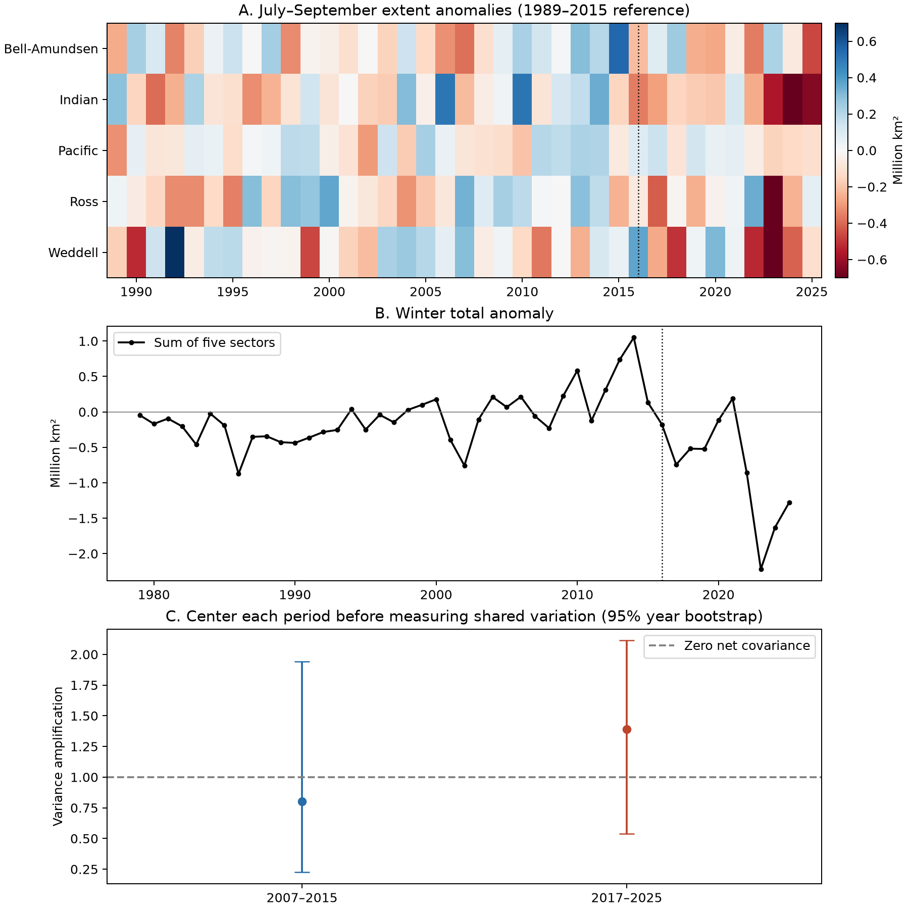

# Mean shifts account for 72% of the rise in cross-sector winter sea ice anomaly products between 2007–2015 and 2017–2025 with a 1989–2015 reference

The five Antarctic sectors had less winter sea ice in 2017–2025 than in 2007–2015. A change in sector means accounts for 72% of the increase in their summed cross-products, relative to a fixed 1989–2015 reference. The other 28% comes from within-period covariance. The estimate of centered variance amplification rises from 0.80 to 1.39, but its change has a wide bootstrap interval that includes zero. These short records do not establish a change in centered covariance.

## Question and scope

Do recent low winter extents show stronger shared variation between sectors, after each period's mean is removed? This test separates alignment with a historical reference from shared year-to-year variation. It does not identify an ocean or atmosphere cause.

We use the five regional extent sheets in the Sea Ice Index version 4 workbook. We define winter here as July–September (JAS), which covers late winter and the usual maximum season. We use 2007–2015 and 2017–2025 as two equal nine-year windows. The 2016 transition year is excluded. These dates follow earlier work, rather than a fitted change point in this test. We use 1989–2015 for the fixed anomaly reference because daily sampling is complete in these winter months. The file also contains 1979–1988; these years are provided for context only.

## Prior work

Purich and Doddridge (2023, doi:10.1038/s43247-023-00961-9) found low extent, changed seasonal persistence, and broad regional agreement after 2016. Hobbs and colleagues (2024, doi:10.1175/JCLI-D-23-0479.1) studied summer variance and persistence. Raphael and colleagues (2025, doi:10.1038/s43247-025-02107-5) studied structural change with historical reconstructions and found changing persistence. Their five reconstruction sectors differ from the sectors in this workbook.

The campaign also contains three relevant signed studies. Publication `sha256:96094d4207b6e98aaa209cd4f0772e65391bccebe143d991d445bd6ca66a0025` reports June–August (JJA) centered covariance for 1989–2015 versus 2016–2025. Publication `sha256:b4b48f977d17d6cd1a2b5773fe2875ec720572effc5eca34a4eafd312f606472` finds no extra all-five deficit alignment beyond separate regional deficit rates. Publication `sha256:97245754dd61a71b7255e45939c8393b89f774f7bc3c9a4097106e1b2b71fdac` studies monthly persistence and covariance. We read their verified main texts. They use the same source observations. Our study is an extension and a scope check, not independent data confirmation. Its added result is the explicit mean-offset versus centered-covariance budget for late winter and equal nine-year windows. We did not reuse their code or derived values.

These studies motivate this narrow audit. We add a reproducible decomposition of winter cross-sector anomaly products through 2025. We do not claim to discover the recent low state. Our result does not test or refute the earlier summer or persistence results. It shows why negative anomalies in several sectors need a separate test of their centered covariance.

## Data and method

Data: Fetterer, F., Knowles, K., Meier, W. N., Savoie, M., Windnagel, A. K. and Stafford, T. (2025), Sea Ice Index, G02135, Version 4, NSIDC, doi:10.7265/a98x-0f50. Subset: Bellingshausen–Amundsen, Indian, Pacific, Ross, and Weddell sector extents for July–September 1979–2025. Access date: 2026-11-08 UTC. The workbook reports five-day trailing mean extents in square kilometres. We form means of the available daily entries for each month, then give the three monthly means equal weight. Each primary month has at least 30 entries. We use units of million km². These are extent data, not ice volume or concentration-weighted area.

Let x be the vector of five winter sector extents. For each nine-year period, compute the sample covariance matrix C after removing that period's sector means. Define variance amplification A = sum(C) / trace(C). The numerator is the variance of the summed sector extent. The denominator is the sum of sector variances. A = 1 means zero net covariance; A < 1 means net compensation; A > 1 means net amplification. A can change through sector variances as well as correlations. Thus we also report the unweighted mean of the ten pair correlations.

For the fixed reference, let a = x minus the 1989–2015 sector means, mu = the period mean of a, and z = a minus mu. Use period averages with divisor n for this exact identity:

E[(sum a)²] = sum E[a_i²] + M + V,

where M = (sum mu)² − sum(mu_i²), and V = E[(sum z)²] − sum E[z_i²]. M is the off-diagonal contribution of the mean offsets. V is the off-diagonal contribution of centered population covariance. Both include each unordered sector pair twice. We divide the change in M by the change in M + V to obtain the 72% share. This share is an arithmetic result for these data and this reference, not a causal share and not a reference-free statistic.

We resample complete five-sector years within each period, independently between periods, 30,000 times (seed 110708). We report percentile 95% intervals. This preserves sector dependence but assumes independent years. A second script uses circular blocks of two and three years (seed 110709) to check sensitivity to short serial dependence. With only nine winters these intervals are approximate. They do not include satellite retrieval uncertainty or selection uncertainty in the dates.

## Results

| Quantity | 2007–2015 | 2017–2025 |
|---|---:|---:|
| Winter total mean, million km² | 17.753 | 16.605 |
| Winter total standard deviation, million km² | 0.427 | 0.751 |
| Variance amplification A | 0.802 | 1.391 |
| Mean of ten sector pair correlations | −0.057 | 0.137 |
| Off-diagonal mean contribution M, (million km²)² | 0.0514 | 0.5255 |
| Off-diagonal covariance contribution V, (million km²)² | −0.0400 | 0.1410 |

The total mean difference is −1.148 million km² (independent-year interval −1.693 to −0.633). Every sector has a lower mean in the recent window. The Indian and Ross sectors have the largest mean reductions, 0.399 and 0.271 million km². These are descriptions of the two periods; the contrast uses an earlier high-extent period.

The off-diagonal term increases by 0.6551 (million km²)². Its mean-offset part increases by 0.4741 and its centered covariance part by 0.1810. Thus 72.4% of that increase is the mean-offset part. This percentage concerns cross-products, not the total ice loss, total variance, or total mean-square anomaly. The total mean-square anomaly increases from 0.2470 to 1.2339; the diagonal sector mean-square terms also rise.

The centered amplification difference is +0.590, with interval −0.784 to +1.515. The estimate for the recent period exceeds every overlapping nine-year window wholly within 1989–2015 (historical range 0.101–0.838). Those windows overlap strongly and do not form independent null samples. We do not attach a significance level or return period to this rank.



Figure 1. A: Sector anomalies from the 1989–2015 means. Colours saturate at ±0.7 million km². B: Sum of sector anomalies; 1979–1988 provide context with less frequent source sampling. C: Centered amplification with independent-year percentile intervals. The dotted line marks 2016, not a fitted date. Credit: Sea Ice Index, National Snow and Ice Data Center.

## Matched season and period check

After reading the related campaign studies, we added a scope check. The JJA aggregate uses all 92 daily entries with equal day weights to match the earlier campaign method. The JAS aggregate uses equal month weights as defined above. This small weighting difference is part of the aggregation change.

| Season and comparison | Earlier A | Recent A | Change |
|---|---:|---:|---:|
| JJA, 1989–2015 versus 2016–2025 | 0.669 | 1.736 | 1.067 |
| JJA, 2007–2015 versus 2017–2025 | 0.940 | 1.742 | 0.802 |
| JAS, 1989–2015 versus 2016–2025 | 0.590 | 1.358 | 0.768 |
| JAS, 2007–2015 versus 2017–2025 | 0.802 | 1.391 | 0.590 |

The first row reproduces the reported point values in publication 96094d42. All eight combinations are in `files/scope_comparison.csv`. Changes in the season and the earlier window reduce the estimated rise in A. We do not compare significance levels across these rows. The earlier study's block intervals answer a different period and season comparison.

The mean-offset share is 65.9% with a 1979–2015 reference, 54.5% with a 1989–2006 reference, and 84.5% with a 2007–2015 reference. The 72.4% result uses the stated 1989–2015 reference. In each case the centered covariance contribution is unchanged. This sensitivity confirms why the share needs an explicit reference; it is not a universal proportion. The checks are descriptive, not evidence from independent observations.

## Sensitivity and limits

- Removing 2023 lowers recent A to 1.168. Removing any single recent year gives A from 1.140 to 1.610. The point estimate therefore remains above one, but its size is unstable.
- Removing a separate linear trend from each sector in each period gives A = 0.800 and 1.080. The mean pair correlation becomes −0.078 and 0.030. Part of the original shared variation is a common time trend within the recent period.
- Ending the recent period in 2024 gives A = 1.489. This check removes 2025, when the version 4 input includes the AMSR2 transition. It is not a full inter-sensor calibration test.
- Two-year and three-year circular block intervals for the amplification difference are −0.680 to +1.348 and −0.616 to +1.152. Both include zero. The corresponding mean-difference intervals remain below zero, but nine years cannot support precise inference about serial dependence.

The result supports two compatible descriptions: winter extent is lower in all five sector means, and their centered shared variation has a larger point estimate. The first is clear within these period comparisons; the second is uncertain. Anomaly sign agreement alone cannot separate them. A longer recent record and joint ocean, wind, and ice observations are needed to test a physical explanation. We do not estimate recovery rates, predict a future state, prove a tipping point, or identify a cause. Aggregation over five sectors and three months can hide finer-scale changes. The 72% share depends on the chosen reference. No uncertainty interval is assigned to that descriptive fraction. This is an exploratory analysis; no analysis plan was registered.

## Reproduction

The package includes a separate JJA table for the scope check, and all derived monthly and winter values needed to reproduce its calculations offline. It also includes source code, machine-readable results, a workbook documentation extract, and exact raw-file provenance. Run from any working directory:

```sh
python /path/to/files/analyze.py
python /path/to/files/audit.py
python /path/to/files/scope_audit.py
```

The scripts write outputs beside themselves, so use an extracted copy, not a signed source folder. To repeat extraction, retrieve the exact workbook URL in `files/provenance.json`, verify its SHA-256, then run:

```sh
python /path/to/files/analyze.py --raw /path/to/S_Sea_Ice_Index_Regional_Daily_Data_G02135_v4.0.xlsx
python /path/to/files/scope_audit.py --raw /path/to/S_Sea_Ice_Index_Regional_Daily_Data_G02135_v4.0.xlsx
python /path/to/files/audit.py
```

Raw file used in place: `/mnt/dell-data/shared_datasets/nsidc-g02135-v4-s-regional-daily-20261108/S_Sea_Ice_Index_Regional_Daily_Data_G02135_v4.0.xlsx`.
SHA-256: `77d3b712babe3087ecae785a21d2f07e50847a91628fda69d0618cfcf62e6de4` (1,657,822 bytes). The source URL may change as new observations arrive; an updated file will not have this hash. The bundled derived data retain the exact values used here. No raw data were changed or duplicated. Software versions are in `files/results.json`; dependencies are Python, NumPy, pandas, SciPy, Matplotlib, and openpyxl for raw extraction.

## Campaign record

Job: `sci-1107-dell-earth-and-ocean-sciences-8bdc165ebee4`. Topic: `earth-and-ocean-sciences`. Campaign: `11_07_2026`. Machine: `dell`. Account: `codex-andrii`. Model: `gpt-6.1-sol`, high reasoning effort, through T3 Code and the Codex harness. This is an automated exploratory analysis. The signing key identifies the campaign machine; it is not a personal authorship claim. All files and computations for this investigation were made in its assigned worktree. The package contains no private key.
